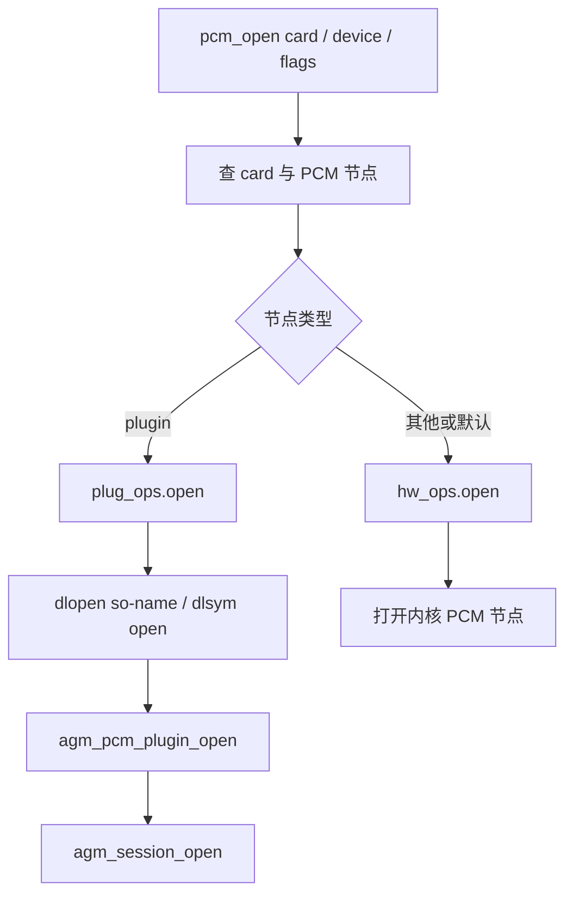
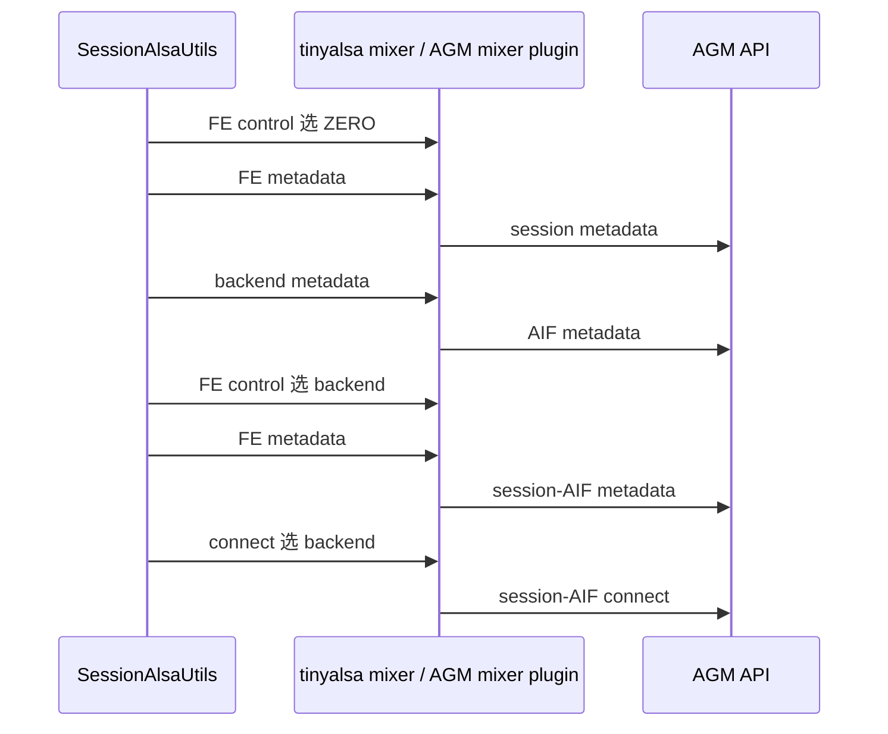

# 15.12 audio-alsa 与 tinyalsa：名称区分、PCM 插件及返回值

> [返回本章](README.md) · [15.2 PAL 架构](15_15.2_架构层次图.md) · [15.10 HAL-PAL](15_15.10_HAL-PAL适配层架构.md)

历史文件名保留。本节先解释旧 `audio-alsa` 的实际职责，再以本地 PAL 使用的 tinyalsa 分支解释 AudioReach PCM 入口。二者不是同一个库，不能用 `msm_*` API 替代 PAL 的 pcm/mixer API。

## 1. 三个相似名字，三种职责

| 模块 | 本地位置/模块名 | 职责 |
|---|---|---|
| Qualcomm audio-alsa | proprietary/mm-audio/audio-alsa，`libaudioalsa` | MSM 具名 mixer 命令控件封装 |
| vendor tinyalsa | opensource/tinyalsa，`libqti-tinyalsa` | pcm/mixer API，硬件与插件 ops 分派 |
| AGM tinyalsa plugins | opensource/agm/plugins/tinyalsa | PCM、mixer、compress 操作转成 AGM API |

PAL 的 Android.mk 对 PLATFORM_VERSION 匹配 `11 R 12` 时使用 vendor tinyalsa 头与 libqti-tinyalsa；其他分支使用 libtinyalsa。AGM 插件有相同版本选择。本文依此阅读 vendor 分支，不因为 external 下还有 tinyalsa/tinyalsa_new 就任选一份当作产品实现。

## 2. 保留 audio-alsa 本来的知识边界

`vendor/qcom/proprietary/mm-audio/audio-alsa/inc/control.h` 声明的公开结构是：

```c
struct msm_control {
	int card;
	int fd;
};
```

库的 hw.c 使用打开的 control fd，调用 SNDRV_CTL_IOCTL_ELEM_INFO/READ/WRITE 等。没有实现 tinyalsa 的 pcm_open/pcm_write 或 struct pcm。

主要接口族：

| 接口 | 库内意图 |
|---|---|
| msm_mixer_open / msm_mixer_close / msm_mixer_count | 打开指定控制设备、释放、枚举 |
| msm_get_device / msm_get_device_class / msm_get_device_capability | 查询设备及属性 |
| msm_en_device / msm_route_stream / msm_route_voice | 设备、流及语音路由命令 |
| msm_set_volume / msm_set_device_volume | 流/设备音量命令 |
| msm_start_voice / msm_end_voice 及 ext 变体 | 语音会话命令 |
| msm_set_voice_tx_mute / msm_set_voice_rx_vol 及 ext 变体 | 语音静音和音量命令 |
| msm_device_mute / msm_enable_anc / msm_set_dual_mic_config | 其他具名控件操作 |

例如 msm_route_stream 校验 dir∈{1,2}，选择 Stream 或 Record 控件，再填入 dec_id、dev_id、set 三个整数。它不是 Android AudioPolicy 的路由算法，也不是 AGM graph 选择器。

这些控制名只有对应驱动提供时才有意义。PAL 本地构建的直接依赖与所读 Session 路径不是这套 libaudioalsa API；这不等于已经证明整个产品没有任何其他调用者。

## 3. pcm_open 的分叉点在用户态

vendor tinyalsa/pcm.c 的原文：

```c
pcm->snd_node = snd_utils_get_dev_node(card, device, NODE_PCM);
pcm_type = snd_utils_get_node_type(pcm->snd_node);
if (pcm_type == SND_NODE_TYPE_PLUGIN)
    pcm->ops = &plug_ops;
else
    pcm->ops = &hw_ops;
```

- snd_utils 动态加载 libsndcardparser，按 card/device 查节点。
- 节点/解析信息不存在时，snd_utils_get_node_type 默认返回硬件类型。
- 选好 ops 后调用对应 open，**不是先尝试 AGM 插件，任何插件错误都自动改走硬件**。
- hw_ops 的 pcm_hw_open 打开 `/dev/snd/pcmC%uD%u%c`；plug_ops 的 pcm_plug_open 加载 so-name 并解析 `<库主体名>_open`。



这里的 ops->ioctl 是 C 函数指针接口。**用户态插件分支的 SNDRV 命令分派不是内核 ioctl 系统调用。** 是否跨 IPC 是插件调用的 AGM API 实现决定的下一层问题。

## 4. 配置如何把一个设备变成 AGM PCM 插件

本地 AR `configs/msmnile_au/card-defs.xml` 的一个完整节点：

```xml
<pcm-device>
    <id>100</id>
    <name>PCM100</name>
    <pcm_plugin>
        <so-name>libagm_pcm_plugin.so</so-name>
    </pcm_plugin>
    <props>
        <playback>1</playback>
        <capture>0</capture>
        <session_mode>0</session_mode>
    </props>
</pcm-device>
```

这是源配置，不是当前设备已安装/加载的证据。parser 还会：

- 尝试读取 `/proc/asound/cardN/id`；读到名称时改用名称匹配，而非仅用数字 card ID。
- 从 vendor.audio.card.def 属性选择配置文件，否则用 CARD_DEF_FILE 默认值。
- 持有 card 定义引用，在对应 put 时释放引用。

因此“代码传入 card=100”和“当前 XML/驱动确实匹配到这个节点”是两项检查，不能根据示例数字推断所有平台固定映射。

AGM 插件以 PCM device 参数作为 session_id，另向 agm_session_open 获取 uint64_t handle。**PCM device/session_id 与该 handle 不是同一个值体系**，更不是 AudioFlinger I/O handle 或 AAOS zoneId。

## 5. PCM 参数与状态的逐层转换

| tinyalsa 操作 | 插件实现 | AGM API |
|---|---|---|
| 插件 open | AGM 分配私有配置与请求 session | agm_session_open |
| HW_PARAMS | 格式、rate、channels、periods；period frames 转 bytes | agm_session_set_config |
| SW_PARAMS | start/stop thresholds | 再次 agm_session_set_config |
| PREPARE | agm_pcm_prepare | agm_session_prepare |
| START | agm_pcm_start | agm_session_start |
| WRITEI / READI | frames 换算 byte count | agm_session_write / read |
| DROP | agm_pcm_drop | agm_session_stop |
| close | 关闭 session、释放私有对象/card 引用 | agm_session_close |

插件包装层有自己的 OPEN→SETUP→PREPARED→RUNNING 状态：hw_params、prepare、start 成功后才推进；drop 成功回 SETUP。write 允许 PREPARED/RUNNING，read 要求 RUNNING。不能把它与 PAL Stream 状态或 AGM 内部 session 状态画成同一个变量。

`pcm_start()` 先调用 pcm_prepare，再发 START；SessionAlsaPcm::prepare 本身返回 0，并不抵消这层的 prepare。普通 PAL start 已显式调用 pcm_start，不必套用“所有输出都只能靠第一次 write 触发启动”的解释。

## 6. 数据计量：bytes → frames → bytes，不是一路返回字节数

### 6.1 tinyalsa API 返回状态

本地 pcm_write/pcm_read 接收字节 count，用声道数和存储位宽计算 x.frames。成功返回 **0**，不是已写/已读字节数。

PCM S24_LE 在插件中使用 32-bit 存储宽度，S24_3LE 才是 24-bit 打包；不能一概用 bit depth=24 计算三字节 frame 分量。

### 6.2 插件再转成 AGM byte count

agm_pcm_writei_frames 原文：

```c
buff = x->buf;
count = x->frames * (priv->media_config->channels *
        agm_format_to_bits(priv->media_config->format) / 8);

ret = agm_session_write(handle, buff, &count);
errno = ret;

return ret;
```

这里把 count 的地址传给 AGM，但返回后没有把更新的 count 换算并写回 x->result。因此不能声称 AGM 的短写数量一定逐层透传给 PAL。

SessionAlsaPcm::write 按 out_buf_size 分块，tinyalsa 返回成功后累加本次请求块大小；末尾才写 *size。错误 goto exit 可绕过该赋值，不能解释成总能返回已写部分。read 则在循环后写 *size=bytesRead，错误出口语义不完全对称。

### 6.3 errno 约定也不能按标准硬件 ioctl 假定

插件把 AGM 返回值原样赋给 errno；tinyalsa 中有用正 EPIPE 比较来选择重启的分支。AGM 的负错误返回与 libc ioctl 的 -1/正 errno 模型不能直接画等号。

教学和定位时同时记录 AGM ret、errno、tinyalsa 返回状态与 PAL size。本文未运行错误注入，不能宣称某个 EPIPE 路径已在目标产品复现或自动恢复有效。

## 7. mixer 控制是另一条桥，不随每块 PCM 自动执行

vendor tinyalsa/mixer.c 可以同时汇总 hw_grp 与 virt_grp：先尝试硬件 mixer，再尝试 plugin，只有两者均失败才使 mixer_open 失败。每个控件通过所属 group 的 ops 分派；不是全局任选一套 PCM ops 的镜像算法。

AGM mixer plugin 的关键转换：

| 控制意图 | 插件到 AGM |
|---|---|
| backend metadata | agm_aif_set_metadata |
| FE control=ZERO 时写 metadata | agm_session_set_metadata |
| FE control 选择具体 backend 后写 metadata | agm_session_aif_set_metadata |
| connect/disconnect | agm_session_aif_connect(session_id, aif_id, state) |

connect 控件的 ZERO 值是 no-op；它通过枚举值查找 AIF ID，并从控件名区分 connect/disconnect。某些控制回调会把 -EALREADY 归一为 0；正常返回不总意味着新建了不同关系。



图是普通单向配置主线；省略空 metadata、错误及类型特例，不是每次 PCM write 的时序。

## 8. MMAP 与普通 read/write 分开看

AGM 插件同时存在 mmap/munmap/sync_ptr/poll 操作。MMAP+NOIRQ 条件会选 AGM_DATA_PUSH_PULL，get_buf_info 获取 data/position buffer 信息，再映射相应 fd。

这些事实不等于普通 read/write 也零拷贝；所读 HIDL agm_session_write 客户端明确 memcpy 到 vector。本文也不把插件 mmap 直接解释为 QNX 或 ADSP 物理共享区：fd 的来源、跨域映射及一致性需继续向下研究。

## 9. 按边界定位，而不是仅看 /dev/snd

1. 确認实际库分支与 card/device，核对 card-defs 配置和属性。
2. 确认选中的是 plug_ops 还是 hw_ops；只看 /proc/asound/pcm 可能漏掉用户态插件节点。
3. 区分 metadata/connect 失败与 PCM config/prepare/start 失败。
4. 关联 PAL size、tinyalsa status、AGM count；成功状态不证明可听输出。
5. 对 IPC service death、MMAP 和 DSP 数据可见性另做专项追踪，不拿普通 PCM 成功路径推导透明恢复。

源码均相对 `Android/lagvm/LINUX/android/`：

- `vendor/qcom/proprietary/mm-audio/audio-alsa/src/hw.c`、`vendor/qcom/proprietary/mm-audio/audio-alsa/inc/control.h`。
- `vendor/qcom/opensource/tinyalsa/pcm.c`、`vendor/qcom/opensource/tinyalsa/pcm_plugin.c`、`vendor/qcom/opensource/tinyalsa/pcm_hw.c`、`vendor/qcom/opensource/tinyalsa/snd_utils.c`、`vendor/qcom/opensource/tinyalsa/mixer.c`。
- `vendor/qcom/opensource/agm/plugins/tinyalsa/src/agm_pcm_plugin.c`、`vendor/qcom/opensource/agm/plugins/tinyalsa/src/agm_mixer_plugin.c`。
- `vendor/qcom/opensource/agm/snd_parser/src/snd-card-parser.c`。
- `vendor/qcom/opensource/audio-hal-ar/primary-hal/configs/msmnile_au/card-defs.xml`。

以上为源码和配置解释，未执行设备命令、构建、PCM 测试或性能测量。
