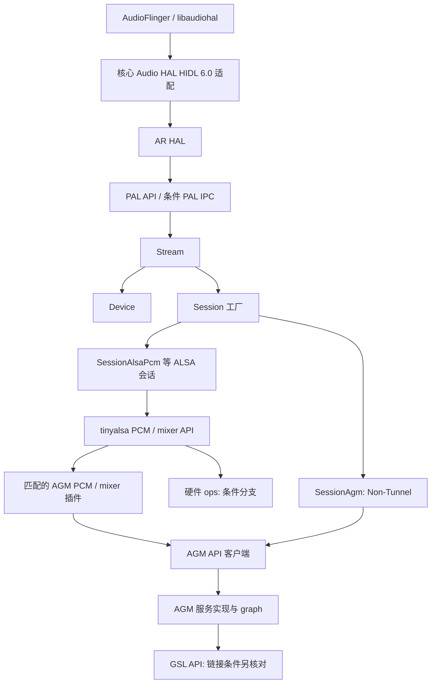
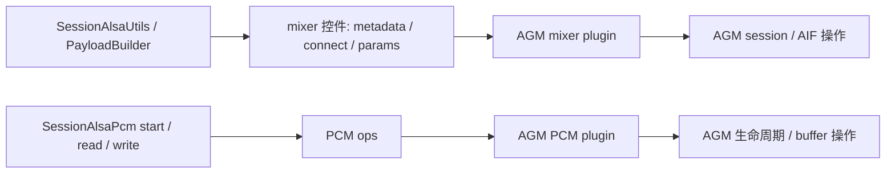

# 15.2 PAL 架构：对象边界、ALSA 插件与 AGM 入口

> [返回本章](README.md) · [HAL-PAL 适配](15_15.10_HAL-PAL适配层架构.md) · [工厂映射](15_15.99_附录_Stream-Session-Device映射关系.md)

本节建立 Android 12L/API 32 + SA8295 AudioReach 的分层模型。**逻辑层不是进程，也不是执行域。** 同一个 C 函数名可能由 IPC 客户端或实现库提供；相同 tinyalsa API 可以落到硬件 ops 或用户态插件。

## 1. 从上到下先识别六个问题

| 层/边界 | 解决的问题 | 本地范围 |
|---|---|---|
| AudioFlinger / Policy | 谁混音、选择哪条 I/O 与设备 | Native Framework，不直接选 DSP 模块 |
| 标准核心 Audio HAL | Framework 怎样访问厂商设备/流 | 产品 manifest 声明 HIDL 6.0，不是笼统 HAL 7.x/AIDL |
| AR HAL → PAL | Android attributes/flags/BUS 怎样变成 PAL stream/device | C API 入口与条件 PAL IPC，见 15.10 |
| PAL 对象 | 流状态、设备引用、会话实现如何协作 | Stream、Session、Device 三套工厂，不是一一固定组合 |
| tinyalsa / AGM | PCM 与图控制怎样进入会话服务 | PCM/mixer 插件和部分直接 AGM API 调用 |
| GSL 接口及以下 | 图服务怎样继续配置/传输 | 本节确认链接条件，不把它当作已证实的跨 VM PCM 布局 |

AudioControl 是车载控制接口，不应夹在 AudioFlinger 的 PCM 数据链中；见 [10.1](../10_AudioControl_HAL/10_10.1_AudioControl_HAL总览.md)。

## 2. 逻辑依赖图：不要漏掉插件



图表达依赖，不是每次 write 都执行全部节点。mixer 控制配置与 PCM buffer 传输分开，Device 的独立生命周期也不能隐去后直接画成 Session 内部私有子对象。

### 2.1 PAL 不是唯一一个 Stream 类

普通 PCM、COMPRESSED、VOICE_CALL、NON_TUNNEL、SoundTrigger 等类型可选择不同 Stream/Session。检测引擎可以持有 Session，但不是 Session 子类。对应关系和所有权已在 15.99 解释，本节不复制另一张容易失配的枚举大全。

### 2.2 为什么 pcm_open 不一定打开内核 PCM 节点

本地 vendor tinyalsa 的 pcm_open 先查询 sound-card 定义：插件类型选 plug_ops，其余选 hw_ops。插件通过 dlopen/dlsym 加载配置中的库；硬件路径才在 pcm_hw.c 打开 `/dev/snd/pcmC*D*`。

详见 [15.12 ALSA 名称与插件分派](15_15.12_QC_audio-alsa_ALSA层实现.md)。不能由 Session 类名中含 Alsa，推断其所有控制必经 ALSA 内核再到 AGM。

## 3. 普通 SessionAlsaPcm：open 并不等于 pcm_open

### open：准备 FE/BE 关系

`SessionAlsaPcm::open()` 获取 attributes、关联 Device 和 backend 名称，取得虚拟 mixer，按方向/类型分配 FE IDs，再调用 SessionAlsaUtils::open。

单向通用路径中，后者：

1. 用 PayloadBuilder 收集 stream KV/CKV，形成 AGM metadata。
2. 找到 FE control、metadata、connect 控件；先选 ZERO 下发纯 session metadata。
3. 对每个 backend 收集 device 与 stream-device metadata。
4. 切换 FE control 到 backend，下发对应 metadata，再请求 connect。

它不是简单的 `agm_session_open()` 同名转发，也不是打开所有硬件后再逐帧重复下发这些 KV。

### prepare：本类是空操作

本地连续原文：

```cpp
int SessionAlsaPcm::prepare(Stream * s __unused)
{
   return 0;
}
```

这不表示 AGM graph 不需要 prepare。实际 tinyalsa pcm_start 内会调用 pcm_prepare，插件再映射到 agm_session_prepare。不同层的同名方法不可互相替代。

### start：格式、PCM handle、模块配置与启动

首次从 SESSION_IDLE 进入时，读取 PAL buffer 信息，转换格式与 bytes→period frames，调用虚拟声卡上的 pcm_open，并检查 pcm_is_ready。随后还有 MFC/custom payload、类型特有控制和 pcm_start。

普通输出的打开片段为：

```cpp
pcm = pcm_open(rm->getVirtualSndCard(), pcmDevIds.at(0), PCM_OUT, &config);
```

MMAP、双向 hostless、语音/检测等分支另有参数和控制顺序；不要把这个普通输出片段推广到所有 Stream。

## 4. 两条通路在 AGM 汇合，但职责不同



- metadata 是选择/配置音频图的键值及属性载荷；不是 PCM 样本。
- connect 是 session 与 AIF 的关系操作；不是 AAOS AudioMix 注册，也不是 Android AudioPatch handle。
- SessionAlsaPcm 的数据调用以 tinyalsa 状态返回为边界，再维护自己的字节计数；并非直接向上透传每层短写长度。
- SessionAlsaUtils::open 的一些 mixer setter 返回值未被赋给 status，部分 KV 错误被显式忽略。因此该方法正常返回不能证明所有配置 setter 或下游图操作都成功。

## 5. AGM C API 名字不能证明本地直调

PAL 与 AGM tinyalsa 插件的 Android.mk 都链接 `libagmclient`。本地 HwBinders 客户端模块由 `agm_client_wrapper.cpp` 等生成，依赖 `vendor.qti.hardware.AGMIPC@1.0`。

例如其 agm_session_write 明确把数据复制到 HIDL vector：

```cpp
hidl_vec<uint8_t> buf_hidl;
buf_hidl.resize(*byte_count);
memcpy(buf_hidl.data(), buf, *byte_count);
```

之后调用 ipc_agm_session_write 并接收状态和 count。这足以否定“只要是 PAL→AGM，就必然全链路零拷贝”，但不能推出 MMAP、metadata-buffer 等所有接口都使用同一种传输。

`agm/ipc/Android.mk` 用 AUDIO_FEATURE_AGM_USES_SW_BINDER 分支选择源码；目录中同时有 HwBinders/SwBinders/DBus 不证明三者同时运行，也不能把 SwBinders 命名解释为“同进程”。最终加载模块与服务状态需要独立确认。

## 6. GSL 前端与执行域：只画到已确认的边界

AGM service/Android.mk 在 ENABLE_HYP=true 时链接 `libar-gsl_fe`，否则链接 `libar-gsl`。结合产品 mk 的虚拟化声明，可以研究 GSL 前后端协议，但这只是构建选择的证据。

本节不据此宣称：

- AGM 的每个操作与 PCM 数据共用一条完全相同的 MM-HAB 消息链；
- Android 的某个 PCM buffer 地址可以直接作为 QNX/DSP 地址使用；
- GSL、APM、SPF 与驱动均运行在同一个域；
- 所有函数正常返回都代表数据已经送到扬声器。

这些结论必须分别追踪协议、buffer 映射、服务端与 DSP 接口。避免用“AGM Service”这个逻辑名称代替进程证据。

## 7. 怎样沿源码走而不绕回总览

源码路径相对 `Android/lagvm/LINUX/android/`：

- `vendor/qcom/opensource/pal/session/src/SessionAlsaPcm.cpp`：open 与 start 的区别、read/write 与状态。
- `vendor/qcom/opensource/pal/session/src/SessionAlsaUtils.cpp`：FE/BE metadata、connect 与参数。
- `vendor/qcom/opensource/pal/session/src/PayloadBuilder.cpp`：KV 与模块 payload，不在 utils/src。
- `vendor/qcom/opensource/tinyalsa/pcm.c`、`vendor/qcom/opensource/tinyalsa/mixer.c`：ops 分派。
- `vendor/qcom/opensource/agm/plugins/tinyalsa/src/agm_pcm_plugin.c`、`vendor/qcom/opensource/agm/plugins/tinyalsa/src/agm_mixer_plugin.c`：ALSA 风格操作转成 AGM API。
- `vendor/qcom/opensource/agm/ipc/HwBinders/agm_ipc_client/src/agm_client_wrapper.cpp`：同名 API 的 IPC 客户端实现。
- `vendor/qcom/opensource/agm/service/Android.mk`：GSL 链接条件；运行部署另查。

先理解各层对象与状态，再追踪单个操作，最后才合成跨层时序。本文是静态源码解释，不是运行架构或设备延迟测试报告。
