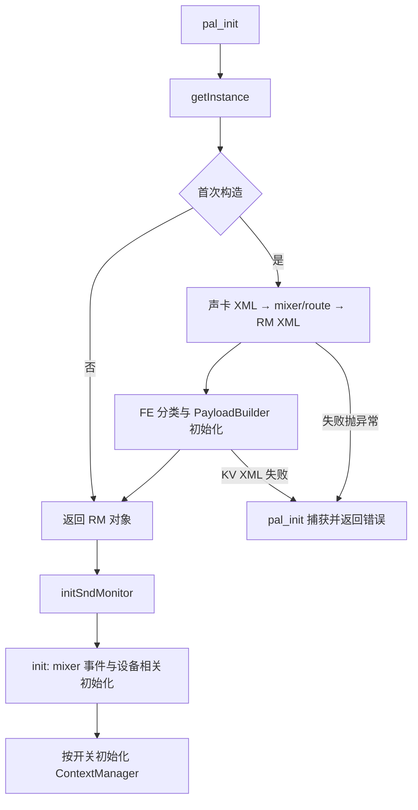
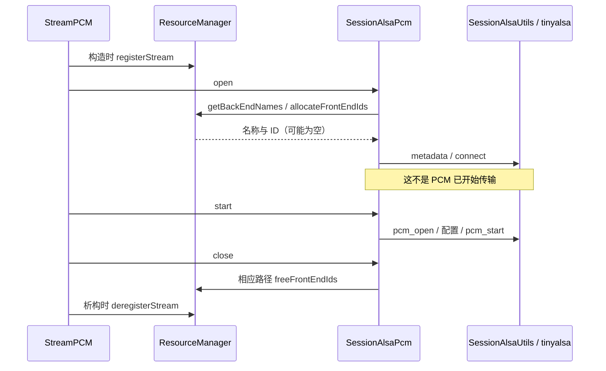

# 15.6 ResourceManager：把流需求落到平台资源

> 主线：本地 Android 12L/API 32、车载 AudioReach PAL。ResourceManager（RM）维护 PAL 侧配置、资源和协作状态；它不是 AudioPolicyManager，也不是 QNX GSL 或 DSP 图调度器。

读完本文，应能区分“Stream 对象已登记”“取得 FE ID”“设备参数已选好”“Session 已连接”“音频已运行”。前四项各自有状态与失败路径，任何一项单独成功都不能证明最后一项。

## 15.6.1 先建立资源模型

| 对象/数据 | RM 中的作用 | 不应混为一谈的概念 |
|---|---|---|
| `devInfo` | 从声卡定义得到的设备号、类型、方向和 session mode，供 FE 分类 | 不是 PAL 设备能力表 `deviceInfo` |
| `deviceInfo` | PAL device 的默认配置、usecase/custom-key 覆盖、EC 计数等 | 不是 Android `AudioDeviceInfo` |
| 各类 FE vector | 普通 PCM、hostless、compress、voice 等候选 ID | 不等于 BUS address、PAL device ID 或 DSP MIID |
| `listAllBackEndIds` | 按 PAL device ID 查询后端名称 | 不是与 FE 相同的“借出/归还池” |
| 分类流列表与 `mActiveStreams` | 记录已注册对象，便于并发、设备和 SSR 遍历 | 列表名含 active，不表示流已 STARTED |
| `audio_hw_mixer`、`audio_virt_mixer`、`audio_route` | 控件访问与 mixer path 应用的句柄 | 句柄存在不证明板级通路已经发声 |

源码入口均相对于 Android 根目录：

- `vendor/qcom/opensource/pal/resource_manager/src/ResourceManager.cpp`：本章主要实现。
- `vendor/qcom/opensource/pal/resource_manager/inc/ResourceManager.h`：成员、结构及接口声明。
- `vendor/qcom/opensource/pal/Pal.cpp`：`pal_init()` 与流的公共入口。
- `vendor/qcom/opensource/pal/stream/src/StreamPCM.cpp`、`vendor/qcom/opensource/pal/session/src/SessionAlsaPcm.cpp`：资源实际被使用的时机。

## 15.6.2 单例构造与 PAL 初始化不是同一步

`getInstance()` 使用共享指针与 `mResourceManagerMutex` 的双重检查；本地实现不是 `pthread_once` 或 `std::call_once`。不能仅从“用了 mutex”推导整个 RM 的任意并发访问都安全。

构造函数执行的主要工作是：

1. `XmlParser(SNDPARSER)` 读取声卡定义。
2. `init_audio()` 找声卡、打开 mixer、计算配置路径并初始化 audio route。
3. `XmlParser(rmngr_xml_file)` 读取资源配置。
4. 分类填充 FE 池、初始化实例位图，构造 Non-Tunnel session ID 候选。
5. 注册 AGM service crash callback；这一步失败只记录日志，没有像 XML 失败那样抛异常。
6. 加载 ADM 库、初始化 wakelock，调用 `PayloadBuilder::init()`；后者失败抛异常。
7. 创建 ContextManager 对象；是否启动它另由配置和后续入口决定。

随后 `pal_init()` 还有独立阶段，以下是连续源码摘录：

```cpp
ret = ri->initSndMonitor();
if (ret != 0) {
    PAL_ERR(LOG_TAG, "snd monitor init failed");
    goto exit;
}

ri->init();

ret = ri->initContextManager();
```

`initSndMonitor()` 启动 RM 的 SSR 工作线程并创建 SndCardMonitor；`init()` 启动 mixer 事件线程，按条件初始化充电并发监听，并取得 Speaker 实例。它不是重新加载全部 XML 的入口。`pal_init()` 没有检查 `ri->init()` 的返回值；本地该函数正常路径返回 0，Speaker 实例未取得时也只记录日志。不能据此声称已完成扬声器校准。



### 声卡与文件名是怎样选出的

`init_audio()` 从 `SND_CARD_HW` 开始枚举 mixer，按声卡名中的字符串判断候选；列表包含 `sa8155`、`sa6155`、`gvmauto` 等，也有其他平台。命中某个字符串不等于证明板卡型号。未找到时按代码上限重试，不是无限等待。

取得候选后另开 `snd_virt_card` 的 mixer（静态初值 100）。虚拟 mixer 失败返回 `-EIO`；audio route 初始化失败关闭两个 mixer 并返回 `-EINVAL`。vendor tinyalsa 的 mixer 本身还能聚合硬件和插件控件，因此不能按 `audio_hw_mixer` 变量名把所有操作都认成内核 ioctl。

`getFileNameExtn()` 把声卡名按 `-` 分段，以 `_` 连接，遇到以 `snd` 开头的段停止；`getVendorConfigPath()` 再结合 `ro.boot.product.vendor.sku` 选择配置目录。具体文件来源见 [15.9 配置地图](15_15.9_配置文件列表.md)。本地这条选择过程没有“任意平台 XML 缺失就自动退回通用 XML”的保证。

## 15.6.3 FE 池：类型、方向和模式共同决定

构造阶段先把 `devInfo` 分类，运行期再由 `allocateFrontEndIds(sAttr, lDirection)` 选择池。对普通 PCM 家族，输出取 playback 池；输入按 `TX_HOSTLESS` 选择 hostless TX 或普通 record；双向按 RX/TX hostless 分别取池。RAW 输出在此被拒绝。

| 分支 | 分配依据 | 阅读要点 |
|---|---|---|
| 普通 PCM 家族，含 PLAYBACK_BUS | 流方向与 `lDirection` | 多个 Stream 类型可以共享同一类 FE 池，不是一种类型绑定一个固定设备号 |
| COMPRESSED | 输入/输出 compress 池 | PCM_OFFLOAD 仍在上述 PCM 家族，不能只看名字中的 offload |
| VOICE_CALL | 双向属性、RX/TX 与 VSID | 区分 VOICEMMODE1/2 及对应 loopback 常量，不套普通 PCM 借还结论 |
| VOICE_CALL_RECORD / MUSIC | InCall 专用池 | 声卡定义中的 NON_TUNNEL mode 与 PAL_STREAM_NON_TUNNEL 类型不是同一分类轴 |
| CONTEXT_PROXY | ContextProxy 专用池 | 构造时来自 NO_CONFIG 的 capture 项 |
| PAL_STREAM_NON_TUNNEL | 合成的 session ID vector | 不是必须存在的普通 `/dev/snd/pcm...` 节点 |

本地 `getNumFEs()` 当前各分支都返回 1。双向 Session 分别请求 RX 和 TX，不能把一次分配返回 1 写成“整个双向流只有一个 ID”。普通池从末尾选择并删除元素；不足时返回空 vector，而不是负 errno，也没有在这里抢占已有流来腾出 FE。

`freeFrontEndIds()` 按属性把 ID `push_back` 回相应池，空输入只记录错误并返回；这里没有通用去重、所有权校验或完整的防重复释放协议。Session 的成功与错误退出路径必须与分配配对阅读。

### 不要把注释中的设计意图升级为实现保证

两处值得保留的源码细节：

- Non-Tunnel ID 初始化用 `maxDeviceIdInUse + i`，而 `i` 从 0 开始。首个候选与最大已有 ID 数值相同；不能照注释写成“严格从最大值加一开始、保证跨类无冲突”。是否产生运行冲突还取决于使用和分配范围。
- `allocateVoiceFrontEndIds(std::vector<int> listAllPcmVoiceFrontEnds, ...)` 按值接收 vector，删除发生在副本；`freeFrontEndIds()` 的 Voice 分支却向成员池追加。它不是普通池同样的借出语义，不应宣称所有 Voice FE 在此被独占消耗。

此外，分配入口仍有 `TODO: lock resource manager`；多个分支在 `erase(it)` 后继续调整迭代器。本文不把这些实现写成已证明线程安全或迭代器安全，也不修改产品代码。

## 15.6.4 用普通 PCM 的生命周期串起资源

`StreamPCM` 在构造阶段登记 `rm->registerStream(this)`，析构时注销。不是每次 `start()` 都注册，也不是每次 `stop()` 都注销。普通 PCM 的 Session 在 `open()` 阶段取得设备后端和 FE ID，再由 SessionAlsaUtils 配置 metadata/connect；真正 `pcm_open()` 在 Session 的 start 路径。详见 [15.12 PAL→tinyalsa→AGM](15_15.12_QC_audio-alsa_ALSA层实现.md)。



`registerStream()` 持有 `mActiveStreamMutex`，按实际类型登记分类列表，之后加入 `mActiveStreams`。它不在这里分配 FE，不负责 APM 的 usage→BUS 路由选择。注册代码中的“按优先级抢占”的相关草稿位于 `#if 0`，不能当作生效机制。

还有一个错误边界：未知类型分支将 `ret` 设为 `-EINVAL`，随后仍执行 `mActiveStreams.push_back(s)`；登记返回错误不能泛化成“没有任何副作用”。注销按类型删除分类列表，再删除总列表；总列表删除的返回值没有代替分类删除结果。

## 15.6.5 设备参数、后端名称与设备切换

`getDeviceInfo(deviceId, type, custom_key, ...)` 的配置层次是：

1. 找 PAL device 默认配置；
2. 找匹配 stream type 的 usecase，对非零或非空的相应字段覆盖；
3. 在该 usecase 内匹配 custom key，再做字段覆盖。

这不是“找到 XML 节点后整体替换结构体”。例如 channel、sample rate、bit width 各有覆盖标记，priority 的 custom 覆盖还排除最低优先级值。

`getDeviceConfig()` 用以上结果构建传入的 `pal_device.config`：先校验 channels 不为 0 且不超过 max，再生成 channel map；sample rate 和 bit width 没有设备默认值时取流配置，空 `sAttr` 则采用源码默认值。格式字段还受 `bitFormatSupported` 影响。SCO、USB、A2DP、代理设备等有额外分支；不能把普通扬声器参数选择写成全部设备的唯一规则。

后端名称查询使用 PAL device ID 索引 `listAllBackEndIds`；双向重载分别输出 RX/TX 的 `(deviceId, name)`。这个 pair 的 first 是 PAL device ID，不能直接称为 AGM AIF ID；后续还要走 SessionAlsaUtils/AGM 的查询与连接。

`streamDevSwitch()` 对请求去重，检查声卡状态及特定 A2DP 就绪条件，锁住相关 Stream，然后先 disconnect、再 connect。出错时释放锁，但函数没有把已成功断开的所有连接恢复成原图的通用事务回滚。`streamDevConnect_l()` 对 `-ENETRESET` 继续处理其他项，这是 SSR 中保留设备关联的特殊策略，不是远端已经连接成功。

## 15.6.6 EC 引用与并发：保留真实机制，去掉通用抢占故事

`updateECDeviceMap(rx_dev, tx_dev, tx_str, count, is_txstop)` 维护 TX 设备内的 `ec_ref_count_map`：RX device ID → `(TX Stream*, count)` 列表。它不是一个直接接通硬件线的三参数 setter。

- 正 `count` 增加已存在引用，或为未存在的 stream 建立项。
- `count == 0` 对已有项递减，到零移除；没有对应项时可能返回 `-EINVAL`。
- TX stop 分支查找并删除该 TX Stream 的记录；空 RX 参数仅在此模式被允许。
- 返回值是引用计数或错误码，不统一是“0 表示所有 EC 已成功启用”。实际 EC 设置还要看设备注册/注销及 Stream/Session 调用。

`ConcurrentStreamStatus(type, dir, active)` 当前转调 `HandleConcurrenyForSoundTriggerStreams()`。后者面向已登记的 VOICE_UI、ACD、SENSOR_PCM_DATA，依据并发配置执行暂停/恢复或 LPI/NLPI/capture-profile 切换，并在调用 Stream 动作时释放后重新取得 RM 锁。它不是返回布尔值的任意流仲裁器。

因此不能从这两个接口推出“通话永远抢占媒体”“VoIP 自动 duck 媒体”或“导航必定混音”。AAOS 焦点交互由 [12.6 焦点矩阵](../12_Audio_Focus_Deep_Dive/12_12.6_AAOS焦点交互矩阵.md) 解释；PAL 中设备配置优先级、检测流并发和应用焦点是不同层。

## 15.6.7 SSR 是分发恢复请求，不是恢复成功证明

`ssrHandler(state)` 在 `cvMutex` 下把状态压入 `msgQ`，再通知条件变量。`ssrHandlingLoop()` 消费队列；它自己不是一个直接 `poll()` 内核 uevent 的线程。

工作线程维护前后状态，更新 `cardState`，按变化发全局回调：OFFLINE 遍历已注册 Stream 调 `ssrDownHandler()`；ONLINE 在相关 ContextManager 处理后调用各 Stream 的 `ssrUpHandler()`。重复状态和空列表另有处理，`CARD_STATUS_NONE` 用于退出。各 Stream handler 出错时记录日志，并非统一回滚或永远重试。

恢复请求发出不等于所有 Session 重建成功，更不等于遗漏的 PCM 已被重放。跨 VM 的 QNX backend reset/session 清理另见 [18.2 GSL 跨 VM](../18_AGM_GSL_Architecture/18_18.2_GSL跨VM控制与缓冲区.md)，不要把两边状态机合成一个原子恢复操作。

## 15.6.8 排障时按资源阶段提问

| 现象 | 首先核对 | 避免的误判 |
|---|---|---|
| `pal_init` 失败 | XML 文件打开/解析、实际声卡名、计算出的 route/resource 文件、两个 mixer 句柄 | 文件存在就等于消费者选择了它 |
| open 时无 FE | 流类型/方向/hostless、所选池、先前失败路径的归还情况 | 一律归因于 DSP 忙 |
| 设备格式不符 | device 默认→usecase→custom key→设备特殊分支 | 只看应用请求采样率 |
| 切换后断声 | 哪个 Stream disconnect/connect 已执行、返回值、声卡状态 | “函数加锁，所以失败自动回到旧路径” |
| SSR 后不恢复 | RM 队列、各 Stream handler 结果、Session 和跨域状态 | cardState ONLINE 等于完整音频就绪 |

这些是源码导出的观察点，不是已运行的设备诊断结果。理解 RM 的关键，是沿着“配置选择→资源取得→Session 使用→归还/恢复”的每一道边界核对，而不是把它称为无所不管的音频总调度器。

---

[← 上一个](15_15.5_核心类层次图-Stream-Device-Session.md) | [返回15章](README.md) | [返回导航](../README.md) | [下一个 →](15_15.7_PayloadBuilder-载荷构建器.md)
