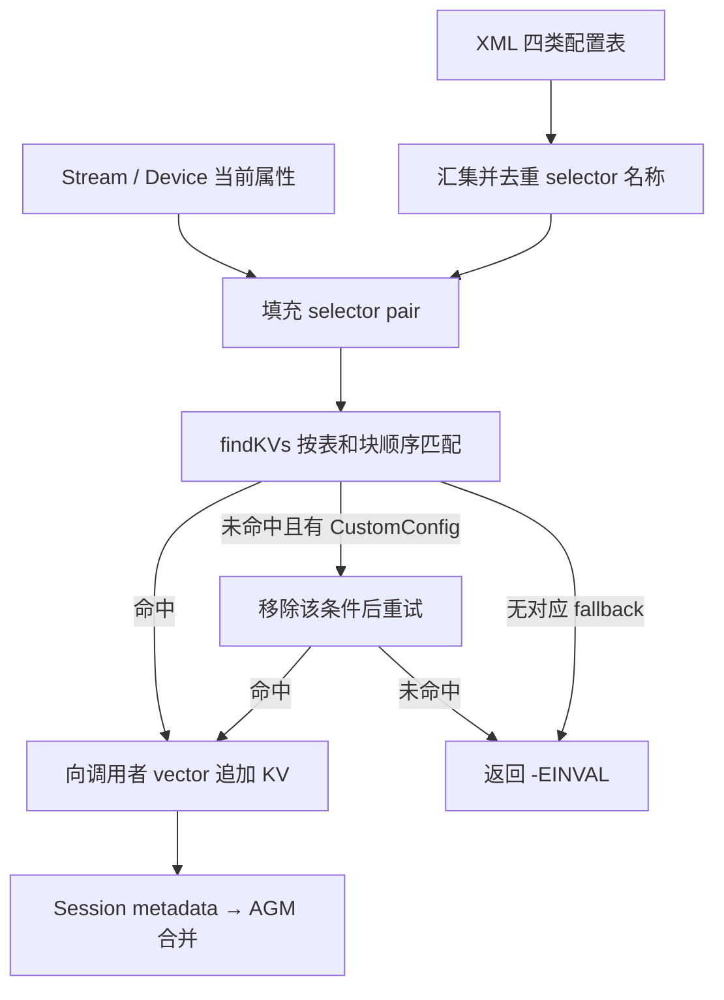
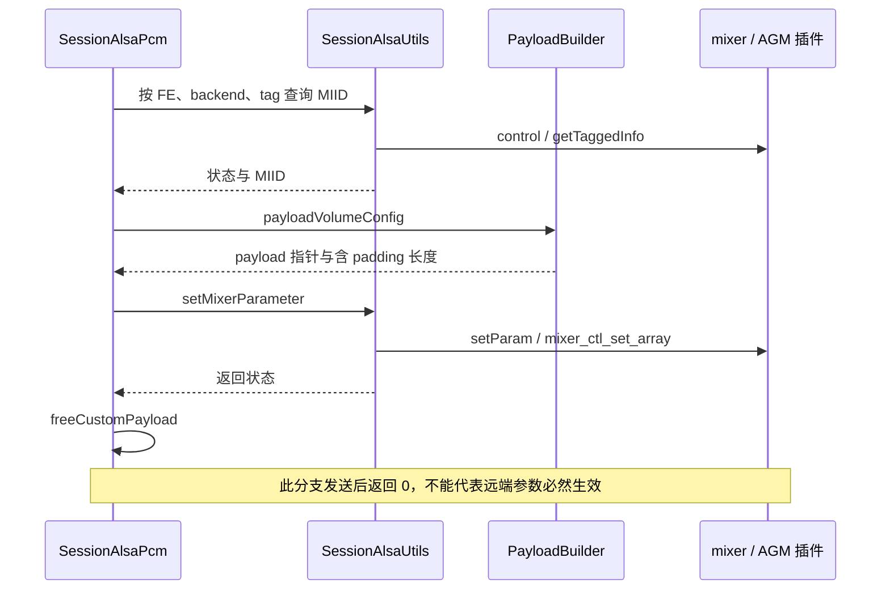

# 15.7 PayloadBuilder：从选择条件到 KV，再到模块参数

> 适用本地 AudioReach PAL。源码位于 `vendor/qcom/opensource/pal/session/src/PayloadBuilder.cpp` 与 `vendor/qcom/opensource/pal/session/inc/PayloadBuilder.h`，不是 utils 目录。

PayloadBuilder 有两类不同产物：一类是供图/校准/标签选择使用的键值向量，另一类是发给模块实例的参数字节缓冲。
> **摘录约定**：本文所有源码摘录 fence 均已统一去除源码前导缩进（内容、顺序、连续性与源码逐 token 一致，仅空白归一化）。
它不负责整个 Session 生命周期，也不自行保证参数已经在 DSP 上生效。

## 15.7.1 四种产物，不是一个“DSP 配置包”

| 产物 | PAL 侧形态 | 主要用途与边界 |
|---|---|---|
| GKV | `std::vector<std::pair<int,int>>` | 表达流、设备和后处理的图选择条件；不是图句柄，也不是单个 key 唯一标识整个运行图 |
| CKV | 同上 | 选择校准维度/取值；不等于数据库内容或完整 media format |
| TKV 与 tag | vector 加 `gsltag` 出参 | 对某个标签表达 mute、pause、采样率等配置选择；tag、KV key 和 MIID 各有含义 |
| 模块 payload | 字节指针与长度，通常含模块参数头 | 把特定 parameter ID 的字段发给已找到的模块实例 |

SessionAlsaUtils 把 KV 组织成 metadata，经 mixer 插件送 AGM；AGM 合并 session/session-AIF/device metadata，再调用 GSL。完整图生命周期见 [18.1 AGM 会话与图](../18_AGM_GSL_Architecture/18_18.1_AGM会话与音频图.md)。不能把 PayloadBuilder→Session 的 C++ vector 误写成已经是 GSL wire structure 或“全链路零拷贝”。

## 15.7.2 XML 如何变成可查询的条件表

Android 分支的 `USECASE_XML_FILE` 是 `/vendor/etc/usecaseKvManager.xml`；FEATURE_IPQ_OPENWRT 或 LINUX_ENABLED 分支为 `/etc/usecaseKvManager.xml`。RM 构造时调用静态 `PayloadBuilder::init()`：清空四张表，用 Expat 解析以下结构。

```text
streams / stream(type)
streampps / streampp(type)
devices / device(id)
devicepps / devicepp(id)
  └─ keys_and_values(selector 属性...)
       └─ graph_kv(key, value)
```

这是结构示意，不是可直接安装的完整 XML。四张表分别是 `all_streams`、`all_streampps`、`all_devices`、`all_devicepps`。`type/id` 可以是逗号分隔列表；selector 属性的值也可分拆为多个 `(selector_type, string)` 候选。`processGraphKVData()` 把 key/value 字符串转换后追加进当前块。

**解析成功不等于语义完备。** 本地 graph_kv 回调按属性数组位置期待 `key` 在前、`value` 在后；selector 名称经 LUT 的 `.at()` 查询，不是任意自定义名字都会被接受。不要因为 XML 语法允许属性换序，就假定这个消费者也无条件支持。

`init()` 打开文件失败返回 `-EINVAL`；XML buffer/解析错误也设置错误。另一个实现边界是 `XML_ParserCreate()` 失败分支只记录日志并跳转清理，没有更新初值为 0 的 `ret`。因此“init 返回 0”不能被扩展为每一种异常下表都有效。产品代码未在此修改或做异常注入。

## 15.7.3 selector 匹配不是“最具体规则覆盖默认”

普通单向 `populateStreamKV()` 的检索分三步：

1. `retrieveSelectors(type, all_streams)`：收集匹配类型所有块的 selector 名，删除重复名称。
2. `getSelectorValues()`：从 Stream/Device 填充实际值。输出方向为 RX，输入为 TX，双向可为 RX_TX；其他分支包括 Instance、SubType、StreamType、CustomConfig、BUS_address 等。BITWIDTH_SEL 在该函数中仍是待补逻辑。
3. `retrieveKVs()`：查找匹配块，把块中的 KV 追加到调用者的 vector。

XML 结束一个 stream/device 项时，块按 **selector 名称数量升序** `std::sort`，不是“条件越多越优先”。同数量块没有稳定排序保证。

`compareSelectorPairs()` 的实际判定也需要仔细读：pair 数量相等时排序后比较全部内容；不相等时检查**每个实际填充的 pair 是否都能在 XML 候选 pair 中找到**。这容纳了一个 selector 的多个允许值，但不是通用的布尔表达式求值器，也不是对每种 selector 完备性的证明。

`findKVs()` 对一个匹配 type/id 项取第一个命中的块；命中只退出该项的内层循环，外层若还有匹配项仍可能追加。实际 selector 为空时，仅寻找 XML selector 也为空的块。

若第一次找不到，`retrieveKVs()` 会从实参 vector 移除 CUSTOM_CONFIG_SEL 后重试；仍找不到返回 `-EINVAL`。这是**去掉 custom config 的特定 fallback**，不是把 BUS、方向或全部 selector 都丢弃后任意套默认值。



这里去重的是 selector 名，不是最终 KV key。最终 metadata 的按 key 合并/保留顺序属于 AGM，不能用本层的 `removeDuplicateSelectors()` 代替。

## 15.7.4 车载实例：BUS address 如何参与图选择

本地车载配置在 `vendor/qcom/proprietary/mm-audio-auto/auto-casa-xml/usecaseKvManager.xml`。以下为其中连续片段：

```xml
<keys_and_values Direction="RX" BUS_address="BUS00_MEDIA">
    <!-- STREAMRX - BUS00_MEDIA -->
    <graph_kv key="0xA1000000" value="0xA100F015"/>
    <!-- INSTANCE - INSTANCE_1 -->
</keys_and_values>
```

它位于 `PAL_STREAM_PLAYBACK_BUS` 项下。只有流类型、实际方向和 bus_addr 等匹配过程对应时，才会检索到这个配置；BUS01/02/03/08/16 另有取值。注释 `INSTANCE_1` 后没有额外 graph_kv，不能从注释补造 INSTANCE 键。

同一文件的 `PAL_DEVICE_OUT_SPEAKER` 无 selector 块给出 `(0xA2000000, 0xA2000001)`。这解释了为什么 BUS00 到 BUS03 即使映射到同一个 PAL speaker，仍可携带不同 stream KV；并不证明最终数据库中必然存在匹配图或板上接线。

`getSelectorValues()` 的 BUS_ADDRESS_SEL 分支取 `sattr->bus_addr`；对 LOOPBACK 明确跳过。不能把这条例子扩大成所有流都必须带 BUS selector。文件是否被当前产品构建安装，见 [15.9 配置选择](15_15.9_配置文件列表.md)。

## 15.7.5 重载与返回值决定你究竟拿到了什么

| 接口 | 本地行为 |
|---|---|
| 单 vector `populateStreamKV` | 获取属性、选择 selector、检索 stream KV；调用 `retrieveKVs()` 却没有接收其返回值 |
| RX/TX 双 vector `populateStreamKV` | 为特定 LOOPBACK、VOICE_CALL 分支分别填 direction/subtype/VSID；不是所有单向逻辑的通用镜像 |
| 单向 `populateStreamDeviceKV` | 当前函数体直接返回 0，不填 KV |
| 双向 `populateStreamDeviceKV` | 按有效 RX/TX device 调对应流 KV，再做 device KV；需按重载看调用 |
| 单向 `populateDeviceKV` | BT 设备在这里跳过；其他设备取实际 device 属性和 selector；检索错误没有完整向上传递 |
| `getDeviceKV` | 用空 selector 从 `all_devices` 调 `retrieveKVs`，仍然查 XML 表，不是绕开 XML 的固定映射 |
| `getBtDeviceKV` | 按 codec/ABR/hostless 等构造 selector 后查询同一类表 |

例如单向 stream KV 的连续源码：

```cpp
selectors = retrieveSelectors(sattr->type, all_streams);
if (selectors.empty() != true)
    filled_selector_pairs = getSelectorValues(selectors, s, NULL);
retrieveKVs(filled_selector_pairs ,sattr->type, all_streams, keyVector);
```

函数最终返回的 `status` 可能仍是此前 `getStreamAttributes()` 的成功结果。因此调试时需要同时看返回值和 vector 内容，不能把 `populateStreamKV()==0` 写成“XML 一定命中”。

## 15.7.6 CKV 与 TKV：校准维度不局限于增益

旧文“采样率/通道数绝不会进 CKV”不符合本地实现，也不能反过来说“CKV 就是全部媒体格式”。按入口区分：

- `populateStreamCkv()`：VOICE_UI 放 STREAM_CHANNELS；LOOPBACK 按 8/16 kHz 放 SAMPLINGRATE，并放 VOLUME/LEVEL_15；默认也放 VOLUME/LEVEL_15。代码注释谈及初始音量策略，但不能据此证明实际消除了噪声。
- `populateDevicePPCkv()`：检测流可放 CHANNELS；部分播放流按设备与功能开关放 RAS_SWITCH，并为指定 speaker/headset 类设备放 GAIN/GAIN_0；LOOPBACK 也有采样率分支。
- `populateCalKeyVector()`：MBDRC 取 `getGainLevel()`；扬声器保护/VI 按对应关联设备声道数选择映射。它不会无条件填充所有校准键。
- `populateTagKeyVector()`：输入 PAL tag，返回对应 GSL tag 和 TKV，例如 MUTE_TAG→MUTE/ON、UNMUTE_TAG→MUTE/OFF，二者都返回 TAG_MUTE。tag 不是模块实例地址。

校准键被构造、数据库查询成功、参数发出和实际校准效果仍是四个阶段，见 [16.6 AudioReach 校准](../16_Vendor_QNX_Architecture/16_16.6_ACDB校准体系.md)。

## 15.7.7 模块 payload：以 Volume 路径贯通

### 先取得 MIID，再构造参数

`SessionAlsaPcm::setParameters()` 的 PAL_PARAM_ID_VOLUME_USING_SET_PARAM 分支，在普通输出/输入方向按对应 backend 查询 TAG_STREAM_VOLUME。`SessionAlsaUtils::getModuleInstanceId()` 先选择 metadata scope，再通过该 FE 的 `getTaggedInfo` mixer 控件取 tag 信息，选匹配 tag 的首个 module entry 的 `module_iid`。

- **MID**：模块类型；**MIID**：所选图中的模块实例。
- **tag ID**：查询/配置的标签；**parameter ID**：模块内部参数种类。
- **FE ID**：决定查询哪个 Session 的控件；**backend name**：影响查询的 metadata scope。

这些数字不能互换。查询成功也不等于任何后续发送都成功。该 helper 使用固定 1024 字节查询缓冲，缺控件返回的是正 `ENOENT`，并非所有错误都是同一种负值。

### Volume 的布局与数值

`payloadVolumeConfig()` 取 `volume_pair[0].vol`，乘 `PLAYBACK_VOLUME_MAX`（0x2000），转 long 后赋给 16 位 `master_gain`。源码局部变量虽叫 `voldB`，这里实际是线性值缩放，不是 `20*log10` 的 dB 转换。它没有逐通道复制整个 volume_pair 数组，也没有 ramp_duration 字段；此函数内未见通用范围夹紧。

以下连续摘录说明头字段与长度：

```cpp
header = (struct apm_module_param_data_t*)payloadInfo;
header->module_instance_id = miid;
header->param_id = PARAM_ID_VOL_CTRL_MASTER_GAIN;
header->error_code = 0x0;
header->param_size = payloadSize -  sizeof(struct apm_module_param_data_t);
volConf = (volume_ctrl_master_gain_t *) (payloadInfo + sizeof(struct apm_module_param_data_t));
volConf->master_gain = vol;
```

概念布局如下，不以示意替代 ABI 声明：

```text
apm_module_param_data_t | volume_ctrl_master_gain_t | 尾部 padding
                        master_gain + reserved
param_size = 模块参数体字节数，不包含通用头和尾 padding
输出 size = 头 + 参数体 + 补齐到 8 字节的 padding
```

`error_code` 在发送前置零是初始化，不是 DSP 回报成功。`payloadVolumeConfig()` 返回 void；输出指针/长度及异常路径需要调用者管理。

### 发送与释放也有边界



这里有必须保留的实现问题，而不是可照抄的安全示范：

1. Volume builder 使用 `new uint8_t[...]()`；调用路径的 `Session::freeCustomPayload()` 使用 `free()`，不是应与数组 new 配对的 `delete[]`。这属于分配/释放不匹配风险，不能描述成已实现正确的统一内存所有权。
2. `setMixerParameter()` 通常仅使用调用者的 payload；但创建控件名缓冲失败时会 `free(payload)` 并仅清空局部形参，外层指针仍在。之后调用者再清理存在重复释放风险。
3. Session 的 Volume 分支记录发送 `status` 后仍直接 `return 0`。MIID 查询失败走错误出口与“已查询但发送失败”的行为不同。

这些是静态源码发现，未做内存检查器或失败注入，也未修改 PAL。

## 15.7.8 MFC 对照：不要把所有 builder 当作同一种内存协议

`payloadMFCConfig()` 的参数体为 `param_id_mfc_output_media_fmt_t`，后接每声道一个 `uint16_t` channel map。它写 sampling_rate、bit_width、num_channels；有 `ch_info` 时复制指定 map，否则调用默认 map 构造；双声道且 RL rotation 时交换左右。

MFC 使用 `calloc`，与上述 Volume 的 `new[]` 不同。两者都按总 payload 大小补齐 8 字节，并将未含尾 padding 的参数体大小写入 `param_size`。内存缓冲长度、DSP 参数长度、PCM sample 位宽和 channel map 元素大小是四个不同单位。

Session start 路径中的 MFC 构造、追加 custom payload、发送和释放，应按条件逐步跟踪；不能写成每个流必然在 open 阶段设置全部模块，也不能从 MFC 参数得到物理 Codec/TDM 时钟已生效的结论。

## 15.7.9 按“选择—定位—发送”定位故障

| 问题 | 应观察的边界 |
|---|---|
| 图选择不符 | 实际加载的 usecase XML、selector 集合与实际值、命中块、最终 KV，而不是只看 PAL 类型 |
| 配置接口返回 0 但缺 KV | 核对调用者是否忽略 retrieveKVs 返回值、vector 是否为空或含旧数据 |
| 找不到 Volume/MFC | FE、backend scope、tag 与返回 MIID，不能硬编码一个模块实例号 |
| 参数大小错误 | 参数头/参数体/变长数组/padding 分别计算，核对使用的具体 builder |
| 音量无变化 | 先确认该参数分支是否被选择，再查发送状态和后续层；不要把默认 setVolume、tag 配置与本节分支视为同一路径 |
| 崩溃或异常清理 | 对照分配器与每条释放路径；正常调用成功不能证明内存异常路径正确 |

继续阅读：[15.12 用户态 ALSA/AGM 桥](15_15.12_QC_audio-alsa_ALSA层实现.md)、[18.2 跨 VM 控制与缓冲](../18_AGM_GSL_Architecture/18_18.2_GSL跨VM控制与缓冲区.md)。GSL frontend 的预编译可见性边界不因理解了 PayloadBuilder 就消失。

---

[← 上一个](15_15.6_ResourceManager-PAL核心管理模块.md) | [返回15章](README.md) | [返回导航](../README.md) | [下一个 →](15_15.8_HIDL_接口定义.md)
