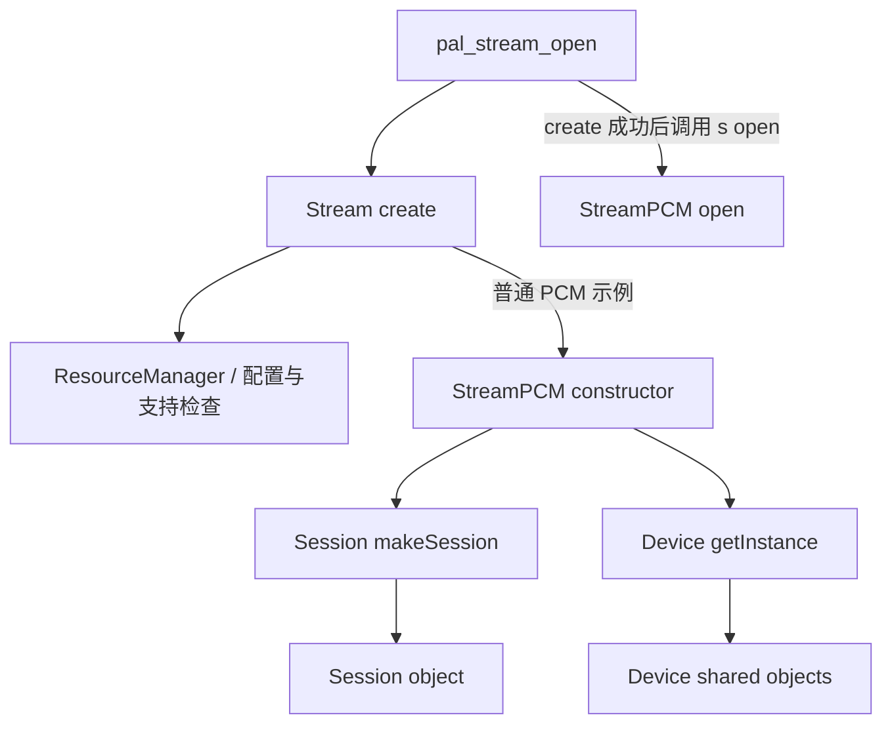

# 15.99 Stream、Session、Device：工厂映射与适用边界

> [返回第 15 章](README.md) | [HAL-PAL 适配层](15_15.10_HAL-PAL适配层架构.md) | [返回总目录](../README.md)

## 为什么要分三张表，而不是一张“万能声路表”

PAL 的三个名字回答不同问题：

- **Stream**：这是什么用例，使用哪种生命周期与数据接口？
- **Session**：该用例如何操作底层会话、配置与数据通路？
- **Device**：这个请求涉及哪些 PAL 设备，怎样获取并管理它们？

流类型、Session 类和设备之间存在关联，但**不是一对一的固定绑定**。同一个 Stream 类可用于输入或输出，也可能选择不同 Session；设备集合还受配置、地址、并发和路由影响。

本附录依据本地 Android 12L AudioReach 的 `vendor/qcom/opensource/pal/` 实现。表格描述的是工厂分派，不承诺每种枚举都在本产品运行可用，也不据此推断 DSP 拓扑、固定延迟或板级接线。

## 15.99.1 对象从哪里来



这张图只展开普通 PCM 的对象创建关系。`pal_stream_open()` 先调用 `Stream::create()`，再执行对象的 `open()`。创建对象、打开资源、启动数据通路是不同步骤；不是 ResourceManager 直接生成并返回一个可播放的 handle。

`Stream::create()` 在分派前还会获取 ResourceManager、处理设备配置、检查 `isStreamSupported()`。`NON_TUNNEL` 和 `CONTEXT_PROXY` 跳过部分普通设备处理；`ULTRASOUND` 有专门设备赋值。因此下面的 switch 映射表不能替代前置条件。

## 15.99.2 第一张表：Stream 工厂分派

对应 `stream/src/Stream.cpp` 的 `Stream::create()`。这里列出 switch 中的分组；未命中或配置不受支持时，不会凭默认分支创建通用 Stream。

| `pal_stream_type_t` | 工厂创建的 C++ 类 | 阅读提示 |
|---|---|---|
| `PAL_STREAM_LOW_LATENCY`、`PAL_STREAM_DEEP_BUFFER`、`PAL_STREAM_GENERIC` | `StreamPCM` | 类型不等于采样率、方向或固定延迟 |
| `PAL_STREAM_VOIP_TX`、`PAL_STREAM_VOIP_RX`、`PAL_STREAM_PCM_OFFLOAD` | `StreamPCM` | “offload”字样不保证使用压缩 Stream |
| `PAL_STREAM_VOICE_CALL`、`PAL_STREAM_LOOPBACK` | `StreamPCM` | Voice 的 Session 选择仍有专门分支 |
| `PAL_STREAM_ULTRA_LOW_LATENCY`、`PAL_STREAM_PROXY`、`PAL_STREAM_PLAYBACK_BUS` | `StreamPCM` | mmap/BUS 等条件还需继续看属性和生命周期 |
| `PAL_STREAM_HAPTICS`、`PAL_STREAM_RAW` | `StreamPCM` | 不能据此把 haptics 数据处理当作普通立体声 |
| `PAL_STREAM_COMPRESSED` | `StreamCompress` | 继续追踪压缩会话和回调 |
| `PAL_STREAM_VOICE_UI` | `StreamSoundTrigger` | 有检测引擎层，不是普通 PCM read 的别名 |
| `PAL_STREAM_VOICE_CALL_RECORD`、`PAL_STREAM_VOICE_CALL_MUSIC` | `StreamInCall` | 区别于 `PAL_STREAM_VOICE_CALL` |
| `PAL_STREAM_NON_TUNNEL` | `StreamNonTunnel` | 创建时传入 `NULL, 0` 设备参数 |
| `PAL_STREAM_ACD` | `StreamACD` | 上下文检测流，继续追踪检测引擎 |
| `PAL_STREAM_CONTEXT_PROXY` | `StreamContextProxy` | 创建时也不传普通设备列表 |
| `PAL_STREAM_ULTRASOUND` | `StreamUltraSound` | 工厂之前已有超声设备处理 |
| `PAL_STREAM_SENSOR_PCM_DATA` | `StreamSensorPCMData` | 专用实现，不能只靠枚举名推导数据路径 |

**源码原文摘录：** `Stream::create()` 的 Non-Tunnel 分支。

```cpp
            case PAL_STREAM_NON_TUNNEL:
                stream = new StreamNonTunnel(sAttr,
                                             NULL,
                                             0,
                                             modifiers,
                                             noOfModifiers,
                                             rm);
                break;
```

读表时有两个很有用的反例：

- `VOICE_CALL` 创建的是 `StreamPCM`，但它的 Session 不等于普通 PCM Session。
- `VOICE_CALL_RECORD` 和 `VOICE_CALL_MUSIC` 创建的是 `StreamInCall`，不能看到“VOICE”就填成与通话完全相同的一行。

## 15.99.3 第二张表：Session 工厂只有四个分支

**源码原文摘录：** `session/src/Session.cpp`，`Session::makeSession()` 中的 switch。函数在此前检查 `rm`、`sAttr` 是否为空，在此后返回 `s`。

```cpp
    switch (sAttr->type) {
        //create compressed if the stream type is compressed
        case PAL_STREAM_COMPRESSED:
            s =  new SessionAlsaCompress(rm);
            break;
        case PAL_STREAM_VOICE_CALL:
            s = new SessionAlsaVoice(rm);
            break;
        case PAL_STREAM_NON_TUNNEL:
            s = new SessionAgm(rm);
            break;
        default:
            s = new SessionAlsaPcm(rm);
            break;
    }
```

| 传入工厂的 type | 返回类 | 不能混淆的概念 |
|---|---|---|
| `PAL_STREAM_COMPRESSED` | `SessionAlsaCompress` | 压缩会话，不是所有带 OFFLOAD 的流 |
| `PAL_STREAM_VOICE_CALL` | `SessionAlsaVoice` | 专门通话 Session，即使上层 Stream 类叫 `StreamPCM` |
| `PAL_STREAM_NON_TUNNEL` | `SessionAgm` | **不是 `SessionAlsaPcm`** |
| 其他 type | `SessionAlsaPcm` | 仅表示“调用此工厂时”的 default，不等于所有 Stream 都直接在构造函数中调用它 |

组合两个工厂、再检查构造函数，可得到以下常用路径：

| 示例 type | Stream | Session | 组合依据 |
|---|---|---|---|
| `PAL_STREAM_DEEP_BUFFER` | `StreamPCM` | `SessionAlsaPcm` | StreamPCM 构造时调用 Session 工厂 |
| `PAL_STREAM_VOICE_CALL` | `StreamPCM` | `SessionAlsaVoice` | 同一 Stream 类，传入 type 不同 |
| `PAL_STREAM_COMPRESSED` | `StreamCompress` | `SessionAlsaCompress` | StreamCompress 构造时调用工厂 |
| `PAL_STREAM_VOICE_CALL_RECORD` | `StreamInCall` | `SessionAlsaPcm` | StreamInCall 构造时调用工厂并落入 default |
| `PAL_STREAM_NON_TUNNEL` | `StreamNonTunnel` | `SessionAgm` | StreamNonTunnel 构造时调用工厂 |

这解释了为什么不能用“SA8295 全部走 SessionAlsaPcm”代替实际映射，也不能因目录中存在旧的类声明，就把它加入当前工厂返回列表。

## 15.99.4 检测引擎不是 Session 子类清单

`SoundTriggerEngineGsl`、`ACDEngine` 等名称可能出现在 `session/` 目录，但**目录位置不等于继承关系，也不等于 `Session::makeSession()` 的返回类**。

当前实现中：

- `StreamSoundTrigger` 经 `SoundTriggerEngine::Create()` 创建检测引擎。`SoundTriggerEngineGsl` 的构造逻辑取得流属性后，再调用 `Session::makeSession()` 保存到 `session_`。
- `StreamACD` 经 `ContextDetectionEngine::Create()` 获取引擎；`ContextDetectionEngine` 构造逻辑同样创建自己的 Session。
- 引擎层还涉及模型、事件和检测状态。不要把“引擎持有 Session”改画成“引擎就是 Session”，也不要假定所有检测引擎都使用完全相同的后端。


图只展示已沿源码追踪的一个引擎分支。类名带 `Gsl` 也不意味着它绕过 Session 直接成为一个“SessionGsl”。

## 15.99.5 第三张表：Device 工厂按 device ID 分派

`device/src/Device.cpp` 的 `Device::getInstance()` 根据 `pal_device.id` 调用具体设备类的工厂。以下是帮助阅读 PCM 和车载流的部分分支，不是板上实际外设清单。

| PAL device ID | 调用的设备工厂 | 说明 |
|---|---|---|
| `PAL_DEVICE_OUT_HANDSET` | `Handset::getInstance()` | 与 Speaker 是不同类别 |
| `PAL_DEVICE_OUT_SPEAKER` | `Speaker::getInstance()` | 具体返回对象还受 speaker protection 条件影响 |
| `PAL_DEVICE_OUT_A2B_SPKR` | `A2BSpeaker::getInstance()` | 可用于车载 BUS 映射，不证明真实接线 |
| `PAL_DEVICE_OUT_A2B2_SPKR` | `A2B2Speaker::getInstance()` | 与前一 ID 区分 |
| `PAL_DEVICE_OUT_WIRED_HEADSET`、`PAL_DEVICE_OUT_WIRED_HEADPHONE` | `Headphone::getInstance()` | 多个 ID 进入同一类工厂 |
| `PAL_DEVICE_OUT_USB_DEVICE`、`PAL_DEVICE_OUT_USB_HEADSET`、`PAL_DEVICE_IN_USB_DEVICE`、`PAL_DEVICE_IN_USB_HEADSET` | `USB::getInstance()` | 方向和设备地址仍需区分 |
| `PAL_DEVICE_IN_HANDSET_MIC` | `HandsetMic::getInstance()` | 普通输入设备示例 |
| `PAL_DEVICE_IN_SPEAKER_MIC` | `SpeakerMic::getInstance()` | 不能仅由 App source 推导最终选择 |
| `PAL_DEVICE_OUT_BLUETOOTH_SCO`、`PAL_DEVICE_IN_BLUETOOTH_SCO_HEADSET` | `BtSco::getInstance()` | 输入/输出共用类名，不等于同一个数据方向 |
| `PAL_DEVICE_OUT_BLUETOOTH_A2DP`、`PAL_DEVICE_IN_BLUETOOTH_A2DP` | `BtA2dp::getInstance()` | 继续看具体 ID 和连接状态 |
| `PAL_DEVICE_OUT_AUX_DIGITAL`、`PAL_DEVICE_OUT_AUX_DIGITAL_1`、`PAL_DEVICE_OUT_HDMI` | `DisplayPort::getInstance()` | 不应按枚举名猜测 C++ 类名 |

### Device 可以复用，不是每次 Stream open 都 new 一个扬声器

**源码原文摘录：** `device/src/Speaker.cpp` 的实例获取逻辑。

```cpp
    if (!obj) {
        if (ResourceManager::isSpeakerProtectionEnabled) {
            std::shared_ptr<Device> sp(new SpeakerProtection(device, Rm));
            obj = sp;
        }
        else {
            std::shared_ptr<Device> sp(new Speaker(device, Rm));
            obj = sp;
        }
    }
    return obj;
```

这里 `obj` 是该类的静态共享对象。已有对象时直接返回；首次创建时，speaker protection 条件决定实际派生对象。**一条 Stream 持有 Device 引用，不代表独占该物理输出。**

`Device::getObject()` 则按 ID 查找已有对象，各具体类的接口有差异，有些带 ID 参数，有些不带。不能把“每类一个全局单例”推广到所有 Device，也不能把它和会按需创建对象的 `getInstance()` 混为一谈。

设备配置还在 ResourceManager、各设备类以及路由操作中继续处理。这里的工厂表既不表示设备一定已经 open/start，也不表示它和某个 Stream type 永久绑定。

## 15.99.6 Non-Tunnel 应怎样理解

本地实现提供了三条可以连起来理解的线索：

1. `Stream::create()` 给 `StreamNonTunnel` 传入空设备列表；其构造函数也显式忽略设备参数，保存输入和输出 media config。
2. 构造时经 Session 工厂取得 **`SessionAgm`**。
3. `SessionAgm::open()` 调用 `agm_session_open(..., AGM_SESSION_NON_TUNNEL, ...)`；读写方法使用 AGM 带 metadata 的 buffer 接口。

因此，这条路径应先理解为**不按普通设备播放流方式连接设备的输入/输出处理会话**。本地代码足以证明它不是“普通 PCM → 扬声器”的别名；但不能据 Non-Tunnel 一词断言它不使用 DSP、不经过虚拟化，或等同于 Android AudioTrack 的某个固定 flag。

也不能把 Non-Tunnel 扩大为“所有 PAL 都直接调用 AGM session API”：普通 `SessionAlsaPcm::write()` 所读到的实现调用 `pcm_write()` 或 mmap 写入接口，调用层次不同。

## 15.99.7 如何从一条 HAL 请求得到实际对象关系

建议按下面顺序分析，而不是直接查一个“场景 → 固定声路”表：

1. 在 HAL 确认 **flags、source、format、direction、BUS address**。
2. 阅读实际 `GetPalStreamType()` 的判断顺序，得到 PAL type；输入与输出函数不同。
3. 阅读设备映射以及传入的 `pal_device` 配置，不要只看 type。
4. 在 `Stream::create()` 确认是否通过支持检查，以及创建什么类。
5. 进入该类构造或引擎创建逻辑，确认谁持有 Session、何时调用 Session 工厂。
6. 分别追踪 open、start、read/write、stop、close；遇到路由或 SSR，再看它们如何改变设备和状态。

这样才能解释“同一个 StreamPCM 为什么可能配不同 Session”“为什么一个 BUS 地址不能代表一个独占硬件通道”等问题。并发优先级、EC reference、ACDB 配置和跨 VM 传输需要继续读各自实现，不能从三张工厂表中自动推出来。

## 源码阅读位置

以下均相对 `Android/lagvm/LINUX/android/vendor/qcom/opensource/pal/`：

| 文件 | 关注点 |
|---|---|
| `PalDefs.h` | 流、方向、设备和媒体属性定义；枚举存在不代表工厂支持 |
| `Pal.cpp` | `pal_stream_open()` 的 create → open → handle，以及失败清理 |
| `stream/src/Stream.cpp` | `Stream::create()` 的前置条件与完整分派 |
| `stream/src/StreamPCM.cpp`、`StreamCompress.cpp`、`StreamInCall.cpp`、`StreamNonTunnel.cpp` | 普通构造路径怎样创建 Session、处理 Device |
| `session/src/Session.cpp` | `Session::makeSession()` 四分支 |
| `stream/src/StreamSoundTrigger.cpp`、`StreamACD.cpp` | 检测引擎的创建入口 |
| `session/src/SoundTriggerEngineGsl.cpp`、`ContextDetectionEngine.cpp` | 引擎持有 Session 的位置 |
| `device/src/Device.cpp`、`Speaker.cpp` | device ID 分派、获取与复用 |
| `session/src/SessionAgm.cpp` | Non-Tunnel 的 AGM mode 与 metadata 读写 |
| `session/src/SessionAlsaPcm.cpp` | 普通 PCM Session 的写入层次 |

继续阅读：[15.10 HAL-PAL 适配层](15_15.10_HAL-PAL适配层架构.md)，把工厂关系放回一次普通 PCM 播放的生命周期中。
