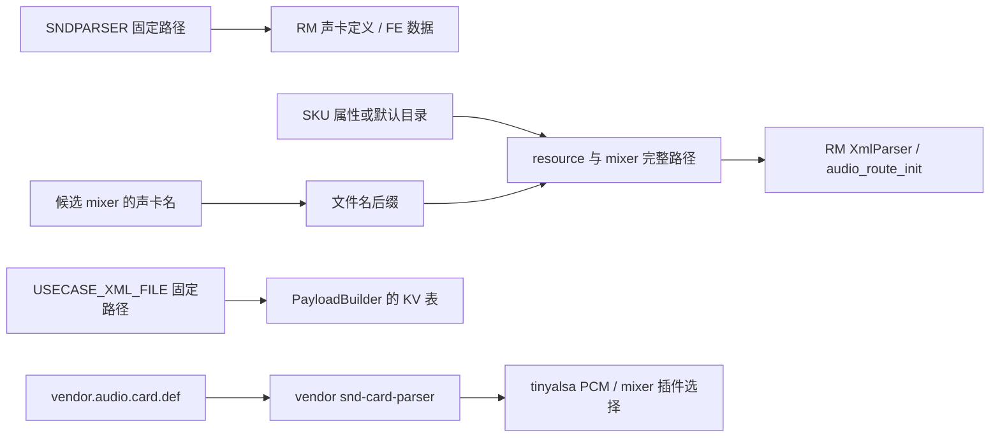

# 15.9 配置地图：谁选择文件，谁消费其中的字段

> 本文以本地 Android 12L、msmnile_gvmq、AudioReach 为主线。配置源码、构建安装规则、运行时选择、硬件效果是四层证据。本文核对前两层和消费者代码，不声称已经读取实机文件或确认声卡/板级接线。

PAL 不是“全部行为都由一个 XML 控制”。有些表来自 XML，有些默认值、类型分支和错误处理在 C++ 中；上层策略、AGM 和 QNX 也有各自的配置消费者。

## 15.9.1 从消费者看文件，而不是从名字猜用途

| 配置 | 消费者/阶段 | 本文要区分的责任 |
|---|---|---|
| `car_audio_configuration.xml` | CarAudioService / CarAudioZonesHelper | Zone、音量组、Context 与 BUS；不分配 PAL FE |
| `audio_policy_configuration.xml` | Native Audio Policy 配置加载 | HAL module、mix/device port、route 等；不是 RM 直接读取的策略表 |
| `card-defs.xml` | RM 的声卡定义解析；vendor snd-card-parser 的独立读取 | FE 名称/模式与 PCM、mixer 插件定义；两个消费者的选择逻辑不同 |
| `resourcemanager_<后缀>.xml` | RM 构造中的 XmlParser | PAL 设备默认值/usecase、backend 名、插件控制等 |
| `usecaseKvManager.xml` | PayloadBuilder::init | stream/device/PP 的 selector→graph KV 表；不是任意完整校准数据库 |
| `mixer_paths_<后缀>.xml` | RM 的 audio_route 初始化与后续路径控制 | path 名和控件值；不等于所有名字都在当前声卡有实现 |
| ACDB / workspace / delta | AGM/GSL 与数据库服务 | 文件发现、注册和查询；不归 RM 统一加载 |
| QNX audio fileset / 服务配置 | QNX 构建与对应服务 | 另一执行域的安装与启动条件，不能从 Android XML 自动推得 |

上层两类配置的解析和状态边界分别见 [9.18 Car 配置](../09_AAOS_Car_Audio/09_9.18_CarAudioZonesHelper-XML配置解析.md)、[6.2 APM](../06_Audio_Policy_Engine/06_6.2_AudioPolicyManager-策略核心实现.md)；数据库和 QNX 安装见 [16.7 双域数据库](../16_Vendor_QNX_Architecture/16_16.7_ACDB校准数据Android与QNX双域共享.md)。

## 15.9.2 车载源文件与构建条件

Android 根目录下，车载资源/KV 文件不是从 monaco 或 taro 文件名猜出来的：

| 源码位置 | 直接可证明的内容 |
|---|---|
| `vendor/qcom/proprietary/mm-audio-auto/auto-casa-xml/` | 含 resourcemanager_gvmauto8295_adp_star.xml、usecaseKvManager.xml、hw_ep_info.xml、kvh2xml.xml 等 |
| `vendor/qcom/proprietary/mm-audio-auto/auto-casa-xml/Android.mk` | 在平台列表匹配且 BUILD_TINY_ANDROID 不为 true 时，声明 ETC prebuilt，目标为 TARGET_OUT_VENDOR_ETC |
| `vendor/qcom/proprietary/mm-audio-auto/configs/audio_ar_vendor_proprietary_product.mk` | 对 msmnile_gvmq/msmnile_au 的平台+suffix 组合加入 PRODUCT_PACKAGES；gvmauto8295 RM XML 位于 ENABLE_HYP=true 条件内，usecase XML 在该外层平台条件内 |
| `vendor/qcom/opensource/audio-hal-ar/primary-hal/configs/audio_ar_vendor_product.mk` | 对上述平台组合引入 msmnile_au.mk，并列出 AudioReach 包 |
| `vendor/qcom/opensource/audio-hal-ar/primary-hal/configs/msmnile_au/msmnile_au.mk` | card-defs 的共享复制规则，以及 msmnile_gvmq 的三份 gvmauto mixer XML 复制规则；外面仍有 stub HAL 等条件 |

文件模块被定义，不等于一定进入最终产品；包名加入列表，不等于已经检查生成镜像。本文没有执行产品配置求值或构建，也不把安装片段当作实机文件清单。

特别注意：这个 `msmnile_au.mk` 中一组 Audio Policy/Car XML 复制规则位于 **PRODUCT_NAME=msmnile_gvmgh** 条件内。不能因为它们与 gvmq mixer 规则在同一个文件，就说它们已被此规则安装到 gvmq。前文使用的 common_au Car XML是可读源码实例，当前产品最终安装链仍需结合其他规则和产物核实。

`usecaseKvManager-dpk.xml` 等同目录文件也不能只因存在就视为实际加载源；本节所读 prebuilt 的 `LOCAL_SRC_FILES` 是 `usecaseKvManager.xml`。

## 15.9.3 运行时选择：三个入口，不是一套统一搜索路径

### A. RM 的声卡定义

`vendor/qcom/opensource/pal/resource_manager/src/ResourceManager.cpp` 的 `SNDPARSER` 在 Android 分支为 `/vendor/etc/card-defs.xml`；Linux/OpenWrt 条件分支为 `/etc/card-defs.xml`。构造函数先解析它，再开始 `init_audio()`。

其中 `<card><id>` 经 `processCardInfo()` 写 `snd_virt_card`；设备项填 `devInfo`，再按 name/type、playback/capture、session_mode 建 FE 池。源码初值 100 不是解析后永远不可改变的常量。

同一个源 `card-defs.xml` 在 vendor tinyalsa 一侧还由 `libsndcardparser` 使用：`vendor/qcom/opensource/agm/snd_parser/src/snd-card-parser.c` 读取 `vendor.audio.card.def` 覆盖默认文件。**不能把此 property 的覆盖行为套到 RM 的 SNDPARSER 上。** 插件选择详见 [15.12](15_15.12_QC_audio-alsa_ALSA层实现.md)。

### B. RM resource 和 mixer path

RM 的 `init_audio()` 从已打开的候选 mixer 取得实际声卡名。`getFileNameExtn()` 按 `-` 拆分，以 `_` 拼接，遇到以 `snd` 开头的字段停止，再生成两种文件名。

```text
条件示例（不是实机观测）：
声卡名 gvmauto8295-adp-star-snd-card
    → 后缀 gvmauto8295_adp_star
    → resourcemanager_gvmauto8295_adp_star.xml
    → mixer_paths_gvmauto8295_adp_star.xml
```

目录由 `getVendorConfigPath()` 决定：Android 默认 `/vendor/etc`；若 `ro.boot.product.vendor.sku` 非空，则 `/vendor/etc/audio/sku_<值>`。Linux/OpenWrt 无 SKU 时用 `/etc`。没有证据说明这里只凭 `ro.board.platform` 即可得出最终文件名。

这还意味着：平铺部署到 vendor/etc 的文件，不自动证明 SKU 子目录已经有相同副本。当前代码也没有在该入口保证“缺后缀文件就退回 mixer_paths.xml/resourcemanager.xml”。

### C. PayloadBuilder 的 KV 文件

`vendor/qcom/opensource/pal/session/src/PayloadBuilder.cpp` 的 `USECASE_XML_FILE` 是自己的编译期路径：Android 为 `/vendor/etc/usecaseKvManager.xml`，Linux/OpenWrt 为 `/etc/usecaseKvManager.xml`。它不调用 RM 的 SKU 目录函数。



图中没有从 SKU 指向 KV 固定路径的箭头，也没有从 parser property 指向 RM SNDPARSER 的箭头；这是两个容易在排障中混淆的边界。

## 15.9.4 读一个真实 resource XML

`resourcemanager_gvmauto8295_adp_star.xml` 的开头包含：

```xml
<config_params>
    <param key="native_audio_mode" value="multiple_mix_dsp"/>
    <param key="max_sessions" value="128"/>
    <param key="logging_level" value ="3" />
</config_params>
```

这里是 `param key/value`，不是虚构的 `<param native_audio_mode="true"/>`。RM 把 `multiple_mix_dsp` 映射为 NATIVE_AUDIO_MODE_MULTIPLE_MIX_IN_DSP；不能把这个字段解释为一个“true=ADSP、false=ARM”的总开关。`max_sessions=128` 也是配置输入，不是所有 Stream 共用的硬件并发容量承诺；具体支持检查、分类列表和 FE 池另有约束。

真实顶层还包含 `bt_codecs`、`controls`、`config_voice`、`device_profile` 等。BT 条目使用 `codec_format`、`codec_type`、`codec_library` 表示库映射；声明某 codec 库不等于已经协商了该 codec，更不证明相应 DSP 路径在当前运行。

### 设备 ID、backend 名与 path 名分别是什么

以下是同一文件的连续片段：

```xml
<id>PAL_DEVICE_OUT_SPEAKER</id>
<back_end_name>TDM-LPAIF-RX-PRIMARY</back_end_name>
<max_channels>8</max_channels>
<channels>8</channels>
<snd_device_name>speaker</snd_device_name>
<speaker_protection_enabled>0</speaker_protection_enabled>
```

- `id` 是 PAL 设备枚举。
- `back_end_name` 写入 RM 后端名称映射，供 Session 后续连接/查询使用。
- `snd_device_name` 对应命名的 route path；同名 `speaker` path 可以在匹配的 mixer XML 中找到。
- channels/max_channels 是配置能力/默认值，不是从车内数出来的扬声器个数。
- speaker protection 的 0 是这份源配置的值，不代表产品永远不可能从别处启用功能。

另一项 A2B speaker 的 backend 是 `TDM-LPAIF_RXTX-RX-PRIMARY`，channels/max_channels 为 32。只靠“车机一般 4/6/8 声道”会遗漏真实配置；反过来 32 个配置声道也不证明有 32 个物理扬声器。

设备默认值、usecase 与 custom-key 覆盖的读取方式见 [15.6 RM](15_15.6_ResourceManager-PAL核心管理模块.md)。`device_profile` 本身确实存在，不应因为旧文的内层示例错误而一并说它是虚构标签。

## 15.9.5 不同配置怎样在一次输出中相遇

以已匹配普通输出的条件场景为例：

1. Car 层将 Context/usage 组织成 BUS 路由规则，Native Policy 选择可用输出。
2. HAL 根据 flags、地址等选择 PAL 属性与设备；BUS address 与 PAL device 并不一一对应。
3. RM 按已选 resource 配置取得设备格式/后端；Session 从 card-defs 派生的 FE 池取得 ID。
4. PayloadBuilder 使用 usecase XML 和实际 selector 生成 stream/device KV；同一 speaker 可对应不同 BUS 的 stream KV。
5. Session 配置 metadata/connect、打开/启动 PCM 插件，AGM 再管理会话和图。
6. 模块参数、mixer path 与校准分别有自己的消费和错误返回，不能把其中一个成功替代整个链路成功。

这不是把 XML 按文件顺序串行读一遍：Car/Policy 的加载、PAL 初始化、每次流创建及运行期参数更新发生在不同对象和阶段。

## 15.9.6 修改配置之前的核对清单

| 要改变的对象 | 先核对 | 不能只做的动作 |
|---|---|---|
| 车载 Zone/BUS | Car XML 版本、输入/输出设备地址、AudioMix 与 affinity | 只改 PAL speaker backend |
| FE 数量或插件 | RM 与 snd-card-parser 各自读取的 card-defs、设备模式、池分类 | 只把 max_sessions 调大 |
| 某设备媒体格式 | resource 的默认/usecase/custom 字段，以及设备特殊分支 | 只改应用 AudioFormat |
| 某 BUS 的图选择 | usecase XML 的类型、方向、BUS selector 与数据库匹配 | 只把 key 数值复制到其他设备 |
| route path | 实际计算出的 mixer XML、path 名和可用控件 | 因文件含同名 path 就断言控件写入成功 |
| 校准 | 数据库域、注册句柄、图查询和参数应用阶段 | 把复制文件视为已经加载生效 |

本文没有执行设备命令。若之后获得运行环境，`media.audio_flinger`、`media.audio_policy`、`audio` 分别是不同服务的 dump 入口；不能把 `dumpsys audio` 输出称为 AudioFlinger dump。观察到声卡、路径或列表也仍不等于声音/时钟/接线已验证。

---

[← 上一个](15_15.8_HIDL_接口定义.md) | [返回15章](README.md) | [返回导航](../README.md) | [下一个 →](15_15.10_HAL-PAL适配层架构.md)
