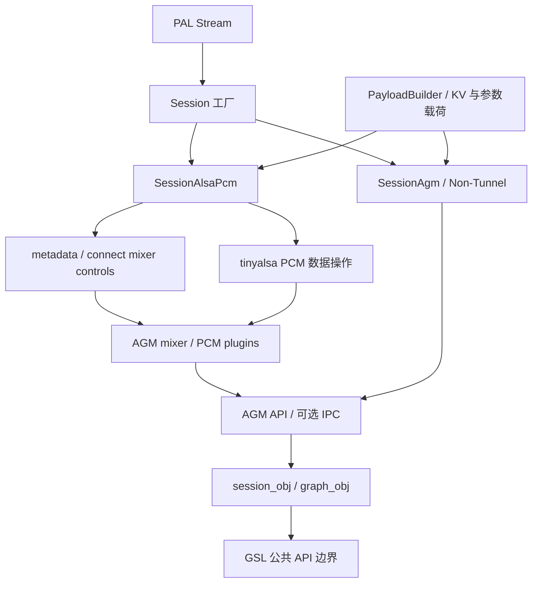

# 16.11 PAL Session 与 GSL 接口：声明、适配与执行边界

> [上一节：AGM 入口](16_16.10_AGMAudio_Graph_Manager深度解.md) · [本章导航](README.md) · [下一节：双域全景](16_16.12_Android+QNX双域架构总结.md) · [总导航](../README.md)

## 16.11.1 为什么保留 SessionGsl 这个文件名？

历史链接以 SessionGsl 为名，容易让读者以为 PAL 普通播放会直接创建该对象。本页保留文件名，但以**本地工厂与调用链**为依据，区分头文件声明、编译输入和运行实例。

本地 [SessionGsl.h](../../Android/lagvm/LINUX/android/vendor/qcom/opensource/pal/session/inc/SessionGsl.h) 确实声明 `class SessionGsl : public Session`，包含 graphHandle、KV 指针、PayloadBuilder、open/prepare/start/read/write 等接口。头中的 `getMIID()` 还是直接返回 0、不填写输出参数的内联方法；不能只凭函数名认定它完成了标签查询。

但所查 `session/src/` 未找到对应 SessionGsl.cpp，[PAL Android.mk](../../Android/lagvm/LINUX/android/vendor/qcom/opensource/pal/Android.mk) 的当前源列表也不列它；[Session.cpp](../../Android/lagvm/LINUX/android/vendor/qcom/opensource/pal/session/src/Session.cpp) 的 `Session::makeSession()` 实际选择如下：

| PAL Stream type | 当前工厂创建对象 | 下游学习入口 |
|---|---|---|
| COMPRESSED | SessionAlsaCompress | 压缩会话的专用实现，不套用普通 PCM 生命周期 |
| VOICE_CALL | SessionAlsaVoice | 语音会话路径 |
| NON_TUNNEL | SessionAgm | 直接使用 AGM 会话 API 的路径 |
| default | SessionAlsaPcm | 普通 PCM 及该分支接收的其他类型，继续由内部条件细分 |

真实工厂尾部摘录：

```cpp
case PAL_STREAM_NON_TUNNEL:
    s = new SessionAgm(rm);
    break;
default:
    s = new SessionAlsaPcm(rm);
    break;
```

正确结论是“**当前已核对的工厂不创建 SessionGsl**”，而不是“全产品不存在这个运行时类”，更不能从缺少 .cpp 编造它被哪个版本废弃的历史。检测类引擎与 Session 子类也不是一套对象分类；参见 [15.99 映射关系](../15_PAL_Architecture/15_15.99_附录_Stream-Session-Device映射关系.md)。

## 16.11.2 PAL 如何进入 AGM，而不是把 KV 直接交给 GSL？



图中 PayloadBuilder 是被 Session 调用的构造器，不是独立传输服务。常规 PCM 的控制与数据分两路：

1. 构造 GKV/CKV/TKV 或模块参数，SessionAlsaUtils 将适用 KV/属性打包为 metadata，经 mixer control 下发；metadata 的 session/AIF/session-AIF scope 必须匹配。
2. connect 操作让 AGM 确定会话与 AIF 关联，进而创建/增加/改变图；仅设置 metadata 不等于启动。
3. start 后的 tinyalsa PCM 操作可进入 AGM PCM plugin；不是每次 `pcm_*` 都必然对 Linux 声卡节点 ioctl。
4. AGM 的 session_obj/graph_obj 管理会话与图，再调用 GSL。Non-Tunnel 的 SessionAgm 则不必先绕同一套 mixer/PCM plugin 链。

完整实现分别见 [15.12 tinyalsa 与插件](../15_PAL_Architecture/15_15.12_QC_audio-alsa_ALSA层实现.md)、[17.1 AGM 会话与图](../17_AGM_GSL_Architecture/17_17.1_AGM会话与音频图.md)、[15.7 PayloadBuilder](../15_PAL_Architecture/15_15.7_PayloadBuilder-载荷构建器.md)。不要给全部 Session 画一条 `PayloadBuilder → SessionAlsaUtils → mixer → GSL` 的通用生命周期。

### KV、payload、handle 是不同接口对象

- PayloadBuilder 的 KV 方法返回状态，向引用参数 `vector<pair<int,int>>` 追加 KV；容器不是 wire format，也不是图句柄。
- AGM metadata 有自己的布局/合并规则，AGM 再构造 GSL 所需向量。`gsl_key_vector` 使用 `num_kvps` 和 `kvp`，不是 `num_kv_pairs`。
- `payloadVolumeConfig` / `payloadMFCConfig` 生成模块参数载荷，需 MIID；它们不取代 GKV 图选择。
- tag 是查询/配置标签，MID 是模块类型，MIID 是实例；FE、backend name、AGM AIF 和 GSL handle 不可互换。

因此不再把缩写为 `...` 的方法表包装成“真实可编译接口”。要调用哪个 overload，应沿具体 Session 的调用点阅读对应声明与实现。

## 16.11.3 GSL 公共接口与内部操作不要混名

公共契约见 QNX [gsl_intf.h](../../Qnx/apps/qnx_ap/AMSS/multimedia/audio/audio_ar/audio_driver/audio_reach/gsl/api/gsl_intf.h)，宿主入口实现见 [gsl_main.c](../../Qnx/apps/qnx_ap/AMSS/multimedia/audio/audio_ar/audio_driver/audio_reach/gsl/src/gsl_main.c)。

| 公共接口 | 学习重点 |
|---|---|
| `gsl_open(gkv, ckv, &handle)` / `gsl_close(handle)` | 不透明 handle 的创建和释放，不是直接返回 DSP 对象地址 |
| `gsl_ioctl(handle, cmd_id, payload, payload_size)` | PREPARE/START/STOP/FLUSH、数据配置、图增删改等命令式接口 |
| `gsl_set_cal` | 按 GKV/CKV 应用校准；数据库注册不是同一操作 |
| `gsl_set_config` | GKV、tag 和 TKV 参与配置选择 |
| `gsl_set_custom_config` | 参数载荷路径，不等于重新选择整个图 |
| `gsl_read` / `gsl_write` | tag、buffer、输出字节计数与状态；不同 data mode 完成方式不同 |
| `gsl_register_event_cb` | 保存客户端回调及上下文；自定义模块事件注册是另一命令 |

启动是公共 `gsl_ioctl(..., GSL_CMD_START, ...)`，内部再调 `gsl_graph_start()`；不要补造公共 `gsl_start()` 或 `gsl_open_graph()`。`gsl_ioctl` 是库中的命令分发函数名，不表示它本身就是内核系统调用。

图状态/共享 SG、GPR 应答、数据完成的详细解释统一在 [17.3 GSL 图生命周期与 DSP 命令](../17_AGM_GSL_Architecture/17_17.3_GSL图生命周期与DSP命令.md)。尤其注意：PREPARE 没有独立 GRAPH_PREPARED 状态，本地状态与远端完成不等价，write 的输出长度也未必是完成量。

## 16.11.4 同名 GSL API 可以落到不同链接实现

[AGM service/Android.mk](../../Android/lagvm/LINUX/android/vendor/qcom/opensource/agm/service/Android.mk) 中，头文件选择条件与库链接条件分开。`ENABLE_HYP=true` 分支链接 `libar-gsl_fe`，否则选择完整 GSL 库路径；不能从编译器看到 `gsl_intf.h` 就断言完整 GSL 在 Android 进程执行。

本地 SA8295 虚拟化主线的学习链为：AGM → gsl_fe 公共 API 代理边界 → HAB → QNX VM backend → QNX 本地 GSL → GPR → SPF/APM。源码能够说明后端调用与构建条件，但前端内部只有已找到的预编译头/库证据；库名不证明服务已启动，链接条件也不证明某次请求已执行。

- [17.2](../17_AGM_GSL_Architecture/17_17.2_GSL跨VM控制与缓冲区.md) 解释 MM_AUD_1 普通命令/应答、MM_AUD_2 事件及 READ/WRITE 完成例外。
- [16.12](16_16.12_Android+QNX双域架构总结.md) 解释全景与进程/域证据边界。
- [17.3](../17_AGM_GSL_Architecture/17_17.3_GSL图生命周期与DSP命令.md) 解释宿主 GSL 到 DSP 命令边界。

本页依据可见源码修正接口定位，未构建产品或验证运行时实例；不能把目录搜索的未命中升级为所有构建、历史版本和二进制的绝对不存在证明。
