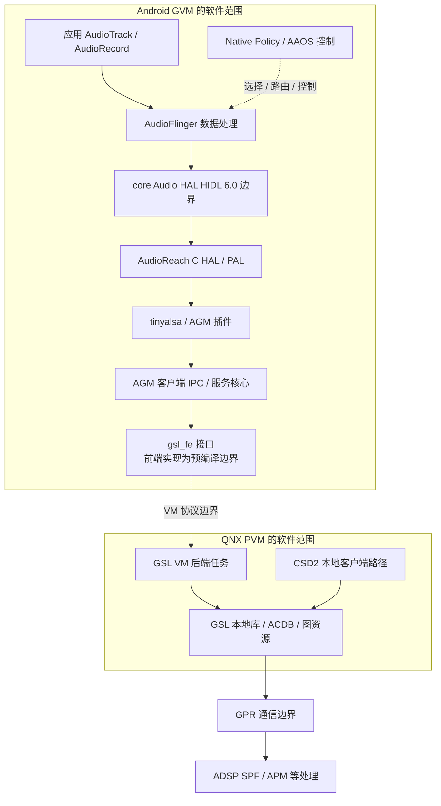
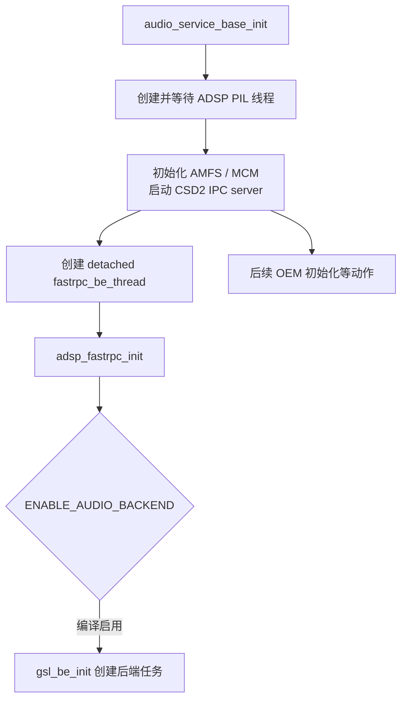

# 16.12 Android + QNX 双域架构：逻辑层、执行域与可验证边界

[返回本章](README.md) | [18.2 跨 VM 控制与缓冲区](../18_AGM_GSL_Architecture/18_18.2_GSL跨VM控制与缓冲区.md) | [16.7 双域数据库](16_16.7_ACDB校准数据Android与QNX双域共享.md)

> 本文按本地 Android 12L/API 32 + SA8295 AudioReach 整理。目标是把已核对的层内机制接成准确全景，而不是把所有服务、库和 DSP 模块都压成一根箭头。本文没有验证目标机进程、启动时间、DSP/板级连接或安全音频效果。

## 1. 一张图先分清三个执行域



图中 GSL 本地实现放在 QNX 软件域，**不放在 ADSP 框内**；GSL VM 后端也不是 GSL 本体的同义词。DSP 的 APM 与 Android AudioPolicyManager 虽可缩写相同，但职责和执行域不同。

箭头表示已核对普通路径中的职责衔接，不保证每种 Stream 都逐框经过：Non-Tunnel、压缩、语音、检测引擎和 MMAP 等有不同 Session/数据路径。虚线表示控制关系或前端实现不可见的边界，不是已运行验证的逐函数调用。

## 2. 哪些是接口，哪些是库，哪些是任务

| 名称 | 本地证据支持的定位 | 不能直接推断 |
|---|---|---|
| core Audio HAL HIDL 6.0 | `msmnile_gvmq` manifest 声明的接口版本 | 所有 HAL 都是 6.0，或目标服务已运行 |
| AudioControl AIDL v1 | AAOS 与车载控制 HAL 的独立接口 | 它承载 PCM 或代表 core Audio HAL 为 AIDL |
| AR HAL / PAL | C HAL 回调及 Stream/Session/Device 抽象 | 所有对象都同进程、所有流都同一 Session |
| AGM | 客户端 API、可选 IPC、服务核心与插件分别实现 | 目录名 service 就是进程声明 |
| gsl_fe | 虚拟化构建可链接的前端库与接口 | 已知其内部全部复制、等待和重试细节 |
| gsl_be | QNX 后端库代码及服务/session task | 必定是名为 gsl_be 的独立进程 |
| QNX 本地 GSL | 图、校准查询、资源与 SPF 命令相关实现 | GSL 函数在 DSP 上直接执行 |

版本依据为 `Android/lagvm/LINUX/android/device/qcom/msmnile_gvmq/manifest.xml`。标准边界、PAL 工厂和 AGM IPC 分别见 [8.1](../08_HAL_Layer/08_8.1_Audio_HAL双轨架构.md)、[15.99](../15_PAL_Architecture/15_15.99_附录_Stream-Session-Device映射关系.md)、[18.1](../18_AGM_GSL_Architecture/18_18.1_AGM会话与音频图.md)。

`vendor/qcom/opensource/agm/service/Android.mk` 的 `ENABLE_HYP=true` 选择 `libar-gsl_fe`，而 `PRODUCT_NAME=msmnile_gvmq` 选择 gsl_fe 头；这两个条件不同。PAL/插件的 `libagmclient` 与 AGM 核心不是同一个库。不要把 build 依赖直接展开成已经验证的进程拓扑。

## 3. QNX 后端是怎样被接入初始化代码的

源码：`Qnx/apps/qnx_ap/AMSS/multimedia/audio/audio_ar/audio_service/src/coreinit.c`。

`audio_service_base_init()` 内先创建 ADSP PIL 加载线程，随后执行若干基础设施初始化并 join 该线程，检查 `adsp_pil_load_status`；之后调用 AMFS/MCM 初始化、启动 CSD2 IPC server，再创建 detached 的 `fastrpc_be_thread`，还会启动 OEM 设备初始化线程。

`fastrpc_be_thread` 先调用 `adsp_fastrpc_init()`，其失败记录日志；GSL 后端调用有编译条件：

```c
#ifdef ENABLE_AUDIO_BACKEND
    LOG(QCLOG_INFO,"gsl_be_init");
    rc = gsl_be_init();
    LOG(QCLOG_INFO,"bringup gsl_be init done, rc %d...\n", rc);
#endif
```

对应 s8295 QVM host 构建文件：

`Qnx/apps/qnx_ap/AMSS/multimedia/audio/audio_ar/audio_service/aarch64/o-le-s8295-ar-qvmhost/Makefile`

其 HYP710/QHS220 工具链条件分支定义 `ENABLE_AUDIO_BACKEND`，静态链接 `gsl_beS` 等并链接 `uhab`。这证明此变体的装配条件，不证明所有 QNX 变体都启用，也不证明现场进程已执行到该代码。



**线程创建成功不等于线程内部初始化成功。** 外层没有将所有异步步骤都 join 后才宣告“完整音频链路就绪”。部分调用结果被忽略或只记录；上图也不能推出 Hypervisor、Android boot、声卡上线与后端全部服务的全局先后关系。

本地 `csd2_cgm_init()` 另有 `gsl_init()` 与初始数据库加载；VM INIT handler 则假设本地核心已初始化并进行版本检查。如何由产品启动和客户端初始化满足该假设，需要继续结合相应入口证据，而不是把 VM INIT 画成重复初始化核心。

## 4. 数据流不能省略的两层区别

### 控制消息和样本数据不同

QNX 后端用 MM_AUD_1 处理命令与普通应答，MM_AUD_2 发送事件；不是一条负责播放、一条负责录音。READ/WRITE 携带缓冲描述，外层跳过普通应答，依赖 READ_DONE/WRITE_DONE 类事件。完整解释见 [18.2](../18_AGM_GSL_Architecture/18_18.2_GSL跨VM控制与缓冲区.md)。

### 共享内存和整链零拷贝不同

- HOST 模式可导出 QNX/GSL 数据缓冲。
- GUEST 模式可导入外部分配，用本地映射/分配 handle 和 offset 访问。
- OOB 参数缓冲与 PCM 数据缓冲分别管理。
- Android 客户端共享内存、HAL FMQ、AGM HIDL 两侧仍有复制；共享某一段映射不等于整条链路零拷贝。

同样，GSL graph handle、HAB export ID、QNX vaddr、AGM session handle 与 PAL handle 不能合并成一个“跨域地址”。

## 5. 校准既有本地初始库，也有远端追加入口

QNX AR fileset 可从 `adp_8295_ar` 源目录安装到 `etc/acdb/adp_8295` 目标目录；初始文件集包含数据库与 workspace，并指定可写路径。Android AGM 也选择和扫描数据库目录，QNX ADD_ACDB_DATABASE handler 可将远端路径加 `/vm/%03d` 前缀后追加注册。

因此：

- 不能把 Android 的数据库一律称为“架空/占位”。
- 不能把目录目标没有 `_ar` 当作 legacy 证据。
- 不能把路径映射当作自动同步文件或已建立挂载。
- 不能把追加库成功当作每条 GKV 都命中该库、每个模块都已应用预期参数。

机制分别见 [16.6](16_16.6_ACDB校准体系.md) 与 [16.7](16_16.7_ACDB校准数据Android与QNX双域共享.md)，不再在全景图里添加无来源的 `acdb-loader → HAL` 校准箭头。

## 6. 恢复与安全音频必须单独证明

| 事件 | 已看到的机制 | 仍需另外证明 |
|---|---|---|
| DSP/音频服务 DN | 后端 global callback 清图记录并转发事件 | 上层各 Stream 何时重建、旧样本如何处理 |
| 音频服务 UP | 本回调记录/转发通知 | 原路由、参数、校准和播放位置全部恢复 |
| GVM/HAB 断连 | `-ENODEV` 分支清理 session 相关资源 | 每条错误分支均无泄漏、无挂起 |
| Android 应用或服务退出 | Android 对象与焦点/路由有各自生命周期 | QNX 本地音频必定不受共享 DSP/设备影响 |

后端 SSR 的 `reset_only` 清图与断连时销毁连接不是同一件事，不能写成每次 SSR 都关闭再重建所有 HAB 通道。Android 声卡监控、HAL/PAL 的 SSR 行为也不能由这个后端 callback 一次性推导。

本地 QNX 路径不经过 Android 应用层，不代表已经证明安全告警“最高优先级”或“Android 崩溃时绝不受影响”。这需要相应服务、路由、DSP 资源策略和测试证据。AAOS 焦点矩阵同样不是全车物理音频优先级表；见 [12.6](../12_Audio_Focus_Deep_Dive/12_12.6_AAOS焦点交互矩阵.md)。

## 7. 推荐联读

1. [15.10 HAL-PAL](../15_PAL_Architecture/15_15.10_HAL-PAL适配层架构.md)：普通 PCM 的延迟 open/start 与错误隐藏。
2. [15.12 tinyalsa/AGM 插件](../15_PAL_Architecture/15_15.12_QC_audio-alsa_ALSA层实现.md)：控制路径、样本路径及单位。
3. [18.1 AGM](../18_AGM_GSL_Architecture/18_18.1_AGM会话与音频图.md)：metadata、AIF、图与设备引用。
4. [18.2 GSL VM](../18_AGM_GSL_Architecture/18_18.2_GSL跨VM控制与缓冲区.md)：消息、两种内存模式、完成与清理。
5. [16.6/16.7 校准](16_16.6_ACDB校准体系.md)：数据库来源、查询及跨域路径。

16.14 等旧文的本地 GSL 内部、其他 QNX 服务和设备侧细节仍待逐篇核对；本篇不是对这些旧文章的整体背书，也不代替实机验证。
