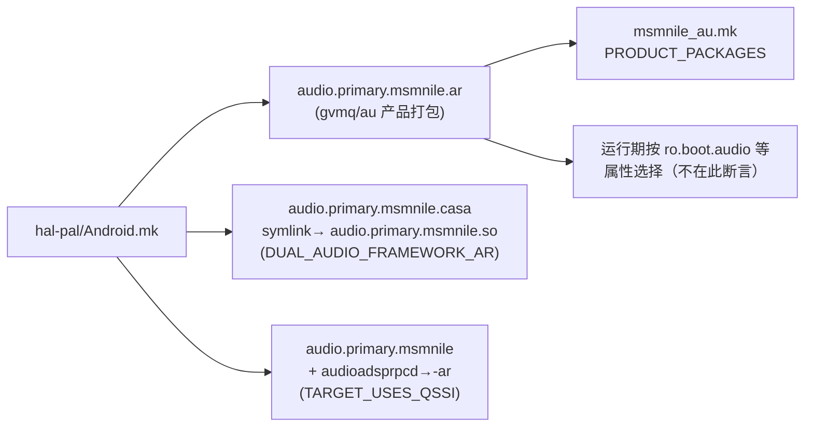

# 16.13 Primary HAL（AudioReach 版）：组装、扩展与通话面

> [前篇：auto-casa-xml 配置](16_16.9_auto-casa-xml配置.md) · [本章导航](README.md) · [后篇：双域架构总结](16_16.12_Android+QNX双域架构总结.md) · [总导航](../README.md)

> 定位：`vendor/qcom/opensource/audio-hal-ar/primary-hal/hal-pal/` 是 audio@6.0 HIDL 服务背后的 AR 版 primary HAL。**流与设备的打开/写入/待机机制已在 [15.10](../15_PAL_Architecture/15_15.10_HAL-PAL适配层架构.md) 深讲，本页不重复**；这里收编三件 15.10 没展开的事：模块怎么被组装与命名（`.ar` 后缀的来历）、`audio_extn` 分发层、以及通话专用面 `AudioVoice`（VSID 会话状态机）。

## 16.13.1 模块组装：六个源文件起步

`hal-pal/Android.mk` 的核心源文件表：

```makefile
LOCAL_SRC_FILES := \
    AudioStream.cpp \
    AudioDevice.cpp \
    AudioVoice.cpp \
    audio_extn/soundtrigger.cpp \
    audio_extn/Gain.cpp \
    audio_extn/AudioExtn.cpp
```

> 源码：`vendor/qcom/opensource/audio-hal-ar/primary-hal/hal-pal/Android.mk`

注意与直觉不同的两点：`audio_extn/` 目录里还有 `auto_hal.cpp`、`FM.cpp`、`Hfp.cpp`、`battery_listener.cpp` 等文件，但**它们不在本模块的 SRC 列表里**（对应功能要么由 `AudioExtn.cpp` 内的静态成员承接，要么属于其他构建目标，本页不妄断归属）；`AudioDevice.cpp` 里引用的 `auto_hal` 能力实际来自 `AudioExtn::audio_extn_autohal_GetCarAudioPalStreamType()`（定义在 AudioExtn.cpp）。条件编译只有两族：`AUDIO_FEATURE_ENABLED_PAL_HIDL`（PAL 走 HIDL 代理）与 `AUDIO_FEATURE_ENABLED_GEF_SUPPORT`（追加 `Gef.cpp`，通用效果框架）。共享库基线里 `libar-pal` 是唯一的 PAL 通道（HIDL 打开时再加代理库）。

## 16.13.2 命名与加载：`.ar` 后缀的故事

模块名由产品名决定，这是 AR/Elite 双框架共存的关键：

```makefile
# Automotive LAGVM will need to have both AR and Elite
# audio hals available on target for conditional loading
# depending on the ro.boot.audio prop.
# Only msmnile_gvmgh/msmnile_au must have AR HAL linked to the
# audio.primary.msmnile.so name
ifneq (,$(filter $(PRODUCT_NAME), msmnile_gvmq msmnile_au))
LOCAL_MODULE := audio.primary.$(TARGET_BOARD_PLATFORM).ar
LOCAL_MODULE_RELATIVE_PATH := hw
LOCAL_MODULE_TAGS := optional
LOCAL_MODULE_OWNER := qti
LOCAL_VENDOR_MODULE := true
include $(BUILD_SHARED_LIBRARY)
endif
```

> 源码：`vendor/qcom/opensource/audio-hal-ar/primary-hal/hal-pal/Android.mk`（注释为源码原文）

本主线产品（msmnile_gvmq）打包的是 **`audio.primary.msmnile.ar`**（`configs/msmnile_au/msmnile_au.mk` 的 `PRODUCT_PACKAGES` 明确列出）。同一份 Android.mk 还有第二段：`DUAL_AUDIO_FRAMEWORK_AR` 时构建 `.casa` 模块并 **symlink** 到 `audio.primary.msmnile.so`；`TARGET_USES_QSSI`（非 DUAL）时构建不带后缀的 `audio.primary.msmnile` 并把 `audioadsprpcd` symlink 到 `-ar` 版。注释里说清了意图：车上同时存在 AR 与 Elite 两个 HAL，按 `ro.boot.audio` 属性在启动时选择加载。**静态结论到此为止**——audio@6.0 服务按 policy 配置里的模块名加载哪个 `.so`，属于产品配置与运行期行为，本页不做推断。



## 16.13.3 audio_extn：参数分发与可选特性

`AudioExtn.cpp` 是 HAL 的"杂务前台"：`SetParameters()` 收到键值对后先问 voice，再转给 audio_extn 家族（HFP/FM 等按特性开关），`GetParameters()` 同构。它同时管理一批 `*_feature_init`（battery listener、HFP、A2DP、KPI 优化等），统一模式是 "特性开关 + dlopen/注册 + 失败降级为空实现"。车载相关的典型一员：

```cpp
pal_stream_type_t AudioExtn::audio_extn_autohal_GetCarAudioPalStreamType(char* address)
```

> 源码：`vendor/qcom/opensource/audio-hal-ar/primary-hal/hal-pal/audio_extn/AudioExtn.cpp`（签名节选；按 BUS 地址推导 PAL 流类型，衔接 [15.10 §15.10.3](../15_PAL_Architecture/15_15.10_HAL-PAL适配层架构.md) 的 BUS 地址语义）

要分清的三层：**特性是否编译**（mk 条件）、**运行时是否启用**（`*_feature_init` 的开关参数，多来自 `vendor.audio.feature.*` 属性）、**单个请求是否走它**（键名匹配）。任何一层为否，看到的都是"没有这个功能"，而不是同一现象。

## 16.13.4 AudioVoice：VSID 会话与最小状态机

通话不是"一条流"，而是**按 VSID 索引的会话表**。类定义里写死了两个 modem 语音域：

```c
#define VOICEMMODE1_VSID         0x11C05000
#define VOICEMMODE2_VSID         0x11DC5000
```

> 源码：`vendor/qcom/opensource/audio-hal-ar/primary-hal/hal-pal/AudioVoice.h`。会话表大小由同文件 `#define MAX_VOICE_SESSIONS 2` 决定。

构造函数建表：每会话一组 `call_state_t`（`current_`/`new_`）、VSID、TTY、效果缓存标志，然后按槽位赋 VSID：

```cpp
    for (int i = 0; i < max_voice_sessions_; i++) {
        voice_.session[i].state.current_ = CALL_INACTIVE;
        voice_.session[i].state.new_ = CALL_INACTIVE;
        voice_.session[i].vsid = VOICEMMODE1_VSID;
        voice_.session[i].pal_voice_handle = NULL;
        voice_.session[i].tty_mode = PAL_TTY_OFF;
        voice_.session[i].volume_boost = false;
        voice_.session[i].slow_talk = false;
        voice_.session[i].pal_voice_handle = NULL;
        voice_.session[i].hd_voice = false;
        voice_.session[i].pal_vol_data = pal_vol_;
        voice_.session[i].device_mute.dir = PAL_AUDIO_OUTPUT;
        voice_.session[i].device_mute.mute = false;
    }

    voice_.session[MMODE1_SESS_IDX].vsid = VOICEMMODE1_VSID;
    voice_.session[MMODE2_SESS_IDX].vsid = VOICEMMODE2_VSID;
```

> 源码：`vendor/qcom/opensource/audio-hal-ar/primary-hal/hal-pal/AudioVoice.cpp`（构造函数节选）

### 状态入口：setParameters 里的两个键

电话框架通过 `AudioDevice::SetParameters()` 把通话变化写进来，voice 侧只认两个键（`vsid` + `call_state`）：

```cpp
    err = str_parms_get_int(parms, AUDIO_PARAMETER_KEY_VSID, &value);
    if (err >= 0) {
        uint32_t vsid = value;
        int call_state = -1;
        err = str_parms_get_int(parms, AUDIO_PARAMETER_KEY_CALL_STATE, &value);
        if (err >= 0) {
            call_state = value;
        } else {
            AHAL_ERR("call_state key not found");
            ret = -EINVAL;
            goto done;
        }

        if (is_valid_vsid(vsid) && is_valid_call_state(call_state)) {
            ret = UpdateCallState(vsid, call_state);
```

> 源码：`vendor/qcom/opensource/audio-hal-ar/primary-hal/hal-pal/AudioVoice.cpp`（`VoiceSetParameters` 节选）

VSID 或 call_state 非法就拒绝——**HAL 不猜**。TTY/音量增强/慢谈/HD voice 等键在同函数内更新缓存，若通话已激活则即时 `pal_stream_set_param` 补发。

### 状态机：只有两条合法迁移

`UpdateCalls()` 对每个会话把 `new_` 与 `current_` 对表，不匹配的迁移只记日志不执行：

```cpp
        switch(session->state.new_)
        {
        case CALL_ACTIVE:
            switch(session->state.current_)
            {
            case CALL_INACTIVE:
                AHAL_DBG("INACTIVE -> ACTIVE vsid:%x", session->vsid);
                ret = VoiceStart(session);
                if (ret < 0) {
                    AHAL_ERR("VoiceStart() failed");
                } else {
                    session->state.current_ = session->state.new_;
                }
```

> 源码：`vendor/qcom/opensource/audio-hal-ar/primary-hal/hal-pal/AudioVoice.cpp`（对称的 `ACTIVE -> INACTIVE -> VoiceStop` 分支同构）

两条合法迁移：`INACTIVE→ACTIVE` 起呼、`ACTIVE→INACTIVE` 挂断。`VoiceStart` 失败时 `current_` 不动——下次重试仍是同一条迁移，不会"半激活"。注意 `new_` 只是电话框架的**意图**，真正决定动作的是与 `current_` 的组合。

### 起呼：一次 pal_stream_open 带双端设备

`VoiceStart` 把会话翻译成一个 PAL 通话流：TX/RX 两个 `pal_device`、类型 `PAL_STREAM_VOICE_CALL`，VSID 与 TTY 塞进流属性：

```cpp
    memset(&streamAttributes, 0, sizeof(streamAttributes));
    streamAttributes.type = PAL_STREAM_VOICE_CALL;
    streamAttributes.info.voice_call_info.VSID = session->vsid;
    streamAttributes.info.voice_call_info.tty_mode = session->tty_mode;
```

> 源码：`vendor/qcom/opensource/audio-hal-ar/primary-hal/hal-pal/AudioVoice.cpp`（其前是两个 palDevices 的 TX/RX 填充，其后是 `AUDIO_MODE_CALL_SCREEN` 与 TTY VCO/HCO 的设备覆盖及 `pal_stream_open`）

三个覆盖分支值得记住：call screen 模式把两端都换成 PROXY 设备；TTY HCO 换输出为 HANDSET；TTY VCO 换输入为 HANDSET_MIC——**设备选择在打开前决定，不存在"先开再改"**。打开成功后补发缓存的效果参数（slow_talk/volume_boost/hd_voice），最后由 PAL/AGM 侧按 VSID 找到 modem 语音 graph（GKV 与图构建见 [18.1](../18_AGM_GSL_Architecture/18_18.1_AGM会话与音频图.md)）。

### 路由与挂断

`RouteStream(rx_devices)` 从 RX 设备集反推 TX（`GetMatchingTxDevices`），记住当前 voice 设备 id；关键分支在 `IsAnyCallActive()`：未通话时只更新记账（并在 IN_CALL/CALL_SCREEN 模式下触发 `UpdateCalls` 起呼），通话中设备变化则对每个会话 `VoiceSetDevice()` 换设备。`StopCall()` 把所有会话 `new_` 置 INACTIVE 再统一走 `UpdateCalls`。语音音量走 `pal_volume_data`（构造时预留单声道对，初值 -1.0 表示"尚未设置"）。

## 16.13.5 阅读分工与证据边界

| 想了解 | 去 |
|---|---|
| 流打开/写入/standby 的 PAL 语义 | [15.10](../15_PAL_Architecture/15_15.10_HAL-PAL适配层架构.md) |
| PAL 如何消费配置、建图 | [15.6](../15_PAL_Architecture/15_15.6_ResourceManager-PAL核心管理模块.md)、[18.1](../18_AGM_GSL_Architecture/18_18.1_AGM会话与音频图.md) |
| mixer_paths/card-defs 配置族 | [15.9](../15_PAL_Architecture/15_15.9_配置文件列表.md)、[16.9](16_16.9_auto-casa-xml配置.md) |
| HAL 服务装配（QNX 侧对照） | [16.17](16_16.17_QNX_audio_service_vm_VM音频服务.md) |

| 层次 | 本页能证明 | 本页不能证明 |
|---|---|---|
| 源码 | SRC 列表、模块命名规则、VSID 表、状态机、覆盖分支 | — |
| 构建 | gvmq/au 打包 `.ar` 模块 | 实际镜像里加载哪个 HAL |
| 运行 | — | 通话是否真正建立、语音 graph 是否在 DSP 侧生效 |

## 本节小结

Primary HAL 的 AR 版像一栋三层小楼：一层是装配（`.ar` 后缀让 AR 与 Elite 共存一机）、二层是杂务（audio_extn 的特性开关与参数分发）、三层是通话（VSID 会话表 + 双迁移状态机 + 打开前的设备覆盖）。流与设备的地基在 15.10，图的地基在 18 章——把本页当索引，别在这里重复挖。

---

[← 16.9 auto-casa-xml 配置](16_16.9_auto-casa-xml配置.md) · [本章导航](README.md) · [16.12 双域架构总结 →](16_16.12_Android+QNX双域架构总结.md) · [总导航](../README.md)
