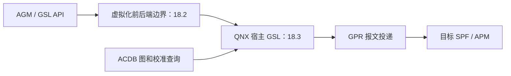

# 16.14 GSL 内部架构：兼容入口

> [上一节：Primary HAL](16_16.13_Primary_HALAudioReach版深度解.md) · [本章导航](README.md) · [下一节：Q&A](16_16.15_常见问题与解答Q&A.md) · [总导航](../README.md)

GSL 的内部机制现集中到第 18 章，避免将 PAL、AGM、跨 VM 协议和宿主图状态混成一条调用链。本页保留原路径，作为兼容入口。

## 按问题选择正文

| 你要理解的问题 | 正文 |
|---|---|
| GSL handle、GKV node、共享 SubGraph 是什么关系？ | [18.3 GSL 图生命周期与 DSP 命令](../18_AGM_GSL_Architecture/18_18.3_GSL图生命周期与DSP命令.md) |
| 为什么 prepare 没有 PREPARED 状态，stop 状态不等于 DSP STOP 成功？ | [18.3 的状态与控制机制](../18_AGM_GSL_Architecture/18_18.3_GSL图生命周期与DSP命令.md) |
| GPR basic response、READ/WRITE_DONE、EOS、buffer 复用怎样协作？ | [18.3 的数据路径与完成机制](../18_AGM_GSL_Architecture/18_18.3_GSL图生命周期与DSP命令.md) |
| HAB 哪个通道发普通应答，哪个通道发事件？HOST/GUEST 管什么？ | [18.2 跨 VM 控制与缓冲区](../18_AGM_GSL_Architecture/18_18.2_GSL跨VM控制与缓冲区.md) |
| PAL 是否创建 SessionGsl？AGM 如何进入 GSL？ | [16.11 接口边界](16_16.11_SessionGsl与GSL接口.md)、[18.1 AGM](../18_AGM_GSL_Architecture/18_18.1_AGM会话与音频图.md) |
| GKV/CKV/TKV 从哪里来，数据库如何加载？ | [16.6 校准模型](16_16.6_ACDB校准体系.md)、[16.7 双域数据库](16_16.7_ACDB校准数据Android与QNX双域共享.md) |

## 保留的层次定位

GSL 位于 QNX 宿主侧，不应称作“DSP 端 GSL”；APM/SPF 才是它通过报文请求操作的目标。GPR 报文投递、DSP 完成、跨 VM 事件和应用所见进度是不同边界。

对应源码入口是 [QNX gsl](../../Qnx/apps/qnx_ap/AMSS/multimedia/audio/audio_ar/audio_driver/audio_reach/gsl/)。其中 graph/datapath/common、子图池和消息构造分别承担图控制、数据/完成、同步应答、共享引用及载荷内存职责。ar_osal 提供 OS 抽象，但不能由此断言整个栈绝不调用原生 API，或 Android 与 QNX 完整 GSL 的差异仅在一个适配目录。

本次已迁移普通图、GPR 命令与数据路径讲解；RTC、动态模块、硬件资源、GPR datalink、QNX/内核适配尚需各自的源码追踪。原文目录数量、超时常量和宏存在不作为完整性、性能或实际部署证明；前端预编译与硬件验证边界仍适用。
