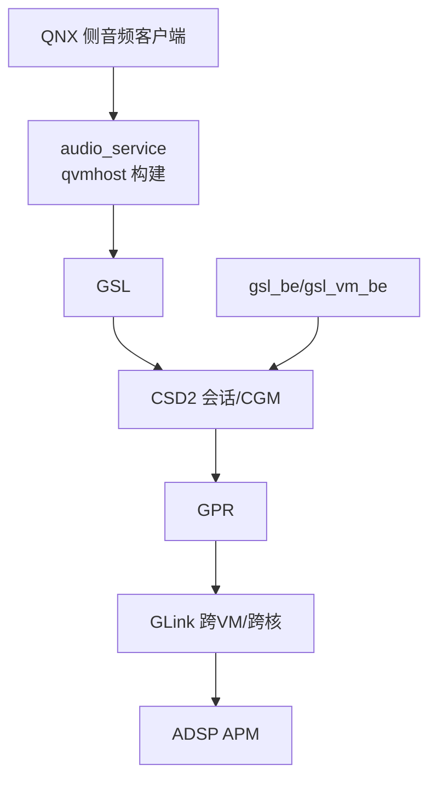

[← 16.14 GSLGraph_Service_Layer](16_16.14_GSLGraph_Service_Layer内部架.md) | [← 返回16章](README.md) | [返回导航](../README.md)

---

## 16.15 常见问题与解答(Q&A)

> **证据等级约定**（本页所有答案遵守）：
>
> - **【源码】** = 本仓库产品源码可静态证明（给出路径/行号）。
> - **【构建/部署】** = 构建脚本或安装清单可证明。
> - **【运行时】** = 合理的排查步骤，但**本仓库无法证明**目标机上的实际行为（无设备日志样本）；命令本身是各 OS 的通用工具。
> - 涉及 **Elite 遗留组件**（apr_lib/ams_lib/QNX Audio Manager/audio_a2b）的问题，本库主线（AudioReach）**不展开**，见 16.18/16.19/16.20 的兼容口径。

### 16.15.1 auto-audiod 与声卡状态

#### Q1: auto-audiod 检测不到 ADSP 声卡怎么办？

**A**（详细机制见 [16.2](16_16.2_auto-audiod守护进程.md)）：

**Step 1 — 声卡列表【运行时】**：
```bash
cat /proc/asound/cards
# auto-audiod 解析每两行一条的声卡记录；卡名必须以 msm/apq/sa 前缀开头才会被监控【源码】
```

**Step 2 — 声卡 state 文件【运行时】**：
```bash
cat /proc/asound/card0/state
# state fd 是强制项：解析不到即监控线程不工作【源码】
```

**Step 3 — 日志【源码】**：日志 TAG 是 `AutoAudioDaemon`（`AutoAudioDaemon.cpp` 的 `#define LOG_TAG "AutoAudioDaemon"`）：
```bash
adb logcat -s AutoAudioDaemon:auto_audio_ext
```

**Step 4 — 前缀过滤【源码】**：非 msm/apq/sa 开头的卡名被跳过（16.2 的 `getSndCardFDs` 过滤逻辑）。

**Step 5 — 服务是否启动【构建/部署】**：`AUDIO_FEATURE_ENABLED_AUTO_AUDIOD` 在 msmnile_au.mk **位于 `ifneq ($(ENABLE_HYP),true)` 门内**（:90-95）；本产品主线 `msmnile_gvmq.mk:23` 设 `ENABLE_HYP := true`，**HYP 主线不编译 audiod**（改置 `AUDIO_FEATURE_ENABLED_SND_MONITOR := true`），仅非 HYP 配置才有该守护进程。

**注意**：Linux 的 `udevadm monitor` 在 Android guest 上**不存在**（Android 用 ueventd，非 udev）；网上排查文章里的 udevadm 步骤对本平台不适用。

#### Q2: Hostless 会话无法启用怎么排查？

**A**（hostless 三层结构见 [16.2](16_16.2_auto-audiod守护进程.md)）：

**Step 1 — Mixer 控制【源码+运行时】**：msmnile 平台路由表把 `SEC_TDM_RX_7 Port Mixer TERT_TDM_TX_7` 与 `QUAT_TDM_RX_7 Port Mixer QUIN_TDM_TX_7` 置 1【源码】。Mixer 控件来自 **mixer_paths XML**（Android 域），不是 UCM（UCM 是 Linux/LXC guest 的配置，见 [16.8](16_16.8_ALSA_UCM配置.md)——常见混写）：
```bash
tinymix -D 0 | grep "Port Mixer"
```

**Step 2 — PCM 设备号【源码】**：msmnile hostless 表中 MERC 用 TX 49/RX 48，A2B 用 TX 53/RX 50【源码】。设备号写死在源码表里：
```bash
ls -la /dev/snd/pcmC0D*
```

**Step 3 — ADSP 状态【源码+运行时】**：hostless 只在 bootup/restart 时机配置一次，mixer 打开带 1000×10ms 重试；若当时卡不 ONLINE，直接失败【源码】。
```bash
cat /proc/asound/card0/state
```

**Step 4 — Wakelock【源码】**：
```bash
cat /sys/power/wake_lock
```
源码证据（统一名称，按 hostless 通路计数 acquire/release）：
```c
static const char* wakelock_name = "audio_daemon";
```
> 源码：`vendor/qcom/proprietary/mm-audio-auto/auto-audiod/auto_audio_ext.cpp`（wakelock_name 定义在 67 行附近）。`wake_lock_fd` 以 `O_WRONLY|O_APPEND` 打开 `/sys/power/wake_lock`，`wakelock_level` 引用计数控制实际写入。

**Step 5 — HAL 通知【源码】**：hostless 之后 `notifyAudioDevice` 以 `setParameters(SND_CARD_STATUS, "N,ONLINE")` 通知 HAL——这只证明**送达 HAL 入口**，HAL 内部如何消费见 [15.10](../15_PAL_Architecture/15_15.10_HAL-PAL适配层架构.md)。

#### Q3: ADSP SSR 后音频未恢复怎么办？

**A**（通知链见 [16.2](16_16.2_auto-audiod守护进程.md) 与 [16.17](16_16.17_QNX_audio_service_vm_VM音频服务.md)）：

**能从源码说的部分**：
1. SSR 后 audiod 检测 OFFLINE→ONLINE 转换（共享 `prev_state`，多卡共享一变量是源码静态事实）【源码】；
2. ONLINE 后重启 hostless（重启属性分支 `vendor.audio.audiod.started`）【源码】；
3. HAL 收到 `SND_CARD_STATUS` 通知【源码】；
4. QNX 侧 SSR 由 CSD2 全局事件（`csd2_open(CSD2_MODULE_TYPE_SSR)` + `CSD2_CMD_REG_GLOBAL_EVENT`）承接【源码】。

**必须实测确认的部分**：ACDB 是否重新推送、PAL/AGM 是否重开图、TDM 路由是否重建——这些属于 15/17 章的运行层，静态读码只能给出"入口在哪"，不能保证发生。

**不要用的命令**：网上流传的 `setprop persist.audio.ssr_recovery` 在本仓库源码中**不存在**该属性读取点【源码（负结论）】。

#### Q4: 如何理解 AutoPower 的 deep sleep / shutdown 行为？

**A**（全量分析见 [16.3](16_16.3_AutoPower与VHAL集成.md)）：

**【源码】可证的行为**：
- 单一订阅 `AP_POWER_STATE_REPORT`（`SubscribeFlags::EVENTS_FROM_ANDROID`）；
- `onPropertySet` 只有两种动作：`DEEP_SLEEP_EXIT` → `auto_audio_ext_enable_hostless_all()`；`SHUTDOWN_POSTPONE` → `auto_audio_ext_disable_hostless_all()`；
- `DEEP_SLEEP_ENTRY` 只打日志，无动作；
- VHAL 死亡重连 100×100ms，失败后 AutoPower 静默失效直到进程重启。

**【运行时】**不可静态断言：MCU 信号时序、ADSP 低功耗状态迁移、唤醒后校准重推——文档若断言这些，需要实机日志支撑。

### 16.15.2 早期提示音 audio-chime

#### Q5: audio-chime 启动音播放失败怎么排查？

**A**（全量分析见 [16.5](16_16.5_audio-chime早期提示音.md)）：

**Step 1 — 服务定义【构建/部署】**：`service audio_chime /vendor/bin/audio_chime /vendor/etc/bike_bell.wav`（oneshot/disabled）只出现在 **msmnile_au 的 init.target.rc**；主线 msmnile_gvmq rc **没有**此项【源码（负结论）】。先确认你的产品到底装没装它。

**Step 2 — 日志【源码】**：TAG 是 `early-audio-chime`（`audio_chime_app.c` 定义 `LOG_TAG "early-audio-chime"`）：
```bash
adb logcat -s early-audio-chime
```

**Step 3 — Mixer/PCM/ACDB【源码】**：硬编码值——card 0、TERT_TDM_RX_0、MultiMedia23（PCM 设备 55）、backend 87、ACDB 60；ACDB 经 `dlopen libaudiohalpluginclient.so` → `acdb_loader_init_v4` → `send_audio_cal_v6`。任一失败按 16.5 的错误标签链定位。

**Step 4 — 不要找不存在的开关**：`persist.audio.silent_boot` 属性在本仓库源码中没有读取点【源码（负结论）】。silent boot 是另一个模块（[16.4](16_16.4_Silent_Boot监控.md)），且其编译宏只在非 AR 配置定义——AR 主线大概率没有该监控。

### 16.15.3 ACDB 校准

#### Q6: ACDB 校准数据没有推到 ADSP 怎么排查？

**A**（体系见 [16.6](16_16.6_ACDB校准体系.md)、[16.7](16_16.7_ACDB校准数据Android与QNX双域共享.md)）：

- **文件存在性【运行时】**：`ls /vendor/etc/acdbdata/`（Android 侧）/ QNX 侧 fileset 安装路径——两边安装的文件集合可以静态核对（16.7 有清单）。
- **加载入口【源码】**：Android 侧 chime 走 plugin client 的 `acdb_loader_init_v4`；QNX 侧无独立 acdb-* 工具——ats_fts/ats_rtc 是 `audio_reach/acdb/ats/src/ats.c` 内的 ATS 服务（16.6:166）。
- **双域分工【源码】**：主库直接加载（Android）与 AM 直连装载（QNX）并存；具体某块板哪个生效是**部署事实**，读码只能列出候选路径。
- 网上流传的 "ACDB ID=15/60/22/36" 对照表**与本仓库产品无关**，不要照抄【源码（负结论）：这些注释不出现在本树】。

### 16.15.4 QNX 域播放问题

#### Q7: QNX 侧音频无法播放怎么排查？

**A**（QNX 侧真实链路见 [16.17](16_16.17_QNX_audio_service_vm_VM音频服务.md)）：

**先纠正一个高频错误**：QNX Audio Manager / ams_lib / apr_lib 属于 **Elite 架构遗留**（[16.18](16_16.18_QNX_ams_lib_音频管理服务库.md)、[16.19](16_16.19_QNX_apr_lib_APR协议库.md) 已转兼容口径）。**AudioReach 主线的 QNX 域链路**是：



**排查次序**：
1. **audio_service 是否在跑【运行时】**：`pidin | grep audio_service`（QNX 工具）；其启动参数 `-U` 仅在 `SECPOL_ENABLE=1` 时可用【源码】。
2. **GSL 图操作返回码【源码】**：GSL 命令在 `AR_ETIMEOUT`/`AR_EABORTED`/`AR_ESUBSYSRESET` 时直接退出，无重试协议【源码】——SSR 期间的失败是预期行为。
3. **GPR 链路状态【源码】**：GLink 必须处于 CONNECTED 才能发（否则 `AR_ENOTREADY`）；rx intent 只在 CONNECTED 后注册（128/512/1024/4096 各若干）【源码】。
4. **跨 VM 段【源码】**：Android 侧 gsl_fe → MM-HAB → gsl_vm_be（见下节）。

`slog2info`/`pidin` 是 QNX 通用工具，命令本身没问题；但具体日志行、进程名在目标机上的样子属于【运行时】。

#### Q8: QNX 侧 TDM 通道被 Android 占用怎么办？

**A**：这是**路由配置问题**，不是进程冲突：
- Android 域路由由 `resourcemanager_gvmauto8295_adp_star.xml` + `mixer_paths_gvmauto8295_adp_star.xml` 决定（[16.9](16_16.9_auto-casa-xml配置.md)）；
- audiod 的 hostless 表也占用 MERC/A2B 相关的 Port Mixer【源码】；
- "哪个域用哪组 TDM"是**产品路由设计**，源码只能证明两域各自的候选集，不能证明互斥约定——互斥性由 DSP 侧图/端口分配保证（[17.1](../17_AGM_GSL_Architecture/17_17.1_AGM会话与音频图.md)），跨域仲裁细节属【运行时】。

### 16.15.5 GSL 与 Graph 配置

#### Q9: gkv、ckv、tkv 有什么区别？

**A**（详见 [17.3](../17_AGM_GSL_Architecture/17_17.3_GSL图生命周期与DSP命令.md)）：

| 维度 | gkv (Graph KV) | ckv (Cal KV) | tkv (Tag KV) |
|------|------|------|------|
| 回答的问题 | 要什么样的图 | 用哪套校准 | 配置发给哪个模块实例 |
| 内容 | 流类型+设备类型组合 | 音量/增益等键值 | 模块标签+实例 |
| 失败表现 | 图打不开/选错子图 | 校准缺失 | set 参数落错模块 |

选图依据 `usecaseKvManager.xml` 词典（PayloadBuilder 固定路径读 `/vendor/etc/usecaseKvManager.xml`）【源码】。

#### Q10: PAL Session 的 open 与 start 差在哪？

**A**：open 对应 `gsl_open()`（分配 handle、注册回调、按 GKV 选子图池），start 对应 `gsl_ioctl(GSL_CMD_START)`——GSL 对外**没有独立的 start API**，统一走 ioctl 命令【源码：`gsl_intf.h`，`GSL_CMD_START=0x0`】。图状态机（IDLE→OPENED→STARTED→…，无 PREPARED 态）与错误态不可重写规则见 [17.3](../17_AGM_GSL_Architecture/17_17.3_GSL图生命周期与DSP命令.md)。

#### Q11: multiple_mix_dsp 是什么？

**A**：本产品 PAL 配置确实选了它【源码】：

```xml
<param key="native_audio_mode" value="multiple_mix_dsp"/>
```
> 源码：`vendor/qcom/proprietary/mm-audio-auto/auto-casa-xml/resourcemanager_gvmauto8295_adp_star.xml`（config_params 第一项）

含义：多流可并存，各自开图，混音在 DSP 内完成。注意该值是**产品配置选择**——同名配置在其他平台（如 monaco）也出现，机制解读应挂在 PAL 的 native audio 模式族，而不是本平台特例。

#### Q12: DSP Graph 配置问题怎么调？

**A**：
- **【源码】**先看配置来源：GKV 词典（usecaseKvManager.xml）、resourcemanager XML、ACDB blob 文件名引用（[16.9](16_16.9_auto-casa-xml配置.md)）。配置错 = 静态可查。
- **【源码】**命令超时语义：`gsl_send_spf_cmd` 在 AR_ETIMEOUT/AR_EABORTED/AR_ESUBSYSRESET 直接退出（17.3）。
- **【运行时】**PAL 日志 TAG 是带前缀的 `PAL: SessionAlsaPcm`、`PAL: PayloadBuilder`（`#define LOG_TAG` 的真实值【源码】）：
```bash
adb logcat -s "PAL: SessionAlsaPcm" "PAL: PayloadBuilder"
```
- 网上流传的 `persist.audio.gsl.debug` 属性、`/sys/kernel/debug/audio/adsp_graph_status`、"错误码 0x0001~0x0007 对照表" 在本仓库源码中**均无出处**【源码（负结论）】。

### 16.15.6 双域隔离与 MM-HAB

#### Q13: Android 域和 QNX 域如何互不干扰？

**A**（架构总结见 [16.12](16_16.12_Android+QNX双域架构总结.md)）：

| 隔离维度 | 机制 | 证据等级 |
|---|---|---|
| 控制通道 | Android 经 gsl_fe→MM-HAB→gsl_vm_be 代理；QNX 本地直达 GSL/CSD2 | 【源码】 |
| 图与端口 | 各自开图，DSP 内按 GKV/端口分配 | 【源码】 |
| 校准数据 | ACDB 文件双域安装清单与装载路径分立 | 【源码+部署】 |
| "TDM 通道分工表" | 具体哪个域用哪组 TDM 是产品设计 | 【运行时】 |

注意把 "QNX PVM 和 Android GVM 使用不同 APR 地址域" 这类说法替换为 AR 事实：**AR 用 GPR（domain/port/token/opcode），不用 APR**；APR 是 Elite 遗留（[16.19](16_16.19_QNX_apr_lib_APR协议库.md)）。

#### Q14: MM-HAB 通信超时/断开怎么排查？

**A**（前端/后端详见 [16.14](16_16.14_GSLGraph_Service_Layer内部架.md)、[17.2](../17_AGM_GSL_Architecture/17_17.2_GSL跨VM控制与缓冲区.md)）：

**【源码】协议事实**——VM 消息 opcode 是真实枚举：
```c
    GSL_VM_OPCODE_OPEN = 4, /* gsl_open() */
    GSL_VM_OPCODE_CLOSE = 5, /* gsl_close() */
```
```c
    GSL_VM_OPCODE_IOCTL = 13, /* gsl_ioctl() */
```
> 源码：`Qnx/apps/qnx_ap/AMSS/multimedia/audio/audio_ar/audio_driver/gsl_be/inc/gsl_vm_msg.h`（GSL_VM_OPCODE_OPEN/CLOSE/IOCTL 定义处）。图启动没有独立 opcode：`GSL_VM_OPCODE_IOCTL(13)` 携带 `GSL_CMD_START(0x0)` 完成

**【运行时】排查**：Android 侧 `/dev/habmm` 节点存在性、gsl_fe 连接日志；QNX 侧 `pidin | grep audio_service`。**区分三层**：HAB 通道通 ≠ GSL 会话建立 ≠ 数据传输成功（17.2 的成功层级表）。

**gsl_fe 注意**：Android 树只有**预编译库+导出头**，没有 gsl_fe 源码【源码（负结论）】——它的内部重试/日志格式不可从本仓库断言。

### 16.15.7 Elite 遗留与低层虚拟化话题（限定口径）

#### Q15: APR / ams_lib / QNX Audio Manager 的问题怎么排查？

**A**：**不排查**——按本库约定，这些属于 Elite 架构遗留：
- `apr_lib`：APR 协议库（[16.19](16_16.19_QNX_apr_lib_APR协议库.md) 兼容口径）；AR 主线 IPC 是 **GPR**（[16.17](16_16.17_QNX_audio_service_vm_VM音频服务.md)、17 章）。
- `ams_lib`：Elite 音频管理服务库（[16.18](16_16.18_QNX_ams_lib_音频管理服务库.md) 兼容口径）。
- "QNX Audio Manager"：Elite 时代的组件名，AR 主线的对应物是 audio_service + CSD2 体系。
- `audio_a2b`：仅 `audio_elite` 树且纯预编译（[16.20](16_16.20_QNX_audio_a2b_A2B总线音频.md)）。

遇到含这些名词的排查步骤，先问一句：这是 Elite 平台的文档吗？

#### Q16: AVMM/VAPM/SMMU 这些虚拟化底层怎么调？

**A**：本仓库能证明的只有**构建链接关系**：audio_service 的 qvmhost 构建链接 `avmm_lib`/`uhab`【构建】（[16.17](16_16.17_QNX_audio_service_vm_VM音频服务.md)）。更深的 MM 虚拟化（AVMM 协议、VAPM、SMMU 映射）源码不在本树，相关调试步骤一律按**外部平台知识**对待，不在本库展开——除非将来拿到对应源码。

#### Q17: A2B 总线音频问题怎么排查？

**A**：主线视角下 A2B 是**数据面配置**：PAL 的 A2BSpeaker/A2B2Speaker 设备、audiod hostless 表的 A2B PCM（TX 53/RX 50）、LXC UCM 的 a2b 用例【源码】。A2B 协议栈本体（总线发现/时隙配置）不在 AR 树——见 [16.20](16_16.20_QNX_audio_a2b_A2B总线音频.md) 的兼容入口。

### 16.15.8 快速定位速查

#### Q18: 出了音频问题，从哪里开始？

**A**：按"域→层→证据"三步：

| 现象域 | 第一步（静态可查） | 第二章节 |
|---|---|---|
| Android 应用/策略 | CarAudio 配置 + AudioPolicy 日志 | 09/06 章 |
| Android HAL/PAL | hal-pal 模块 + PAL 日志 TAG | [15.10](../15_PAL_Architecture/15_15.10_HAL-PAL适配层架构.md) |
| Android↔DSP 控制 | gsl_fe→MM-HAB→gsl_vm_be 的成功层级 | [17.2](../17_AGM_GSL_Architecture/17_17.2_GSL跨VM控制与缓冲区.md) |
| 图/命令 | GSL 状态机与 SPF 命令语义 | [17.3](../17_AGM_GSL_Architecture/17_17.3_GSL图生命周期与DSP命令.md) |
| QNX 域 | audio_service 启动与 GPR 链路状态 | [16.17](16_16.17_QNX_audio_service_vm_VM音频服务.md) |
| 开机/早期 | audiod/chime 的构建宏与 rc 服务项 | [16.2](16_16.2_auto-audiod守护进程.md)/[16.5](16_16.5_audio-chime早期提示音.md) |
| 校准 | ACDB 文件清单与装载路径 | [16.6](16_16.6_ACDB校准体系.md) |

**口诀**：先分层（哪个域、哪个进程、哪条链），再取证（日志 TAG 是源码里 `#define LOG_TAG` 的值），最后才谈修复。**TAG 写错 = 白查**：`AutoAudioDaemon`、`early-audio-chime`、`PAL: SessionAlsaPcm` 都是本树的真实 TAG【源码】。

---

## 本页小结

这页 Q&A 的存在价值不是"命令大全"，而是**把网上通用排查知识钉回本平台证据**：哪些 TAG/属性/路径/设备号是源码里真实存在的，哪些是外部平台知识混进来的。修复动作永远跟着分层证据走。

---

[← 16.14 GSLGraph_Service_Layer](16_16.14_GSLGraph_Service_Layer内部架.md) | [← 返回16章](README.md) | [返回导航](../README.md)
