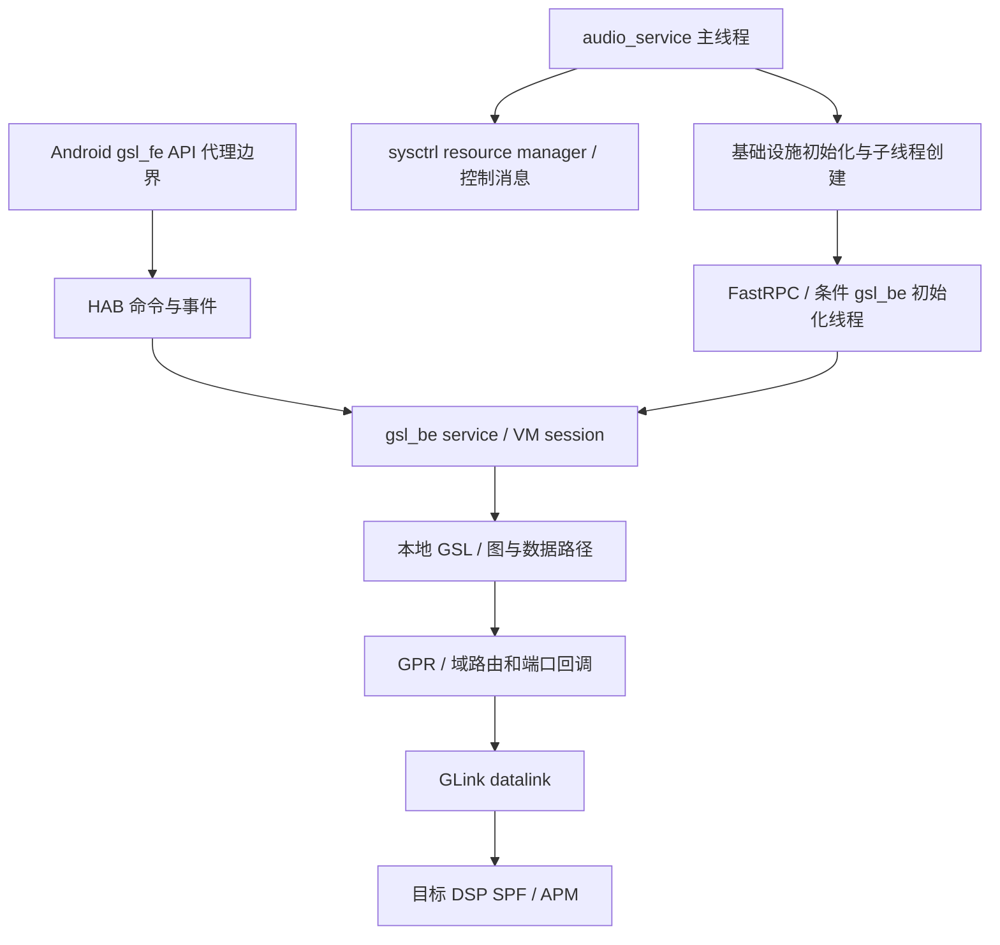

# 16.16 QNX AudioReach 后端：不要把源码目录当作内核层

> [上一节：Q&A](16_16.15_常见问题与解答Q&A.md) · [本章导航](README.md) · [下一节：AR audio_service](16_16.17_QNX_audio_service_vm_VM音频服务.md) · [总导航](../README.md)

## 历史路径与当前主线

本文件名保留 audio_driver_vm，以维持旧链接。原文大量内容来自另一路 Elite 架构，不再据此解释本地 Android 12L + SA8295 + QNX AudioReach。当前应从 [audio_ar/audio_driver](../../Qnx/apps/qnx_ap/AMSS/multimedia/audio/audio_ar/audio_driver/) 及 [audio_ar/audio_service](../../Qnx/apps/qnx_ap/AMSS/multimedia/audio/audio_ar/audio_service/) 的实际调用/装配关系入手。

**driver 目录是一组实现的组织位置，不代表其中每个库都在内核中，也不代表全部请求依次穿过每个子目录。** QNX 用户态服务可以使用资源管理器、DAL、GLink 与内存映射接口；获得硬件访问权限与成为内核模块不是一回事。

## 16.16.1 三条职责线

1. **装配线**：服务负责初始化与线程创建，失败和异步就绪按 [16.17](16_16.17_QNX_audio_service_vm_VM音频服务.md) 分析。
2. **跨 VM 接入线**：gsl_be 接收自己的协议、管理会话/缓冲/完成事件；细节集中在 [17.2](../17_AGM_GSL_Architecture/17_17.2_GSL跨VM控制与缓冲区.md)。
3. **宿主到 DSP 线**：本地 GSL 管理图、GPR 投递报文，DSP 执行相应命令；分别见 [17.3](../17_AGM_GSL_Architecture/17_17.3_GSL图生命周期与DSP命令.md) 与 [16.19](16_16.19_QNX_apr_lib_APR协议库.md)。

这些箭头是职责/调用关系，不是“一条 PCM 必经每个框”的数据复制示意。HAB 和 GLink 服务于不同边界；gsl_be、GSL、GPR 也不是三个名字对应三个必然独立的进程。

## 16.16.2 源码中有多个库，不等于它们都在同一主链

| 可见组件 | 当前可以确定的联系 | 不能仅凭名字推导 |
|---|---|---|
| `gsl_be` | AR service 条件初始化；HAB session 调本地 GSL | 每个 VM 命令先经过 AVMM/APRv2/VAPM |
| `audio_reach/gsl` | 宿主图选择、配置、控制和数据路径 | GSL 就是 DSP 固件 |
| `audio_reach/gpr` | 按 domain 分发到 datalink，按 port 找回调 | GPR 包仍按 APR 地址/域编号解析 |
| `csd2` | AR service 使用 CSD2 IPC/SSR 接口；CGM 中有本地 gsl_init 调用 | 它就是旧 AMS 库改名，或每次 Android 写入都必经全部 CSD2 模块 |
| `avmm_lib` | AR 目录有此库，s8295-ar-qvmhost 的条件链接中出现 | 链接即证明 gsl_vm_be 每条命令通过它做策略仲裁 |
| `amfs2_lib`、MCM、OEM | service 有各自初始化调用 | 文件服务/时钟管理等同于通用音频图调度器 |

依据 [service common.mk](../../Qnx/apps/qnx_ap/AMSS/multimedia/audio/audio_ar/audio_service/common.mk)、[目标变体 Makefile](../../Qnx/apps/qnx_ap/AMSS/multimedia/audio/audio_ar/audio_service/aarch64/o-le-s8295-ar-qvmhost/Makefile) 和 [coreinit.c](../../Qnx/apps/qnx_ap/AMSS/multimedia/audio/audio_ar/audio_service/src/coreinit.c)，应逐一追调用者、函数表、线程与编译条件。这里不把旁支库的存在画成当前 GSL 命令的必经路径。

## 16.16.3 虚拟化不只有一个“共享内存”

一次跨域传输可能同时涉及：客户端原始 PCM、VM 共享 buffer 的 export/import 标识、QNX 宿主映射地址、SPF 地址与 mem_map_handle、GPR packet 及其 OOB payload。它们的生命周期和所属地址空间不同。

- HAB export ID 不是虚拟地址，也不是 GSL graph handle。
- GPR packet 的内存池与 PCM buffer 池不是同一个资源；投递 packet 完成不能代表 PCM 已播出。
- SMMU/IOMMU 关联的是设备地址翻译等底层机制，源码出现 SMMU 路径或 waitfor 不证明映射成功、隔离策略正确或 DMA 已启动。
- main 等待 `/dev/smmu/STCU/HLOS_AUDIO1` 是初始化中的一个观察点，不是所有 VM 音频请求都通过这个节点的证明。
- HOST/GUEST VM 分配角色与 GSL 的 blocking/non-blocking/SHMEM/EXTERN_MEM/PUSH_PULL 模式是两个维度，不能直接一一对应。

具体描述符、完成与清理分别在 [17.2](../17_AGM_GSL_Architecture/17_17.2_GSL跨VM控制与缓冲区.md) 和 [17.3](../17_AGM_GSL_Architecture/17_17.3_GSL图生命周期与DSP命令.md)。本页不声称完整核对了底层 SMMU 驱动或硬件页表。

## 16.16.4 从故障归属理解恢复

| 异常 | 首先区分什么 |
|---|---|
| Android 进程/服务退出 | Android 生命周期与仍存在的 QNX/VM 会话是否分别清理 |
| HAB 断开 | VM backend 的连接与会话清理；不是直接等同 DSP SSR |
| GLink 断开 | 传输 channel 状态/重开；不是 GSL 图自动重建 |
| DSP 子系统 down | GSL 依赖掩码、错误态、映射/后端 reset 与客户端重新建图 |
| service 仍存活但无声 | 分离线程是否成功、图/端点是否准备、数据与完成状态，而非只看进程名 |

“QNX 进程独立于 Android”只能说明生命周期边界，不能推出 Android 崩溃对共享 DSP/设备资源毫无影响，也不能当作安全音频或功能安全认证证据。倒车提示音、抢占、duck/mute 是否具备具体优先级与隔离保证，需要对应策略及硬件证据；本页不再沿用旧文的虚构矩阵或全部底层仲裁保证。
