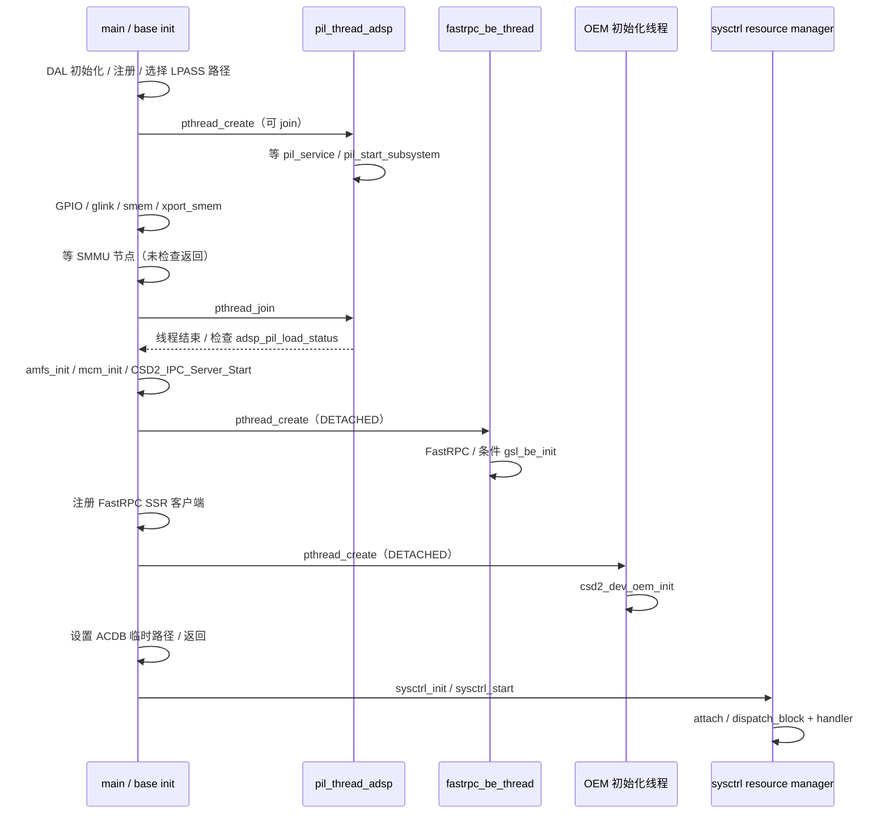

# 16.17 QNX AudioReach audio_service：服务装配与并行初始化

> [前篇：后端边界](16_16.16_QNX_audio_driver_vm_VM音频驱动层.md) · [本章导航](README.md) · [后篇：旧 AMS 入口](16_16.18_QNX_ams_lib_音频管理服务库.md) · [总导航](../README.md)

## 16.17.1 服务进程与处理库的分工

本页保留历史 audio_service_vm 文件名，正文改以 **audio_ar/audio_service** 为依据，适用于本地 Android 12L + SA8295 + QNX AudioReach 主线。旧文引用的另一套架构不再作为这里的启动流程。

服务的作用是装配进程级基础设施、启动有关子系统和后端，并让主线程进入 QNX resource manager 消息循环。GSL、GPR、CSD2 等库和后端线程可以处于这个服务进程中；**“main 不逐块处理 PCM”不等于“整个进程不参与数据路径”**。也不能把名为 audio_driver 的源码目录当作统一内核模块。

阅读时区分四种就绪：主进程已经启动、初始化调用返回、异步后端已能接入、DSP 图已可工作。它们没有一个通用布尔值可以代替。

主要依据：[main.c](../../Qnx/apps/qnx_ap/AMSS/multimedia/audio/audio_ar/audio_service/src/main.c)、[coreinit.c](../../Qnx/apps/qnx_ap/AMSS/multimedia/audio/audio_ar/audio_service/src/coreinit.c)。

## 16.17.2 main：权限、参数、后台化与常驻

main 的顺序是：请求 I/O 权限 → 注册 SIGTERM → 检查 `/dev/audio_service` → 解析参数 → `Resource_Daemonize()` → core init → sysctrl init/start。

- `ThreadCtl(_NTO_TCTL_IO, 0)` 失败走关键错误处理并返回失败；获得 I/O 权限不改变进程的用户态属性。
- “已有实例”检查是 `0 < open(DEVICE_NAME, O_RDONLY)`，不是 `>= 0`。它遗漏合法 fd 0，也不是原子锁；检查与后来 attach 之间仍有时间间隔。未打开节点也可能是权限/其他错误，不能一概等同于“没有服务”。
- SIGTERM handler 记录后直接 `exit(0)`，此处未执行逐图 stop/close 等显式清理序列；不能称作可靠的优雅关机协议。
- `audio_service_core_init()` 在调用 base 之前就置静态 `inited=1`，失败后未回退；不是可随时重试且不会留下部分初始化的通用单例。

| 参数/条件 | 当前 AR main 的行为 |
|---|---|
| `-f <path>` | 复制 LPASS 配置路径；重复指定先释放上次字符串，传给 base/PIL 线程使用 |
| `-v` | v 计数增加，但启用 slog2 且 v 非零时统一设置 `QCLOG_DEBUG2`；不是每多一个 v 提升一级 |
| `-h` | 打印 usage、释放已分配路径后成功退出；已有实例检查发生在它之前 |
| `-U <ids>` | 只有环境 `SECPOL_ENABLE` 首字符为 `1` 才调用 set_ids_from_arg，失败退出；不是无条件降权 |
| 未识别参数 | switch 的 `?`/default 只 break，没有在此统一返回错误 |

后台化实现位于 [dll_utils_i.h](../../Qnx/apps/qnx_ap/AMSS/platform/qal/clients/dll_utils/public/amss/core/dll_utils_i.h)：`Resource_Daemonize()` 调 `procmgr_daemon`，保留 umask/文件描述符，非空 LOG_TO_CONSOLE 再影响标准流处理；返回值被忽略。调用发生不等于已确认后台化成功。

## 16.17.3 base init：哪些步骤并行，哪些真正等待？

`audio_service_base_init()` 的编排不是旧文所述的 APR/SMMU/VAPM 同步链：



### PIL 是一个有结果检查的并行阶段

PIL 线程先 `waitfor("/dev/pil_service", 5000, 0)`，设置线程名/优先级，再调用 `pil_start_subsystem(config_path, "adsp")`。其中日志虽然写着 `skip pil_start_subsystem for lpass`，**实际仍有调用**；不能从日志文字删掉这一箭头。

主线程同时配置 GPIO、初始化 glink/smem/xport_smem，并等待 `/dev/smmu/STCU/HLOS_AUDIO1`。这些 waitfor 及若干初始化返回值没有在这里检查。随后 `pthread_join(adsp_tid, NULL)`，再用 `adsp_pil_load_status` 判断 PIL 调用是否成功；失败使 base 返回 DAL_ERROR。等待动作、节点出现和 PIL 结果仍是不同事实。

### 后两条线程不构成全后端就绪屏障

主线程继续 AMFS、MCM、CSD2 IPC Server，再把线程属性设为 `PTHREAD_CREATE_DETACHED`。FastRPC/backend 与 OEM 初始化都是分离线程，创建失败会使 base 返回错误，但创建成功后不 join、不收集线程函数结果。

FastRPC 线程的调用片段：

```c
rc = adsp_fastrpc_init();
if(rc){
    LOG(QCLOG_ERROR,"FastRPC Init failed");
}
```

之后 `ENABLE_AUDIO_BACKEND` 条件块仍调用 `gsl_be_init()`，所以 FastRPC 失败不必然阻止后端初始化尝试。`adsp_fastrpc_init()` 对相应 fastrpc_qnx_init 有有限重试，随后注册默认 listener；ENABLE_MDF 下还有另一处理域分支。它不是“任何初始化错误都立即退出，绝无重试”的模型。

[gsl_be.c](../../Qnx/apps/qnx_ap/AMSS/multimedia/audio/audio_ar/audio_driver/gsl_be/src/gsl_be.c) 中 `gsl_be_init()` 建立会话队列/锁、注册 CSD2 SSR 客户端并创建后端 service task。这里的 `gsl_init(NULL)` 是注释，不是实际调用。QNX 初始 GSL/数据库由 CSD2 CGM 等路径承担，见 [16.6](16_16.6_ACDB校准体系.md)；VM INIT 又有自己的语义，见 [16.7](16_16.7_ACDB校准数据Android与QNX双域共享.md)。

### 路径也是资源，不能只检查文件名

默认 LPASS 路径来自编译宏 `combpath(ifs_base, /etc/lpass_cfg)`，`-f` 可作为线程参数覆盖。环境 `ifs_base` 存在时，代码在 else 块内创建 `char lpass_cpath[64]`，将其地址交给块外静态指针使用：

```c
char lpass_cpath[64]={0};
pLPASS_CONFIG_PATH= lpass_cpath;
snprintf(pLPASS_CONFIG_PATH,sizeof(lpass_cpath) ,"%s/etc/lpass_cfg", pifs_base);
```

块结束后该数组生命周期已结束，后续日志/线程使用存在悬空指针风险。显式 `-f` 的堆字符串在正常路径随 PIL join 完成后由 main 释放，但这不能修复环境分支之前的无效路径访问。这里是静态源码问题，未运行、未复现崩溃，也不修改产品代码。

## 16.17.4 `/dev/audio_service` 是控制资源，不是 PCM 设备

[sysctrl.c](../../Qnx/apps/qnx_ap/AMSS/platform/utilities/sysctrl/src/sysctrl.c) 检查已初始化上下文后调用 [sysctrl_service.c](../../Qnx/apps/qnx_ap/AMSS/platform/utilities/sysctrl/src/sysctrl_service.c) 的 `start_service()`：建立 dispatch、设置 connect/io handlers、以字符设备属性 attach 名字，再进入循环。

真实循环中的关键行：

```c
dispatch_handler(ctp);
```

它前面的 `dispatch_block()` 阻塞接收消息，失败会返回；不是“永远不会失败或返回”的保证。这里的 message buffer 大小设置为 2048、nparts_max 为 1，不能把它当作所有音频 PCM 传输块的上限。

- open 使用标准 iofunc_open_default；OCB 在相应分配/释放回调中管理。
- write 默认验证请求、获取客户端 euid，再将命令字符串交 `dispatch_rm_command_ex()`；它不是 `gsl_write()` 的音频样本通道。存在用户自定义 write hook 时可走另一分支。
- devctl 先走默认处理；没有注册用户 udevctl 时返回 ENOSYS。注册 handler 不等于内置了所有音频控制指令。
- 通用 sysctrl 有 ACL/字符设备属性；不能由此声明全部音频数据与跨 VM 权限策略已经受此节点统一控制。

本地 start_service 还存在 `strlcpy(dev_name, device_name, strlen(device_name))` 的长度传参，可能使复制名字少最后一个字符；默认 write 中 dispatcher 返回值未决定写入计数。应区分 attach 的名字、命令解析使用的名字和写入返回，不靠节点存在证明命令效果。

main 不接收 sysctrl_start 的返回值，若它返回则进入“意外退出”关键错误处理后返回 EXIT_SUCCESS；因此也不能仅用进程退出码概括资源管理器启动的完整结果。

## 16.17.5 SSR：监听器重建不等于音频图已恢复

`adsp_frpc_ssr_init()` 通过 `csd2_open(CSD2_MODULE_TYPE_SSR, ...)` 获取 handle，再用 CSD2_CMD_REG_GLOBAL_EVENT 注册回调。open 失败只记录，仍继续 ioctl；base 又未检查该辅助函数返回值，所以 base 成功不证明 SSR 注册成功。

收到 CSD2_GLOBAL_EVENT_AUDIO_SVC_DN 时清本地标志；UP 时进入 `adsp_frpc_ssr_handling()`：先 deregister 默认 listener，再重新 FastRPC 初始化/注册；ENABLE_AMFS 时调用 AMFS SSR 处理。UP 分支自己设置标志后立即检查，不是要求先见过一次 DN 的严格配对机。

这一逻辑与 GSL 的 graph ERROR、VM 后端 reset_only 清理分工不同：listener 重建、映射恢复、客户端重新 open/start、重新送入 PCM 都有各自责任。不能沿用“AR 服务 SSR 全是空桩”，也不能反向声称它自动重放了中断音频。

## 16.17.6 构建条件与观察问题

[service common.mk](../../Qnx/apps/qnx_ap/AMSS/multimedia/audio/audio_ar/audio_service/common.mk) 给出 GSL/GPR/ACDB/AR OSAL/CSD2 IPC 等链接输入。[s8295-ar-qvmhost Makefile](../../Qnx/apps/qnx_ap/AMSS/multimedia/audio/audio_ar/audio_service/aarch64/o-le-s8295-ar-qvmhost/Makefile) 声明 ASIC_8295、CSD2/MCM 变体，并在工具链匹配 HYP710 或 QHS220 时定义 AUDIO_HYP710/ENABLE_AUDIO_BACKEND，加入 gsl_be/avmm/uhab。

这些证据支持进程装配与条件分析，不是实机服务启动、镜像安装或所有链接符号均被使用的证明。本批没有运行服务、修改设备或注入 SSR。

| 观察阶段 | 应核对的证据 | 不能自动推出 |
|---|---|---|
| main 启动 | I/O 权限、参数/环境、后台化与 core 返回 | DSP 已加载 |
| PIL 阶段 | join、adsp_pil_load_status、实际 pil 调用结果 | FastRPC 已就绪 |
| 分离线程创建 | 各线程自身日志与初始化 rc | 主线程成功即后端成功 |
| resource manager | attach/dispatch 状态 | HAB 已连、GSL 图已 start |
| SSR UP | 注册是否成功、listener 重建返回、后续图操作 | 中断数据已恢复或安全音频隔离已验证 |

后续沿 [18.2 VM backend](../18_AGM_GSL_Architecture/18_18.2_GSL跨VM控制与缓冲区.md) → [18.3 宿主 GSL](../18_AGM_GSL_Architecture/18_18.3_GSL图生命周期与DSP命令.md) → [16.19 GPR](16_16.19_QNX_apr_lib_APR协议库.md) 阅读，分别看进程内工作线程、图操作与传输完成。
