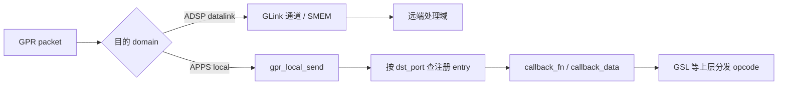
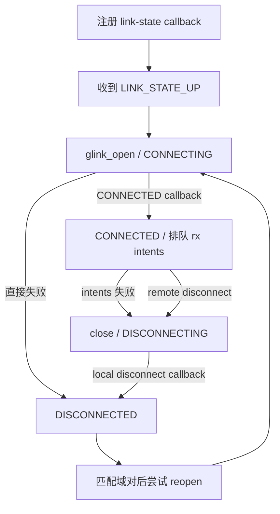
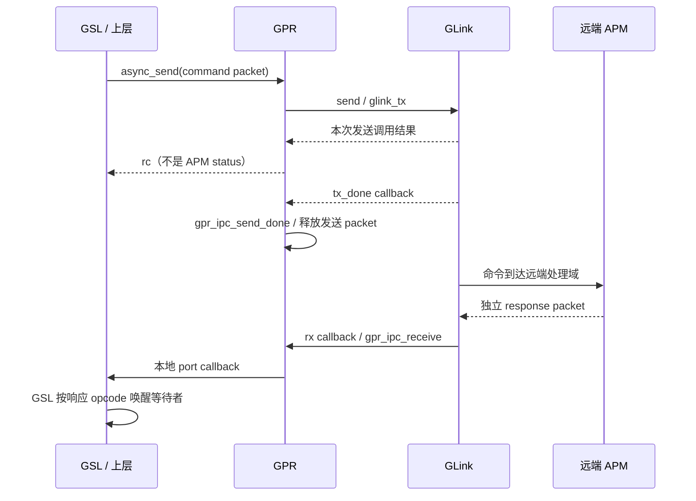

# 16.19 AudioReach GPR/GLink：路由、连接与报文所有权

> [上一节：图管理入口](16_16.18_QNX_ams_lib_音频管理服务库.md) · [本章导航](README.md) · [下一节：A2B](16_16.20_QNX_audio_a2b_A2B总线音频.md) · [总导航](../README.md)

## 16.19.1 为什么这个历史 APR 文件现在讲 GPR？

保留旧文件名以维持链接；本地 Android 12L + SA8295 + QNX AudioReach 主线中，GSL 使用 **GPR（Generic Packet Router）**。旧文的 APR 库、APR 地址/域编号与调用接口不直接作为这里的底层协议。本文不展开 Elite。

[18.3](../18_AGM_GSL_Architecture/18_18.3_GSL图生命周期与DSP命令.md) 已解释 GSL 怎样发 APM 命令、等 basic response 和接收数据完成。这里再下一层：GPR 怎样选择投递方向、分发本地回调，GLink 怎样建立连接，以及谁释放 packet。**GLink 发送完成、APM 应答、PCM buffer DONE 与声学完成不是一件事。**

源码入口为 [QNX GPR](../../Qnx/apps/qnx_ap/AMSS/multimedia/audio/audio_ar/audio_driver/audio_reach/gpr/)。虽然文件叫 gpr_drv 或包含 island 字样，这些符号也被 QNX 服务链接使用；命名本身不证明内核或 DSP 执行域。

## 16.19.2 两级寻址，不是把所有标识塞进 token

[gpr_packet.h](../../Qnx/apps/qnx_ap/AMSS/multimedia/audio/audio_ar/audio_driver/audio_reach/gpr/api/gpr_packet.h) 的包头具有独立的源/目的 domain、源/目的 port、token 与 opcode。

| 字段/名称 | 作用 |
|---|---|
| `dst_domain_id` | 选择目的域对应的 datalink 函数表 |
| `src_domain_id` | 标明来源；释放 datalink 来包时也用于选择归还通道 |
| `dst_port` | 本地域投递时查注册的 module/session entry |
| `src_port` | 发送方的回调/路由身份，如 GSL graph 的源端口 |
| `opcode` | 命令、应答或事件的类型；业务解释属于 APM/GSL 等上层 |
| `token` | 上层自行赋义的关联信息；GSL 数据路径可用为 buffer 索引，普通图控制并不统一按它排队 |
| GLink `port_name` | 建立域间通道的名字，如 `adsp_apps`；不是上面的整数 GPR port |



GPR 不决定 BUS/Zone 路由，也不根据 token 调整音量。domain 是处理域，不是车载音区；port 是报文接收实体，不是物理扬声器端口。

## 16.19.3 QNX 平台到底选择了什么？

[platform/qnx/gpr_init_wrapper.c](../../Qnx/apps/qnx_ap/AMSS/multimedia/audio/audio_ar/audio_driver/audio_reach/gpr/platform/qnx/gpr_init_wrapper.c) 指定 APPS 为本地域；datalink 表中的两个有效条目为：

```c
{GPR_IDS_DOMAIN_ID_ADSP_V,ipc_dl_glink_init, ipc_dl_glink_deinit},
{GPR_IDS_DOMAIN_ID_APPS_V,ipc_dl_local_init,ipc_dl_local_deinit},
```

包装层还给出 100 个 512 字节、4 个 4096 字节的 packet pool 参数。旧式 internal init 将其转成两个静态池，并设置相应域共享内存支持标志；通用 v2 实现另能处理动态池。**这里的 pool 是 GPR 报文资源，不是 PCM period、最大音频流数量或吞吐量测试。**

[common.mk](../../Qnx/apps/qnx_ap/AMSS/multimedia/audio/audio_ar/audio_driver/audio_reach/gpr/common.mk) 选择：

- `core/src/array_based` 的本地端口注册实现，不是同目录另一套 hash 实现。
- `target/cmn` 的 GLink 域对表，不是看到 slate 文件就认为当前在用 slate。
- 定义 `audioss_proc`，源码据此不启用 GPR_GLINK_QOS_SUPPORT。不能把条件代码中的 550us QoS 请求写成本目标已启用，更不能写成实测端到端延迟。

[glink_port_info_cmn.c](../../Qnx/apps/qnx_ap/AMSS/multimedia/audio/audio_ar/audio_driver/audio_reach/gpr/datalinks/gpr_glink/src/target/cmn/glink_port_info_cmn.c) 的 APPS/ADSP 条目使用 `apss`、`lpass` 和 `adsp_apps`。通用表含其他域对不等于 QNX wrapper 全部初始化了它们。

## 16.19.4 注册与本地投递：回调表不是音频会话池

[core/src/gpr_drv.c](../../Qnx/apps/qnx_ap/AMSS/multimedia/audio/audio_ar/audio_driver/audio_reach/gpr/core/src/gpr_drv.c) 的 `__gpr_cmd_register()` 调 register_v2，以 src_port 注册 callback 和上下文。这里的 session entry 是**GPR 接收端注册记录**，不是 AGM session_obj 或 GSL graph。

[array_based/gpr_session.c](../../Qnx/apps/qnx_ap/AMSS/multimedia/audio/audio_ar/audio_driver/audio_reach/gpr/core/src/array_based/gpr_session.c) 在线性槽表中检查重复 port、寻找空位；重复注册失败，满表也失败，不是无限增长。先分配 node 后找槽的满表失败分支没有释放该 node，是静态资源风险，不是已做内存测试。

[core/src/gpr_drv_island.c](../../Qnx/apps/qnx_ap/AMSS/multimedia/audio/audio_ar/audio_driver/audio_reach/gpr/core/src/gpr_drv_island.c) 的 `gpr_local_send()` 在 task lock 内找 entry，释放锁后调用回调。因此“register/deregister 有锁”不自动保证任意并发注销都能等所有在途回调结束。注销 wrapper 还忽略 gpr_deinit_session 的返回，不能把注销返回 EOK 当成之前一定注册过。

本地投递没有强制创建独立 worker：回调可以在触发投递的上下文中发生。上层需要自行控制阻塞、重入和生命周期；GSL 的控制 signal 分组见 [18.3](../18_AGM_GSL_Architecture/18_18.3_GSL图生命周期与DSP命令.md)。

## 16.19.5 GLink：注册 link 回调、open、connected 是三个阶段

实现：[gpr_glink.c](../../Qnx/apps/qnx_ap/AMSS/multimedia/audio/audio_ar/audio_driver/audio_reach/gpr/datalinks/gpr_glink/src/gpr_glink.c)。

1. ipc_dl_glink_init 保存 GPR 的 receive/send_done callbacks，初始化 port 状态，读取域对表，调用 gpr_glink_init，并返回 send/receive_done vtable。
2. gpr_glink_init 为匹配的域对注册 link-state callback，transport 设为 SMEM；**不是此时就已经打开并连上通道**。
3. link-state callback 只在 UP 时查表并调用 gpr_glink_open。open 配置 notify_rx/tx_done/tx_abort/state 等回调，先设 CONNECTING，再调用 glink_open；直接失败改回 DISCONNECTED。
4. 收到 GLINK_CONNECTED 后设 CONNECTED，再排队接收 intents；默认有 128/512/1024/4096 字节四组。任一组失败会 close 并转 DISCONNECTING。
5. gpr_glink_tx 只有 CONNECTED 才发送，否则 `AR_ENOTREADY`。连接中 open 的重复调用可直接 EOK，不能作为“连接完成”的确认。



这是回调处理路径，不是无条件恢复保证。gpr_glink_init 即使注册 link callback 失败也只记日志后 EOK；ipc_dl_glink_init 又未传播 gpr_glink_init 返回。因此 **GPR 初始化成功不能证明 link callback 已注册或远端已连接**。

远端断开触发 close，本地断开回调尝试重开；源码不展示通用指数退避/请求重放或旧 GSL graph 自动重建。close 也不立即证明所有异步通知已排空。

## 16.19.6 发送 packet：先转移所有权，再等传输层回收

`__gpr_cmd_async_send()` 从目的域取 send 函数。若包属于 GPR 静态池，先把 metadata owner 标成目的 port，再调用 datalink；立即发送失败则恢复源 port。它不自行等待 APM 执行结果。

GLink send 使用 `glink_tx(..., buf, buf, size, GLINK_TX_REQ_INTENT)`。第一次 buf 作为传输私有信息，另一个是报文地址；返回只描述此发送调用的结果。



图只强调两类回调不同，不规定 tx_done 与业务应答在所有运行中的绝对先后。tx_done 后原命令包可能已回收，上层若还需要原 opcode 等信息应在发送前保存；GSL helper 正是如此。传输 abort 的处理又不同，会调用 end_command 报错/释放，不等于成功处理。

`gpr_ipc_send_done()` 检查接收参数中的长度与 packet header 大小，再 `__gpr_cmd_free()`。这里与 receive 函数都先从 packet 取 header、再判断 NULL，不能将其描述成完整的空指针/恶意包防护；本篇没有做错误注入。

## 16.19.7 接收 packet：谁归还 GLink 的接收资源？

GLink rx callback 调 `gpr_ipc_receive(buf, size)`，后者核对长度，再经 `__gpr_cmd_async_send()` 重新按目的域分发，通常进入本地 port callback。回调可将 response packet 暂交给 GSL 等待线程；此时不能由 GLink callback 无条件立即归还。

统一 free 的职责依来源而变：

| packet 来源 | `__gpr_cmd_free()` 的处理 |
|---|---|
| GPR 静态池 | 清 owner metadata，归还 memq |
| GPR 动态分配池 | 查动态分配记录，释放并减相应计数 |
| datalink 接收内存 | 按 `src_domain_id` 找 `receive_done`，归还给 datalink |

真实 datalink 归还摘录：

```c
return local_gpr_ipc_dl_table[domain_id].fn_ptr->receive_done(domain_id, (void *)packet);
```

对 GLink 就是 `gpr_glink_rx_done()` → `glink_rx_done(..., TRUE)`，不是普通 free。该函数要求端口 CONNECTED，否则返回 AR_ENOTREADY；断连时释放路径也有条件，不应称作不可能失败的资源回收。

正常 GSL basic response 由 signal 暂存 packet，等待者消费/释放后才沿以上路径归还；数据完成事件可能由 graph/datapath callback 更早消费。**GPR 报文内存回收不释放客户端 PCM 映射，也不证明数据已播出。**

### 错误路径必须连着读

- gpr_ipc_receive 的内部分发失败会尝试 free，但函数末尾仍 EOK；返回不能原样代表业务投递成功。
- 端口不存在时 default callback 调 `__gpr_cmd_end_command()`，后者会尝试按 opcode 类型生成失败应答并释放原包；default callback 随后返回 AR_ENOTREADY。外层 receive 失败分支又 free 原包，存在重复归还/释放风险；不把通用错误出口写成总是正确的所有权协议。
- end_command 对 response/event 不再生成 basic response，但仍释放原包；不是所有来包都无条件“回一个错误应答”。

以上是静态源码路径，未证明某一运行必然出现损坏，也不在本次文档维护中修改产品实现。

## 16.19.8 排查时逐层提出问题

1. **初始化**：QNX wrapper 装配了哪些域，common.mk 选择哪个 target/session 实现？
2. **连接**：link-state 注册、UP、open 返回、CONNECTED、rx intents 是否分别成功？
3. **投递**：目的 domain 是否有 send 函数，目的 port 是否注册，callback 是否仍有效？
4. **资源**：发送池是否耗尽，接收包是否完成归还，断连时 receive_done 是否失败？
5. **业务**：是否收到 APM basic response/GSL 数据完成，其 status 是什么？不要用 tx_done 替代它。
6. **音频效果**：回到图、端点、PCM 和设备侧证据，不从 GPR 包投递成功推导声音正常。

本篇止于可见 GPR/GLink API 与适配实现；未验证底层 SMEM/中断/DMA 硬件、实时性或跨 VM 隔离。与之相邻的 [16.17 服务装配](16_16.17_QNX_audio_service_vm_VM音频服务.md)、[18.2 HAB](../18_AGM_GSL_Architecture/18_18.2_GSL跨VM控制与缓冲区.md)、[18.3 GSL](../18_AGM_GSL_Architecture/18_18.3_GSL图生命周期与DSP命令.md) 分别解释不同边界。
