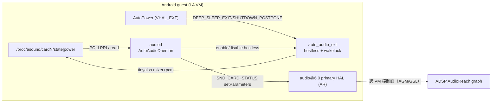

# 16.2 auto-audiod 守护进程

> [前篇：16.1 概述](16_16.1_概述.md) · [本章导航](README.md) · [后篇：16.3 AutoPower与VHAL集成](16_16.3_AutoPower与VHAL集成.md) · [总导航](../README.md)

> 定位：Android guest 里的 vendor 守护进程 `audiod`。它监听 ADSP 声卡的 online/offline 与电源状态，按需拉起/拆除 hostless TDM 会话，并在声卡状态变化时把 `SND_CARD_STATUS` 通知给 audio HAL。它**不产生业务音频**，也不是 QNX 侧 audio_service（见 [16.17](16_16.17_QNX_audio_service_vm_VM音频服务.md)）；"收到通知" 更不等于 "音频已恢复"。

源码：`vendor/qcom/proprietary/mm-audio-auto/auto-audiod/`（`auto_audiod_main.cpp`、`AutoAudioDaemon.cpp/.h`、`auto_audio_ext.cpp/.h`、`Android.mk`），约 2000 行。

## 16.2.1 进程定位与编译开关

init 脚本把它注册为 vendor 服务，用户 `system`，额外组 `wakelock` 并带 `BLOCK_SUSPEND` 能力——这解释了后文电源 worker 为什么能用 wakelock：

```rc
service audiod /vendor/bin/audiod
    class main
    user system
    group system wakelock
    capabilities BLOCK_SUSPEND
```

> 源码：`device/qcom/msmnile_gvmq/init.target.rc`

`main()` 很短：把进程优先级调到 `ANDROID_PRIORITY_AUDIO`，写两枚 boot KPI 标记，然后**直接在主线程调用** `audiod->threadLoop()`——这个类没有继承 Thread、没有起 Binder 线程池，所谓 "daemon" 就是一个 while(1) 轮询循环：

```cpp
AutoAudioDaemon *audiod = new AutoAudioDaemon();
place_marker("M - Auto Audio Daemon created...");

if (!audiod)
    return 1;

if (!audiod->threadLoop())
    return 1;
```

> 源码：`vendor/qcom/proprietary/mm-audio-auto/auto-audiod/auto_audiod_main.cpp`

是否编译由产品配置决定，且 AR 树的开关带 **HYP 门控**（`msmnile_au.mk:90-95` 逐字）：

```make
ifneq ($(ENABLE_HYP),true)
AUDIO_FEATURE_ENABLED_AUTO_AUDIOD := true
AUDIO_FEATURE_ENABLED_SND_MONITOR := false
else
AUDIO_FEATURE_ENABLED_SND_MONITOR := true
endif
```

本产品主线 `device/qcom/msmnile_gvmq/msmnile_gvmq.mk` :23 设 `ENABLE_HYP := true`（经 `audio_ar_vendor_product.mk` 引入）——即 **HYP 主线下 audiod 不编译，改置 SND_MONITOR := true**；只有非 HYP（ENABLE_HYP≠true）配置才编入 audiod。`Android.mk` 内部再固定打开三组宏，行为矩阵如下：

| 宏 | 本平台 | 带来的行为 |
|---|---|---|
| `AHAL_EXT`（AUDIO_HAL_EXT） | 开 | 链接 audio@6.0 HIDL；`notifyAudioDevice()`/HAL 死亡重连被编译进来 |
| `VHAL_EXT`（VEHICLE_HAL_EXT） | 开 | 编入 `AutoPower.cpp`；**不再打开/轮询 `/proc/asound/cardN/power`**，电源信息改由 VHAL 提供（见 [16.3](16_16.3_AutoPower与VHAL集成.md)） |
| `LINUX_ENABLED` | 关 | 仅 Linux guest（LV）变体：改用 alsa-lib、跳过 power 节点监控 |
| `SILENT_BOOT_ENABLED` | 需产品另配 | 编入静默模式监视线程（见 [16.4](16_16.4_Silent_Boot监控.md)），否则 `auto_audio_ext_silent_boot_monitor_start()` 展开为空 |

> 这些宏写在 `vendor/qcom/proprietary/mm-audio-auto/auto-audiod/Android.mk` 的模块内变量里，当前文件里是硬编码的 `true`；换产品时以各自 configs 目录的 `.mk` 为准。

构造函数只做两件事：`auto_audio_ext_init()`（分配全局状态、初始化 wakelock fd），以及 `VHAL_EXT` 下 `new AutoPower()`——后者构造即启动自己的 VHAL 连接线程。

## 16.2.2 声卡发现：getSndCardFDs()

`/proc/asound/cards` 每张卡占两行，解析时用 `line++ % 2` 跳过第二行；第一行里先后用 `strtok_r` 切出卡号和 `[...]` 中的卡名，然后按前缀过滤：

```cpp
//Only consider sound cards associated with ADSP
if ((strncasecmp(card_id, "msm", 3) != 0) &&
    (strncasecmp(card_id, "apq", 3) != 0) &&
    (strncasecmp(card_id, "sa", 2) != 0)) {
    ALOGD("Skipping non-ADSP sound card %s", card_id);
    continue;
}
```

> 源码：`vendor/qcom/proprietary/mm-audio-auto/auto-audiod/AutoAudioDaemon.cpp`

三个要点：

1. **前缀过滤只是名字约定**。"msm/apq/sa 开头 = ADSP 卡" 是本地枚举习惯，不是对底层驱动的验证；USB 声卡、虚拟卡都会被跳过。
2. 每张入选卡打开两个只读 fd：`/proc/asound/cardN/state`（必开，开失败则跳过该卡）和 `/proc/asound/cardN/power`（仅当**未定义** `LINUX_ENABLED` 且**未定义** `VHAL_EXT` 时才打开；开失败会关掉 state fd 并跳过该卡）。
3. 发现即调用 `auto_audio_ext_set_snd_card(snd_card)`，但在 Android（非 LINUX_ENABLED）分支里它只记录卡号，**并不打开 mixer**——mixer 要等主循环里 `bootup_complete` 或重启路径才由 `auto_audio_ext_open_mixer()` 打开（重试 1000 次 × 10ms）。

## 16.2.3 主循环 threadLoop()：状态轮询

主循环前半是重试发现：最多 100 次 × 100ms 等声卡出现；一张都没有就 `goto thread_exit`，此时 `threadLoop()` 返回 **true**，`main()` 返回 0——即 "没找到声卡" 表现为进程正常退出（依赖 init 按需重启），不是崩溃。发现成功后先启动 Silent Boot 监视（[16.4](16_16.4_Silent_Boot监控.md)）。

`VHAL_EXT` 打开时（本平台）没有电源 worker，主循环直接进入 `poll()`：

```cpp
pfd[i].fd = mSndCardFd[i].state;
pfd[i].events = POLLPRI;
```

对 sysfs 属性节点，`POLLPRI` 在节点内容变化时触发；醒来后 read 8 字节、`lseek` 复位、`strstr` 判 `ONLINE`/`OFFLINE`。状态处理围绕两个**跨卡共享**的变量（均为函数/文件级，不是 per-card）：

- `bootup_complete`（文件级 static）：首次看到 ONLINE 时置 1，开 mixer、拉起 hostless，此后才允许 OFFLINE→disable 的对称处理。
- `prev_state`（函数局部）：与 `cur_state` 比较决定是否动作。

```cpp
if (!bootup_complete && (cur_state == SND_CARD_ONLINE)) {
    bootup_complete = 1;
    ALOGV("sound card bootup completed");
    auto_audio_ext_open_mixer(mSndCardFd[i].snd_card);
    auto_audio_ext_enable_hostless(mSndCardFd[i].snd_card);
}
prev_state = cur_state;
```

> 源码：`vendor/qcom/proprietary/mm-audio-auto/auto-audiod/AutoAudioDaemon.cpp`。其上方的 `if (bootup_complete && (prev_state != cur_state))` 分支按 ONLINE/OFFLINE 对称调用 enable/disable，并在 AHAL_EXT 下穿插 `notifyAudioDevice()`。

### audiod 自身重启分支

进入 poll 前，主循环还读一次 `vendor.audio.audiod.started` 属性（仅非 LINUX_ENABLED 编译）：若已是 `true`，说明**audiod 进程自身重启**了（内核声卡状态可能一直 ONLINE，`POLLPRI` 不会再触发），于是直接：置 `bootup_complete=1`、`audioRestartNoti=true`、开 mixer、读一次 state，ONLINE 则对所有卡 `enable_hostless`，并向 HAL 补发一次通知。首次启动则把属性置 `true`。

静态观察（不修产品代码，仅记录）：

- 属性分支写在初始化 `pfd` 的 for 循环体内，其中嵌套的 `for (i = ...)` **复用了外层循环变量 `i`**，"重启 + 多卡" 组合下外层迭代会被打断——这是可复核的源码事实，实际影响取决于部署卡数。
- `prev_state`/`bootup_complete` 跨卡共享：两张卡交错变化时，先变化的卡会把共享状态 "带走"，另一张卡的状态迁移可能被判定为 "无变化" 而不处理。
- poll 返回 -1 会 break 出主循环，随后 join worker、`putSndCardFDs()` 关 fd，`threadLoop()` 仍返回 true。

## 16.2.4 电源 worker 线程（仅非 VHAL_EXT 构建）

`VHAL_EXT` 关闭的构建里，每张卡再起一个 `workerThread`，阻塞 `read()` `/proc/asound/cardN/power`（sysfs 语义：内容变化才返回），读到 `D0`/`D3hot` 并与上次比较，变化时**还要再看 state 节点是否 ONLINE** 才决定动作：

```cpp
if (prev_power_state != cur_power_state) {
    if (cur_power_state == POWER_D3hot) {
        if (isSndCardOnline(localFDs))
            auto_audio_ext_disable_hostless(localFDs->snd_card);
    }
    else if (cur_power_state == POWER_D0) {
        /* read snd card state */
        if (isSndCardOnline(localFDs))
            auto_audio_ext_enable_hostless(localFDs->snd_card);
    }
}
```

> 源码：`vendor/qcom/proprietary/mm-audio-auto/auto-audiod/AutoAudioDaemon.cpp`

- 处理期间用 `wakelock_acquire()/release()`（引用计数实现，写 `/sys/power/wake_lock`、`wake_unlock`）防止休眠打断半途；`read()` 返回 EINTR（系统冻结中）的分支会**不持 wakelock** 直接 disable hostless 并把 prev 置 D3hot。
- 本平台（VHAL_EXT 开）这段代码不编译；电源事件改走 [16.3](16_16.3_AutoPower与VHAL集成.md) 的 VHAL 订阅，两条路径互斥，不要同时假设两者存在。

## 16.2.5 hostless 会话：auto_audio_ext 的启用/拆除

`auto_audio_ext_enable_hostless(card)` 是全篇最 "厚" 的函数，但它做的事可以分成三层：

1. **路由混音**：`mixer_ctl_set_value` 把平台表里的 port mixer 打开。msmnile 平台两张表项：

| 会话 | mixer 控件 | 值 | TX PCM | RX PCM |
|---|---|---|---|---|
| MERC | `SEC_TDM_RX_7 Port Mixer TERT_TDM_TX_7` | 1 | 49 (`TERT_TDM_TX_HOSTLESS`) | 48 (`SEC_TDM_RX_HOSTLESS`) |
| A2B | `QUAT_TDM_RX_7 Port Mixer QUIN_TDM_TX_7` | 1 | 53 (`QUIN_TDM_TX_HOSTLESS`) | 50 (`QUAT_TDM_RX_HOSTLESS`) |

源码注释解释了动机：ADP 硬件上 TERT/SEC TDM 的 CLK/FSYNC 同时接到 CODEC，需要一个单主提供时钟，dummy hostless 在系统启动时就把 TERT→SEC 驱动起来。**这是该参考硬件的接线说明，不能推广成任意板级的接线事实。**

2. **拉起 PCM**：固定参数（1ch/48kHz/240 帧 period/2 period/S16_LE），对表中的 TX/RX 设备号各做 `pcm_open`（未 ready 重试 1000×10ms）+ `pcm_start`：

```cpp
struct pcm_config pcm_config = {
    .channels = 1,
    .rate = 48000,
    .period_size = 240,
    .period_count = 2,
    .format = PCM_FORMAT_S16_LE,
    .start_threshold = 0,
    .stop_threshold = INT_MAX,
    .avail_min = 0,
};
```

3. **记账与回滚**：每张卡的 `hostless[i].enable` 标志防止重复拉起；任一步失败按 `for (j = i; j >= 0; j--)` 回滚已开的 pcm 并把 mixer 控件清 0。`disable_hostless` 则关 pcm、清路由、清标志。

`enable_hostless_all()/disable_hostless_all()` 只对**已开 mixer** 的卡循环调用——AutoPower 的电源回调用的正是这两个 `_all` 版本（[16.3](16_16.3_AutoPower与VHAL集成.md)）。

边界提醒：`enable` 标志是 audiod 的本地记账，`pcm_start` 成功也只是内核侧 PCM 进入运行态；hostless 是否真正出声取决于 TDM/CODEC/DSP 整链，audiod 既不校验也不感知。

## 16.2.6 notifyAudioDevice()：向 HAL 通知声卡状态

`AHAL_EXT` 下，状态迁移还会通过 audio@6.0 HIDL 转发给 primary HAL：

```cpp
if (type == SND_CARD_STATE) {
    key = "SND_CARD_STATUS";
    snprintf(buf, sizeof(buf), "%d", snd_card);
    value = buf;
    if (status == SND_CARD_ONLINE)
        value += ",ONLINE";
    else
        value += ",OFFLINE";
}
```

> 源码：`vendor/qcom/proprietary/mm-audio-auto/auto-audiod/AutoAudioDaemon.cpp`。随后把键值装进 `hidl_vec<ParameterValue>`，调用 `mDevice->setParameters(NULL, hidlParams)`。

> 源码：`vendor/qcom/proprietary/mm-audio-auto/auto-audiod/AutoAudioDaemon.cpp`

机制分层：

- `getDeviceInstance()` 先 `IDevicesFactory::getService()` + `linkToDeath`，再 `openPrimaryDevice()`；失败按 100×100ms 重试，重试用尽就放弃本次通知。
- HAL 死亡时 `handleAudioHalDeath()` 清空两个 `sp<>` 重连；**重连成功不等于重发状态**——主循环只有下一次 `POLLPRI` 事件或 `audioRestartNoti` 才会再调 `notifyAudioDevice`。
- HIDL 调用要区分两层结果：`Return<void> ret.isOk()`（transport 层）与回调里的 `Result r`（HAL 层）；本函数对两者失败统一按 `FAILED_TRANSACTION` 处理重试。
- 参数键 `SND_CARD_STATUS` 在 AR 版 HAL 侧的公共定义见 `vendor/qcom/opensource/audio-hal-ar/primary-hal/hal-pal/audio_extn/audio_defs_ar.h`。**发出 setParameters 只证明 "投递到了 HAL 入口"**：AR HAL 是否以及如何把该事件转成 PAL/AGM 层的恢复动作，是 [15.10](../15_PAL_Architecture/15_15.10_HAL-PAL适配层架构.md) 与 [18.2](../18_AGM_GSL_Architecture/18_18.2_GSL跨VM控制与缓冲区.md) 的主题，不在本页断言。

## 16.2.7 与 AudioReach 主线的关系



- audiod 是 **ADSP 声卡状态的旁观者与 hostless 看护者**：业务音频（媒体/通话/提示音）完全不经它。
- 声卡 offline 后的真正恢复链（HAL 感知→PAL/AGM 重建 graph→DSP 重开）在 HAL/PAL/GSL 各层各自处理，`SND_CARD_STATUS` 只是其中一路通知。
- 与 QNX 侧 SSR 监听（[16.17](16_16.17_QNX_audio_service_vm_VM音频服务.md)）互不隶属：那是 host VM audio_service 的职责，两者观察的是同一颗 ADSP 的不同侧面。

## 16.2.8 调试与静态观察清单

- 日志 tag：`AutoAudioDaemon`/`AutoAudioDaemonMain`/`auto_audio_ext`；boot KPI 标记写 `/sys/kernel/boot_kpi/kpi_values`（`place_marker` 在 main 与 auto_audio_ext 各有一份实现，符号名相同但链接为不同实体，源码可复核）。
- 快速判断构建形态：有无 `AutoPower` 日志（VHAL_EXT）、有无 `Opening sound card power`（非 VHAL_EXT 电源 worker）、`silent boot monitor` 是否出现（SILENT_BOOT_ENABLED，[16.4](16_16.4_Silent_Boot监控.md)）。
- 已记录的静态事实（非运行验证）：0 卡时 `threadLoop()` 返回 true、`main()` 退出码 0；`prev_state`/`bootup_complete` 跨卡共享；重启属性分支复用外层循环变量 `i`；`putSndCardFDs()` 在非 VHAL 构建下统一 `close(power)`（fd 可能未初始化的路径只被 `continue` 覆盖）。
- 本页所有结论来自源码静态阅读：**没有**执行过 audiod、没有读写 `/proc/asound` 与电源节点、没有验证过实际声卡行为。

| 层次 | 本页能证明 | 本页不能证明 |
|---|---|---|
| 源码 | 分支、重试次数、通知键名、设备号表 | 编译产物与部署形态 |
| 运行 | — | 声卡真实 online/offline、hostless 出声、HAL 是否消费通知 |

## 本节小结

audiod 用约两千行代码做了三件小事：**发现**（前缀过滤 + state/power fd）、**看护**（条件拉起/回滚 hostless TDM 会话）、**转告**（HIDL setParameters 通知 HAL）。理解它的价值在于分清 "声卡状态事件"、"hostless 会话存在" 和 "音频链路恢复" 三个层次——下一节看电源事件如何从 VHAL 进入同一套 hostless helper。

---

[← 16.1 概述](16_16.1_概述.md) · [本章导航](README.md) · [16.3 AutoPower与VHAL集成 →](16_16.3_AutoPower与VHAL集成.md) · [总导航](../README.md)
