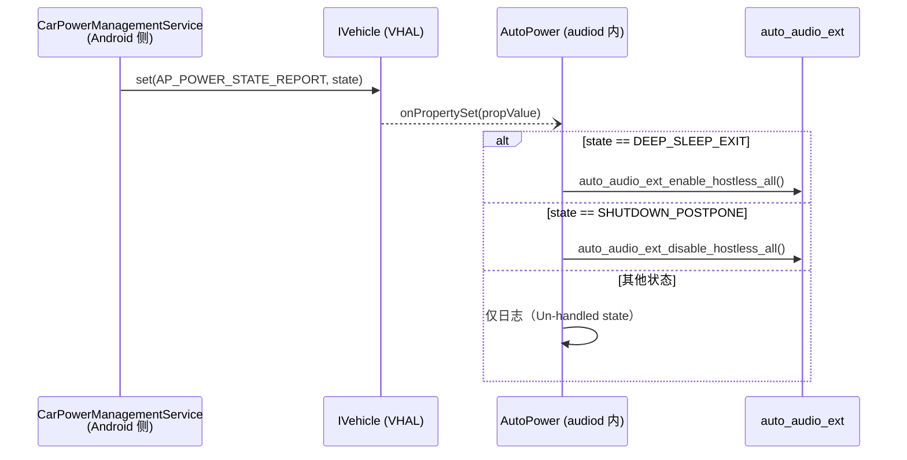

# 16.3 AutoPower 与 VHAL 集成

> [前篇：16.2 auto-audiod守护进程](16_16.2_auto-audiod守护进程.md) · [本章导航](README.md) · [后篇：16.4 Silent Boot监控](16_16.4_Silent_Boot监控.md) · [总导航](../README.md)

> 定位：`AutoPower` 是 audiod 进程内的一个 VHAL 客户端对象（`VHAL_EXT` 编译分支，见 [16.2](16_16.2_auto-audiod守护进程.md)）。它订阅**唯一一个**车机属性 `AP_POWER_STATE_REPORT`，收到其中两个状态时对 hostless 会话做整体开关。它不是电源管理服务、不是 VHAL 实现，更不参与音频数据面。

源码：`vendor/qcom/proprietary/mm-audio-auto/auto-audiod/AutoPower.cpp` 与同目录 `AutoPower.h`（合计约 250 行）。VHAL 接口定义在 `hardware/interfaces/automotive/vehicle/2.0/`（`IVehicle.hal`、`IVehicleCallback.hal`、`types.hal`）。

## 16.3.1 为什么 audiod 需要它

非 VHAL 构建里，audiod 靠每卡一个 worker 线程阻塞读 `/proc/asound/cardN/power` 感知电源（[16.2 §16.2.4](16_16.2_auto-audiod守护进程.md)）。`VHAL_EXT` 构建删掉 power 节点监控，电源信息改由 Android 标准车辆栈上报：CarService 侧的 `CarPowerManagementService`（`packages/services/Car/service/src/com/android/car/power/CarPowerManagementService.java`）通过 VHAL `set()` 上报电源状态，订阅方在 `onPropertySet()` 回调里收到。

于是 AutoPower 的职责收敛为一句话：**把一个电源上报属性，翻译成 hostless 会话的整体开/关**。



## 16.3.2 对象与线程模型

`AutoPower` 实现 vehicle 2.0 的 `IVehicleCallback` 三个回调；自身只有两个成员：`sp<IVehicle> mVehicle` 与一个死亡通知对象。构造函数**立即**创建线程，不等第一次事件：

```cpp
rc = pthread_create(&tid, &attr, AutoPower::audiod_service_task_fn, this);
pthread_setname_np(tid, thread_name);
if (rc)
    ALOGE("%s failed to create audiod service task thread, rc: %d", __func__, rc);
```

> 源码：`vendor/qcom/proprietary/mm-audio-auto/auto-audiod/AutoPower.cpp`

- 线程名 `AUDIOD_SERVICE_TASK_FN`；attr 未设 detach，默认 joinable，且无人 join——线程与进程同生命周期。
- 该线程体 `audiod_service_task_fn` 只做一件事：重试 `initVehicle()`，最多 100 次 × 100ms；构造函数本身**不检查**线程创建结果对功能的影响（只打日志）。静态观察：`AutoPower` 由 `AutoAudioDaemon` 构造函数 `new` 出来后没有额外引用持有，但线程持 `this` 指针运行，对象实际随进程存活。

## 16.3.3 initVehicle()：订阅什么、怎么算成功

```cpp
mVehicle = IVehicle::getService();
if (mVehicle != 0) {
    mVehicle->linkToDeath(mVehicleHalDeathRecipient, 0 /*cookie*/);
} else {
    ALOGE("Failed to obtain IVehicle service");
    return FAILED_TRANSACTION;
}

options.setToExternal(reqVehicleProperties, arraysize(reqVehicleProperties));
status = mVehicle->subscribe(this, options);
if (status != StatusCode::OK) {
    ALOGE("%s: Subscription to vehicle notifications failed with status %d",
        __func__, status);
    return FAILED_TRANSACTION;
}
```

> 源码：`vendor/qcom/proprietary/mm-audio-auto/auto-audiod/AutoPower.cpp`

订阅表只有一项，且 flags 指明了事件来源方向：

```cpp
static SubscribeOptions reqVehicleProperties[] = {
    {
        .propId = AP_POWER_STATE_REPORT,
        .flags = SubscribeFlags::EVENTS_FROM_ANDROID
    },
};
```

两个必须分清的层次：

1. **`EVENTS_FROM_ANDROID`（0x2）**：只收 Android 侧调用 `IVehicle#set()` 产生的事件——即 CarPowerManagementService 对电源状态机的**上报回声**。它不是监听车端请求（`AP_POWER_STATE_REQ` 是另一个属性，本类不订阅），也不是监听 VHAL 内部值变化。
2. **HIDL 分层**：`getService()` 失败返回空指针；`subscribe()` 是同步返回 `StatusCode`。两者都映射为本函数的 `FAILED_TRANSACTION`，由外层重试循环消化。回调本身（`onPropertySet`）是 `oneway`，transport 失败不会在这条链上同步反馈。

注意一个静态事实：`subscribe` 失败时 `mVehicle` 已经非空并已 `linkToDeath`，函数却返回失败——重试下一轮 `if (mVehicle == 0)` 为假，**直接跳过重新订阅**，只剩日志里 "Subscription ... successful" 不会出现、且永远走不到。也就是说订阅失败后，AutoPower 持有一条看似健康的连接但收不到任何事件；直到 VHAL 死亡触发重连才有机会重新订阅。这是可从源码直接读出的路径，值得在排查 "无电源回调" 时优先核对。

## 16.3.4 onPropertySet()：状态分发

回调拿到 `VehiclePropValue` 后读出属性号、状态、参数三个 int32，只认 `AP_POWER_STATE_REPORT`：

```cpp
if (property == AP_POWER_STATE_REPORT)
{
    switch (state)
    {
    case REPORT_DEEP_SLEEP_ENTRY:
        ALOGD("%s: DEEP_SLEEP_ENTRY", __func__);
        break;
    case REPORT_DEEP_SLEEP_EXIT:
        ALOGD("%s: DEEP_SLEEP_EXIT", __func__);
        auto_audio_ext_enable_hostless_all();
        break;
    case REPORT_SHUTDOWN_POSTPONE:
        ALOGD("%s: SHUTDOWN_POSTPONE", __func__);
        auto_audio_ext_disable_hostless_all();
        break;
    default:
        ALOGW("%s: Un-handled state %d", __func__, state);
        break;
    }
}
```

> 源码：`vendor/qcom/proprietary/mm-audio-auto/auto-audiod/AutoPower.cpp`

对应 vehicle 2.0 `VehicleApPowerStateReport` 的枚举值（`types.hal`）：`WAIT_FOR_VHAL`、`DEEP_SLEEP_ENTRY`、`DEEP_SLEEP_EXIT`、`SHUTDOWN_POSTPONE`、`SHUTDOWN_START`、`ON`、`SHUTDOWN_PREPARE`、`SHUTDOWN_CANCELLED` 等都已在文件头部 `#define` 展开，但 switch 只处理两项：

| 上报状态 | audiod 动作 | 含义 |
|---|---|---|
| `DEEP_SLEEP_EXIT` | `auto_audio_ext_enable_hostless_all()` | 从深睡唤醒，重新拉起全部 hostless |
| `SHUTDOWN_POSTPONE` | `auto_audio_ext_disable_hostless_all()` | 关机被推迟的窗口期，先拆 hostless |
| 其余（含 `ON`、`DEEP_SLEEP_ENTRY`、`SHUTDOWN_START`…） | 无动作 | 依赖 16.2 的声卡状态路径处理 |

选这两项是有逻辑的：`DEEP_SLEEP_ENTRY`/`SHUTDOWN` 全程 ADSP 可能掉电重启，声卡 offline 事件（16.2 主循环）会负责拆除；而深睡唤醒时声卡可能始终 ONLINE（`POLLPRI` 不触发），必须靠这条 VHAL 事件补拉起；`SHUTDOWN_POSTPONE` 则是关机流程里 "业务已停但系统还活着" 的窗口。不过**这是从两个动作反推的设计意图**，源码没有注释直接说明，阅读时保持 "两个已编译事实 + 一个合理解释" 的分层。

另外两个回调基本是空操作：`onPropertyEvent()` 只打属性数量（订阅方向决定了常规事件不走它）；`onPropertySetError()` 明确注释 "我们不 set 值，所以不关心 set 错误"。

## 16.3.5 死亡与重连

```cpp
mVehicle->unlinkToDeath(mVehicleHalDeathRecipient);
mVehicle = NULL;
int retryCount = 0;

ALOGI("%s: Reconnecting to IVehicle", __func__);
do {
    if (initVehicle() == OK) {
```

> 源码：`vendor/qcom/proprietary/mm-audio-auto/auto-audiod/AutoPower.cpp`（节选，重试环与 16.3.2 相同）。注意 `DEEP_SLEEP_ENTRY` 只打日志、无动作，与上表一致。

`serviceDied()` → `handleVehicleHalDeath()`：解绑死亡通知、清空 `mVehicle`，然后沿用与初始化相同的 100×100ms 重试环。要分清三件事：

- **重连成功 ≠ 状态追平**。VHAL 恢复后不会重放死亡期间错过的上报；hostless 当前状态与最新电源状态可能不一致，直到下一次状态迁移。
- **死亡回调线程**：`hidl_death_recipient` 回调在 HIDL 内部线程触发，重连循环（最长 10 秒）在该线程上进行；期间 `mVehicle` 已置空，新的 `onPropertySet` 不可能到达。
- **无重试上限后的兜底**：100 次耗尽只打 "Init vehicle fail" 并跳出循环，AutoPower 从此空转（无定时器、无重启机制），需要进程级重启才能恢复订阅。

## 16.3.6 与 hostless helper 的衔接

`auto_audio_ext_enable_hostless_all()/disable_hostless_all()`（实现在 `vendor/qcom/proprietary/mm-audio-auto/auto-audiod/auto_audio_ext.cpp`）遍历 8 个卡槽位，**只处理已开 mixer 的卡**：

```cpp
for (i = 0; i < MAX_SND_CARD; i++) {
    if (!g_auto_audio->snd_card[i].mixer)
        continue;
    ret = auto_audio_ext_enable_hostless(i);
```

> 源码：`vendor/qcom/proprietary/mm-audio-auto/auto-audiod/auto_audio_ext.cpp`

所以 VHAL 事件要真正生效，前置条件是 16.2 的发现/`open_mixer` 流程已完成（`snd_card` 槽位已记录、mixer 已打开）。enable 版本在任一卡失败时会按 `j >= 0` 反向回滚已处理的卡（disable 对未 enable 的会话是幂等跳过）。与单卡版本一样，`_all` 也只是 audiod 的本地记账 + tinyalsa 调用，是否出声仍由整条 TDM/CODEC/DSP 链决定。

## 16.3.7 边界与排查清单

AutoPower **不是**：

- 电源管理服务——Android 侧状态机在 `CarPowerManagementService`，VHAL 实现在车辆 HAL（本仓库未含其实现源码，勿从本类反推）；
- `AP_POWER_STATE_REQ` 的处理者——它不监听请求方向，也不 set 任何属性；
- 声卡/音频恢复的执行者——它只搬动 hostless 会话（[16.2 §16.2.5](16_16.2_auto-audiod守护进程.md)）。

排查 "audiod 对电源事件无反应" 时按序核对（全部为静态可查项，无需实机）：

1. 构建形态：`VHAL_EXT` 是否定义（无 `AUDIOD_SERVICE_TASK_FN` 日志即未编入）。
2. `Init vehicle OK` 是否出现；出现后是否有 `Subscription to vehicle notifications successful`——只看到前者说明命中 §16.3.3 的 "已连接未订阅" 路径。
3. `onPropertySet` 的 `Un-handled state` 日志说明收到了上报但状态不在两项之内。
4. `IVehicle Died`/`IVehicle Reconnected` 判断是否处于重连空转。
5. `_all` 无效时检查对应卡槽位的 mixer 是否已打开（回到 16.2 的发现与 bootup 流程）。

| 层次 | 本页能证明 | 本页不能证明 |
|---|---|---|
| 源码 | 订阅属性与 flags、两个动作、重试与重连路径 | — |
| 部署 | — | VHAL 实现是否在运行、上报值序列 |
| 运行 | — | hostless 是否随事件真实起停、有无出声 |

## 本节小结

AutoPower 用最小的面积完成一次 "属性→动作" 翻译：一条订阅、两个状态、两行调用。它的教学价值在于练习区分**订阅成功/事件到达/动作生效**三层，以及识别 "连接健康但订阅失败" 这类只在重连后才自愈的路径。静默启动监听（[16.4](16_16.4_Silent_Boot监控.md)）则示范另一种内核节点事件源。

---

[← 16.2 auto-audiod守护进程](16_16.2_auto-audiod守护进程.md) · [本章导航](README.md) · [16.4 Silent Boot监控 →](16_16.4_Silent_Boot监控.md) · [总导航](../README.md)
