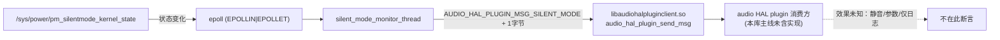

# 16.4 Silent Boot 监控

> [前篇：16.3 AutoPower与VHAL集成](16_16.3_AutoPower与VHAL集成.md) · [本章导航](README.md) · [后篇：16.5 audio-chime早期提示音](16_16.5_audio-chime早期提示音.md) · [总导航](../README.md)

> 定位：audiod 内一个**可选编译**的监视线程，观察内核节点 `/sys/power/pm_silentmode_kernel_state`，在静默模式状态变化时通过 `libaudiohalpluginclient` 把一个 `AUDIO_HAL_PLUGIN_MSG_SILENT_MODE` 消息发给 audio HAL plugin。它不解析音频、不直接静音任何东西——"消息已发出" 与 "静默模式已生效" 之间隔着整个 plugin/HAL 的实现，本页不跨越这条线。

源码：`vendor/qcom/proprietary/mm-audio-auto/auto-audiod/auto_audio_ext.cpp` 的 `SILENT_BOOT_ENABLED` 段与 `auto_audio_ext.h` 的宏开关；plugin 消息定义在 `vendor/qcom/opensource/audio-hal/primary-hal/hal/audio_hal_plugin.h`。

## 16.4.1 编译开关：先问 "有没有编进来"

`Android.mk` 只有在产品配置 `AUDIO_FEATURE_ENABLED_SILENT_BOOT := true` 时才加 `-DSILENT_BOOT_ENABLED` 并引入头文件路径（见 `vendor/qcom/proprietary/mm-audio-auto/auto-audiod/Android.mk`）。没定义时，头文件把入口函数直接变成空操作：

```c
#ifndef SILENT_BOOT_ENABLED
#define auto_audio_ext_silent_boot_monitor_start() (0)
#else
void auto_audio_ext_silent_boot_monitor_start(void);
#endif
```

> 源码：`vendor/qcom/proprietary/mm-audio-auto/auto-audiod/auto_audio_ext.h`

主线要特别注意**配置来源**：`AUDIO_FEATURE_ENABLED_SILENT_BOOT` 出现在**非 AudioReach** 的 `vendor/qcom/opensource/audio-hal/primary-hal/configs/msmnile_au/msmnile_au.mk`（第 136 行）；本知识库主线的 `vendor/qcom/opensource/audio-hal-ar/primary-hal/configs/msmnile_au/msmnile_au.mk` 打开了 `AUDIO_FEATURE_ENABLED_AUTO_AUDIOD`，但未见定义 SILENT_BOOT 相关开关。因此在 AR 主线产品上，`threadLoop()` 里那句 `auto_audio_ext_silent_boot_monitor_start()` 很可能展开为 `(0)`——**不启动任何线程**。判断一台具体设备时，应以其实际编译配置为准，而不是假设本节功能存在。

两种形态对照：

| 形态 | `SILENT_BOOT_ENABLED` | 行为 |
|---|---|---|
| 未定义（AR 主线默认推断） | 否 | 启动调用是 no-op，无日志、无线程 |
| 已定义（需显式配置） | 是 | threadLoop 声卡发现成功后启动监视线程 |

## 16.4.2 启动入口与单例保护

启动点在 [16.2](16_16.2_auto-audiod守护进程.md) 主循环开始轮询之前：声卡发现成功 → `auto_audio_ext_silent_boot_monitor_start()`。函数本身用静态标志 + 互斥锁保证单实例：

```c
pthread_mutex_lock(&silent_boot_lock);
if (!is_monitor_running) {
    ALOGD("%s: starting silent boot monitor", __func__);
    is_monitor_running = true;
    ret = pthread_create(&silent_boot_tid, NULL,
                         &silent_mode_monitor_thread, NULL);
    if (ret) {
        ALOGE("%s: Failed to create silent boot monitor thread", __func__);
        return;
    }
    pthread_detach(silent_boot_tid);
    ALOGD("%s: Silent boot monitor started", __func__);
}
pthread_mutex_unlock(&silent_boot_lock);
```

> 源码：`vendor/qcom/proprietary/mm-audio-auto/auto-audiod/auto_audio_ext.cpp`

静态观察（源码可复核，非运行结论）：`pthread_create` 失败分支在**持锁状态下直接 return**，`silent_boot_lock` 永不解锁——后续任何调用都会阻塞在入口。线程创建成功则 detach，与进程同生命周期；线程退出时自己把 `is_monitor_running` 清回 false，因此监视线程若异常退出，下一次 start 仍可重新拉起（前提是锁还可用）。

## 16.4.3 监视线程：一条"内核节点 → HAL plugin"的传送带

`silent_mode_monitor_thread` 按顺序准备四样东西，任何一步失败都直接走出口（节点 fd、plugin 句柄、epoll 实例三者分别清理，`dlclose` 归还插件）：

1. `open("/sys/power/pm_silentmode_kernel_state", O_RDONLY)`；
2. `dlopen("libaudiohalpluginclient.so", RTLD_NOW)`；
3. `dlsym` 取 `audio_hal_plugin_send_msg` 函数指针；
4. `epoll_create1` + `epoll_ctl(ADD, EPOLLIN | EPOLLET)`。

```c
ev.events = EPOLLIN | EPOLLET;
ev.data.fd = silent_mode_fd;
ret = epoll_ctl(silent_mode_epoll_fd, EPOLL_CTL_ADD,
                silent_mode_fd, &ev);
```

> 源码：`vendor/qcom/proprietary/mm-audio-auto/auto-audiod/auto_audio_ext.cpp`

随后进入 `epoll_wait(-1)` 循环。被唤醒后用 `fetch_silent_mode_status()` 读状态：

```c
lseek(silent_mode_fd, 0, SEEK_SET);
bytes_read = read(silent_mode_fd, (void*)&buf, sizeof(unsigned char));
if (bytes_read < 0) {
    ALOGE("%s: Error reading silent mode file: %s", __func__,
            strerror(errno));
}
else
    *curr_silent_mode = buf - '0';
```

> 源码：`vendor/qcom/proprietary/mm-audio-auto/auto-audiod/auto_audio_ext.cpp`

三个值得记住的细节：

- **单字节 ASCII 解析**：节点内容按 `字符 - '0'` 换算，隐含 "状态是一位数字（如 '0'/'1'）" 的约定；读到其他内容会得到无意义值，但不报错。
- **边缘触发 + 无首读**：`EPOLLET` 只在状态**变化**时唤醒，线程启动时不主动读一次初值。`prev_silent_mode` 初始化为 `(uint8_t)-1`、`curr` 为 0，因此第一次真实变化必然触发通知；但也意味着 "启动时的初始静默状态" 永远不会被上报——消费方若想知道初值，得自己查询。
- **变化检测而非状态广播**：`curr != prev` 才发消息，连续两次相同状态不重复通知。

## 16.4.4 通知边界：消息发出之后发生什么

状态变化时的动作只有一行：

```c
hal_plugin_send_msg(AUDIO_HAL_PLUGIN_MSG_SILENT_MODE,
              &curr_silent_mode, sizeof(curr_silent_mode));
```

> 源码：`vendor/qcom/proprietary/mm-audio-auto/auto-audiod/auto_audio_ext.cpp`

边界要划清楚：

- `AUDIO_HAL_PLUGIN_MSG_SILENT_MODE` 只是 `audio_hal_plugin.h` 里的一个枚举值（注释 `/**<set silent boot mode */`）。**它触发什么——改 HAL 参数、切 graph、还是仅仅记日志——由 plugin 与 HAL 侧实现决定**，那部分实现不在 auto-audiod，也不在本知识库主线（AR 版 hal-pal 树）的源码范围内，本页不做推断。
- `libaudiohalpluginclient.so` 是 dlopen 的预装库（同库也被早期提示音应用 audio-chime 使用，见 [16.5](16_16.5_audio-chime早期提示音.md)）；`dlsym` 失败同样安静退出。
- 消息载荷是 4 字节（`sizeof(curr_silent_mode)`），其中有效的是单字节状态值。
- 发送方不等待结果、不重试、不确认：这是一条 "火后不管" 的单向通知。



## 16.4.5 静态观察与排查清单

已记录的源码事实（非运行验证）：

- `epoll_wait` 返回 -1 时判断 `if (errno == -EINTR)`：`errno` 是非负值而 `-EINTR` 是负常数，该条件**永远为假**，信号中断会直接 break 出循环、线程退出（`is_monitor_running` 复位，可被再次 start 拉起）。
- 读节点失败（`fetch_silent_mode_status` 返回负值）同样 break；即一次读错误就放弃监视。
- 出口路径对未初始化的句柄都有判空清理；`dlclose` 在 fd 关闭之后。
- 线程名未设置（不像 AutoPower 线程有 `AUDIOD_SERVICE_TASK_FN` 命名），排查时靠日志 tag `auto_audio_ext`。

排查 "静默模式无反应" 的静态顺序：

1. 确认 `SILENT_BOOT_ENABLED` 真的编进（见 §16.4.1 的配置来源问题——AR 主线默认可能整个不存在）；
2. 找 `starting silent boot monitor`/`Silent boot monitor started` 日志确认线程拉起；
3. `silent mode state change: N` 出现才算状态被识别；
4. 再往下游（plugin 是否收到、如何处理）已超出本仓库源码可回答的范围，转 HAL/plugin 侧排查。

| 层次 | 本页能证明 | 本页不能证明 |
|---|---|---|
| 源码 | 宏开关、线程流程、epoll 细节、消息名 | — |
| 部署 | — | 节点是否存在、plugin 库是否在镜像里、宏是否配置 |
| 运行 | — | 状态是否真的变化、消息是否被消费、静默是否生效 |

## 本节小结

Silent Boot 监控是一条很窄的传送带：一个内核节点、一个线程、一条单向消息。它最适合用来练习两件事——**先确认功能被编进产品**（AR 主线的配置里可能根本没有这个开关），以及**把 "通知已送达" 和 "效果已发生" 拆开对待**。至此，audiod 三件套（声卡状态 [16.2](16_16.2_auto-audiod守护进程.md)、电源事件 [16.3](16_16.3_AutoPower与VHAL集成.md)、静默模式）形成 Android guest 侧对 "音频可用性环境" 的完整观察面。

---

[← 16.3 AutoPower与VHAL集成](16_16.3_AutoPower与VHAL集成.md) · [本章导航](README.md) · [16.5 audio-chime早期提示音 →](16_16.5_audio-chime早期提示音.md) · [总导航](../README.md)
