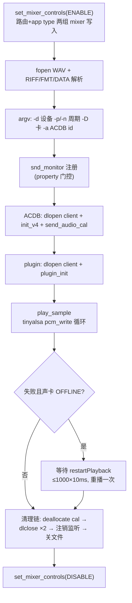

# 16.5 audio-chime 早期提示音

> [前篇：Silent Boot 监控](16_16.4_Silent_Boot监控.md) · [本章导航](README.md) · [后篇：ACDB 校准体系](16_16.6_ACDB校准体系.md) · [总导航](../README.md)

> 定位：一个 **948 行的单文件 C 应用**（`vendor/qcom/proprietary/mm-audio-auto/audio-chime/audio_chime_app.c`），绕过 AudioFlinger，用 tinyalsa 直接在指定 FEDAI 上播一个 WAV，并自带 ACDB 校准下发与最小 SSR 自恢复。它演示了 "业务音频栈尚未就绪时如何出声" 的全部要素，也留下多处硬编码可作教学样本。

## 16.5.1 启动证据链：谁、何时、播什么

本仓库内唯一能证明 "它被启动" 的证据在 **msmnile_au**（非本知识库主线的 msmnile_gvmq）的 init 脚本：

```rc
service audio_chime /vendor/bin/audio_chime /vendor/etc/bike_bell.wav
    class main
    user system
    group system wakelock
    capabilities BLOCK_SUSPEND
    oneshot
    disabled
```

> 源码：`device/qcom/msmnile_au/init.target.rc`。服务声明为 `disabled`，由前文 `on fs` 段的 `start audio_chime` 显式拉起。**主线 msmnile_gvmq 的 init.target.rc 没有这个服务项**——本平台是否使用 chime 由产品自行决定，不能从 "源码存在" 推断 "启动了"。

SELinux 侧（`device/qcom/sepolicy_vndr/qva/vendor/common/audio_chime.te`）补充了它的通信形态：允许 `vendor_acdb_loader_service` 与 `vendor_audio_hal_plugin_service` 的 binder 调用（vndbinder），读写 `audio_device`、写 KPI 节点。这说明下文的两个 "client" 库本质是 **vendor binder 客户端**，而不是本地实现。

## 16.5.2 main() 的一条链



注意顺序：**mixer 先于一切**——文件打不开也要先把路由配好（或者说配错时进程在文件检查前就退出了）；ACDB 与 plugin 都是 `RTLD_LAZY` dlopen 的可选增强，失败走 goto 清理；播放才是主体。

## 16.5.3 默认常量：一个 FEDAI 的全部身份

```c
/*Following are derived as the default values for the MULTIMEDIA23 FEDAI*/
#define DEFAULT_APP_TYPE_RX_PATH  69943
#define DEFAULT_OUTPUT_SAMPLING_RATE 48000
#define DEFAULT_ACDB_ID 60
#define MULTIMEDIA_FEDAI_ID 22
#define DEFAULT_BIT_WIDTH 16
#define DEFAULT_BACKEND_ID 87

/*Mixer control for FEDAI MULTIMEDIA23
  This needs to be modified by customers if the mixer control
  is different for them*/
#define MIXER_AUDIO_ROUTE "TERT_TDM_RX_0 Audio Mixer MultiMedia23"
#define MIXER_AUDIO_STREAM_APP_TYPE_CONFIG "Audio Stream 55 App Type Cfg"
#define MIXER_TYPE_CONFIG "App Type Config"
```

> 源码：`vendor/qcom/proprietary/mm-audio-auto/audio-chime/audio_chime_app.c`

这组宏给 "一条早期音频通路" 的四层身份：app type（69943）、ACDB 设备 id（60）、FEDAI/PCM（mixer 控件名 MultiMedia23、默认播放设备号 55，`MULTIMEDIA_FEDAI_ID 22` 用于 ACDB 调用参数）、后端（87，TERT_TDM_RX_0）。源码注释明说 "客户按自己的 mixer 改"——即这组值是参考硬件的默认，不是平台 ABI。

`set_mixer_controls()` 里还有一个易错点：它**硬编码 `card = 0`** 打开 mixer，而播放的卡号 `-D` 是另一个变量——两者可以不一致；以及成功路径**没有 `mixer_close`**（两次调用 enable/disable 各泄漏一个句柄，进程退出前无人回收）。均为源码可读的静态事实。

app type 写入是两组固定四元数组：

```c
    /*Apply the following as default values for FEDAI MULTIMEDIA23*/
    app_type_cfg[0] = DEFAULT_APP_TYPE_RX_PATH;
    app_type_cfg[1] = DEFAULT_ACDB_ID;
    app_type_cfg[2] = DEFAULT_OUTPUT_SAMPLING_RATE;
    app_type_cfg[3] = DEFAULT_BACKEND_ID;
    mixer_ctl_set_array(ctl, app_type_cfg, sizeof(app_type_cfg)/sizeof(app_type_cfg[0]));
```

> 源码：`vendor/qcom/proprietary/mm-audio-auto/audio-chime/audio_chime_app.c`（另一组 `App Type Config` 写 `[1, 69943, 48000, 16]`）

## 16.5.4 播放：WAV 解析与 play_sample

WAV 解析是教科书式 RIFF 遍历：校验 `RIFF`/`WAVE` 魔数，逐 chunk 找 `fmt `（读通道/采样率/位宽，超出 `struct chunk_fmt` 的部分 `fseek` 跳过）与 `data`（停止遍历）。`fread` 返回值一概未检查；`fmt` 缺失时用默认 2ch/48kHz/16bit。

`play_sample()` 先用 `pcm_params_get` 做硬件能力边界检查（率/通道/位宽/period），再 `pcm_open` → 循环 `fread`+`pcm_write`，`SIGINT` 置 `play_close` 优雅退出。循环条件是 `!play_close && num_read > 0`；`is_playback_complete` 只在 `pcm_write` 失败时置 false（供 SSR 回调判断是否需要重播）。位宽支持 16/24/32 三种格式枚举。

## 16.5.5 SSR 自恢复：snd_monitor 回调

整个 SSR 能力由三个布尔串起来的可选链：property 门控 → dlopen `libsndmonitor.so`（`RTLD_NOW`）→ dlsym 四个 `snd_mon_*` 函数 → 注册监听者（cookie 就是 `sample_data`）：

```c
rc = snd_mon_feature_init(property_get_bool("vendor.audio.feature.snd_mon.enable", false));
```

> 源码：`vendor/qcom/proprietary/mm-audio-auto/audio-chime/audio_chime_app.c`。其后依次是 `audio_chime_snd_mon_init()` 与 `audio_chime_snd_mon_register_listener(sample_data, chime_snd_mon_cb)`。三个布尔串起来的可选链：property 门控 → dlopen `libsndmonitor.so`（`RTLD_NOW`）→ dlsym 四个 `snd_mon_*` 函数 → 注册监听者（cookie 就是 `sample_data`）。

回调处理 `SND_CARD_STATUS` 键（格式 `卡号,ONLINE/OFFLINE`）——**与 audiod 通知 HAL 的参数键同名**（[16.2](16_16.2_auto-audiod守护进程.md) §16.2.6），说明这是平台约定的声卡状态词汇表，两个进程各自消费：

```c
    if(status == CARD_STATUS_ONLINE) {
        /*Configure mixer*/
        rc = set_mixer_controls(ENABLE_MIXER);
        if(rc != 0) {
            ALOGE("%s: failed to configure mixer post SSR\n", __func__);
            return;
        }
        if(is_acdb_init_done) {
            /*Send common custom topology to DSP post SSR*/
            if(sample_data->plt_data->acdb_send_common_top) {
                if(sample_data->plt_data->acdb_send_common_top() < 0)
                    ALOGE("%s: acdb did not set common topology\n", __func__);
            }
```

> 源码：`vendor/qcom/proprietary/mm-audio-auto/audio-chime/audio_chime_app.c`（节选，其后为 v6/v4 校准重发与 `restartPlayback` 置位）

主线侧再等回来：`play_sample` 失败且 `card_status == OFFLINE` 时，主循环以 10ms 步进等 `restartPlayback`（上限 1000 次 = 10 秒），被唤醒后**只重播一次**。源码里的 `ToDo` 注释坦承未做 "按绝对时间判断是否还值得播" 的完善。回调内部还有 `card_status` 去抖：状态未变化直接返回。

边界：`libsndmonitor.so` 如何得知声卡状态（轮询节点、监听 HAL 参数还是别的）在预装库内部，本仓库源码不含其实现；且主线 prebuilt 快照（`vendor/qcom/proprietary/prebuilt_HY11/target/product/msmnile_gvmq`）中能检索到 `libaudiohalplugin.so`，**未检索到** `libsndmonitor.so`/`libacdbloaderclient.so`——运行时可用性无法从静态证据确认，本节机制描述以源码为准。

## 16.5.6 ACDB 下发与 plugin 初始化

ACDB 段 dlopen `libacdbloaderclient.so` 后 dlsym 五个符号（`acdb_loader_init_v4`、`acdb_send_audio_cal_v4/v6`、`acdb_send_common_custom_topology`、`acdb_loader_deallocate_cal`），初始化入参里有一个如实记录的硬编码：

```c
        my_data->acdb_init_data.cvd_version = "2.4";
        my_data->acdb_init_data.snd_card_name = "sa6155-adp-star-snd-card";
        my_data->acdb_init_data.meta_key_list = &my_data->acdb_meta_key_list;
        my_data->acdb_init_data.is_instance_id_supported = &acdb_instance_id_support;
        rc = my_data->acdb_init_v4(&my_data->acdb_init_data, ACDB_LOADER_INIT_V4);
```

> 源码：`vendor/qcom/proprietary/mm-audio-auto/audio-chime/audio_chime_app.c`

`snd_card_name` 写的是 **sa6155** 参考板名，与 SA8295 平台命名不一致——源码如此，不美化。校准下发优先走 8 参数的 `acdb_send_audio_cal_v6(acdb_id, DEV_TYPE_OUT, 69943, 48000, 22, 48000, CAL_MODE_SEND, CAL_OFFSET_ASM_TOP)`，无 v6 符号时退到 v4。ACDB 语义（app type/ACDB id 与 graph 的关系）见 [16.6](16_16.6_ACDB校准体系.md)。

plugin 段只做 `dlopen` + `dlsym("audio_hal_plugin_init")` + 调用一次——**没有任何消息交互**。与 audiod 的 Silent Boot 监视（[16.4](16_16.4_Silent_Boot监控.md) 发送 `AUDIO_HAL_PLUGIN_MSG_SILENT_MODE`）对比：同一个 client 库，两种用法；chime 只需要 plugin 侧就绪（推测为其管理的通路做准备，源码无注释，不作断言）。

## 16.5.7 清理链与静态观察

`main()` 的出口是一串顺序标签：成功路径从 `play_sample` 之后自然落入 `close_pluginhandle:` → `free_myplugin:` → `close_acdbhandle:` → `free_mydata:` → `close_file:`（注销监听、deinit、`fclose`、free），最后落到 `disable_audio_route:` 标签处的 `set_mixer_controls(DISABLE)`——注意该标签**没有任何 goto 指向它**，只是顺位执行。错误路径的标签是跳跃的：例如 ACDB dlopen 失败 `goto free_mydata`，跳过了 `close_file`（文件句柄与 `sample_data` 留待进程退出回收）；calloc 失败分支同理。这些不构成运行期风险（进程将退出），但读代码时要明白标签链不是 "全量回滚"。

| 层次 | 本页能证明 | 本页不能证明 |
|---|---|---|
| 源码 | 单文件流程、常量表、mixer 双写、回调与重播逻辑 | — |
| 构建 | msmnile_au 有 rc 服务项 + sepolicy 域 | 主线 gvmq 是否实际使用 |
| 运行 | — | 声卡状态回调是否发生、ACDB 是否生效、是否真的出了声 |

排查要点（全静态可查）：`vendor.audio.feature.snd_mon.enable` 是否为 true；`early-audio-chime` tag 下的 `DLOPEN failed`/`DLSYM failed` 行定位缺哪个库；`M - Audio_Chime writing audio samples` KPI 标记（写 `/sys/kernel/boot_kpi/kpi_values`，与 audiod 的 `place_marker` 同一节点、各有一份实现）确认是否走到播放。

## 本节小结

audio-chime 把 "绕过音频框架直接出声" 需要的每一样东西都写在一个文件里：路由（mixer）、身份（app type/ACDB id）、校准（ACDB client）、容错（snd_monitor）、清理（goto 链）。它最适合作为 [16.2](16_16.2_auto-audiod守护进程.md) 的对照——audiod 监护声卡与 hostless，chime 则演示当框架缺席时，一个应用要自己扛下多少本该由框架承担的事。下一节回到校准体系本身。

---

[← 16.4 Silent Boot 监控](16_16.4_Silent_Boot监控.md) · [本章导航](README.md) · [16.6 ACDB 校准体系 →](16_16.6_ACDB校准体系.md) · [总导航](../README.md)
