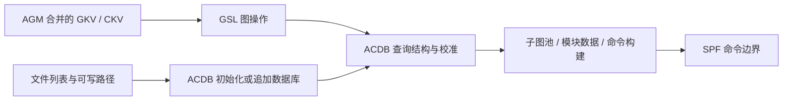
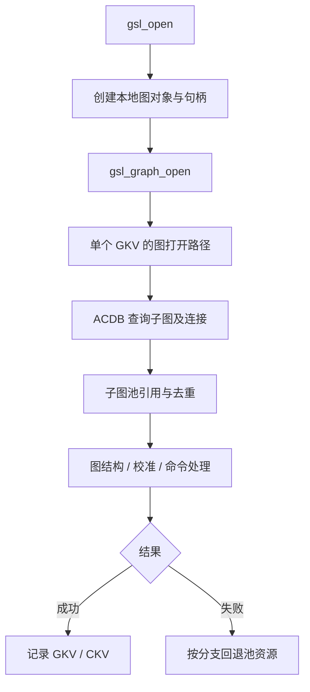

# 16.6 AudioReach 校准：从数据库文件到图与模块参数

[返回本章](README.md) | [AGM 会话与图](../18_AGM_GSL_Architecture/18_18.1_AGM会话与音频图.md) | [16.7 双域数据库加载](16_16.7_ACDB校准数据Android与QNX双域共享.md)

> 本文按本地 Android 12L/API 32、SA8295 AudioReach 源码解释。旧版以 `acdb-loader`、固定 ACDB device ID 和 `AGM_IOCTL` 串接主链的描述不适用于这里。本文不扩展 Elite，也不把文件存在、数据库注册成功或控制调用返回成功说成校准已在实机生效。

## 1. 校准到底在解决什么问题

PCM 的采样率/位宽/声道说明样本如何排列，却不能独自描述一条音频处理图：还需要知道哪些子图和模块连接、模块实例采用哪些参数、哪些端点和设备参与。AudioReach 中，ACDB 提供图及校准数据的查询能力，GSL 将查询结果与子图资源管理、SPF 命令结合。

这不是“PAL 为 speaker 找到一个固定数字，再把整份数据库推给 DSP”的同义改写。应分清四个阶段：

| 阶段 | 输入与产物 | 不代表什么 |
|---|---|---|
| 文件部署 | 构建规则选择数据库、workspace、可写路径 | 目标机已安装且可读 |
| 数据库初始化/追加注册 | 路径列表交给 ACDB，建立可查询数据库 | 每条音频图已创建 |
| 图与校准查询 | GKV/CKV/标签等换取图结构、参数和模块信息 | 所有设备都使用同一参数 |
| 图操作及参数应用 | GSL 组织命令并处理返回值 | 扬声器声学效果达到预期 |



图表示职责，不表示全部对象位于同一个进程。Android AGM 到预编译 `gsl_fe` 的调用，与 QNX 本地 GSL 实现的关系见 16.7。

## 2. GKV、CKV、TKV：不是三份相同的设备号

- **GKV（Graph Key Vector）**：一组 key/value，参与图选择。`gsl_acdb_get_graph()` 将 `num_kvps/kvp` 转为 `AcdbGraphKeyVector`，查询 `ACDB_CMD_GET_GRAPH`。
- **CKV（Calibration Key Vector）**：与图上下文配合选择校准。`gsl_open(gkv, ckv, handle)` 接受它；运行期间也有 `gsl_set_cal()` 路径，并非只有初始化时一次性读取。
- **TKV（Tag Key Vector）**：与 tag 相关的 key/value。GSL 有图的 tag KVs 查询、tagged modules 查询和 tag data 设置接口；不能把 tag、module ID、module instance ID、TKV 都缩写成一个“模块号”。

在 AGM 层，普通连接合并 session、session-AIF、device 三层 metadata；相同 GKV/CKV key 保留先出现的值。PAL/Session 如何准备这些 metadata、AGM 如何合并，见 [18.1](../18_AGM_GSL_Architecture/18_18.1_AGM会话与音频图.md)。这里的职责是说明合并结果如何成为数据库查询条件，而不是再复制一次 metadata 布局。

校准二进制里是否有某个 key、哪条曲线/滤波器适用于某个扬声器，需要查询数据及对应配置证明。不能从文件名 `acdb_cal.acdb` 推出“含所有设备且已全部加载”，也不能套用旧架构的 `SPEAKER_RX=15` 作为此处图选择的完整解释。

## 3. Android AGM 如何找到数据库目录

源码：`vendor/qcom/opensource/agm/service/Android.mk`、`vendor/qcom/opensource/agm/service/src/graph.c`、`vendor/qcom/opensource/agm/service/src/device.c`。

此处 `vendor/` 均相对源码根 `Android/lagvm/LINUX/android/`。

### 3.1 编译根路径加声卡派生后缀

`libagm` 的编译参数提供：

- `ACDB_PATH`：`/vendor/etc/acdbdata/`。
- `ACDB_DELTA_FILE_PATH`：`/data/vendor/audio/acdbdata/delta`。

`graph_init()` 先调用 `get_file_path_extn()`。后者读取声卡信息并有重试；识别到符合条件的 gvmauto、8295/8255、8155 名称时选 `ADP_AR`，其他分支可能拆解声卡名。不是看到产品名 SA8295 就不经过代码条件直接选路径。

成功后，普通示例路径为 `/vendor/etc/acdbdata/ADP_AR`；找不到有效声卡后缀，`graph_init()` 返回 `-ENOENT`，不是自动使用任意默认数据库。

组合目录用一个 50 字节静态数组及 `snprintf`，此处未检查截断返回值。应把“选择逻辑”与“目录名在现场是否完整、存在”分开。

### 3.2 目录扫描不是严格后缀验证

`get_acdb_files_from_directory()` 的实际筛选是子串匹配：

```c
if ((strstr(dentry->d_name, ".acdb") != NULL) ||
     (strstr(dentry->d_name, ".qwsp") != NULL)) {
```

因此 `.acdbdelta`、`.acdb` 后还有其他字符的名字也可能被选中；该循环没有先证明它们是普通文件。`.qwsp` 同样进入传给 GSL 的列表，不能绝对写成“workspace 仅 PC 使用，从不参与加载”。它在数据库内部承担的具体内容仍要看解析层。

这里还有几个会影响排障的实现细节：

1. `opendir()` 失败返回**正的** `EINVAL`，与后面路径格式失败的 `-EINVAL` 符号不同；不要把所有返回值统一画成同一种 errno 协议。
2. 零个匹配文件只记录日志，列表计数为 0，函数可返回 0；这不等于后续 ACDB 会接受空列表。
3. 遍历顺序来自 `readdir()`，此处没有排序规则。
4. 上限检查使用 `data_files->num_files`，但循环中增长的是 `i`，退出后才把 `i` 赋给 `num_files`。本调用将 `num_files` 初始设为 0，因此不能将该检查解释为已可靠限制每次入数组。gsl_fe 头定义的数组上限是 20；目录中匹配数量超限存在越界风险。这是静态发现，不是已做错误注入，也不修改产品代码。

### 3.3 文件列表、delta 与初始化参数分开

文件条目是 `fileNameLen` 加固定大小 `fileName[]`；列表是 `num_files` 加固定数组。gsl_fe 头路径：`vendor/qcom/proprietary/prebuilt_HY11/target/product/msmnile_gvmq/obj/include/mm-audio/gsl_fe/gsl_intf.h`。

普通扫描条目的长度用 `strlen()`；delta 字段却设置为 `strlen()+1`。不要在跨域协议示例中悄悄统一二者，掩盖调用侧差异。

`graph_init()` 最后准备：

```c
init_data.acdb_files = &acdb_files;
init_data.acdb_delta_file = &delta_file;
init_data.acdb_addr = 0x0;
init_data.max_num_ready_checks = 1;
init_data.ready_check_interval_ms = 1000;
ret = gsl_init(&init_data);
```

delta 字段传的是编译路径，不是这里解析并合并过的参数文件内容。`acdb_addr=0` 说明本调用走文件描述方式，不能解读为所有部署都使用内存镜像。ready check 的 1 和 1000 是接口输入，**不是测得的启动时延**，也不是必然 sleep 一秒。

`gsl_init` 非零结果经 `ar_err_get_lnx_err_code()` 转换；较早的目录错误并非都经过同一转换点。`graph_deinit()` 调用 `gsl_deinit()` 后直接返回 0，不能据此证明下层清理没有错误。

## 4. QNX 本地 GSL 与 ACDB 初始化做什么

QNX 源码：

- `Qnx/apps/qnx_ap/AMSS/multimedia/audio/audio_ar/audio_driver/audio_reach/gsl/src/gsl_main.c`
- `Qnx/apps/qnx_ap/AMSS/multimedia/audio/audio_ar/audio_driver/audio_reach/acdb/src/acdb.c`

这里解释的是**可见的 QNX 本地实现**，不是用它替代不可见的 Android `gsl_fe` 实现。

`gsl_init()` 先初始化 GPR，尝试数据日志，再将文件描述交给 ACDB：

```c
rc = acdb_init((AcdbDataFiles *)init_data->acdb_files,
    (AcdbFile *)init_data->acdb_delta_file);
```

随后初始化子图池、全局持久校准池、graph/锁/信号、MDF 与子系统状态、消息构建、动态模块及 RTC 等。ACDB 成功只是整个 GSL 初始化的一步；后续错误会进入不同清理分支。

`acdb_init()` 明确拒绝空指针或 `num_files==0`。有效输入转成内部路径列表，然后先执行 `ACDB_INIT_CMD_INIT`，再执行 `ACDB_INIT_CMD_ADD_DATABASE`。第二步失败会返回失败，不应把这两步理解为“无论文件如何都能用默认库”。

另外还有 `acdb_add_database()`，它直接执行 ADD_DATABASE 并返回数据库 handle，不重复执行完整 INIT。QNX 用它承接额外 GVM 数据库的路径，见下一篇。

## 5. 从查询到图操作：不是整库 memcpy 到 DSP

源码：`Qnx/apps/qnx_ap/AMSS/multimedia/audio/audio_ar/audio_driver/audio_reach/gsl/src/gsl_graph.c`。

`gsl_acdb_get_graph()` 的查询分两次：

1. 用 GKV 和空响应缓冲查询所需大小及子图信息。
2. 分配响应缓冲，再发 `ACDB_CMD_GET_GRAPH` 取数据。

```c
rc = acdb_ioctl(ACDB_CMD_GET_GRAPH, &cmd_struct, cmd_struct_size,
    &rsp_struct, rsp_struct_size);
```

这里的 `acdb_ioctl` 是用户态 ACDB C 函数及命令分发，不是因为名字含 ioctl 就能画出一个 Linux `AGM_IOCTL` 内核节点。

返回零大小/零子图是源码允许的情形，不一定是查询失败。`gsl_graph_open_single_gkv()` 随后把子图及连接加入池、去除不需再次打开的资源，再调用 `gsl_graph_open_sgids_and_connections()`；成功才把 GKV/CKV 更新到图节点。后者涉及模块数据、校准与命令构建，不能缩写成“一个文件等于一个 DSP graph”。

同一文件中还能看到 `ACDB_CMD_GET_SUBGRAPH_DATA`、非持久子图校准、全局持久校准和 `ACDB_CMD_GET_TAGGED_MODULES` 等不同查询。结构、校准、标签信息有不同输入输出，不应混写为一个自创 `loadCalibration(deviceId)` API。



这张图不替代 GPR/SPF 协议和设备端点的后续学习，也不证明某份校准在目标扬声器上生效。

## 6. 修改校准与调音通道不要混为一谈

可见接口区分：

- `gsl_set_cal()`：对运行图设置新的校准条件；本地代码会检查图状态及 CKV。
- `gsl_set_cal_data_to_acdb()` / tag data 对应接口：修改 ACDB 数据的路径，与 graph set-cal 不是同一个动作。
- 持久化开关与可写目录：影响修改如何保存，不等于所有参数调整自动落盘。
- ATS：调音服务通道，不是常规 PCM 数据热路径，也不是每次 open 必须经过 PC 调音工具。

ATS 源码为 `Qnx/apps/qnx_ap/AMSS/multimedia/audio/audio_ar/audio_driver/audio_reach/acdb/ats/src/ats.c`。`ats_init()` 中传输有编译条件：未定义 `ATS_OTTP` 时尝试 diag；`ATS_OTTP` 或 `_DEVICE_SIM` 时才有 TCP/IP server 初始化。online、fts、rtc、mcs、adie 的初始化及错误处理也不完全相同。源码有 TCP/IP 模块不等于量产 QNX 已开放某端口，因此本文不提供虚构端口或“连上即可修改”的实机操作结论。

## 7. 排障：先确认错在哪一阶段

| 现象/证据 | 优先检查 | 避免的误判 |
|---|---|---|
| AGM 初始化失败 | 声卡后缀、组合路径、目录访问、返回值符号 | 一律归咎 DSP 不响应 |
| 目录存在但仍失败 | 实际匹配文件、计数、路径长度、ACDB 返回 | 存在一个 .acdb 就必然有效 |
| GSL 初始化成功但 graph 失败 | 实际 GKV/CKV、数据库查询、子图/模块创建返回 | 初始化成功即所有图都可用 |
| graph 能启动但效果错误 | 当前参数、校准条件、设备路径与实际测量 | 只按二进制文件名推断 EQ/增益 |
| 重启后修改丢失 | 修改的是图状态还是数据库、持久化开关及可写位置 | 调音工具返回成功就已落盘 |

本文完成的是源代码机制解释。文件部署和跨 VM 数据库入口继续阅读 [16.7](16_16.7_ACDB校准数据Android与QNX双域共享.md)；没有执行构建、调音工具、实机加载或声学测试。
