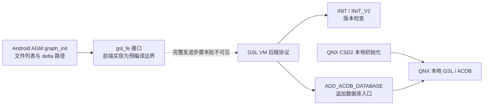
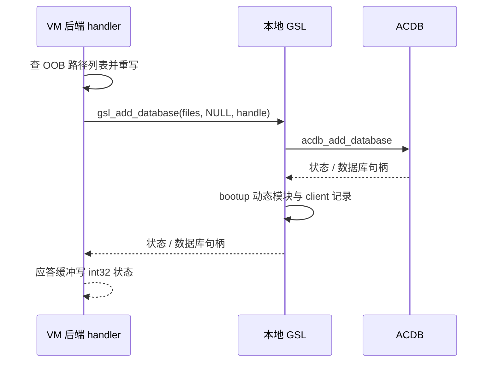

# 16.7 Android 与 QNX：数据库部署、远端注册及路径边界

[返回本章](README.md) | [16.6 校准基础](16_16.6_ACDB校准体系.md) | [AGM 会话与图](../17_AGM_GSL_Architecture/17_17.1_AGM会话与音频图.md)

> 保留原“双域共享”文件路径便于旧链接访问，但“共享”不表示两域的数据库内容必定相同、不表示启动时自动同步文件，更不表示共享 PCM 缓冲。本文仅解释可见源码与部署规则；没有验证目标机挂载、已加载库、运行服务或调音效果。

## 1. 先把三个不同动作拆开

旧文将 Android 的 ACDB 一概称为“架空/占位”，与本地源码不符：AGM 明确组织文件列表，QNX 后端也有追加远端数据库的处理函数。正确模型至少区分：

| 动作 | 可见调用 | 主要作用 |
|---|---|---|
| QNX 本地栈初始化 | `csd2_cgm_init()` → 本地 `gsl_init()` → `acdb_init()` | 初始文件集及 GSL 核心资源 |
| GSL VM INIT / INIT_V2 | `gsl_vm_be_init()` / `gsl_vm_be_init_v2()` | 校验前后端版本；V2 还记录版本及内存模式 |
| 追加远端数据库 | `gsl_vm_be_add_acdb_database()` → `gsl_add_database()` | 解析已登记 OOB 中的路径列表，重写路径并追加注册 |

不能把它们串成“每次 GVM INIT 都先重新初始化整个 QNX GSL”。更不能省略数据库查询，写成“QNX Audio Manager → AGM → 把全部 ACDB 推给 DSP”的固定链。

## 2. Android 能看到哪里，哪里仍是预编译边界

`vendor/qcom/opensource/agm/service/Android.mk` 中，`PRODUCT_NAME=msmnile_gvmq` 选择 gsl_fe 头；`ENABLE_HYP=true` 选择 `libar-gsl_fe`，否则选择 `libar-gsl`。两项是不同的构建条件。

本地可见前端接口文件：

`vendor/qcom/proprietary/prebuilt_HY11/target/product/msmnile_gvmq/obj/include/mm-audio/gsl_fe/gsl_intf.h`

该 prebuilt 产品目录的 vendor/lib 与 vendor/lib64 中还各有一个 `libar-gsl_fe.so`。本批定位到的是头和预编译库，没有前端实现源码；Android `args/gsl` 的本地 GSL 源码不能自动当作 gsl_fe。

因此可以证明 AGM 将目录扫描结果交给 `gsl_init(&init_data)`，也可以证明后端处理 ADD_ACDB_DATABASE；但**不能仅凭两端名字就声称已读到前端内部完整调用顺序、重试或 OOB 序列化实现**。



虚线明确的是证据缺口，不是已经验证的逐函数时序。源文件存在与库链接条件也不证明目标机正在运行某个具体进程。

## 3. QNX 自己的初始库从哪里来

### 3.1 fileset 的源名与目标名可以不同

源码：`Qnx/apps/qnx_ap/target/filesets/qc.audio.common.build`。

```makefile
#if defined (__AUDIO_REACH__) && defined(VARIANT_8540)
etc/acdb/adp_8295/acdb_cal.acdb=acdb/adp_8295_ar/acdb_cal.acdb
etc/acdb/adp_8295/workspaceFile.qwsp=acdb/adp_8295_ar/workspaceFile.qwsp
etc/acdb/adp_8295/acdb_cal.acdbdelta=acdb/adp_8295_ar/acdb_cal.acdbdelta
```

AR 源目录带 `_ar`，目标目录仍叫 `adp_8295`。因此不能仅凭目标路径没有 `_ar` 就判断它是 legacy 校准。也不能把 fileset 的相对目标直接改写成没有源码依据的 `/sys/platform/acdb/`。

这段规则要求 `__AUDIO_REACH__` 与 `VARIANT_8540` 同时成立；另有 lemans 分支。它说明安装映射意图，不证明当前镜像确实采用了这组宏、文件内容一致或加载成功。

### 3.2 CSD2 构造本地初始化文件集

源码：`Qnx/apps/qnx_ap/AMSS/multimedia/audio/audio_ar/audio_driver/csd2/modules/session/stream/src/csd2_cgm.c`。

非 Windows 分支由 `ifs_base`、`/etc/acdb/`、`ACDB_PATH` 组合：

```c
#define ACDB_FILE_PATH Xcomb4path(ifs_base, /etc/acdb/, ACDB_PATH, /acdb_cal.acdb)

#define WORKSPACE_FILE_PATH Xcomb4path(ifs_base, /etc/acdb/, ACDB_PATH, /workspaceFile.qwsp)

#define ACDB_DELTA_FILE_PATH Xcomb3path(ifs_base, /etc/acdb/, ACDB_PATH)
```

`Qnx/apps/qnx_ap/AMSS/multimedia/audio/audio_ar/audio_driver/csd2/aarch64/so-le-s8295-qvmhost/Makefile` 定义 `ACDB_PATH=adp_8295`。这是某一构建变体，不是所有 QNX 目标都相同。

`csd2_cgm_init()` 准备两个普通文件条目（数据库与 workspace）、单独的 delta 路径，以及最大检查次数为 5 的 ready check 参数和非 Windows 分支的 50 ms interval，再调用 `gsl_init()`。该 delta 路径是目录形式，不能把 fileset 中 `.acdbdelta` 的存在等同于这个函数直接点名读取该文件。初始化失败返回 `CSD2_EFAILED`；成功后尝试 `gsl_enable_acdb_persistence(1)`，后者失败只记录日志。

本地代码还尝试用环境变量 `ifs_base` 重定向路径，但实现不能被美化为通用安全路径层：重定向分支将三个指针指向块内 64 字节局部数组，离开块后才继续使用；路径拷贝长度又采用原宏的 `sizeof`。有生命周期/长度方面的静态风险，未执行构建或验证现场触发条件。这里只解释已有代码，不修改产品。

## 4. VM INIT 不等于再加载一次本地初始库

源码：`Qnx/apps/qnx_ap/AMSS/multimedia/audio/audio_ar/audio_driver/gsl_be/src/gsl_vm_be.c`。

两个 INIT handler 的注释与实现都按“本地 GSL 已初始化”处理：只调用 `gsl_get_version()`，并比较版本，不重新调用 `gsl_init()`。

- native GSL major 必须一致；后端 minor 不得低于前端要求。
- VM message version 也不得低于前端要求。
- 不兼容时返回 `AR_EVERSION`。
- V2 还写入 `session->fe_version` 与 `session->mem_type`；这些赋值在版本比较之后仍会执行，不应把字段已更新视为握手成功。

这个假设需要由系统启动/服务装配满足。handler 的存在不能证明启动顺序已在目标机得到满足。

## 5. ADD_ACDB_DATABASE：共享的是路径描述，不是整份文件内容

协议头：`Qnx/apps/qnx_ap/AMSS/multimedia/audio/audio_ar/audio_driver/gsl_be/inc/gsl_vm_msg.h`。

`GSL_VM_OPCODE_ADD_ACDB_DATABASE=38`，命令结构为：

```c
typedef struct gsl_vm_cmd_add_acdb_database {
    uint32_t oob_export_id; /* where stores custom config payload to be set */
    uint32_t payload_size;
} gsl_vm_cmd_add_acdb_database_t;
```

`gsl_be.c` 根据 opcode 分发到 `gsl_vm_be_add_acdb_database()`：

1. 校验命令包大小。
2. 用 `oob_export_id` 查找此 session 已登记的 OOB 对象。
3. 将 OOB 的本地 `vaddr` 解释成 `struct gsl_acdb_data_files`。
4. 为每条文件路径加远端 VM 前缀。
5. 调用本地 GSL 追加数据库，返回状态。

这里 OOB 内容是固定数组形式的**文件路径列表**，不是数据库文件正文。仅看到 OOB 指针，不能推出“ACDB 文件通过 PCM 共享内存同步到 QNX”。

### 5.1 路径重写与文件可访问性是两件事

handler 使用 `"/vm/%03d%s"` 和 `session->remote_vmid` 构造新路径。若远端提供绝对路径，逻辑上得到“VM 前缀 + 原绝对路径”；本文不指定实际 VM 编号。

`%03d` 是最小打印宽度，不是 VM ID 范围校验。代码将 `fileNameLen` 加 7，也没有检查 `snprintf` 截断返回值，不能据此证明所有输入的前缀都恰好七字节或长度一定正确。

更关键的是，本段不建立 `/vm/...` 挂载，不复制文件，也不检查路径权限。要证明实际加载，需要另外确认路径在后端可访问及 ACDB 返回状态。

### 5.2 可见的校验边界不能省略

本 handler 没有使用命令中的 `payload_size` 去验证完整 OOB 文件列表，也没有在此处将 `num_files` 与固定数组容量逐项核验。查到 OOB 对象及命令包大小正确，不等于每个字符串和条目都有效。

路径条目回拷还有一个细节：

```c
ar_mem_cpy(&acdb_data_files->acdbFiles[i],
        GSL_MAX_LEN_OF_ACDB_FILENAME,
        &tmp_acdb_data_file, sizeof(struct gsl_acdb_file));
```

目的容量传的是文件名上限 256，而源大小是包含长度字段和文件名数组的完整结构。QNX 实现 `Qnx/apps/qnx_ap/AMSS/multimedia/audio/audio_ar/audio_driver/audio_reach/ar_osal/src/qnx/ar_osal_mem_op.c` 按两种大小的最小值执行 memcpy 并返回成功，因此不能保证完整条目尾部被更新。短路径是否足够、长路径是否触发问题是不同问题；本批没有做错误注入，不能将截断当成已验证安全。

## 6. 注册句柄与图句柄不是同一个对象

handler 实际调用：

```c
rc = gsl_add_database(acdb_data_files, NULL, &session->acdb_handle);
```

第二参数是 `NULL`。这条后端追加路径没有把 Android `graph_init()` 的 delta 路径作为可写路径传进去；原 handler 的 writable-file 解析语句是注释。不能把 Android init-data 的字段与后端实际参数无条件连起来。

本地实现 `Qnx/apps/qnx_ap/AMSS/multimedia/audio/audio_ar/audio_driver/audio_reach/gsl/src/gsl_main.c`：

- 分配 client 记录，在 `acdb_client_lock` 下调用 `acdb_add_database()`。
- 成功后尝试为 `AR_AUDIO_DSP` 加载该数据库的 bootup 动态模块。
- 保存文件描述、可选可写路径与数据库 handle，加入 client 列表。
- 动态模块加载失败时走 `acdb_remove_database()` 回退并释放本次 client 记录。

这是追加数据库及相关资源，不是另开一条 PAL stream。`session->acdb_handle`、GSL graph handle、AGM session handle 分属不同层。VM graph-open handler 将 GKV/CKV 传给 `gsl_open()`，本段没有把数据库 handle 作为 graph-open 参数，因此也不能从这里推出“每个 VM 的同名 GKV 天然完全隔离”或数据库覆盖优先级。



这里 handler 的应答是状态值，不把本地数据库指针作为一个可供 Android 解引用的地址返回。

## 7. 清理有代码路径，不等于恢复已验证

`Qnx/apps/qnx_ap/AMSS/multimedia/audio/audio_ar/audio_driver/gsl_be/src/gsl_be.c` 的 session cleanup 先对非空 `acdb_handle` 调用 `gsl_remove_database()`，再清理图和 OOB。删除数据库的返回值在这个调用点未处理。

本地 `gsl_remove_database()` 查找 client，未找到返回 `AR_EBADPARAM`；找到后先卸载 bootup 动态模块，再移除 ACDB 数据库，最后删除 client 列表节点。任一步失败都可能提前返回；列表节点被移除也不等于能宣称所有相关分配均已释放。不能将这段清理描述成已验证的“GVM 重启完全恢复校准状态”。

读者应分别观察：连接生命周期、追加库成功、图使用情况、删除结果、重新连接后的再次注册。不能只观察一个新 graph handle 就断言旧数据库已清除。

## 8. 双域排障证据应如何组织

| 证据层 | 可检查问题 | 本文不能替现场回答的事 |
|---|---|---|
| Android 选择 | 声卡后缀、扫描路径、列表数量、gsl_init 返回 | 实际安装了哪份文件 |
| VM 协议 | INIT 版本、ADD 命令、OOB 对象、状态 | 预编译前端具体如何发送及重试 |
| QNX 路径 | remote_vmid、拼接后的路径、权限/文件可达性 | 挂载已经正确、两域文件相同 |
| 本地数据库 | 初始库与追加库、handle、注册/删除错误 | 指定 GKV 最终命中哪份实际校准 |
| 图与模块 | 查询条件、图操作返回、当前模块参数 | 物理端点和声学结果 |

用这条分层方法替代“Android 没有本地 GSL 所以校准全是占位”。反过来，有远端数据库入口也不能夸大为“Android 提供的所有参数一定生效”。调音接口及 ATS 的编译边界见 [16.6](16_16.6_ACDB校准体系.md)。
