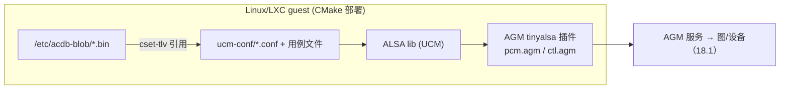

# 16.8 ALSA UCM 配置

> [前篇：ACDB 校准双域共享](16_16.7_ACDB校准数据Android与QNX双域共享.md) · [本章导航](README.md) · [后篇：auto-casa-xml 配置](16_16.9_auto-casa-xml配置.md) · [总导航](../README.md)

> 定位：`vendor/qcom/proprietary/mm-audio-auto/alsa-ucm/` 是 **Linux/LXC guest 侧**的 ALSA UCM（Use Case Manager）配置集。它用 "主配置 + 每用例一个文件" 的结构描述 TDM/AGM 路由。**部署证据是 CMake（LE/LXC 构建族），不是 Android 主线的 mk**——先分清它服务谁，再读结构。

## 16.8.1 部署边界：谁会装它

目录下没有 `Android.mk`，只有 `CMakeLists.txt`。安装逻辑按构建旗标分派：

- `LXC_SUPPORT=true`：装 `lxc-gvm-*` / `lxc-sa6155/sa8295/sa8155-*` 变体（容器内 Linux 音频栈）；
- `HYP_SUPPORT=true` 且 `TARGET_BOARD_PLATFORM=quin-gvm-gen4`：装 **`gvmauto8295-adp-star-snd-card/ucm-conf/`**，同时装同卡的 `acdb-blob/`、`acdb-blob-multiclient/`、`audio-pp-blob/`（到 `${CMAKE_INSTALL_SYSCONFDIR}` 即 `/etc/...`）与 `gvmauto8295-adp-pp-control/`。

本知识库主线（Android guest `msmnile_gvmq` + QNX AudioReach）的产品 mk（`audio_ar_vendor_proprietary_product.mk`、`msmnile_au.mk`）**未检索到 alsa-ucm/UCM 的部署项**。结论：UCM 是 Linux(LXC/HYP) 音频路径的配置；Android 主线的路由走 PAL resourcemanager/mixer_paths（[16.9](16_16.9_auto-casa-xml配置.md)、[15.9](../15_PAL_Architecture/15_15.9_配置文件列表.md)）。把它写进 Android 主线配置清单是不对的。

## 16.8.2 结构：主配置只做索引

主配置 `gvmauto8295-adp-star-snd-card.conf`（`Syntax 4`）声明 AGM 插件库与用例索引：

```conf
Syntax 4

LibraryConfig.agm.Config {
        pcm.agm {
                @args [ CARD DEV ]
                        @args.CARD {
                        type integer
                        default 1
                }
                @args.DEV {
                        type integer
                        default 0
                }
                type agm
                card $CARD
                device $DEV
        }

        ctl.agm {
                type agm
                card 1
        }
}

SectionUseCase."HiFi" {
        File "hifi"
}
```

> 源码：`vendor/qcom/proprietary/mm-audio-auto/alsa-ucm/gvmauto8295-adp-star-snd-card/ucm-conf/gvmauto8295-adp-star-snd-card.conf`（头部节选；其后 `Navigation/Record/ICC/Hfp_wb/A2B/A2B2/A2B_Record/...` 逐项 `File` 索引）

两个关键词：

- **`LibraryConfig.agm.Config`**：声明 `pcm.agm`/`ctl.agm` 两个 ALSA 插件——UCM 打开的 "PCM" 不是 `hw:`，而是 AGM 的 tinyalsa 插件（[16.10 AGM](16_16.10_AGMAudio_Graph_Manager深度解.md)、[18.1](../18_AGM_GSL_Architecture/18_18.1_AGM会话与音频图.md) 里 `agm_mixer_plugin/agm_pcm_plugin` 的用户）。
- **主文件不写用例内容**，只 `SectionUseCase."X" { File "x" }` 索引到同目录独立文件（`hifi`/`navigation`/`record`/`icc`/`hfp_wb`/`a2b`/`a2b2`/`a2b_record`/`a2b2_record` 等）。

## 16.8.3 用例文件：EnableSequence 即路由脚本

以 `hifi` 为例，`SectionVerb` 的 EnableSequence 就是一串发给 `cdev "agm"` 的 mixer 命令：

```conf
SectionVerb {
    EnableSequence [
        cdev "agm"
        cset "name='TDM-LPAIF-RX-PRIMARY rate ch fmt' 48000,8,2,1"
        cset "name='PCM0p control' ZERO"
        cset-tlv "name='PCM0p metadata' /etc/acdb-blob/hifi_Meta_stream.bin"
        cset-tlv "name='TDM-LPAIF-RX-PRIMARY metadata' /etc/acdb-blob/hifi_Meta_device.bin"
        cset "name='PCM0p control' TDM-LPAIF-RX-PRIMARY"
        cset-tlv "name='PCM0p metadata' /etc/acdb-blob/hifi_Meta_streamdevice.bin"
        cset "name='PCM0p connect' TDM-LPAIF-RX-PRIMARY"
    ]
```

> 源码：`vendor/qcom/proprietary/mm-audio-auto/alsa-ucm/gvmauto8295-adp-star-snd-card/ucm-conf/hifi`（节选；`value { playbackPCM "agm:1,0" }` 在同 Section 尾部）

读法分层：`cset` 设格式/连接（FE `PCM0p` 接 BE `TDM-LPAIF-RX-PRIMARY`）；`cset-tlv` 把 **acdb-blob 元数据二进制**（`/etc/acdb-blob/*.bin`，由 CMake 随 UCM 一起安装）喂给对应控件。`playbackPCM "agm:1,0"` 告诉 UCM 客户端：播放走 AGM 插件卡 1 设备 0。二进制 blob 内容（校准数据）不在本页展开，只确认**文件名与引用关系**。

`SectionDevice`（如 `Speaker`，`PlaybackChannels "6"`）与 `SectionModifier`（如 `Record` 叠加 TX 侧命令）补充设备/修饰维度——结构与标准 ALSA UCM 一致，本页不逐文件罗列。

## 16.8.4 三条路由配置族的分工

| 配置族 | 部署到 | 服务的栈 | 章节 |
|---|---|---|---|
| alsa-ucm（本页） | `/etc`（CMake，LXC/HYP Linux guest） | Linux ALSA + AGM 插件 | 本页 |
| resourcemanager_*.xml + mixer_paths_*.xml | `/vendor/etc`（Android mk） | PAL（Android 主线） | [16.9](16_16.9_auto-casa-xml配置.md)、[15.9](../15_PAL_Architecture/15_15.9_配置文件列表.md) |
| card-defs.xml | `/vendor/etc`（Android mk） | AGM snd-card-parser | [18.1](../18_AGM_GSL_Architecture/18_18.1_AGM会话与音频图.md) |



| 层次 | 本页能证明 | 本页不能证明 |
|---|---|---|
| 源码/构建 | UCM 结构、AGM 插件声明、CMake 安装条件 | — |
| 部署 | — | 任何具体目标机是否装了它、LXC 是否在用 |
| 运行 | — | 用例切换是否发生、acdb-blob 是否被 DSP 消费 |

## 本节小结

UCM 是给 Linux(LXC/HYP) 音频栈的 "脚本化路由"：主文件索引、用例文件执行、AGM 插件承载、acdb-blob 供数据。主线 Android guest 不用它——认清这条边界，才不会把三套路由配置混为一谈。下一节的 auto-casa-xml 正是 Android 侧的对应物。

---

[← 16.7 ACDB 校准数据双域共享](16_16.7_ACDB校准数据Android与QNX双域共享.md) · [本章导航](README.md) · [16.9 auto-casa-xml 配置 →](16_16.9_auto-casa-xml配置.md) · [总导航](../README.md)
