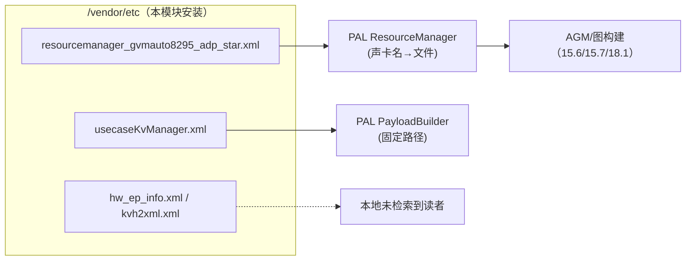

# 16.9 auto-casa-xml 配置

> [前篇：ALSA UCM 配置](16_16.8_ALSA_UCM配置.md) · [本章导航](README.md) · [后篇：Primary HAL(AR版)](16_16.13_Primary_HALAudioReach版深度解.md) · [总导航](../README.md)

> 定位：`vendor/qcom/proprietary/mm-audio-auto/auto-casa-xml/` 是一个**只装文件的模块**——把 11 个 XML 铺到 `/vendor/etc/`，为 AudioReach 的 PAL/AGM 提供配置。本页回答三个问题：装了什么、谁来挑文件、每个文件被谁消费。**"已安装" 与 "被消费" 是两回事**，本页逐个文件给出证据等级。

## 16.9.1 模块形态与安装

`Android.mk` 只为板型 `sdmshrike/msmnile/MSMSTEPPE`、非 tiny build 时编译；每个文件一个 `BUILD_PREBUILT`，目标路径统一 `/vendor/etc/`：

```makefile
include $(CLEAR_VARS)
LOCAL_MODULE            := resourcemanager_gvmauto8295_adp_star.xml
LOCAL_MODULE_FILENAME   := resourcemanager_gvmauto8295_adp_star.xml
LOCAL_MODULE_TAGS       := optional
LOCAL_MODULE_CLASS      := ETC
LOCAL_MODULE_PATH       := $(TARGET_OUT_VENDOR_ETC)
LOCAL_SRC_FILES         := resourcemanager_gvmauto8295_adp_star.xml
include $(BUILD_PREBUILT)
```

> 源码：`vendor/qcom/proprietary/mm-audio-auto/auto-casa-xml/Android.mk`（其余 10 个文件同构）

产品聚合在 `vendor/qcom/proprietary/mm-audio-auto/configs/audio_ar_vendor_proprietary_product.mk`：`MM_AUDIO_AR_PROP` 列表一次性把 9 个文件（hw_ep_info、kvh2xml、6 个 resourcemanager 变体、usecaseKvManager）并入 AR 产品。主线 msmnile_au 的产品配置即走此路径。

| 文件 | 变体/说明 | 消费者（本地源码证据） |
|---|---|---|
| `resourcemanager_gvmauto8295_adp_star.xml` 等 6 变体 | 6155/8155/sa8155_adp_star/非 auto 与 auto 组合 | **PAL ResourceManager**，按声卡名选择（§16.9.2） |
| `usecaseKvManager.xml` | 流/设备 GKV 表（另有 dpk 变体，本模块未装） | **PAL PayloadBuilder**，固定路径打开（§16.9.3） |
| `hw_ep_info.xml` | codec_dma/i2s/tdm/slim 端点定义 | **本地源码树无按文件名打开者**（§16.9.4） |
| `kvh2xml.xml` | KEY_DEF 键定义（LA/LE 平台 id 等） | **本地源码树无按文件名打开者**（§16.9.4） |

## 16.9.2 resourcemanager_*.xml：声卡名决定读哪个

8 个变体不会同时生效。PAL `ResourceManager` 枚举声卡（接受 sa8155/msmnile/sa6155/gvmauto 等前缀的卡），把卡名按 `target-formfactor-variant-snd-card` 约定切成文件扩展名：

```cpp
    card_sub_str = strtok_r(snd_card_name, "-", &tmp);
    if (card_sub_str == NULL) {
        PAL_ERR(LOG_TAG,"called on invalid snd card name");
        goto err;
    }
    strlcat(file_name_extn, card_sub_str, XML_PATH_EXTN_MAX_SIZE);

    while ((card_sub_str = strtok_r(NULL, "-", &tmp))) {
        if (strncmp(card_sub_str, "snd", strlen("snd"))) {
            strlcat(file_name_extn, XML_FILE_DELIMITER, XML_PATH_EXTN_MAX_SIZE);
            strlcat(file_name_extn, card_sub_str, XML_PATH_EXTN_MAX_SIZE);
        }
        else
            break;
    }
```

> 源码：`vendor/qcom/opensource/pal/resource_manager/src/ResourceManager.cpp`（`getFileNameExtn`，dash 转 `_`，遇 `snd` 截止）

随后拼出 `resourcemanager_<扩展名>.xml`（基础名宏 `RMNGR_XMLFILE_BASE_STRING_NAME "resourcemanager"`）在 vendor 配置路径下打开。对本平台：卡名 `gvmauto8295-adp-star-snd-card` → `resourcemanager_gvmauto8295_adp_star.xml`；同规则也选择 `mixer_paths_gvmauto8295_adp_star.xml`（[16.13](16_16.13_Primary_HALAudioReach版深度解.md)/[15.9](../15_PAL_Architecture/15_15.9_配置文件列表.md)）。**换卡名等于换配置文件**——同名前缀之外的平台变体不会被读到。

文件内部结构（config_params、bt_codecs、controls 插件、in_stream/device_profile 的 usecase/snd_device_name/back_end_name 等）已在 PAL 章节深讲，此处不重复：

```xml
<resource_manager_info>
    <config_params>
        <param key="native_audio_mode" value="multiple_mix_dsp"/>
        <param key="max_sessions" value="128"/>
        <param key="logging_level" value ="3" />
    </config_params>
    <config_gapless key="gapless_supported" value="1"/>
```

> 源码：`vendor/qcom/proprietary/mm-audio-auto/auto-casa-xml/resourcemanager_gvmauto8295_adp_star.xml`（文件头部）

## 16.9.3 usecaseKvManager.xml：PAL 的 GKV 词典

PayloadBuilder 用**固定路径**打开它（非声卡名推导）：

```cpp
#if defined(FEATURE_IPQ_OPENWRT) || defined(LINUX_ENABLED)
#define USECASE_XML_FILE "/etc/usecaseKvManager.xml"
#else
#define USECASE_XML_FILE "/vendor/etc/usecaseKvManager.xml"
#endif
```

> 源码：`vendor/qcom/opensource/pal/session/src/PayloadBuilder.cpp`

内容是 "PAL 流类型/设备 → graph key-value" 的映射表——正是 [18.1](../18_AGM_GSL_Architecture/18_18.1_AGM会话与音频图.md) 讲的 GKV 身份的来源之一：

```xml
<graph_key_value_pair_info>
    <streams>
        <!-- Low-latency stream -->
        <stream type="PAL_STREAM_LOW_LATENCY">
            <keys_and_values Direction="TX" Instance="1">
                <!-- STREAMTX - RAW_RECORD -->
                <graph_kv key="0xB1000000" value="0xB1000009"/>
            </keys_and_values>
            <keys_and_values Direction="RX" Instance="1">
                <!-- STREAMRX - PCM_LL_PLAYBACK -->
                <graph_kv key="0xA1000000" value="0xA100000E"/>
                <!-- INSTANCE - INSTANCE_1 -->
                <graph_kv key="0xAB000000" value="0x1"/>
            </keys_and_values>
        </stream>
```

> 源码：`vendor/qcom/proprietary/mm-audio-auto/auto-casa-xml/usecaseKvManager.xml`

结构分四块：`streams`/`streampps`（流侧 GKV+流后处理）、`devices`/`devicepps`（设备侧）。注意同一流类型按 Direction/Instance 给出多组键值——"一个流类型" 不等于 "一组 GKV"。

## 16.9.4 hw_ep_info.xml 与 kvh2xml.xml：装了，但本地找不到读者

这是本页最重要的负结论。两个文件都随产品安装到 `/vendor/etc/`，但按文件名全仓检索，**本地源码树中没有打开它们的代码**：

- AGM 源码里大量出现 `hw_ep_info_t`（`device.c`/`session_obj.c`/`device_hw_ep.c` 等），但那是**数据结构名**；AGM 的硬件端点信息实际来自 snd-card-parser 对 `card-defs.xml` 的解析（[18.1](../18_AGM_GSL_Architecture/18_18.1_AGM会话与音频图.md)、[15.9](../15_PAL_Architecture/15_15.9_配置文件列表.md)）。
- `kvh2xml.h` 头文件（键枚举）被 AGM `device.c` include（来自 `vendor/qcom/proprietary/mm-audio-headers/acdbdata/kvh2xml.h`），但那是编译期头文件，与安装的 `kvh2xml.xml` 文件是两回事。
- 结论的正确姿势：**不能写 "AGM 读取 hw_ep_info.xml"**。它们的读者若存在，在预装二进制或其他仓库里；静态证据只能证明 "文件已部署" 与 "本地无人按名打开"。

这类 "部署了却查无消费者" 的文件常见用途是：跨仓库组件（如闭源 HAL plugin、工具链 codegen 输入）或历史遗留。知识库如实记录检索结果，比补一个想象中的消费者更接近事实。

## 16.9.5 与其他配置章节的分工



- 配置**结构与语义**（怎么影响路由/会话/图）→ [15.6](../15_PAL_Architecture/15_15.6_ResourceManager-PAL核心管理模块.md)、[15.9](../15_PAL_Architecture/15_15.9_配置文件列表.md)、[18.1](../18_AGM_GSL_Architecture/18_18.1_AGM会话与音频图.md)。
- mixer_paths/card-defs 的安装与选择 → [16.13](16_16.13_Primary_HALAudioReach版深度解.md)（HAL 配置族）与 [15.9](../15_PAL_Architecture/15_15.9_配置文件列表.md)。
- 本页只负责 "这个模块装什么、谁挑、谁读" 的证据链。

| 层次 | 本页能证明 | 本页不能证明 |
|---|---|---|
| 源码/构建 | 11 个文件、安装路径、选择算法、两个已证读者 | — |
| 部署 | — | 目标机上文件是否实际存在、是否被外部二进制读取 |
| 运行 | — | 配置生效结果（路由/图/校准） |

## 本节小结

auto-casa-xml 是配置发布的 "货架"：PAL 按声卡名从货架上取 resourcemanager 变体、按固定路径取 GKV 词典，另两件商品在本地查无买家。把 "安装、选择、消费、生效" 四层分开问，是读一切 vendor 配置模块的通用方法——下一节把这个方法用到 Primary HAL 的配置族上。

---

[← 16.8 ALSA UCM 配置](16_16.8_ALSA_UCM配置.md) · [本章导航](README.md) · [16.13 Primary HAL(AR版) →](16_16.13_Primary_HALAudioReach版深度解.md) · [总导航](../README.md)
