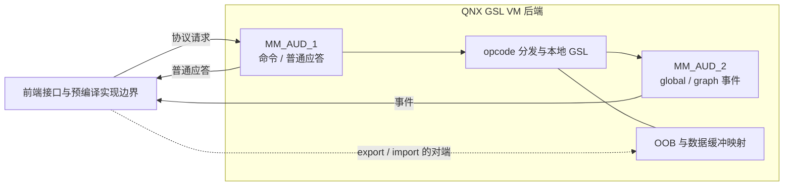
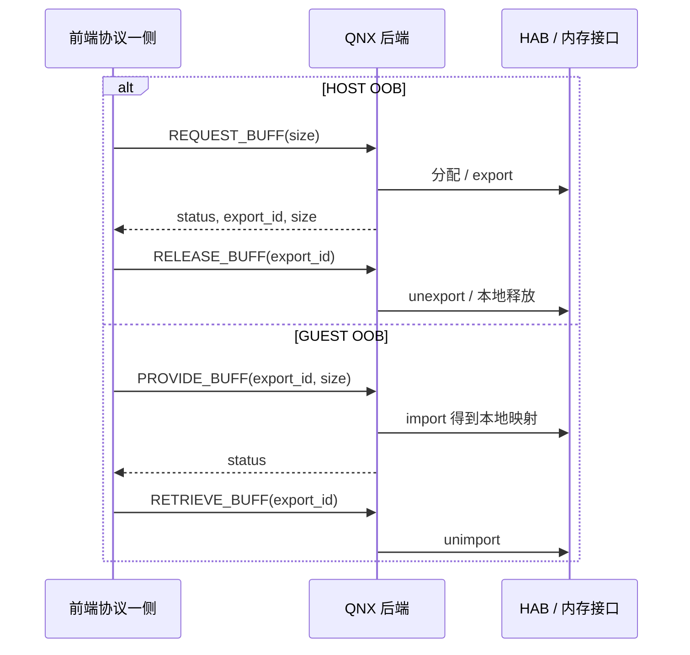
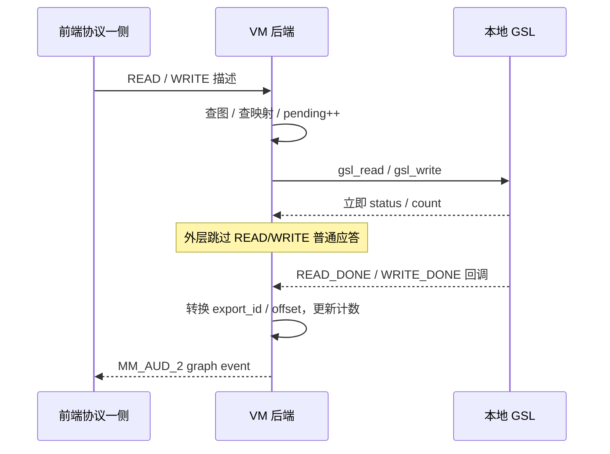

# 17.2 GSL 跨 VM 控制与缓冲区：命令、句柄、共享内存和完成事件

[返回本章](README.md) | [前置：17.1 AGM 会话与图](17_17.1_AGM会话与音频图.md) | [双域数据库](../16_Vendor_QNX_Architecture/16_16.7_ACDB校准数据Android与QNX双域共享.md)

> 本文主线为本地 Android 12L/API 32 + SA8295 AudioReach。Android gsl_fe 只有已定位的预编译库和接口头；下面深入的是可见的 QNX GSL VM 后端。不要把后端协议、前端库内部实现、实际运行连接和整条播放路径零拷贝当作同一件事。

## 1. 为什么还需要一层 VM 协议

AGM 调用 `gsl_open/gsl_ioctl/gsl_read/gsl_write`，调用者看到的是 C API。但虚拟化构建中 AGM 可链接 gsl_fe，QNX 有相应后端将请求转成本地 GSL 调用。两域不能直接互相解引用 C 指针，且控制请求、较大的参数数据、PCM 缓冲、异步完成事件具有不同生命周期。

学习这一层应先回答四个问题：

1. 图请求通过什么消息到达后端？
2. 哪些字段是句柄，哪些表示共享内存，哪些只是字节计数？
3. 谁分配、导出、导入和释放缓冲？
4. read/write 的立即返回和完成通知是否走同一通道？

主要源码位于 `Qnx/apps/qnx_ap/AMSS/multimedia/audio/audio_ar/audio_driver/gsl_be/`：`src/gsl_be.c` 管连接、任务、队列与 OOB；`src/gsl_vm_be.c` 管 opcode、图、数据缓冲与回调；`inc/gsl_vm_msg.h` 定义协议结构，`inc/gsl_be_i.h` 定义后端持有对象。

## 2. 两条 HAB 连接，不是播放/录音各一条

`gsl_be_service_task_fn()` 先后用 `MM_AUD_1`、`MM_AUD_2` 打开 HAB 连接，再创建 session task。源码中命名为：

| 后端字段 | 实际用途 | 不能据名字推断 |
|---|---|---|
| `tx_hab_handle`（MM_AUD_1） | session task 接收命令，通常也发送应答；用于内存 export/import | TX 专门承载播放 PCM |
| `rx_hab_handle`（MM_AUD_2） | 后端发送 global/graph 事件 | RX 专门承载录音 PCM |

播放和录音操作都可以通过命令通道请求，并通过事件通道完成。read/write 的方向是 GSL 数据接口方向，不等于这两个 socket 名字。



session 对象维护图队列、OOB 队列、两连接、事件发送锁、远端 VM ID 等。`remote_vmid` 来自 `habmm_socket_query()`，不是将 AGM session_id 当作 VM 编号。一个 VM 后端 session 可以持有多个 graph_info；它也不等于一个 AudioTrack 或 PAL Stream。

命令/事件收发缓冲分别定义为 4096 字节。这个数字不是 PCM period 大小、音频带宽或时延指标。头里还有 64 KiB OOB 预留常量，也不能把它当作所有音频缓冲的固定大小。

## 3. 包格式与图句柄

### 3.1 有三种消息前缀

协议的概念布局如下，字段顺序以头定义为准：

```text
命令：uint32 opcode | 命令头 | 可选尾随参数
应答：int32 status  | 应答头 | 可选返回参数
事件：uint32 type   | global/graph 事件头 | 事件参数
```

`GSL_VM_OPCODE_OPEN` 的命令头包含 GKV/CKV 数量，后面放连续 key/value 条目。后端先检查最小长度，再按条目数量检查长度，将本地指针指向收到的消息缓冲，调用本地 `gsl_open()`。这是在接收域重建参数，不是透传 Android 的 key-vector 指针。

成功后创建 `gsl_be_graph_info` 并记录本地 graph handle，open 应答包含状态和句柄。该句柄是给后续请求引用的 opaque token；本地 `gsl_handle_t` 定义为 `void *`，不意味着前端可以解引用它，也不等于 DSP 物理地址。

源码中的消息结构还包含 enum、指针类型和不同版本字段；不能仅凭某一域的 `sizeof` 就声称协议可在任意 ABI 组合间无条件兼容。

### 3.2 opcode 不总是“一条消息直接等于一次 API”

- INIT/INIT_V2：主要是版本校验，不重新初始化本地 GSL，见 [16.7](../16_Vendor_QNX_Architecture/16_16.7_ACDB校准数据Android与QNX双域共享.md)。
- IOCTL：根据子命令重建 GKV/CKV/properties，或执行缓冲对齐、导出/导入等额外工作。
- GET buffer-info：HOST 与 GUEST 模式行为不同。
- READ/WRITE：handler 虽填写应答，但外层 session loop 不发送普通应答。

open 的本地 GSL 成功、graph_info 分配成功、事件回调注册成功也是三个阶段。`REGISTER_EVENT_CB` handler 另行调用 `gsl_register_event_cb()`，不能把一次 open 成功视为所有通知都已建立。

## 4. 内存模式与消息版本是两个条件

`gsl_vm_msg.h` 定义：

| 内存模式 | 控制参数 OOB | PCM 数据接口模式 |
|---|---|---|
| `GSL_VM_MEM_TYPE_HOST` | REQUEST_BUFF / RELEASE_BUFF | `GSL_DATA_MODE_SHMEM` |
| `GSL_VM_MEM_TYPE_GUEST` | PROVIDE_BUFF / RETRIEVE_BUFF | `GSL_DATA_MODE_EXTERN_MEM` |

后端创建 session 时默认设 HOST；INIT_V2 可以记录前端传来的 `mem_type`。READ/WRITE handler 的版本分支依据 `fe_version >= GSL_VM_VERSION_2`，完成事件的结构选择则依据 `mem_type`，不能将两个判断合并成一个布尔变量。

头文件默认 `GSL_VM_MSG_VERSION=VERSION_1`，但 `gsl_be/common.mk` 明确加入 `-DGSL_VM_MSG_VERSION=GSL_VM_VERSION_2`。读构建时不能只看头的缺省值。另一方面，支持 V2 不等于已证明当前连接使用 GUEST 模式，前端实际选择本批不可见。

## 5. 先看控制参数的 OOB 生命周期

OOB 队列中保存 export ID、本地 vaddr 与大小。它可承载自定义参数、查询返回数据或数据库路径列表，**不是每个 OOB 都是 PCM 数据**。

### HOST：后端分配并导出

`gsl_be_request_buff()` 将请求大小向页边界对齐，QNX 分支用 `pmem_malloc_ext_v2()` 分配，再 `habmm_export()`，将对象加入 session 的 OOB 队列。应答给出 export ID 与大小。

`gsl_be_release_buff()` 执行 unexport、pmem_free、从队列删除并释放描述对象。unexport 失败仍会继续本地清理，后续队列操作可覆盖返回值；不是全事务保证。

### GUEST：后端导入，不负责释放对端分配

`gsl_be_add_buff()` 接受前端提供的 export ID 与大小，通过 `habmm_import()` 得到 QNX 本地映射，加入队列。`gsl_be_remove_buff()` 执行 unimport 并删除描述，不在这里对对端内存执行 pmem_free。

REQUEST/RELEASE 与 PROVIDE/RETRIEVE 的 handler 会检查对应 mem_type。不应把四个名字统称为“释放共享内存”，忽略分配方与映射方的职责。



图只陈述后端所支持的协议交互，不补写预编译前端里的分配函数、调用顺序或失败重试。

## 6. PCM 数据缓冲：逻辑大小、分配步长、映射身份分开

### 6.1 CONFIGURE 时做页对齐

处理 `GSL_CMD_CONFIGURE_READ_PARAMS/WRITE_PARAMS` 时，后端先记下请求的 `buff_size`，向 4096 字节页边界对齐后交给本地 GSL，并设置 `platform_info=session->pmem_flag`。成功后将原始大小恢复到后端记录。

因此“每块有效音频字节数”和“每块分配/导出步长”不一定相同。不能用页对齐后的大小直接计算应用每次消费的 PCM 帧数。

### 6.2 HOST 的每块缓冲有自己的映射记录

GET_READ/WRITE_BUFF_INFO 先从本地 GSL 获取缓冲地址。`gsl_vm_be_buff_export()` 逐块 export，记录 QNX vaddr ↔ export ID，返回描述给前端。代码限定返回块数不超过 `GSL_VM_MAX_NUM_DATA_BUFFERS`（16）。

返回大小保留请求侧逻辑大小，导出长度采用对齐大小。某一块导出失败可留下前面已导出的块，不能把失败出口画成自动完整撤销。

### 6.3 GUEST 将一整片外部内存导入后分块

GUEST 的 GET buffer-info 分支不是从 GSL 申请另一份缓冲，而是调用 `gsl_vm_be_buff_import()`。它取 `buffs[0].export_id`，导入“对齐后的单块大小 × 块数”的一整片内存，然后为各块记录偏移后的 vaddr。

- `IMPORT_TO_FD` 条件下导入为 phandle，再尝试 `pmem_map_handle()`。
- 另一分支直接导入为后端 vaddr。
- 多块记录可以共享一个 export ID；**export ID 不一定能唯一指出片内某块**，V2 的 offset 才参与外部内存定位。

map-handle 失败/映射长度不符在此处只记录日志，不能宣称 import 成功就保证所有地址有效。

| 字段 | 含义 | 常见混淆 |
|---|---|---|
| `buff.size` | 本次操作数据字节数 | PCM 帧数或整个分配长度 |
| `buff_size` | 配置请求的单块逻辑大小 | 页对齐后步长 |
| `export_id` | HAB 导出身份 | 物理地址、PCM 块序号 |
| `vaddr` | 当前域可见的虚拟地址 | 另一域可直接解引用的地址 |
| `alloc_size` / `offset` | 外部内存分配大小与片内偏移 | 自动经过本 handler 完整范围校验 |
| `alloc_handle` | 交给本地 GSL 的分配标识 | 原样采用前端传来的句柄 |

共享映射仅证明这一接口支持特定内存共享方式。Framework write/read、HAL FMQ 和 AGM HIDL 两侧仍有已核对的复制，见 4.4、8.1、17.1，不能据此称整条链路零拷贝。

## 7. READ/WRITE 为什么不能只看 handler 的 return

V1 的数据描述没有 PCM 数组：

```c
struct gsl_vm_buff {
    uint64_t timestamp;
    uint32_t flags;
    uint32_t size;
    uint32_t export_id;
};
```

后端按 session 查 graph_info，复制 timestamp/flags/size，在相应读/写路径锁内增加 `pending_buf_cnt`，用 export ID 查本地 vaddr，然后调用 `gsl_read()` 或 `gsl_write()`。

V2 还取 `alloc_size/offset`，但**不直接采用消息中的 alloc_handle**：

```c
#ifdef IMPORT_TO_FD
    buff.alloc_info.alloc_handle = (uint64_t)dp_info->ext_buff_phandle; //use phandle as alloc handle
#else
    buff.alloc_info.alloc_handle = (uint64_t)dp_info->ext_buff_vaddr; //use VA-host as alloc handle
#endif
```

V2 结构中虽有 metadata 字段，本 handler 没有逐项把它们完整转入 `gsl_buff`。字段声明不等于每条路径都传递它。

两个 handler 最后都填写 `status + size` 应答；但 session loop 明确跳过 READ/WRITE 的普通发送：

```c
if (( *(uint32_t *)(session.tx_buf) == GSL_VM_OPCODE_READ) || (*(uint32_t *)(session.tx_buf) == GSL_VM_OPCODE_WRITE))
    continue;
```

完成结果依赖 BUFF_DONE 类事件。即使本地调用立即失败，外层这里也会跳过普通应答；handler 增加的 pending 计数没有在该错误分支直接回滚。不能擅自补上“失败一定同步返回给前端”或“必定自动生成失败事件”的机制。

## 8. 完成事件怎样带回缓冲身份

`gsl_vm_be_graph_callback()` 收到 `GSL_EVENT_ID_READ_DONE/WRITE_DONE` 后：

- HOST：按本地 `buff.addr` 反查 export ID。
- GUEST：用路径的整片 export ID，并携带 `alloc_info.offset`。
- 更新该路径的 `processed_buf_cnt` 与 `pending_buf_cnt`。
- 组装 graph event，包含 graph handle、source module、event ID 与 payload。

`gsl_vm_be_send_event()` 在 `rx_lock` 内复制事件到发送缓冲，经 MM_AUD_2 发送；事件超出 4096 字节上限返回错误。`GSL_VM_ACK_RSP` 是条件代码，头中没有默认启用，不能把发送成功等同于前端已处理完成。



这是成功方向的机制图，不是每个失败都保证产生回调的承诺。完成计数以缓冲事件计，不是扬声器已播放帧数；它不能替代声学或捕获数据验证。

## 9. close、断连、SSR 是不同生命周期

| 场景 | 可见后端动作 | 不保证的事 |
|---|---|---|
| graph CLOSE | 调本地 gsl_close；成功后销毁对应 graph_info 及映射记录 | 任意失败都完整回滚并返回统一应答 |
| HAB recv 返回 `-ENODEV` | session cleanup：数据库、图、OOB；随后销毁连接与 session | GVM 的上层对象和旧 PCM 已恢复 |
| 其他 recv 错误 | 当前循环继续尝试 | 有界次数重试/自动退避 |
| AUDIO_SVC_DN | `gsl_be_ssr_handling()` 调 `cleanup_graphs(..., reset_only=1)`；发送 global 事件 | 一律关闭再重建 HAB 连接 |
| AUDIO_SVC_UP | 当前 callback 记录并转发通知 | 自动重建原图/重新填回丢失的 PCM |

`reset_only=1` 的图清理跳过本地 `gsl_close()`，而 `reset_only=0` 才调用它。SSR 清理图记录与 GVM 断连清理整个 session/OOB/数据库不能画成同一张无条件时序图。

队列锁主要保护查找和容器操作，不能扩展解释为回调、导入内存和并发 close 的完整安全证明。源码还存在需要谨慎解读的失败边界：graph_info 创建失败后没有在 open handler 直接补一次 gsl_close；部分内存分配失败分支没有设置新的非零 rc；callback 的分支局部 payload 地址在离开该分支作用域后才用于复制。这些静态风险说明“看到清理函数”不足以宣称所有错误恢复正确；本文不修改产品代码、不做故障注入。

## 10. 按证据定位，而不是画一根“零拷贝”箭头

1. **连接层**：两 socket 是否建立？remote_vmid、session task、版本条件是什么？
2. **控制层**：opcode 与子命令、graph handle、返回状态、消息长度是否匹配？
3. **内存层**：HOST/GUEST、逻辑大小/对齐步长、export/import 身份和 offset 是否一致？
4. **完成层**：是否注册回调？pending/processed 怎样变化？事件发送是否失败？
5. **恢复层**：是单图关闭、GVM 断连还是 DSP/音频服务重启？哪些资源已清理、哪些要由上层重建？

相关函数与常量为可见源码依据，不是现场验证结果。本文没有运行前端、HAB、QNX、DSP、渲染器或性能测试；完整平台视角见 [16.12](../16_Vendor_QNX_Architecture/16_16.12_Android+QNX双域架构总结.md)。
