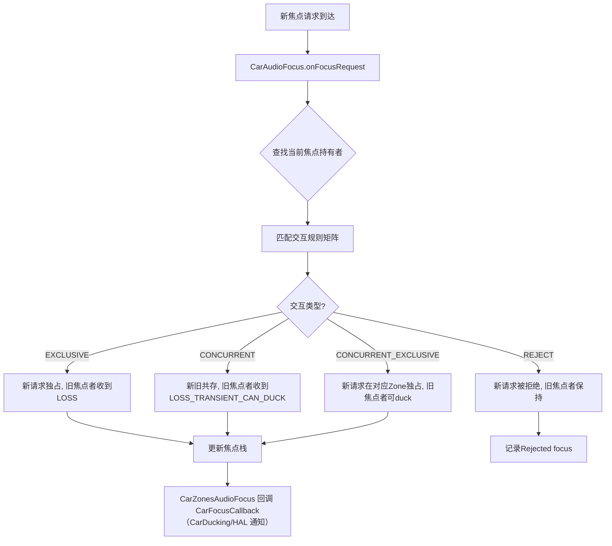
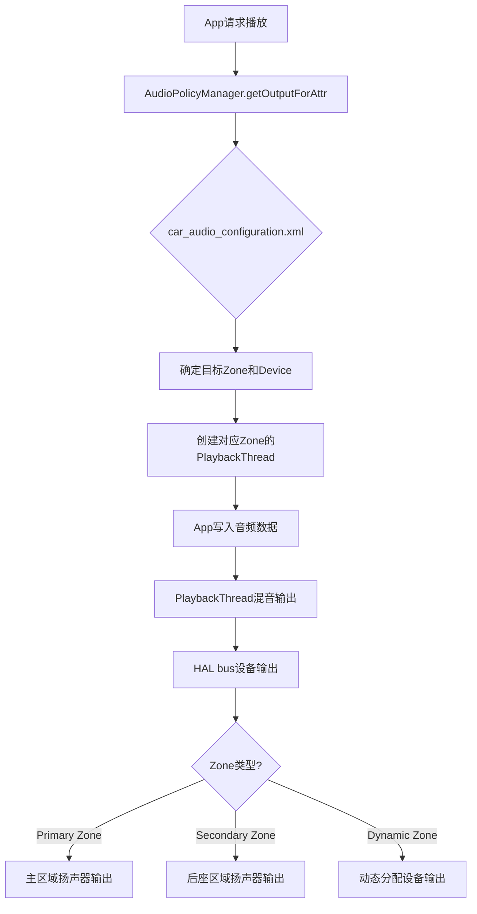
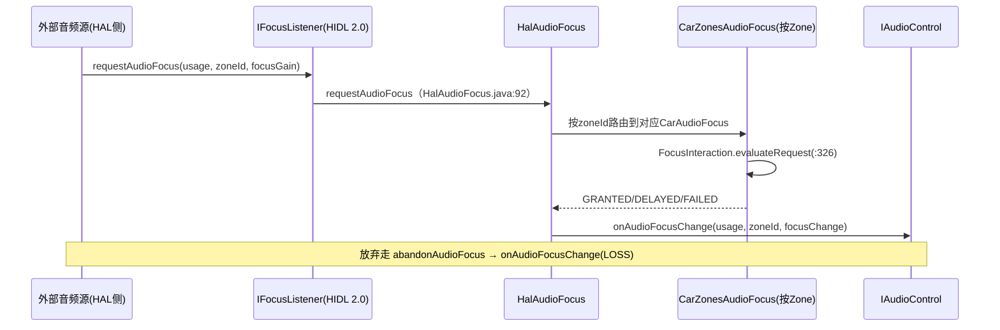
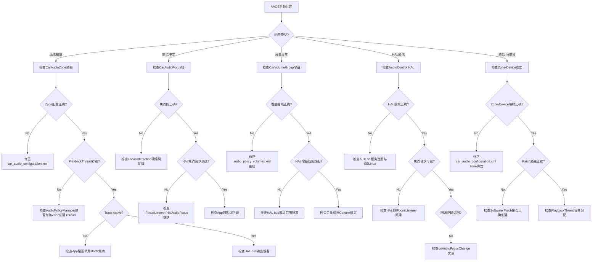

## 17.8 AAOS CarAudio调试

> [← 上一个](17_17.7_AudioFlinger详细dump解读.md) | [返回目录](README.md) | [下一个 →](17_17.9_AudioPolicy配置验证.md)

---


### 17.8.1 CarAudioFocus调试

AAOS音频焦点通过CarAudioFocus管理，调试时需检查焦点栈和交互规则。

**焦点调试命令**：

> **版本边界（负结论）**：12L `CarAudioService.dump(IndentingPrintWriter)`（`CarAudioService.java:304`）**不解析任何子命令**——`dumpsys car_audio focus`/`focus_history` 等子命令与 `cmd car_audio ...` 命令族均不存在（`packages/services/Car` 全树 grep 无匹配）。

```bash
# CarAudio 全量状态（含焦点 dump，无子命令）
adb shell dumpsys car_audio

# 监听焦点变化（CarZonesAudioFocus 的 TAG 经 CarLog.tagFor 前缀）
adb logcat -s CAR.AUDIO CarDucking

# 查看框架侧焦点栈（MFC）
adb shell dumpsys audio | grep -A 30 "Audio Focus"
```

**CarZonesAudioFocus dump输出结构**（`CarZonesAudioFocus.java:227`，12L 逐字摘录）：

```java
    void dump(IndentingPrintWriter writer) {
        writer.println("*CarZonesAudioFocus*");
        writer.increaseIndent();
        writer.printf("Delayed Focus Enabled: %b\n", mDelayedFocusEnabled);
        writer.printf("Has Focus Callback: %b\n", mCarFocusCallback != null);
        writer.println("Car Zones Audio Focus Listeners:");
        writer.increaseIndent();
        for (int i = 0; i < mFocusZones.size(); i++) {
            writer.printf("Zone Id: %d\n", mFocusZones.keyAt(i));
            writer.increaseIndent();
            mFocusZones.valueAt(i).dump(writer);
            writer.decreaseIndent();
        }
        writer.decreaseIndent();
        writer.decreaseIndent();
    }
```

**焦点交互矩阵验证**：



> **常见焦点问题**：
> 1. 导航播报无法打断媒体 → 检查 FocusInteraction 硬编码矩阵（12L 为构造期硬编码，见 [9.4](../09_AAOS_Car_Audio/09_9.4_CarAudioFocus-车载焦点管理.md)）
> 2. 电话铃声无焦点 → 检查RING电话属性是否在焦点交互矩阵中
> 3. 多Zone焦点冲突 → 每个Zone有独立 CarAudioFocus 实例（mFocusZones 按_zoneId_分栈）

### 17.8.2 CarVolumeGroup调试

CarVolumeGroup管理音量分组和增益曲线。

**音量调试命令**：

> **版本边界（负结论）**：`dumpsys car_audio volume_groups`/`volumes`/`gain_curve` 子命令与 `cmd car_audio set_volume_zone_id` 均不存在（见 17.8.1 负结论）。

```bash
# 音量组随全量 dump 输出（Volume Group Mute Enabled? + 各 zone 的 group dump）
adb shell dumpsys car_audio

# 调节音量走标准 AudioService 路径
adb shell input keyevent KEYCODE_VOLUME_UP
adb shell input keyevent KEYCODE_VOLUME_DOWN

# 增益曲线在 APM 侧（audio_policy_volumes.xml），见 17.9/13 章
```

**CarVolumeGroup dump输出**（**示意**，字段对齐 `CarVolumeGroup.java` dump：group id、每个 context 的 usage 与设备地址、CurrentGainIndex、Muted 等；逐字格式以实机 `dumpsys car_audio` 为准）：
```
Car Volume Groups:
  Zone 0:
    Volume Group 0:
      Context: MUSIC usages=[USAGE_MEDIA] devices=[bus_0_media_out]
      CurrentGainIndex: 70
      Muted: false
    ...
```

**增益曲线类型与适用场景**：

| 曲线类型 | 特征 | 适用场景 | 配置方法 |
|----------|------|---------|---------|
| Linear | 线性映射 | 通用场景 | 默认配置 |
| Logarithmic | 对数映射 | 人耳感知线性 | 12L 无独立车载曲线配置文件 |
| Exponential | 指数映射 | 低音量精细控制 | 12L 无独立车载曲线配置文件 |
| Piecewise | 分段线性 | 自定义映射 | `audio_policy_volumes.xml`（volume 元素 point 列表） |

> **版本边界（负结论）**：`car_volume_config.xml`（及其 Logarithmic/Exponential/Piecewise 曲线元素）在 `packages/services/Car` 全树 grep 无匹配，**不存在此文件**；12L 车载音量曲线沿用 APM 侧 `audio_policy_volumes.xml` 的 VolumeCurve（见 [17.9](17_17.9_AudioPolicy配置验证.md)/[13.1](../13_Volume_Device_Deep_Dive/13_13.1_Volume状态机.md)）。
>
> **OEM定制要点**：
> 1. 音量曲线在 `audio_policy_volumes.xml` 中配置（volume 元素 + 逗号分隔 point），而非车载专属 XML
> 2. 每个Volume Group的Min/Max增益需与HAL bus设备增益范围匹配
> 3. 建议Navigation和Emergency组使用较陡的曲线，确保低音量时可听

### 17.8.3 CarAudioZone调试

CarAudioZone管理多区域音频路由，每个Zone有独立的PlaybackThread和Volume Group。

**Zone调试命令**：

> **版本边界（负结论）**：`dumpsys car_audio zones`/`routing` 子命令与 `cmd car_audio route_stream_zone_id` 不存在（见 17.8.1 负结论）。

```bash
# Zone 配置随全量 dump 输出（含 UserId/AudioZone→OccupantZone/UID 映射）
adb shell dumpsys car_audio

# 查看活跃 PlaybackThread（AF 侧线程）
adb shell dumpsys audio | grep "AudioOut"

# Zone 路由由 car_audio_configuration.xml 静态决定，无运行时切换命令
```

**CarAudioService dump 结构**（`CarAudioService.java:304-360`，12L 逐字摘录要点）：

```
*CarAudioService*
  Configurations:
    Run in legacy mode? %b
    Persist master mute state? %b
    Use hal ducking signals %b
    Volume context priority list version: %d
    Volume key event timeout ms: %d
    Car audio configuration path: %s
  Current State:
    Master muted? %b
    Audio enabled? %b
  Volume Group Mute Enabled? %b
  （各 zone dump：CarAudioZone.dump）
  UserId to Zone Mapping: ...
  Audio Zone to Occupant Zone Mapping: ...
  UID to Zone Mapping: ...
```

> Zone 细节（音量组/设备地址）在 `CarAudioZone.dump` 中输出；PlaybackThread 与 Zone 的对应关系需对照 `dumpsys audio` 的线程列表。

**多Zone音频路由流程**：



> **常见Zone问题**：
> 1. Zone 1无法播放 → 检查PlaybackThread是否创建，HAL bus是否可用
> 2. 音频串Zone → 检查car_audio_configuration.xml中Zone和Device绑定是否正确
> 3. 焦点跨Zone → 每个Zone独立焦点栈，检查CarAudioFocus的Zone间转发逻辑

### 17.8.4 AudioControl HAL调试

AudioControl HAL是AAOS特有的HAL接口，负责车辆音频焦点请求和音量控制。

**AudioControl HAL版本对比**（本树实际形态）：

| 版本 | 形态 | 主要功能 | 本树状态 |
|------|------|---------|----------|
| HIDL 1.0 | IAudioControl | onAudioFocusChange、setBalanceTowardRight、setFadeTowardFront | 存在 |
| HIDL 2.0 | IAudioControl | + registerFocusListener/IFocusListener、onDevicesToDuckChange、onDevicesToMuteChange | 存在 |
| AIDL v1 | IAudioControl | onAudioFocusChange、registerFocusListener、setBalanceTowardRight、setFadeTowardFront（IAudioControl.aidl:44/79/90/101） | **本树主线（manifest 声明）** |
| AIDL v2/v3 | IAudioControl | + setMute、onDevicesVolumeChanges 等 | Android 13+/14，不在本树 |

**AudioControl HAL调试命令**：

> **版本边界（负结论）**：`dumpsys car_audio audio_control_hal`/`hal_focus_requests` 子命令与 `cmd car_audio request_hal_focus`/`notify_hal_volume_change` 均不存在（见 17.8.1 负结论）；HAL 焦点没有 shell 测试命令。

```bash
# 查看服务注册（AIDL）
adb shell dumpsys -l | grep audiocontrol
adb shell cmd -l | grep audiocontrol

# 监听 HAL 焦点链路日志（HalAudioFocus + CarZonesAudioFocus）
adb logcat -s CAR.AUDIO CarDucking
```

**AudioControl HAL焦点请求流程**：



> 真实链路：`IFocusListener.requestAudioFocus/abandonAudioFocus`（HIDL 2.0，`2.0/IFocusListener.hal:31-54`）→ `HalAudioFocus`（usage 域）→ `CarZonesAudioFocus` 仲裁 → 结果经 `IAudioControl.onAudioFocusChange` 回给 HAL。无 `requestHalFocus/replyHalFocusRequest(requestId, granted)` 方法（grep 无匹配）；本树 AIDL v1 与 VHAL 无关（VHAL 只管车辆信号）。详见 [10.3](../10_AudioControl_HAL/10_10.3_焦点回调流程.md)。

**关键调试点**：

| 检查项 | 方法 | 正常期望 | 异常处理 |
|--------|------|---------|---------|
| HAL是否加载 | `dumpsys -l \| grep audiocontrol` | AIDL v1 服务已注册 | 检查 manifest 与 SELinux |
| 焦点请求是否到达 | `logcat -s CAR.AUDIO` | HalAudioFocus requestAudioFocus 日志 | 检查 HAL 侧是否调用 IFocusListener |
| 焦点授予回调 | `logcat -s CAR.AUDIO` | onAudioFocusChange(GAIN/LOSS) 日志 | 检查 HalAudioFocus 仲裁结果 |
| Duck是否触发 | `logcat -s CarDucking` | onAudioFocusChange→duck 地址列表 | 检查 CarDuckingUtils 静态表 |

> **OEM注意**：焦点仲裁在 framework 侧（CarZonesAudioFocus + FocusInteraction 硬编码矩阵）；HAL 侧只需实现 `IAudioControl.onAudioFocusChange` 接收结果。`getAudioZoneIdForAudioFocusInfo`（`CarZonesAudioFocus.java:186`，private）按 UID→Zone 映射决定目标 Zone（Bundle `android.media.audio.attrs.ZONE_ID` 可覆盖）。

### 17.8.5 CarAudio综合调试决策树



### 17.8.6 AAOS音频调试命令速查表

| 命令 | 功能 | 关键参数 |
|------|------|---------|
| `dumpsys car_audio` | CarAudio全量状态（唯一 dump 入口，无子命令） | 无 |
| `dumpsys audio \| grep -A 30 "Audio Focus"` | 框架侧焦点栈（MFC） | 无 |
| `dumpsys audio \| grep AudioOut` | 查看PlaybackThread | 无 |
| `dumpsys audio \| grep AudioIn` | 查看RecordThread | 无 |
| `input keyevent KEYCODE_VOLUME_UP/DOWN` | 音量调节（标准路径） | 无 |
| `logcat -s CAR.AUDIO` | CarAudioService/CarZonesAudioFocus 日志 | 无 |
| `logcat -s CarDucking` | Duck 策略日志 | 无 |
| `dumpsys -l \| grep audiocontrol` | AudioControl HAL 服务注册 | 无 |

> **负结论**：`dumpsys car_audio <子命令>` 与 `cmd car_audio <子命令>` 在 12L 均不存在（`CarAudioService.dump` 不解析子命令，`packages/services/Car` 无 shell 命令实现）。

---

