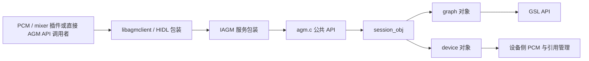
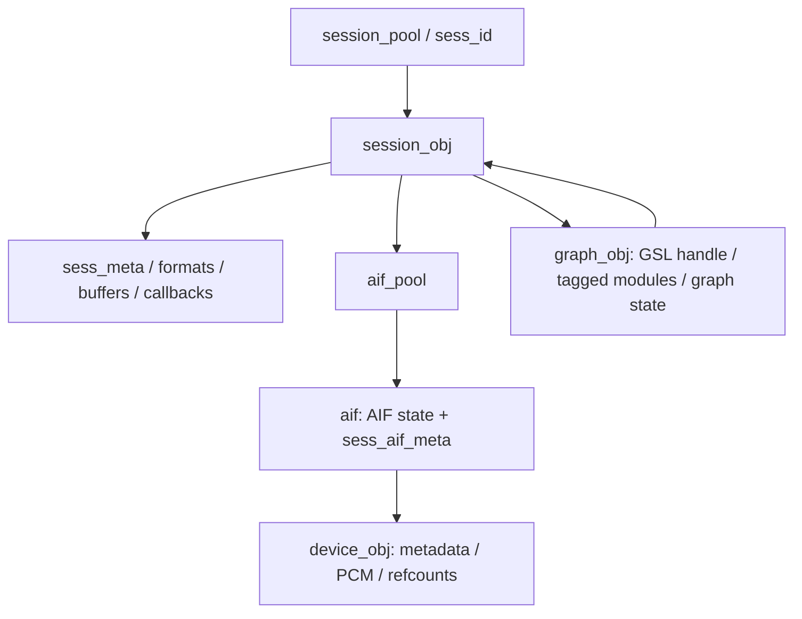
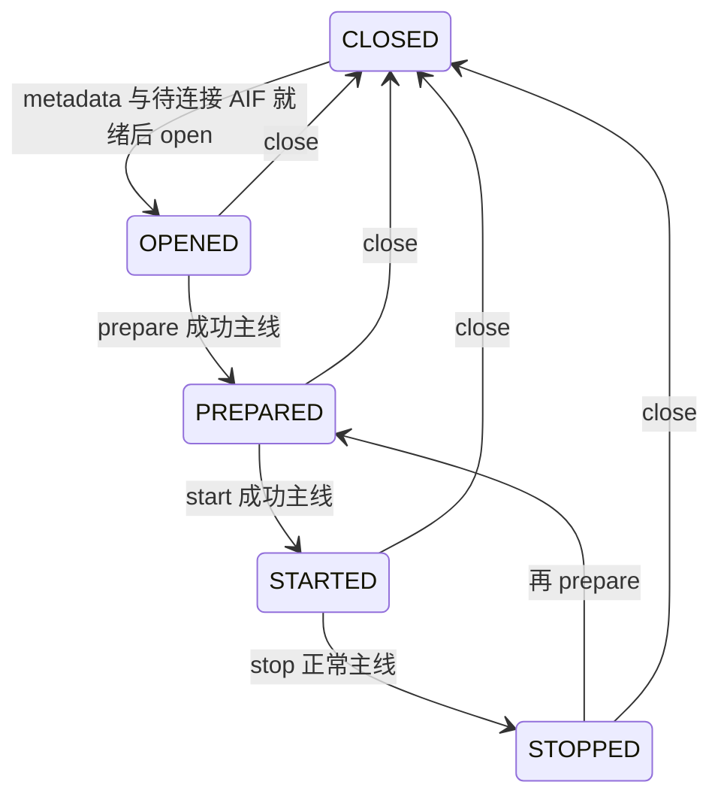

# 18.1 AGM 会话与音频图：从 metadata 到生命周期

> 前置：[15.2 PAL 分层](../15_PAL_Architecture/15_15.2_架构层次图.md)、[15.12 tinyalsa 插件](../15_PAL_Architecture/15_15.12_QC_audio-alsa_ALSA层实现.md) · [本章导航](README.md)

本文按本地 Android 12L/API 32 + AudioReach 源码解释 AGM。重点不是罗列 API，而是回答：**为什么先写 metadata/connect，再打开 PCM？open 时哪些对象已经存在？start/stop/close 各改变什么？**

GSL 在这里是下层接口；跨 VM buffer、QNX 后端和 DSP 图执行不以一根箭头代替具体实现。

## 1. 先分清客户端库与服务实现

PAL/AGM 插件链接 libagmclient；本地 HwBinders 客户端调用 IAGM，服务包装层再调用 libagm 中的同名 C API。核心实现位于 agm/service/src，不因目录名 service 就自动构成独立进程。



这是所读 HwBinders 实现链，不是所有平台的唯一部署。AUDIO_FEATURE_AGM_USES_SW_BINDER 选择另一套源码时，应继续核对模块和运行配置；SwBinders 不能由名字解释成“同进程”。

## 2. 四类标识与三套状态

| 项目 | 含义 | 不能混同 |
|---|---|---|
| session_id / sess_id | 会话池查找 key；AGM PCM 插件使用传入 device 参数 | AAOS zone、AudioFlinger I/O handle |
| uint64_t AGM handle | 本地服务核心把 session_obj 指针作为 handle 使用 | 客户端可解引用的跨进程指针 |
| AIF ID | 音频接口/后端标识；session 内 aif 项引用 device_obj | PAL device enum 或 BUS 字符串本身 |
| graph_handle | graph 对象从 gsl_open 得到的下层句柄 | AGM session handle |

`agm.c` 的 set_config/prepare/start/read/write 等入口会检查非空 handle 及 session_obj_valid_check。后者在会话池里比较对象地址，**不是同时证明 SESSION_STARTED 或图仍有效**。

对象关系：



- session_state：CLOSED、OPENED、PREPARED、STARTED、STOPPED。
- aif_state：既有 AIF_OPEN/AIF_CLOSE 请求标记，也有 OPENED/PREPARED/STARTED 等处理状态。
- graph_state：另一个字段，不能用 session 状态代替。
- device_obj 也有自己的状态及 open/prepare/start 计数；不是每个会话都独占一套硬件。

## 3. 为什么 metadata/connect 可以早于 session open

session_obj_get 不是只查找：如果 sess_id 不存在，会创建对象并加入池。初始对象 calloc 后为 SESSION_CLOSED。

因此调用 agm_session_set_metadata 或 agm_session_aif_connect 时，就可能已有 session_obj，但还没有打开 graph。CLOSED 状态下 connect 主要把 aif 项标记为 **AIF_OPEN**，等待 session_obj_open 消费；不是立即完成硬件连线。

这正好对应 PAL 的顺序：

1. SessionAlsaUtils 经 mixer plugin 下发 session/AIF/session-AIF metadata 与 connect。
2. 后续 SessionAlsaPcm::start 调 pcm_open。
3. AGM PCM plugin 的 open 才调用 agm_session_open。
4. pcm_open 内 HW_PARAMS/SW_PARAMS 再调用 agm_session_set_config。

如果反过来先开普通会话，没有 AIF_OPEN 项，session_open_with_first_device 会返回 **-EPIPE**。这里的 EPIPE 表示没有待连接 backend，不应直接诊断成播放 underrun。

## 4. metadata、tag、cal 与媒体格式不是一份结构

### 4.1 私有 metadata 的确切归属

定义在 `service/inc/private/agm/agm_priv.h`，不是旧文所写的 metadata.h；后者声明处理函数。

- agm_key_vector_gsl：size_t num_kvs + agm_key_value 指针。
- agm_meta_data_gsl：gkv、ckv、**struct sg_prop sg_props**。
- sg_prop：prop_id、num_values、values 指针。

公共 agm_tag_config / agm_cal_config 使用柔性数组 kv[]；不能拿私有指针布局当 IPC 或序列化 blob 布局。公共 tag 结构原文：

```c
struct agm_tag_config {
    uint32_t tag;                /**< tag id */
    uint32_t num_tkvs;           /**< num  of tag key values*/
    struct agm_key_value kv[];   /**< tag key vector*/
};
```

媒体配置另有 rate/channels/format/data_format；session_config 包含方向、模式、阈值、codec union、data_mode、flags。buffer_config 的 size/count/max_metadata_size 又是 buffer 维度，不是 graph KV 个数。

### 4.2 connect 合并的顺序会影响同 key 的结果

普通连接中调用：

```c
merged_metadata = metadata_merge(3, &sess_obj->sess_meta,
                     &aif_obj->sess_aif_meta, &aif_obj->dev_obj->metadata);
```

metadata_merge 按参数顺序拼接 GKV/CKV/properties，再去重。GKV/CKV 去重按 **key** 删除后出现项，保留最早项；不是“device 总覆盖 stream”。properties 按 value 去重，prop_id 在处理带 values 的输入时赋值，不能推广为多种 prop_id 的通用字典合并。

这些 KV 用来选择图、校准及属性操作，不是把可执行模块代码装进一块 PCM buffer。

### 4.3 写入与校验边界

metadata_copy 根据长度分段检查并复制 GKV、CKV 和 properties；某些尾段不足可以提前正常结束，不能宣称每次都要求完整三段。session metadata setter 先释放旧 metadata，再复制新值；失败不保证自动恢复旧配置。

metadata_update_cal 只替换已有 CKV 中相同 key 的 value，不追加不存在的 key。这与合并、参数下发是不同操作。

## 5. session open：首设备、其余设备与无设备模式

session_obj_open 先获取/创建对象，要求 SESSION_CLOSED，再保存 sess_mode。

| 模式 | 本地打开路径 | 不能据此推断 |
|---|---|---|
| DEFAULT | 找 AIF_OPEN，首设备开图，再连接其余设备 | 所有流都固定一个后端 |
| NO_HOST | 同样走有设备路径 | 所有车载 TDM 必然是这种模式 |
| NON_TUNNEL | session_open_without_device | 不使用 DSP/不跨 VM |
| NO_CONFIG | session_open_without_device | 根本不创建 graph 或 GSL handle |

首设备连接执行 metadata_merge→device_open→graph_open；当已有会话需要替换首设备时走 graph_change；新增到已有图的设备走 graph_add。之后应用缓存的 stream、session-device、device 与 tag 参数。

普通 open 成功才设置 SESSION_OPENED 并写出 session 指针。重复打开非 CLOSED 会话返回 -EALREADY。

**失败路径不是统一事务。** 例如连接余下设备的 unwind 会继续执行 disconnect/graph_close，并反复覆盖 ret；不能仅凭最后一个返回值推断最早失败被保留或所有状态已复原。图和设备日志必须关联同一个 sess_id/AIF。

## 6. graph_open：根据 tag/module 信息准备对象，再调用 GSL

graph_open 分配 graph_obj；除 NO_CONFIG 分支外，会：

1. 根据 GKV 查询 tag→module 信息。
2. 将命中的 stream 与 hardware endpoint 模块加入 tagged_mod_list，保存 module ID/instance ID。
3. 对设备模块保存相关 GKV 与 device 引用，供后续配置使用。
4. 调 gsl_open，并注册 GSL event callback。
5. 成功后设置 graph OPENED，返回 graph_obj。

核心调用原文：

```c
ret = gsl_open((struct gsl_key_vector *)&meta_data_kv->gkv,
               (struct gsl_key_vector *)&meta_data_kv->ckv,
               &graph_obj->graph_handle);
```

这里没有根据某个 PAL stream type 直接硬编码整条 DSP 拓扑。实际模块集合取决于 metadata、数据库及 GSL 返回，不能在教材里编一张所有板型通用的固定 Graph。

## 7. set_config 与 prepare：配置缓存和执行分开

session_obj_set_config 复制 stream_config，并按 TX/RX 存放输入或输出媒体/buffer 配置。输出会话在 STARTED/STOPPED 时还可能走 graph_set_media_config_datapath，不能一律解释成只写缓存。

session_prepare 在有设备模式检查可用 AIF、应用设备参数，然后在非 STARTED 状态调用 graph_prepare。后者：

- 遍历 tagged 模块，调用 configure；检查部分方向/hostless 与模块组合。
- 已配置模块通常跳过；硬件端点有重新配置及已启动引用的特殊条件。
- 非 NO_HOST 且非 NO_CONFIG 时配置 buffer。
- 调 `gsl_ioctl(..., GSL_CMD_PREPARE, ...)`，成功后设 graph PREPARED。

session 也在相应成功分支设 SESSION_PREPARED。图配置成功与设备开始输出不是同一个时刻。

## 8. start 的顺序不是永远“先设备后图”

普通有设备模式先检查 AIF；TX 若配置 loopback/EC reference，还检查对应播放 session 或参考 device 的启动状态。

在 hwep_lock 内：

1. SLIMBUS 端点提前 device_prepare/device_start。
2. 调 graph_start→GSL_CMD_START。
3. 再准备/启动其余端点。
4. 所需步骤成功后设置 SESSION_STARTED。

这只是本地条件顺序，不证明本板使用 SLIMBUS。NON_TUNNEL/NO_CONFIG 跳过设备腿，直接启动图。

还应注意：本地 AGM **device_start 并没有调用 pcm_start**。它检查 DEV_PREPARED，维护引用计数和 DEV_STARTED；不要与 PAL Device::start 或 SessionAlsaPcm 的 pcm_start 混为一谈。下层开始执行的含义必须结合 graph_start 看。

失败清理可能 graph_stop，再停止已经标记 AIF_STARTED 的设备；不保证所有中间 PREPARED 状态都被统一清除。

## 9. read/write：状态检查、buffer 包装与 GSL count

服务核心 agm_session_read/write 校验 handle，然后进入 session_obj_read/write。两者在锁内只明确拒绝 SESSION_CLOSED，随后解锁，再构造 agm_buff 并调用 graph 层。**不是只允许 STARTED，也不是整个阻塞 I/O 都持有 session 锁。** 并发 close 的安全性不能仅由这个局部锁推出。

graph 层把 addr/size/timestamp/flags/metadata/alloc_info 转成 gsl_buff：

- 普通路径使用 SHMEM_ENDPOINT tag。
- NON_TUNNEL 且 RX|TX 时，write/read 分别选 WR_SHMEM_ENDPOINT/RD_SHMEM_ENDPOINT。
- graph_write 成功后把 GSL size_written 回填 *size；错误时不执行这个成功回填。
- graph_read 回填 size_read 和时间戳；遇到普通模式零字节会记录异常条件，但该条件没有先显式另设一个非零错误码。

Graph read/write 返回的是状态与 count 双通道，不应把 graph.h 的 read 注释“返回字节数”直接当作实现行为。

### HIDL 普通数据路径存在拷贝

客户端 write 将数据复制到 HIDL vector，服务端再 calloc 并 memcpy 到本地 buffer，调用 libagm 后回送 ret/cnt。read 也有服务端 buffer/vector 和客户端复制。MMAP/metadata-buffer 另走各自接口，不能据此断言所有接口都复制，也不能反过来宣称全链路零拷贝。

## 10. stop 与 close：释放粒度不同

### 10.1 stop 顺序区分 RX/TX

session_stop 要求 SESSION_STARTED。普通 RX 先停图，再停止设备；TX 先停止设备，再停图。无设备模式只停图。设备停止按引用计数，最后一个 start 引用才调用底层 drop/pcm_stop。

正常主线最后设 SESSION_STOPPED，但某些错误分支仍会推进局部状态。例如 graph_stop 无 metadata 分支在检查 GSL STOP 结果前就写 STOPPED；不能把软件状态当作成功确认。

### 10.2 disconnect 不是整个 session close

断开最后一个连接 AIF 时，代码用 session-AIF/device 的 properties 选择局部 graph_stop/close-with-props；多 AIF 时用 graph_remove。随后 device_close。这个选择与直接关闭整个 graph_obj 不同。

### 10.3 close 后会话对象仍可能留在池中

session_close 对已 CLOSED 返回 -EALREADY；其余路径必要时停图、调用 graph_close、清空 graph 指针，关闭达到相应状态的 AIF device，最后设 SESSION_CLOSED。

它没有在这里移除/free session_obj；整个池的释放另在 deinit。因此旧地址仍能通过 pool membership 检查不代表流仍然打开。重开相同 sess_id 与创建全新对象也是两个概念。

graph_close 即使 gsl_close 报错，仍释放本地模块列表、锁和 graph 对象。device_close 只在最后 open 引用释放 PCM。多步清理的 ret 可能被后续步骤覆盖，不能宣称“返回 0 证明每一步远端资源都销毁”。



图仅表示常见 session 生命周期，不是所有错误/动态连接分支的完备转移约束；graph/AIF/device 有独立状态。

## 11. 参数、校准与回调的扩展入口

- agm_session_set_params、session-AIF 参数与 tag 参数负责载荷配置，不等于重新 set_config 媒体格式。
- CLOSED 时某些参数路径会缓存数据，但 session_obj_set_sess_params 同时可返回 -EINVAL；不能把失败一律解读成无副作用。
- agm_session_aif_set_cal 与 ACDB 参数接口是校准入口；数据库安装、路径映射与生效另需追踪，不能根据接口存在宣称校准已加载。
- graph_event_cb 根据 session_id 找池对象，在 cb_pool_lock 下按来源模块和 event_type 筛选 data-path/module callback。READ_DONE/WRITE_DONE/EOS_RENDERED 等事件不是扬声器声学测量。

## 12. 到 GSL 的证据止于哪里

AGM service/Android.mk 对 PRODUCT_NAME=msmnile_gvmq 选择 gsl_fe 头目录，对 ENABLE_HYP=true 链接 libar-gsl_fe，否则 libar-gsl。注意头文件选择与库选择使用的是两个不同条件。

所读代码证实 gsl_open、gsl_ioctl、gsl_read/write 等边界，**尚不足以从本文确定 MM-HAB 消息、跨域共享内存地址、DSP APM 命令封装及板级输出连接**。这些属于后续 GSL 前后端、QNX 与 kernel 主题。

## 13. 源码阅读与定位顺序

路径相对 `Android/lagvm/LINUX/android/`：

1. `vendor/qcom/opensource/agm/service/inc/public/agm/agm_api.h`：公共结构与 API。
2. `vendor/qcom/opensource/agm/service/src/agm.c`：入口与 handle 检查。
3. `vendor/qcom/opensource/agm/service/src/session_obj.c`：池、AIF、生命周期与错误清理。
4. `vendor/qcom/opensource/agm/service/inc/private/agm/agm_priv.h`、`vendor/qcom/opensource/agm/service/src/metadata.c`：布局、复制与合并。
5. `vendor/qcom/opensource/agm/service/src/graph.c`、`vendor/qcom/opensource/agm/service/src/device.c`：GSL 与设备侧边界。
6. `vendor/qcom/opensource/agm/ipc/HwBinders/agm_ipc_service/src/agm_server_wrapper.cpp`：HIDL 到核心 API 的第二次转换。

定位时分别记录 session/AIF/graph/device 状态、首次失败、后续清理和实际 count。这里没有构建、IPC 实测、错误注入或硬件测试结果。
