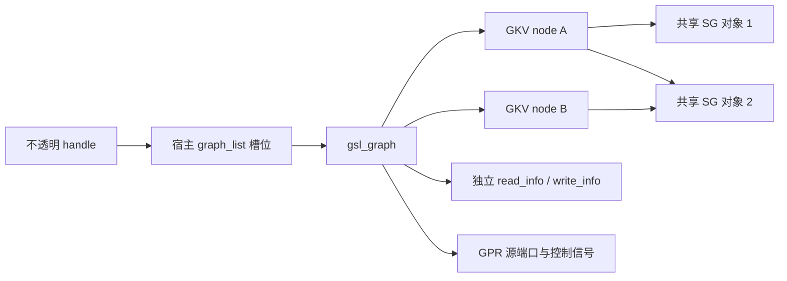
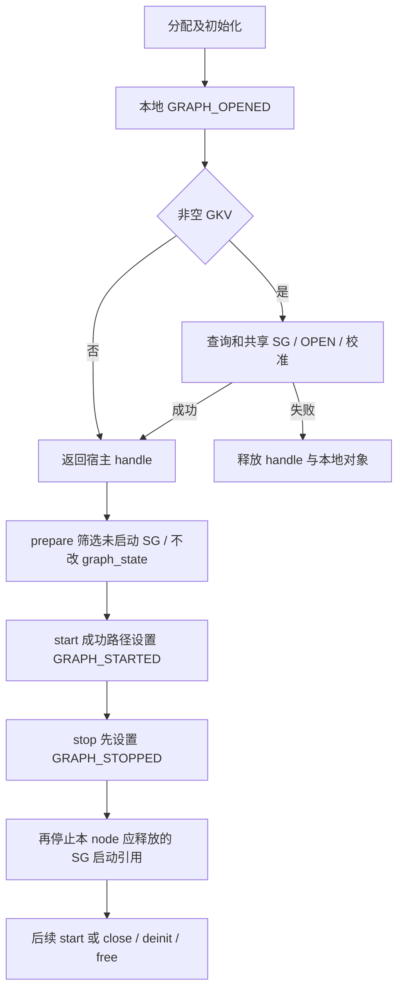
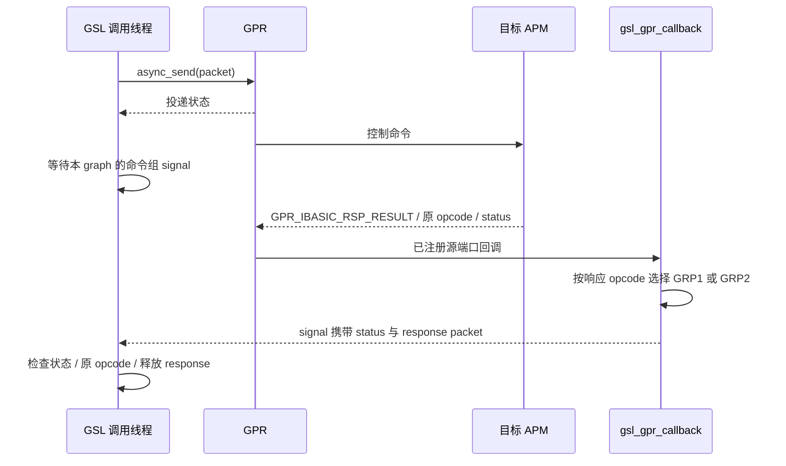
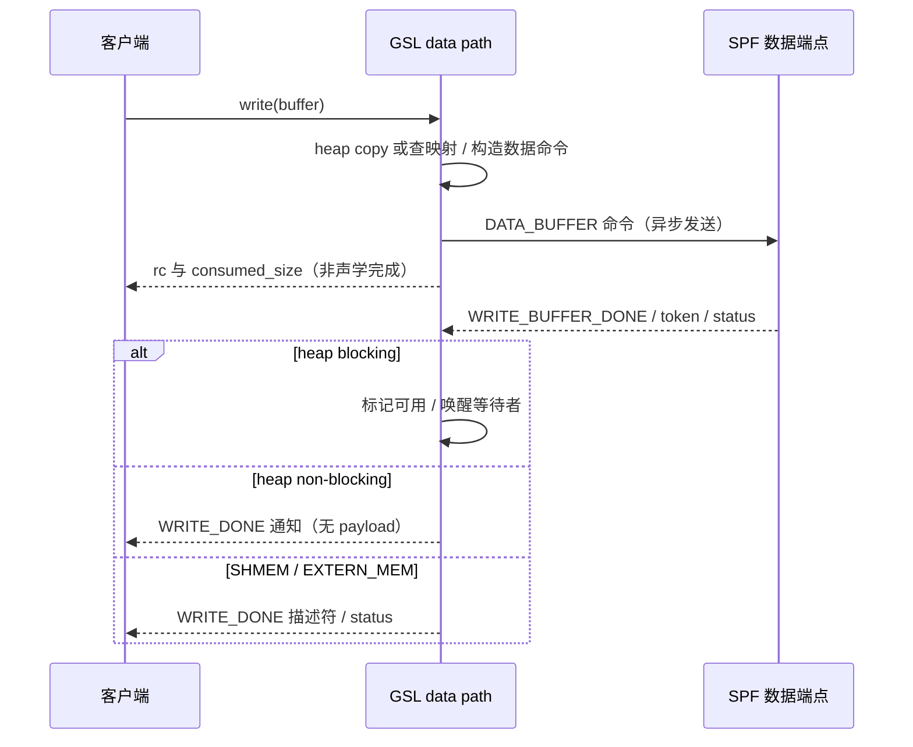

# 18.3 GSL 图生命周期与 DSP 命令

> [本章导航](README.md) · [前篇：GSL 跨 VM](18_18.2_GSL跨VM控制与缓冲区.md) · [AGM 会话](18_18.1_AGM会话与音频图.md) · [总导航](../README.md)

## 从 API 成功到 DSP 完成，还有哪些层？

AGM 将 metadata 转成 GKV/CKV 后调用 GSL；虚拟化路径再经前端与 VM 后端到达 QNX 本地实现。本篇从这里开始：**GSL 是宿主侧图管理库，不是 DSP 上 APM/SPF 的内部实现，也不因名称含 Service 就成为独立进程。**

主线为本地 Android 12L/API 32 + SA8295 + QNX AudioReach。QNX GSL 的可见实现位于 `Qnx/apps/qnx_ap/AMSS/multimedia/audio/audio_ar/audio_driver/audio_reach/gsl/`。Android gsl_fe 内部仍是预编译可见性边界；本篇不替它补写序列化细节。HAB 命令/事件与 HOST/GUEST 内存见 [18.2](18_18.2_GSL跨VM控制与缓冲区.md)，数据库加载/追加见 [16.6](../16_Vendor_QNX_Architecture/16_16.6_ACDB校准体系.md) 和 [16.7](../16_Vendor_QNX_Architecture/16_16.7_ACDB校准数据Android与QNX双域共享.md)。

阅读后应能回答：为什么一个 GSL handle 不等于一个 DSP 子图？为什么 prepare 不产生 PREPARED 状态？write 返回的字节数与 WRITE_DONE 分别证明什么？

## 18.3.1 三种对象、两类地址

主要实现：[gsl_main.c](../../Qnx/apps/qnx_ap/AMSS/multimedia/audio/audio_ar/audio_driver/audio_reach/gsl/src/gsl_main.c)、[gsl_graph.h](../../Qnx/apps/qnx_ap/AMSS/multimedia/audio/audio_ar/audio_driver/audio_reach/gsl/inc/gsl_graph.h)、[gsl_subgraph_pool.c](../../Qnx/apps/qnx_ap/AMSS/multimedia/audio/audio_ar/audio_driver/audio_reach/gsl/src/gsl_subgraph_pool.c)。

| 对象/标识 | 它承担什么 | 不应与什么混同 |
|---|---|---|
| `gsl_handle_t` | 公共 API 的不透明句柄，入口据此查全局 graph_list | C 类型是 `void *`，但本实现并不直接返回 graph 地址 |
| `gsl_graph` | 宿主对象：GKV 链表、控制信号、read/write 数据路径、客户端回调 | 不是一个 DSP module，也不是 AGM session_id |
| `gsl_graph_gkv_node` | 保存一组 GKV/CKV、SG 指针数组、连接、启动/停止位图、子系统依赖 | 一个 graph 可有多个 node；一个 node 可含多个 SG |
| `gsl_subgraph` / SGID | 全局池按 SGID 查找的共享对象；open/start/stop 引用计数 | 不等于 graph handle、GKV 或 MIID |
| GPR `src_port` / `dst_port` | 回调注册端口/目标 APM 或数据端点 MIID | 不是每个端口都代表音频处理模块；源端口可代表宿主 graph |
| `proc_id` / domain | 报文目的处理器/域；默认 ADSP，driver property 还参与选择 | 不是 Android Zone 或 HAB 的 VM 会话编号 |

`to_gsl_handle()` 的真实短摘录：

```c
return (gsl_handle_t)((uintptr_t)(GSL_MAGIC_WORD |
	(index << GSL_GRAPH_IDX_SHIFT)));
```

`get_graph_handle()` 找空槽、必要时扩表，赋予源端口并存入对象；`to_gsl_graph()` 在锁内检查 magic、抽取索引后查表。客户端不能解引用或自行构造这个值。关闭后槽位可复用，编码中没有展示代际字段，因此也不能把“magic 合法”理解为永久有效的对象身份或并发关闭保护。



这张图解释了共享的必要性：两条使用同一设备子图的会话，不应因第二次 open 就重复创建相同 SG，也不应因第一条 stop 就停止仍被第二条使用的 SG。是否共享由 ACDB 返回的 SGID/连接和实际引用决定，不从“相同 PAL Device”直接推导。

## 18.3.2 open：选择、去重、发命令，再挂接本地节点

实现入口在 [gsl_graph.c](../../Qnx/apps/qnx_ap/AMSS/multimedia/audio/audio_ar/audio_driver/audio_reach/gsl/src/gsl_graph.c)：`gsl_graph_open()` → `gsl_graph_open_single_gkv()` → `gsl_graph_open_sgids_and_connections()`。

1. `gsl_open()` 分配宿主 graph/handle，初始化锁、signal 和列表，再进入 graph open；失败释放 handle 并清理本地对象。
2. graph open 注册 `gsl_gpr_callback`。允许空 GKV：此时可以有宿主 graph 和注册端口，却尚无本次要在 SPF 打开的 GKV。
3. 非空 GKV 查询 ACDB 的 SG 列表和连接；加入 SG/连接池并裁剪已共享部分。普通 pool add 增 `open_ref_cnt`，`preload_only` 不增；裁剪按计数和可选 property 判断，不是按“字符串相似”匹配图。
4. 取得新 SG 的 SPF blob、driver property、连接 blob。driver property 参与路由/子系统选择；所需 SPF 子系统未就绪可返回 `AR_ESUBSYSRESET`。
5. 新 SG 和连接都为空可直接成功，无须再发 OPEN。否则构造 `APM_CMD_GRAPH_OPEN`，交 GPR 并等 basic response。
6. 对新 SG 应用校准。此路径把 `AR_ENOTEXIST`/`AR_EUNSUPPORTED` 归为可容忍，其他校准错误会尝试 close 已开 SG，并保留原校准错误；因此 open 成功仍不能证明所有校准项均应用成功。
7. 成功后缓存 GKV/CKV、将 node 挂入 graph；失败分支移除已加入的子图/连接引用并释放临时数据。各辅助函数仍需分别看错误出口，不能概括成跨 DSP 的原子事务。

SG 池 `gsl_sg_pool_remove()` 递减普通 open 引用，降到零且成功脱链才释放对象。**池中的 open 引用与 `start_ref_cnt` 是不同资源维度**：已打开不等于已运行，正在运行也不代表该调用独占子图。

### 命令载荷并不总在共享内存

[gsl_msg_builder.c](../../Qnx/apps/qnx_ap/AMSS/multimedia/audio/audio_ar/audio_driver/audio_reach/gsl/src/gsl_msg_builder.c) 的 `gsl_msg_alloc_ext()` 根据 `force_inband` 和目的域共享内存能力选择：

- in-band：分配包含命令及附加 payload 的 GPR packet，`msg->payload` 指向包内区域；共享内存字段清零。
- OOB：GPR packet 装命令头，另分配/映射 payload，保留宿主 `v_addr`、SPF 地址和映射 handle。
- OPEN 填入 `apm_cmd_header_t` 的地址、mem_map_handle、payload_size，再发送；不能把这里的 SPF 映射 handle 当 HAB export ID。
- `gsl_msg_free()` 分别释放尚持有的共享内存和 packet。发送函数会把 packet 指针置空；“已发出的包”和“调用者还需释放的 OOB”不是同一所有权。

## 18.3.3 状态是本地记账，不是远端状态镜像

`enum gsl_graph_states` 有七项：`GRAPH_IDLE`、`GRAPH_OPENED`、`GRAPH_STARTED`、`GRAPH_STOPPED`、`GRAPH_CLOSED`、`GRAPH_ERROR_ALLOW_CLEANUP`、`GRAPH_ERROR`；**没有 `GRAPH_PREPARED`**。

比枚举注释更重要的是赋值位置。`gsl_graph_init()` 初始化完成就设置 `GRAPH_OPENED`，发生在发送图 OPEN 之前；空 GKV 也可成功返回。常规 `gsl_graph_close()` 没有赋 `GRAPH_CLOSED`，上层随后 deinit/free。不能仅凭枚举画出“每次成功命令严格推进一步”的状态机。



这是普通调用路径示意，不是 API 允许状态的完整自动机。关键区别：

| 操作 | 源码中的决定条件与状态 | 错误边界 |
|---|---|---|
| prepare | 空 GKV 无事可做；只将 `start_ref_cnt == 0` 的 SG 放入 PREPARE 列表 | 不负责分配所有数据 buffer，也不新增 graph 状态 |
| start | 每个 node 筛出尚未由任何引用启动的 SG；basic response 成功或无需发送后，更新该 node 的 start/stop mask 和全局计数 | 前一 node 已成功、后一 node 失败时，没有统一回滚此前启动；read buffer 初次入队返回值在此未被接收 |
| stop | 普通入口仅在 `GRAPH_STARTED` 继续，否则 `AR_EALREADY`；阻止新读写、唤醒/等待在途调用，然后先改 `GRAPH_STOPPED` | 等待异常后仍可能继续；SG STOP 失败不使本地状态自动回滚 |
| read/write | 公共入口拦截两个 ERROR 状态；graph 层检查 flush/stop 的瞬态标志 | 这里并非统一验证 `graph_state == GRAPH_STARTED`，不能由注释推导严格门禁 |
| close | 顶层先尝试 stop，随后 close 全部 node、注销 GPR、释放数据路径与宿主对象 | stop 错误被记录后仍继续；返回值主要来自 close，不保证远端此前每一步成功 |

`gsl_graph_stop_single_gkv()` 只向最后一个启动引用的 SG，或相应已无 start/stop 引用的分支发送 STOP；有 property 时还筛选属性。只有命令成功或无 SG 需要发送，才调整该 node 的 mask 与对应计数。其他 graph 仍使用的共享 SG 不应随本 node 一起停止。

### SSR 不是“任意错误升级”

`gsl_main.c` 的子系统回调按 graph 依赖掩码找受影响对象：master down 进入 `GRAPH_ERROR`，satellite down 进入 `GRAPH_ERROR_ALLOW_CLEANUP`，后者保留向仍存活 master 清理的需要。它们不是“轻微错误/严重错误”通用等级。

`gsl_graph_update_state()` 对已有两类错误态不再改写；它返回旧状态，不是头注释所称更新后状态。普通 `gsl_ioctl()` 在两类错误态都返回 `AR_ESUBSYSRESET`，因此不能给 ERROR_ALLOW_CLEANUP 列出普通 ioctl STOP 作为可用操作。`gsl_close()` 的独立清理路径另行处理；master 已 down 时部分 SPF 清理/等待被跳过。UP 通知、新图重开与旧音频恢复是三件事，参见 [VM 清理](18_18.2_GSL跨VM控制与缓冲区.md)。

## 18.3.4 GPR：投递、应答与事件不是一个返回值

实现：[gsl_common.c](../../Qnx/apps/qnx_ap/AMSS/multimedia/audio/audio_ar/audio_driver/audio_reach/gsl/src/gsl_common.c) 与 `gsl_gpr_callback()`。

`gsl_allocate_gpr_packet()` 填 domain、port、token、opcode 和 payload_size；源 domain 常量为 APPS，目的 domain 由调用参数指定，不能把所有报文都硬编码成 ADSP。GSL 调 GPR 发送，具体 datalink/平台传输是下一层职责；此处不据目录存在证明实机链路已建立。



两组不是“一个串行、一个自由并行”：

- `GRAPH_CTRL_GRP1_CMD_SIG` 收 OPEN/CLOSE/PREPARE/START/SUSPEND/STOP 的 basic response。
- GRP2 收 FLUSH、SET/GET/REGISTER/DEREGISTER CFG、模块事件注册等；`APM_CMD_RSP_GET_CFG` 也投递到此。
- 头文件假设同组请求由客户端串行化，实现还使用 open_close/start_stop/get_set_cfg 等不同锁；信号对象只保存一份 packet，新 set 可释放旧 pending packet。这不是任意并发请求的 response 队列。
- 对普通图控制，callback **按 basic response 中的 opcode 分组**，不是用 token 建一张无限请求表。数据完成中的 token 才用于 buffer 索引/外部内存缓存键；不能声称同一个 token 原样跨越 FE、HAB、GSL、DSP 全链路。

`gsl_send_spf_cmd()` 的等待出口短摘录：

```c
if (rc)
	rc = AR_ETIMEOUT;
else if (ev_flags & GSL_SIG_EVENT_MASK_CLOSE)
	rc = AR_EABORTED;
else if (ev_flags & GSL_SIG_EVENT_MASK_SSR)
	rc = AR_ESUBSYSRESET;
```

SPF response 分支再取 `spf_status`；basic-response helper 在成功且收到相应类型包时检查原 opcode，不匹配为 `AR_EUNEXPECTED`。调用者传空 signal 的数据提交只得到发送阶段结果，不会在该函数等待处理完成。这里没有通用超时重发协议；超时也不能证明远端一定未执行。

[gsl_common.h](../../Qnx/apps/qnx_ap/AMSS/multimedia/audio/audio_ar/audio_driver/audio_reach/gsl/inc/gsl_common.h) 默认分支控制超时 1000ms、read/write 等待 60000ms；Windows COSIM 和 GPR_STUB 分支不同。它们是等待上限/条件编译值，不是音频延迟指标或本次实机生效测量。

## 18.3.5 数据路径：谁持有 buffer，谁等待什么？

实现：[gsl_datapath.c](../../Qnx/apps/qnx_ap/AMSS/multimedia/audio/audio_ar/audio_driver/audio_reach/gsl/src/gsl_datapath.c)，结构见 [gsl_datapath.h](../../Qnx/apps/qnx_ap/AMSS/multimedia/audio/audio_ar/audio_driver/audio_reach/gsl/inc/gsl_datapath.h)。图的 read_info/write_info 分开缓存配置、MIID/tag、buffer 列表、metadata 列表和 dp_signal。

CONFIGURE_READ/WRITE_PARAMS 先检查结构大小，再配置相应方向；graph 层拒绝在 STARTED 时重配。配置带 shmem_ep_tag 时，通常先从已关联 SG 查询模块并要求恰好一个结果，再缓存 MIID/tag（只分配共享内存的 setup mode 有跳过分支）；不是把 tag 数值直接当目的端口。随后查询目的域共享内存能力，并据 mode 选择实现。**普通阻塞、非阻塞、SHMEM、EXTERN_MEM、PUSH_PULL 是不同模式，不是开关的五种写法。**

| 模式 | 本地传递机制 | 返回与完成 |
|---|---|---|
| BLOCKING / NON_BLOCKING | heap API 拷贝到/从内部 buffer；支持共享内存时使用映射 buffer，不支持时有包内数据分支 | 无可用 buffer 时前者等 signal，后者可返回 `AR_ENORESOURCE`；之前可能已有部分字节进度 |
| `GSL_DATA_MODE_SHMEM` | 用客户端 addr 查内部映射 buffer 及 offset；发送后等完成事件 | read 立即设 `filled_size=0`，真实数据由 READ_DONE 提供；write 的 `consumed_size` 不是 DSP 完成量 |
| EXTERN_MEM | 客户端 allocation 信息进入外部内存映射缓存，token 按缓存规则使用 | 完成返回 allocation handle/size/offset；不是普通内部 buff_list 索引协议 |
| PUSH_PULL | 配置数据及位置共享区，向 SPF 设置 push/pull 参数 | 普通 `gsl_dp_read/write` switch 不实现此模式；不能仍画成每块 read/write 命令和 DONE |

SHMEM/EXTERN_MEM/PUSH_PULL 在目的域不支持共享内存时返回不支持；阻塞/非阻塞可走 non-shmem 分支。数据模式与 HOST/GUEST 的 VM 分配角色是两个维度。

### 播放：写入成功首先意味着提交，不是已播出

阻塞/非阻塞 heap write 找内部可用 buffer，将客户端 PCM `memcpy` 进去，按配置 buffer_size 分块发送。每次发送成功才增加 `consumed_size`，满了再找下一块；中途资源不足/关闭/SSR/等待错误会带着此前进度返回。它等待的是**可复用的 buffer**，不是保证本次全部音频声学播放完。

SHMEM write 分支的真实摘录：

```c
rc = gsl_dp_write_shmem(dp_info, internal_buff, internal_md_buff,
	offset, buff_idx, buff->size, buff);
*consumed_size = buff->size;
```

这里即使底层 rc 失败仍会赋请求长度，EXTERN_MEM 也有相似赋值。因此一定同时检查 rc、输出计数和后续事件；不能只见 `consumed_size == size` 就宣布完成。



### 录音：可用 buffer 在这里表示已填好

初次 start 可为 heap 模式预投递 read buffers；数据完成后标记可用。`gsl_dp_read_heap()` 把已填数据拷给客户端，再把内部 buffer 投回 SPF。循环条件是剩余请求容量至少一个配置 buffer_size：小于一块的请求可能成功返回零填充，不能认为任意字节数都会完整读出。

填充 helper 使用 SPF 报告的 data_size；共享内存分支仍留有“假定 SPF 返回不超过客户端请求”的 TODO。重新投递失败还可能发生在已拷贝、但本轮 `filled_size` 尚未累加之间。这里解释静态实现边界，不把它写成已经复现的越界或掉音。non-shmem 分支用包内 data_size/metadata_size 拷贝，同样不能由 API 名推导任意输入都经过了完整容量验证。

SHMEM read 不做上述 heap copy 循环，发送后立即返回零 filled_size，READ_DONE 携带实际 size、timestamp/flags 和 metadata 状态。数据 status、metadata status 与提交 rc 是独立信息。

## 18.3.6 完成回调、EOS 与关闭的所有权

`gsl_handle_read/write_buff_done()` 从 packet token 和响应地址恢复对应 buffer 信息，进一步按 mode 分发：

- heap blocking：标记可用并 set dp_signal。当前 heap 等待代码没有取 signal 中的 status，仅处理等待结果及 CLOSE/SSR flags；不能把它描述成完整传播所有 DSP data_status。
- heap non-blocking：也标记可用，回调的 event_payload 为空，随后设置 signal 供关闭等待使用。通知意味着可继续处理，不携带完整 buffer 描述符。
- SHMEM/EXTERN_MEM：回调带临时 `gsl_event_read_write_done_payload`；必须在回调期间消费/复制描述符，不能保存栈上 payload 指针以后用。其指向的数据内存另有生命周期，复制描述符不等于延长映射寿命。
- read non-shmem 分支暂存收到的 GPR packet，待填充客户端数据后释放；不同分支不共用一个“回调返回立即释放所有数据”的规则。

`processed_buf_cnt` 也不是可靠的已播帧计数：graph callback 尝试 try_lock，只有拿锁且处于 STARTED 才增；状态转换时可以略过，stop 又清零。

EOS 使用 `DATA_CMD_WR_SH_MEM_EP_EOS`，policy 为 LAST；发送不等待。`DATA_CMD_RSP_WR_SH_MEM_EP_EOS_RENDERED` 走独立回调处理。带 EOS flag 的部分 write 路径不传递 EOS helper 的失败码，因此 WRITE 提交成功、EOS 已发、EOS_RENDERED 已收、扬声器已完成输出仍需分开判断。

关闭按 GKV 逐个清理，即便一处失败也继续其他 node；SSR 返回可被当作清理成功处理。之后广播 CLOSE 事件、在非 GRAPH_ERROR 时等待 SPF 归还 buffer，再 deinit 数据路径与注销端口。等待 helper 有超时/SSR 出口并清理 metadata、non-shmem packet；close 没有接收这些等待函数的返回值。**不能由最后释放本地内存推断所有远端命令都确认成功，或所有并发 close/read 使用方式均安全。**

## 18.3.7 把故障问题落到恰当边界

| 观察 | 下一步应核对 | 不宜直接下的结论 |
|---|---|---|
| open 失败 | GKV→SG/连接、driver property、子系统状态、OPEN response、校准错误出口 | “都是 ACDB 文件缺失” |
| 本地 OPENED，但无数据 | 是否空 GKV、是否实际打开/配置/启动了 SG 与数据端点 | “DSP 图已经运行” |
| start 成功但录音读不到 | read 配置/MIID、初次入队及其返回、DONE、mode/请求大小 | “Framework buffer 必然损坏” |
| write 有计数且 rc 非零 | mode、计数赋值位置、之前已提交的块、资源与完成事件 | “按计数全部重试一定不重放” |
| 控制等待超时 | 发送阶段、目的 domain/port、响应 opcode/分组、signal、SSR | “远端未执行，可以无条件重发” |
| close 返回后仍有异常 | 前序 stop/close 错误、等待超时、映射及回调生命周期 | “返回就是所有域同步清理成功” |

另有值得保留的源码边界：公共部分 ioctl 在 RTGM 阻挡时直接返回初始 `AR_EOK`；ADD/REMOVE/CHANGE 的空参数分支只记日志并 break，未设置新错误；FREE_READ_BUFF 实际遍历 write_info、FREE_WRITE_BUFF 遍历 read_info。它们提示必须读分支而非只读命令名，本篇不修改产品源码，也未进行错误注入验证。

继续阅读：[PAL Session 与 GSL 接口边界](../16_Vendor_QNX_Architecture/16_16.11_SessionGsl与GSL接口.md)。本篇覆盖普通图控制与数据路径的主要机制；下游传输见 [16.19 GPR/GLink](../16_Vendor_QNX_Architecture/16_16.19_QNX_apr_lib_APR协议库.md)，宿主服务装配见 [16.17](../16_Vendor_QNX_Architecture/16_16.17_QNX_audio_service_vm_VM音频服务.md)；RTC/MDF/动态模块与更底层 SMEM/内核驱动仍需专题核对。源码摘录和静态校验不是固件执行、渲染、内存安全或硬件测试结果。
