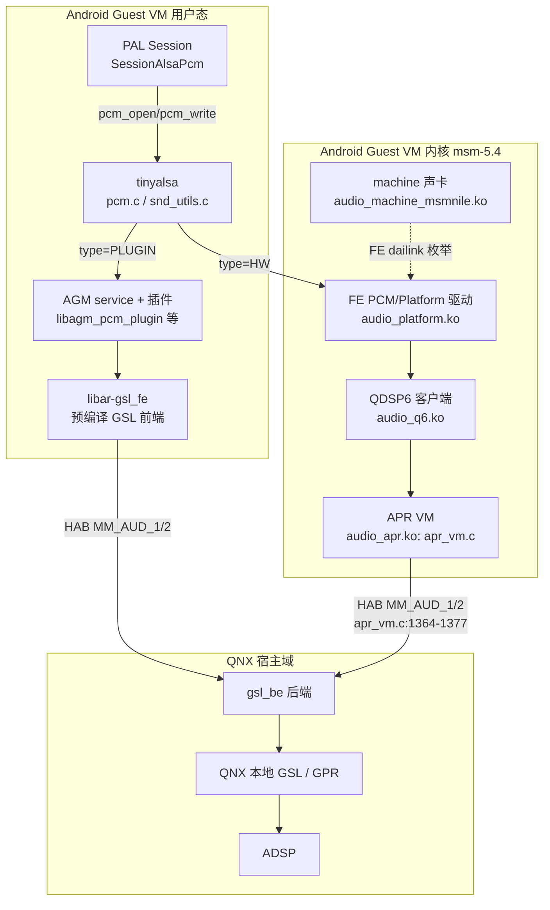

# 19.1 内核音频通路总览：Guest VM 中内核栈的定位

> [← 返回19章](README.md) ｜ [下一个 →](19_19.2_构建配置与模块清单.md)

> 主线口径：Android 12L / API 32 + SA8295（`msmnile_gvmq`，Guest VM）+ QNX AudioReach。内核源码位于 `Android/lagvm/LINUX/android/kernel/msm-5.4/techpack/audio/`（下称 `techpack/audio/`），只读、未做内核构建或实机验证。

本文回答三个问题：**本产品的 Android 内核里有哪些音频驱动？PCM 数据到底走不走内核？内核栈与用户态 PAL/AGM/GSL 是什么关系？**

## 1. 执行域定位：Guest VM 内核不拥有音频硬件

SA8295 上 Android 以 Guest VM 形式运行（QNX 宿主持有 ADSP/Codec/TDM 等硬件，见 [16.12 双域架构总结](../16_Vendor_QNX_Architecture/16_16.12_Android+QNX双域架构总结.md)）。这决定了内核音频栈的形态：

- 内核里**没有** WSA/Codec/TDM 硬件寄存器驱动（QNX 侧才有，见 [16.16 VM 音频驱动](../16_Vendor_QNX_Architecture/16_16.16_QNX_audio_driver_vm_VM音频驱动层.md)）；
- 内核注册的是一张**前端（FE）声卡**：machine 驱动 + FE PCM 设备 + DAI 声明，供用户态枚举与打开；
- 与 QNX 宿主的通信不在 ALSA 数据面里，而在两条独立通道：用户态 **HAB**（`libar-gsl_fe`，见 [18.2 GSL 跨 VM](../18_AGM_GSL_Architecture/18_18.2_GSL跨VM控制与缓冲区.md)）与内核态 **HAB**（`apr_vm.c`，见 [19.5](19_19.5_QDSP6客户端与APR_VM传输.md)）。

> **图的重要限定**：`tinyalsa` 在 `type=HW` 与 `type=PLUGIN` 之间的选择由 **libsndcarddefs 卡定义**决定，而该库与卡定义数据**不在本树**（见 [19.6](19_19.6_用户态消费与插件分发.md) 的勘误）。因此"本产品普通播放走哪条 PCM 路径"**不能从本树静态断言**；可证明的是两条机制的实现与 AGM 插件链的打包存在。图中 `type=HW` 分支画出的是内核栈能力，不是已验证的运行时数据路径。

## 2. 内核栈由哪些部分组成

| 部分 | 内核模块（产品打包名） | 讲解 |
|------|------------------------|------|
| 声卡/machine | `audio_machine_msmnile.ko` | [19.3](19_19.3_ASoC声卡注册.md) |
| FE 与 Platform 驱动 | `audio_platform.ko` | [19.4](19_19.4_FE与Platform驱动.md) |
| QDSP6 客户端 | `audio_q6.ko` | [19.5](19_19.5_QDSP6客户端与APR_VM传输.md) |
| APR VM 传输 | `audio_apr.ko` | [19.5](19_19.5_QDSP6客户端与APR_VM传输.md) |
| ADSP loader / notifier / SSR | `audio_adsp_loader.ko`、`audio_q6_notifier.ko` | [19.5](19_19.5_QDSP6客户端与APR_VM传输.md) |
| Native 编解码桩 | `audio_native.ko` | [19.4](19_19.4_FE与Platform驱动.md) |
| Stub/HDMI codec、snd_event | `audio_stub.ko`、`audio_hdmi.ko`、`audio_snd_event.ko` | [19.3](19_19.3_ASoC声卡注册.md) / [19.4](19_19.4_FE与Platform驱动.md) |

模块名↔Kbuild 对象的对应关系与配置链条在 [19.2](19_19.2_构建配置与模块清单.md) 逐项给出。

## 3. 与相邻章节的分工

- **数据面主线讲解**（Track→AudioFlinger→HAL→PAL→AGM/GSL→QNX→DSP）在 [05.9 播放全栈](../05_AudioFlinger/05_5.9_音乐播放全栈调用链.md)、[05.10 录音全栈](../05_AudioFlinger/05_5.10_录音全栈调用链.md) 与 [16.12](../16_Vendor_QNX_Architecture/16_16.12_Android+QNX双域架构总结.md)；本文不重复。
- **用户态 ALSA 使用方式**（hw_params、controls）在 [15.12 QC audio-alsa](../15_PAL_Architecture/15_15.12_QC_audio-alsa_ALSA层实现.md)；本文只讲内核侧与之对接的设备。
- **QNX 侧驱动**（audio_driver_vm/gsl_be/GPR）在第 16、18 章；本文只讲 Android 内核侧。

## 4. 本文证据边界（如实声明）

1. 所有结论来自静态阅读 `kernel/msm-5.4/techpack/audio/`、`device/qcom/msmnile_gvmq/`、`vendor/qcom/opensource/{tinyalsa,agm,audio-hal-ar}`；**未做内核构建**，模块是否成功加载、声卡是否注册成功未验证。
2. 本产品的设备树（DT）**不在本树**（`kernel/ship_prebuilt/` 仅有 sa8155/sa8195/direwolf/lemans 等其它目标的 dtb），machine 驱动与 DT 的实际绑定关系不可静态证明（见 [19.3 勘误](19_19.3_ASoC声卡注册.md)）。
3. `libsndcarddefs` 库与卡定义数据不在本树，PCM 的 HW/插件路由表不可静态读取（见 [19.6](19_19.6_用户态消费与插件分发.md)）。

---

**源码位置**

| 内容 | 位置 |
|------|------|
| 内核音频源码根 | `kernel/msm-5.4/techpack/audio/`（asoc/ dsp/ ipc/ soc/ include/ config/） |
| 本产品内核配置选择 | `kernel/msm-5.4/techpack/audio/Makefile:2-4`（`CONFIG_QTI_QUIN_GVM` → `config/gvmauto.conf`） |
| 产品打包模块清单 | `device/qcom/msmnile_gvmq/msmnile_gvmq.mk:189-199` |
| 内核 defconfig | `device/qcom/msmnile_gvmq/BoardConfig.mk:152-154`（`autogvm-qgki_defconfig`） |
