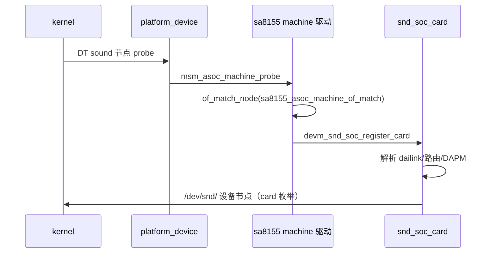

# 19.3 ASoC 声卡注册：machine 驱动与 FE dailink

> [← 上一个](19_19.2_构建配置与模块清单.md) ｜ [本章导航](README.md) ｜ [下一个 →](19_19.4_FE与Platform驱动.md)]

本产品在树内可证明的 machine 驱动有两个候选：`sa8155.c`（`CONFIG_SND_SOC_SA8155`，随产品打包为 `audio_machine_msmnile.ko`）与 `gvm_auto_spf_dummy.c`（`CONFIG_SND_SOC_GVM_AUTO_SPF`，**未打包**）。本文讲清：card 结构怎么来、FE dailink 枚举了什么、dummy 变体差在哪，以及 DT 缺失带来的证明边界。

## 1. sa8155.c：产品声卡的注册路径

`sa8155.c` 是为 SA8155/SA8295 类目标准备的 machine 驱动（约 10700 行）。注册链条（与其他 QCOM machine 驱动同构）：



兼容串表（`sa8155.c:10668-1076`）：

```c
// kernel/msm-5.4/techpack/audio/asoc/sa8155.c:10668-1076（逐字摘录，统一左移缩进；数组尾部的 `{},` 与 `};` 略）
static const struct of_device_id sa8155_asoc_machine_of_match[]  = {
	{ .compatible = "qcom,sa8155-asoc-snd-adp-star",
	  .data = "adp_star_codec"},
	{ .compatible = "qcom,sa8155-asoc-snd-custom",
	  .data = "custom_codec"},
	{ .compatible = "qcom,sa8295-asoc-snd-adp-star",
	  .data = "adp_star_codec"},
	{ .compatible = "qcom,sa8295-asoc-snd-custom",
	  .data = "custom_codec"},
```


> **摘录约定**：本文件所有代码摘录均为真实源码内容，长表/长函数用省略号或"…"标注截断；为排版统一可能整体左移缩进，非逐字符对齐。逐字声明仅对标注"逐字摘录"的片段成立。

本产品板型代号 **adp-star**（与 QNX 侧 `mixer_paths_gvmauto8295_adp_star.xml`、`resourcemanager_gvmauto8295_adp_star.xml` 的命名一致，见 [11.10 OEM 定制矩阵](../11_Vendor_Layer/11_11.10_OEM定制点完整矩阵.md)）。`.data = "adp_star_codec"` 表示 card 按 adp_star 编解码配置初始化。

machine 驱动的职责（ASoC 标准职责，在此文件中的体现）：

1. 定义 **FE dailink**（MultiMedia1…N 播放/录音前端）与 **BE dailink**（TDM/AUXPCM/SLIM 等后端，Guest VM 里多为 dummy 挂接）；
2. DAPM widget/kcontrol 声明（Handset Mic、Digital Mic0-7 等，见 `gvm_auto_spf_dummy.c:207-218` 的同类声明）；
3. 把 card 注册给 ALSA core，产出 `/dev/snd/` 设备与 `/proc/asound/` 信息。

## 2. gvm_auto_spf_dummy.c：SPF dummy 变体（在树、未打包）

`gvm_auto_spf_dummy.c`（1001 行，`DRV_NAME "spf-asoc-snd"` :37）提供一张**只有骨架的声卡**：

- dailink 全部为 `_dummy` 后端（`SND_SOC_DAILINK_REG(lpass_be_auxpcm_rx_dummy)` :232、`secondary/tert/quat/quin_tdm_*_dummy` :252-356 与 :600-676、`primary_tdm_*_dummy` :336-346 等），`stream_name` 仍是真实 TDM 通道名（如 `TDM-LPAIF_WSA-RX-PRIMARY` :430）；
- `msm_populate_dai_link_component_of_node()` 中 platform_of_node 填充段被 `if(0)` 显式跳过（:713 "Skip this part for dummy snd card" 注释，其后约至 :750）；
- 兼容串 `qcom,8155/6155/gvm-auto-spf-asoc-snd-adp-star`（:794-803），同样指向 adp_star_codec；
- 另注册一个 misc 设备 `virt_sndcard_ctl`（:885-889）供用户态控制虚拟声卡（存在性事实；使用方不在树内证据内）；
- `module_init(gvm_auto_spf_init)` → `platform_driver_register`（:995/:974）。

**设计意图（从代码可读出的）**：为 SPF（Sound Process Framework，即 AudioReach 用户态）提供一张只负责**设备枚举**的声卡——用户态按 card/device 打开 PCM，数据面完全由用户态插件接管（见 [19.6](19_19.6_用户态消费与插件分发.md)），因此后端是否 dummy 不影响用户态路由。

## 3. 两个 machine 驱动的关系

| 维度 | sa8155.c（machine_dlkm → audio_machine_msmnile.ko） | gvm_auto_spf_dummy.c（spf_machine_dlkm） |
|---|---|---|
| CONFIG | `SND_SOC_SA8155`（gvmauto.conf:20） | `SND_SOC_GVM_AUTO_SPF`（gvmauto.conf:5） |
| 产品打包 | 在 `AUDIO_DLKM` 清单 | **不在**（msmnile_gvmq.mk:189-199 无此项） |
| BE dailink | 真实/常规 TDM-AUXPCM 集（10k+ 行全量驱动） | 全 dummy |
| 角色（树内证据） | 常规 ASoC card：FE+BE+DAPM 完整 | SPF 枚举骨架 |

两者由**同一个** `gvmauto.conf` 同时启用构建——即树内构建会产出两个 machine 模块，但产品只打包 sa8155 版。运行时哪张卡被 DT 选中，取决于 DT（不在树，见下）。

## 4. 勘误与证明边界

> **勘误（负结论：DT 不在本树）**：本产品的 sound 节点 DT 源码/DTB 不在树内——`kernel/ship_prebuilt/primary_kernel/arch/arm64/boot/dts/vendor/qcom/` 下 16 个 dtb 全部属于 sa8155/sa8195/direwolf/lemans 等**其它目标**，全树 grep `asoc-snd-adp-star` 在 `arch/arm64/boot/dts/` 零命中。因此：
> 1. 无法静态证明本产品 DT 选中的是 `qcom,sa8295-asoc-snd-adp-star`（sa8155.c）还是 `qcom,gvm-auto-spf-asoc-snd-adp-star`（dummy 版）；
> 2. `msm_populate_dai_link_component_of_node()` 依赖的 `asoc-cpu/asoc-platform/asoc-codec` phandle 属性值不可引用；
> 3. 实机 `/proc/asound/cards` 才是判定卡名/数量的入口（静态知识库边界，未验证）。

> **勘误（负结论：不能把 dummy 当"内核不参与音频"的证据）**：dummy machine 的存在常被误读为"Guest VM 内核完全是摆设"。树内证据支持的是更弱也更准确的结论：**BE 硬件驱动不在 Android 内核**（QNX 侧持有），而 FE 数据面是否流经内核取决于 tinyalsa 卡定义路由（[19.6](19_19.6_用户态消费与插件分发.md)），后者不在树内。

---

**源码位置**

| 内容 | 位置 |
|------|------|
| sa8155 machine 兼容串 | `kernel/msm-5.4/techpack/audio/asoc/sa8155.c:10668-10675` |
| dummy machine 全文 | `kernel/msm-5.4/techpack/audio/asoc/gvm_auto_spf_dummy.c`（DRV_NAME :37；DAPM MIC :205-218；dailink :232-356/:600-676；of_match :794-803；virt_sndcard_ctl :885-889；probe msm_asoc_machine_probe :891；register_card :934；module_init :995） |
| Kbuild 装配 | `kernel/msm-5.4/techpack/audio/asoc/Kbuild:184-197,323,332-333` |
| DT 缺失佐证 | `kernel/ship_prebuilt/primary_kernel/arch/arm64/boot/dts/vendor/qcom/`（16 个非本产品 dtb） |
