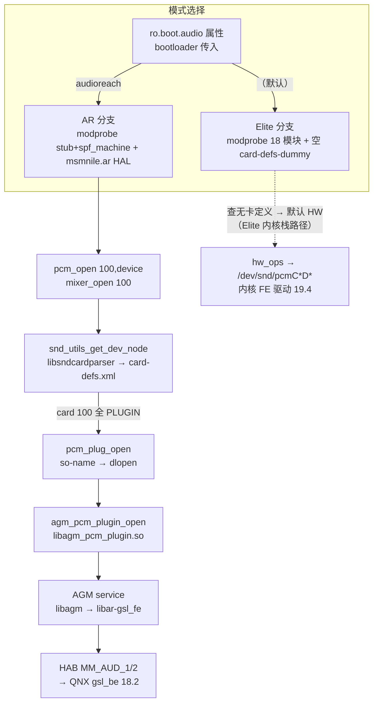

# 19.6 用户态消费与插件分发：启动模式与卡定义共同决定 PCM 路径

> [← 上一个](19_19.5_QDSP6客户端与APR_VM传输.md) ｜ [本章导航](README.md)

本文讲 19 章最后一个关键机制：`pcm_open()` 落到内核 FE 还是 AGM 用户态服务。答案由两层选择共同决定：**启动属性选分支**（`init.target.rc` 决定加载哪组内核模块、指向哪份卡定义），**卡定义选路径**（`card-defs.xml` 的 `type` 属性决定 tinyalsa 走 HW 还是插件）。机制实现、卡定义数据与产品打包链**全部在树内**，因此 AudioReach 主线的 PCM 路由是**静态可证结论**（本文 §3）；不可静态证明的只剩"实机启动属性取哪个值"（§4）。

## 1. 分发机制（tinyalsa 源码，逐锚点）

`snd_utils.c` 通过 dlopen 加载 **libsndcardparser** 库并解析**五个**符号（`snd_card_def_get_card/put_card/get_node/get_int/get_str`，snd_utils.c:92-104）：

```c
// vendor/qcom/opensource/tinyalsa/snd_utils.c:120（逐字摘录）
    node->dl_hdl = dlopen("libsndcardparser.so", RTLD_NOW);
```

该库**实现与构建都在本树内**：`vendor/qcom/opensource/agm/snd_parser/`（`Android.mk:6` `LOCAL_MODULE := libsndcardparser`；`:10` 编译期默认卡定义路径 `CARD_DEF_FILE="/vendor/etc/card-defs.xml"`）。

`pcm.c` 在打开路径上询问节点类型：

```c
// vendor/qcom/opensource/tinyalsa/pcm.c:921-923（逐字摘录，统一左移）
    pcm->snd_node = snd_utils_get_dev_node(card, device, NODE_PCM);
    pcm_type = snd_utils_get_node_type(pcm->snd_node);
    if (pcm_type == SND_NODE_TYPE_PLUGIN)
```

类型定义（snd_utils.h:54-57）：

```c
// vendor/qcom/opensource/tinyalsa/snd_utils.h:54-57（逐字摘录）
enum snd_node_type {
    SND_NODE_TYPE_HW = 0,
    SND_NODE_TYPE_PLUGIN,
    SND_NODE_TYPE_INVALID,
```

- `type=HW`（默认，snd_utils.c:41-53 的失败回退也是 HW——**查无卡定义即走 HW**）→ `hw_ops`：内核 `/dev/snd/pcm*` ioctl；
- `type=PLUGIN` → `plug_ops`：`pcm_plug_open()` 读取节点 `so-name` 属性并 dlopen（pcm_plugin.c:711-724），再按库名拼出 `<name>_open` 符号（:734-756，如 `libagm_pcm_plugin.so` → `agm_pcm_plugin_open`）。

mixer 面同样插件化：`mixer.c:242-293` 先尝试 HW 设备，失败则 `mixer_plugin_open()` 走卡定义的 mixer 插件（"Fail mixer_open if both hw and plugin nodes cannot be opened"）。控制/压缩面对应 `libagm_mixer_plugin`（`agm_mixer_plugin.c`，模块定义 `plugins/tinyalsa/Android.mk:46`）与 `libagm_compress_plugin`（:85）。AGM 服务与 GSL 前端的链接关系在 `agm/service/Android.mk:26/:61/:66`（include 路径 `include/mm-audio/gsl_fe` 预编译头，见 [18.1](../18_AGM_GSL_Architecture/18_18.1_AGM会话与音频图.md)；`libar-gsl_fe` + `libar-gsl`）。

> **符号归属更正（勘误）**：早期版本曾把库名写作 `libsndcarddefs` 并断言"该库与卡定义不在本树"——两半都不成立：库名是 `libsndcardparser`（snd_utils.c:120），库在树内；卡定义 XML 也在树内（§2）。

## 2. 卡定义数据在树内：双份 card-defs 与两条打包链

产品同时接线**两份卡定义**，对应两种启动模式：

| 卡定义 | 内容 | 打包链（全部在树） |
|---|---|---|
| `/vendor/etc/card-defs.xml`（AR 链） | card `<id>100</id>` `<name>gvmauto-virtual,sa8155adpstarsn</name>`：**23 个 pcm-device 全部 `<pcm_plugin>`→`libagm_pcm_plugin.so`，1 个 compress→`libagm_compress_plugin.so`，1 个 mixer→`libagm_mixer_plugin.so`**——全设备 PLUGIN 标记 | `msmnile_gvmq.mk:358`（inherit `vendor/qcom/defs/product-defs/vendor/*.mk`）→ `audio_ar_vendor_product.mk:2,40`（filter `msmnile_gvmq`）→ `audio-hal-ar/primary-hal/configs/msmnile_au/msmnile_au.mk:109-110` 复制 `card-defs.xml` |
| `/vendor/etc/card-defs-dummy.xml`（Elite 链） | **空定义**（整个文件只有 `<def></def>`） | `audio_vendor_product.mk:221-222` → `audio-hal/primary-hal/configs/msmnile_au/msmnile_au.mk:176-177`（注释原文 "Automotive audio card defs dummpy files for elite and ar co-exit"） |

解析器在运行时按属性选择数据源（编译期默认 card-defs.xml）：

```c
// vendor/qcom/opensource/agm/snd_parser/src/snd-card-parser.c:497（逐字摘录）
    property_get("vendor.audio.card.def", card_def_file, CARD_DEF_FILE);
```

另注：`snd_card_def_*` 符号并非只有 tinyalsa 引用——AGM 插件源码同样调用（如 `agm_pcm_plugin.c:761`）。

## 3. 启动模式选择：init.target.rc 双分支

`device/qcom/msmnile_gvmq/init.target.rc:36-45` 按启动属性 `ro.boot.audio` 切换两套音频配置：

```text
// device/qcom/msmnile_gvmq/init.target.rc:36-45（逐字摘录）
# Elite
on early-init && property:ro.boot.audio=""
    exec_background u:r:vendor_modprobe:s0 -- /vendor/bin/modprobe -a -d /vendor/lib/modules snd_event_dlkm wglink_dlkm q6_pdr_dlkm q6_notifier_dlkm apr_dlkm adsp_loader_dlkm q6_dlkm native_dlkm usf_dlkm pinctrl_wcd_dlkm swr_dlkm platform_dlkm wcd_spi_dlkm stub_dlkm wcd_core_dlkm wsa881x_dlkm wcd9360_dlkm hdmi_dlkm machine_dlkm
    setprop vendor.audio.card.def "/vendor/etc/card-defs-dummy.xml"

# AudioReach
on early-init && property:ro.boot.audio=audioreach
    exec_background u:r:vendor_modprobe:s0 -- /vendor/bin/modprobe -a -d /vendor/lib/modules stub_dlkm spf_machine_dlkm
    setprop ro.hardware.audio.primary "msmnile.ar"
    setprop ro.hardware.sound_trigger.primary "msmnile.ar"
```

两个分支的差异是结构性的：

| | Elite（默认，`ro.boot.audio=""`） | AudioReach（`ro.boot.audio=audioreach`） |
|---|---|---|
| 加载的内核模块 | **19 个**（machine/platform/q6/apr/adsp_loader/notifier/snd_event/codec 等全集） | **仅 2 个**：`stub_dlkm` + `spf_machine_dlkm`（dummy machine，见 [19.3](19_19.3_ASoC声卡注册.md)） |
| 卡定义 | 空 card-defs-dummy.xml → snd_card_def 查无卡 → tinyalsa **HW 路径** | 默认 card-defs.xml（card 100 全 PLUGIN）→ tinyalsa **全部插件路径** |
| HAL 属性 | （未在此设置） | `ro.hardware.audio.primary=msmnile.ar`（AR 版 HAL，[16.13](../16_Vendor_QNX_Architecture/16_16.13_Primary_HALAudioReach版深度解.md)） |

PAL 侧对虚拟卡的消费闭环（AR 分支）：

- `ResourceManager.cpp:112` `#define SND_CARD_VIRTUAL 100`、`:407` `snd_virt_card = SND_CARD_VIRTUAL`（可被 resourcemanager XML 的 `<card_info><id>` 覆盖，`processCardInfo` :8914-8920；本产品 XML 无该节点，取默认 100——与 card-defs.xml 的 `<id>100</id>` 一致）；
- `ResourceManager.cpp:1169` `audio_virt_mixer = mixer_open(snd_virt_card)`（mixer_open 经 §1 的插件回退进 `libagm_mixer_plugin`）；
- 所有 PCM 打开都走虚拟卡：`SessionAlsaPcm.cpp:731/:734/:756/:759/:775/:787/:2536-2539/:2711`、`Session.cpp:803`（echo 参考）均为 `pcm_open(rm->getVirtualSndCard(), pcmDevIds.at(0), ...)`。

**由此得出 AudioReach 主线的完整静态证明链**：启动属性 audioreach → 内核只加载 spf dummy 卡（枚举骨架，[19.3](19_19.3_ASoC声卡注册.md)）→ PAL `pcm_open(100,…)`/`mixer_open(100)` → card-defs.xml card 100 **全设备 PLUGIN** → tinyalsa 全部转入用户态 `libagm_pcm_plugin/libagm_mixer_plugin/libagm_compress_plugin` → AGM service（`libagm`→`libar-gsl_fe`）→ HAB MM_AUD_1/2 → QNX `gsl_be`（[18.2](../18_AGM_GSL_Architecture/18_18.2_GSL跨VM控制与缓冲区.md)）。**普通 PCM 数据面不经过内核 FE 驱动**（19.4 的 FE/platform 对象组属 Elite 分支的内核路径）。

> 卡号 100 是纯用户态约定：它由 card-defs.xml 的 `<id>` 与 PAL 默认值共同构成，**不依赖**内核 ASoC 卡的顺序编号（spf dummy 卡注册后的实际卡号树内不可静态预测）。tinyalsa 插件路径不打开 `/dev/snd/` 设备。



## 4. 修正后的证明边界

> **勘误（对早期版本的更正）**：早期版本断言"libsndcarddefs 库与卡定义不在本树、PCM 实际路由不可静态证明"。复验后该负结论**整体不成立**：库（libsndcardparser）在树内、卡定义 XML 在树内且经产品 mk 双链接线、AGM 插件链完整打包（`audio_ar_vendor_product.mk:5-13`：`agmplay`/`agmcap`/`libautohal_pal`/`libagm`/三个 AGM 插件/`libagmmixer`/`vendor.qti.hardware.AGMIPC@1.0`）。AudioReach 主线的 PCM 路由是**静态可证结论**（§3 证明链）。
>
> **仍然不可静态证明的**（如实收窄）：
> 1. **实机启动属性的实际取值**（`ro.boot.audio` 由 bootloader/bootconfig 传入，树内读不到；两条分支的机制都完整在树，但"这台设备以哪个模式启动"超出静态范围）。本库主线按 AudioReach 讲解（与 [16.13](../16_Vendor_QNX_Architecture/16_16.13_Primary_HALAudioReach版深度解.md)、[18 章](../18_AGM_GSL_Architecture/README.md)的 AR 主线一致）；
> 2. Elite 分支下内核声卡（[19.3](19_19.3_ASoC声卡注册.md)）的实际 FE 使用细节（本库不对 Elite 模式展开）；
> 3. AGM 插件之后 DSP 侧图的实际拓扑（[18.3](../18_AGM_GSL_Architecture/18_18.3_GSL图生命周期与DSP命令.md) 边界内）。
> 该边界同时是对 [15.10](../15_PAL_Architecture/15_15.10_HAL-PAL适配层架构.md) 已声明边界的内核侧补充：15.10 拒绝从 `pcm_write()` 直接画出完整跨域链，19.6 给出了分发点实现 + 本产品路由数据的完整闭环。

> **概念纠偏：两类"plugin"不要混淆**。本文的 tinyalsa 卡插件（`libagm_pcm_plugin`，按 card/device 分发）与 PAL 资源 XML 里的 `PLUGIN_CONTROL_VOLUME`（`resourcemanager_gvmauto8295_adp_star.xml:23-35`，`lib_default_plugin_controls.so` 音量控制插件）是**两套无关机制**，仅共享"plugin"一词。后者属于 PAL 控制面，见 [15.6 ResourceManager](../15_PAL_Architecture/15_15.6_ResourceManager-PAL核心管理模块.md)。

## 5. 19 章全链路小结（证据分级）

| 环节 | 证据强度 | 出处 |
|---|---|---|
| 内核构建/模块清单 | 构建+打包文件（静态证明） | 19.2 |
| machine/FE/APR-VM 实现细节 | 驱动源码（静态证明） | 19.3-19.5 |
| 内核 APR-VM 走 HAB MM_AUD_1/2 | 驱动源码（静态证明） | 19.5 |
| 启动双分支（Elite/AR 模块集与卡定义选择） | init.rc + mk 链（静态证明） | 19.6 §3 |
| **AR 主线 PCM 路由 = 用户态 AGM 插件（不经内核 FE）** | **卡定义 + PAL 源码（静态证明）** | 19.6 §2-3 |
| 实机启动属性取值 / Elite 模式运行细节 | **不可静态证明** | 19.6 §4 |
| DT 绑定（两 machine 节点均在树） | DT 源码 + dtb（静态证明） | 19.3 |

---

**源码位置**

| 内容 | 位置 |
|------|------|
| 节点类型查询 | `vendor/qcom/opensource/tinyalsa/pcm.c:618-620,921-923` |
| 类型枚举 | `vendor/qcom/opensource/tinyalsa/snd_utils.h:54-57` |
| libsndcardparser dlopen | `vendor/qcom/opensource/tinyalsa/snd_utils.c:120`（符号解析 :92-104，五个 SND_DLSYM） |
| 解析库实现/构建 | `vendor/qcom/opensource/agm/snd_parser/`（Android.mk:6,10） |
| 卡定义运行时选择 | `agm/snd_parser/src/snd-card-parser.c:497`（property_get vendor.audio.card.def） |
| AR 卡定义 | `audio-hal-ar/primary-hal/configs/msmnile_au/card-defs.xml`（card 100；接线 msmnile_au.mk:109-110） |
| Elite 卡定义 | `audio-hal/primary-hal/configs/msmnile_au/card-defs-dummy.xml`（空 def；接线 msmnile_au.mk:176-177） |
| 启动双分支 | `device/qcom/msmnile_gvmq/init.target.rc:36-45`（Elite :37-39；AR :42-45） |
| PAL 虚拟卡 100 | `pal/resource_manager/src/ResourceManager.cpp:112,407,1169,8914-8920`；`pal/session/src/SessionAlsaPcm.cpp:731-787,2536-2539,2711` |
| mixer 插件回退 | `vendor/qcom/opensource/tinyalsa/mixer.c:242-293` |
| so-name → dlopen → `<name>_open` | `vendor/qcom/opensource/tinyalsa/pcm_plugin.c:711-756` |
| AGM 插件模块定义 | `vendor/qcom/opensource/agm/plugins/tinyalsa/Android.mk:5,46,85` |
| AGM service 链接 GSL 前端 | `vendor/qcom/opensource/agm/service/Android.mk:26,61,66` |
| 产品 AGM 打包 | `vendor/qcom/opensource/audio-hal-ar/primary-hal/configs/audio_ar_vendor_product.mk:5-13` |
| PAL 音量控制插件（对照概念） | `vendor/qcom/proprietary/mm-audio-auto/auto-casa-xml/resourcemanager_gvmauto8295_adp_star.xml:23-35` |
