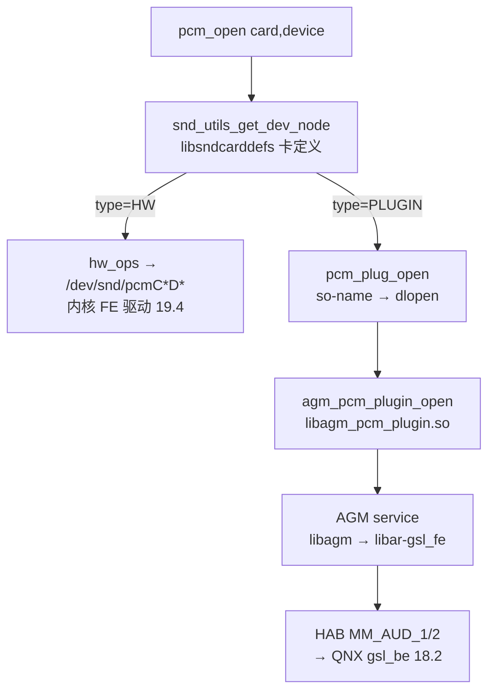

# 19.6 用户态消费与插件分发：tinyalsa 如何在"内核声卡"与"AGM 插件"之间选择

> [← 上一个](19_19.5_QDSP6客户端与APR_VM传输.md) ｜ [本章导航](README.md)

本文讲 19 章最后一个关键机制：`pcm_open()` 落到内核 FE 还是 AGM 用户态服务，由 **libsndcarddefs 卡定义的 `type` 属性**决定。机制实现完全在树内（tinyalsa），但**路由数据不在树内**——这决定了本产品 PCM 路径的最终证明边界。

## 1. 分发机制（tinyalsa 源码，逐锚点）

`snd_utils.c` 通过 dlopen 加载 libsndcarddefs 并解析四个符号（`snd_card_def_get_card/put_card/get_node/get_int/get_str`，snd_utils.c:92-104）。`pcm.c` 在两条路径上询问节点类型：

```c
// vendor/qcom/opensource/tinyalsa/pcm.c:921-923（逐字摘录，统一左移）
    pcm->snd_node = snd_utils_get_dev_node(card, device, NODE_PCM);
    pcm_type = snd_utils_get_node_type(pcm->snd_node);
    if (pcm_type == SND_NODE_TYPE_PLUGIN)
```

类型定义（snd_utils.h:54-57）：

```c
// vendor/qcom/opensource/tinyalsa/snd_utils.h:54-57（逐字摘录）
enum snd_node_type {
    SND_NODE_TYPE_HW = 0,
    SND_NODE_TYPE_PLUGIN,
    SND_NODE_TYPE_INVALID,
```

- `type=HW`（默认，snd_utils.c:41-53 的失败回退也是 HW）→ `hw_ops`：内核 `/dev/snd/pcm*` ioctl；
- `type=PLUGIN` → `plug_ops`：`pcm_plug_open()` 读取节点 `so-name` 属性并 dlopen（pcm_plugin.c:711-724），再按库名拼出 `<name>_open` 符号（:734-756，如 `libagm_pcm_plugin.so` → `agm_pcm_plugin_open`）。



mixer/control 面有对应的 `libagm_mixer_plugin`（`agm_mixer_plugin.c`，模块定义 `plugins/tinyalsa/Android.mk:46`）与 `libagm_compress_plugin`（:85）。AGM 服务与 GSL 前端的链接关系在 `agm/service/Android.mk:26/:61/:66`：include 路径 `include/mm-audio/gsl_fe`（预编译头，见 [18.1](../18_AGM_GSL_Architecture/18_18.1_AGM会话与音频图.md) 的预编译边界）、`libar-gsl_fe` + `libar-gsl`。

## 2. 本产品打包证据（AGM 链齐备）

`vendor/qcom/opensource/audio-hal-ar/primary-hal/configs/audio_ar_vendor_product.mk:5-13` 打包：`agmplay`、`agmcap`、`libautohal_pal`、`libagm`、`libagm_compress_plugin`、`libagm_mixer_plugin`、`libagm_pcm_plugin`、`libagmmixer`、`vendor.qti.hardware.AGMIPC@1.0`。

即：**用户态 AGM 插件链完整部署**。结合 [15.10](../15_PAL_Architecture/15_15.10_HAL-PAL适配层架构.md)（PAL → `SessionAlsaPcm::write()` → `pcm_write()`）与 [18.1](../18_AGM_GSL_Architecture/18_18.1_AGM会话与音频图.md)（AGM 会话/图），插件路径的每一环都有树内证据。

## 3. 勘误与证明边界

> **勘误（负结论：libsndcarddefs 与卡定义不在本树）**：全树搜索 `libsndcarddefs`/`snd_card_def` 无库文件与配置 XML（仅 tinyalsa 源码中的符号引用）。因此：
> 1. 本产品哪张卡、哪个 PCM 设备被标记为 PLUGIN，**不可静态读取**；
> 2. "普通音乐播放一定走 AGM 插件而非内核 FE"是合理推断（AGM 链齐备 + 图管理必须经 GSL），但**不是静态可证结论**；
> 3. 判定入口是实机卡定义/`strace pcm_open` 落点（动态验证，超出本库范围）。
> 该结论同时是对 15.10 已声明边界的内核侧补充：15.10 拒绝从 `pcm_write()` 直接画出完整跨域链，19.6 给出了分发点的确切实现与数据缺口。

> **概念纠偏：两类"plugin"不要混淆**。本文的 tinyalsa 卡插件（`libagm_pcm_plugin`，按 card/device 分发）与 PAL 资源 XML 里的 `PLUGIN_CONTROL_VOLUME`（`resourcemanager_gvmauto8295_adp_star.xml:23-35`，`lib_default_plugin_controls.so` 音量控制插件）是**两套无关机制**，仅共享"plugin"一词。后者属于 PAL 控制面，见 [15.6 ResourceManager](../15_PAL_Architecture/15_15.6_ResourceManager-PAL核心管理模块.md)。

## 4. 19 章全链路小结（证据分级）

| 环节 | 证据强度 | 出处 |
|---|---|---|
| 内核构建/模块清单 | 构建+打包文件（静态证明） | 19.2 |
| machine/FE/APR-VM 实现细节 | 驱动源码（静态证明） | 19.3-19.5 |
| 内核 APR-VM 走 HAB MM_AUD_1/2 | 驱动源码（静态证明） | 19.5 |
| tinyalsa HW/插件分发机制 | 用户态源码（静态证明） | 19.6 |
| **PCM 实际路由（HW vs 插件）** | **不可静态证明（卡定义不在树）** | 19.6 勘误 |
| 声卡实际注册/模块加载 | 不可静态证明（DT 不在树） | 19.3 勘误 |

---

**源码位置**

| 内容 | 位置 |
|------|------|
| 节点类型查询 | `vendor/qcom/opensource/tinyalsa/pcm.c:618-620,921-923` |
| 类型枚举 | `vendor/qcom/opensource/tinyalsa/snd_utils.h:54-57` |
| libsndcarddefs 符号解析 | `vendor/qcom/opensource/tinyalsa/snd_utils.c:92-104` |
| so-name → dlopen → `<name>_open` | `vendor/qcom/opensource/tinyalsa/pcm_plugin.c:711-756` |
| AGM 插件模块定义 | `vendor/qcom/opensource/agm/plugins/tinyalsa/Android.mk:5,46,85` |
| AGM service 链接 GSL 前端 | `vendor/qcom/opensource/agm/service/Android.mk:26,61,66` |
| 产品 AGM 打包 | `vendor/qcom/opensource/audio-hal-ar/primary-hal/configs/audio_ar_vendor_product.mk:5-13` |
| PAL 音量控制插件（对照概念） | `vendor/qcom/proprietary/mm-audio-auto/auto-casa-xml/resourcemanager_gvmauto8295_adp_star.xml:23-35` |
