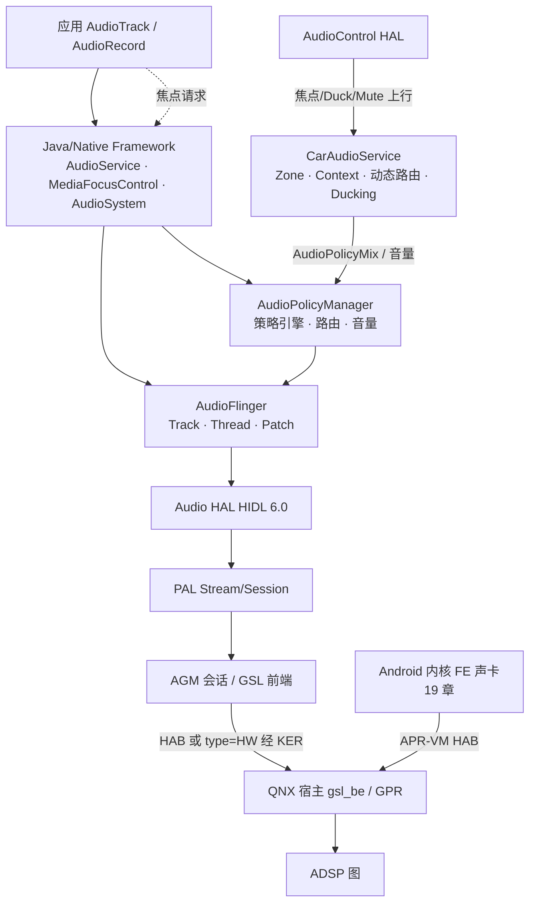

# 20.1 场景阅读指南与全链路全景

> [← 返回20章](README.md) ｜ [下一个 →](20_20.2_场景-多音区媒体与导航并发.md)

本章是**跨层专题**：把 02–19 章按真实使用场景串起来。主线口径 Android 12L + SA8295 + AudioReach 不变；每一步都回链到已核验的讲解文章，本文不引入新的机制断言。

## 1. 为什么要有场景篇

分层章节回答"这一层怎么做"；场景篇回答"这些层**按什么顺序**协作、**哪一步**可能失败"。两个既有全栈文章（[05.9 播放全栈](../05_AudioFlinger/05_5.9_音乐播放全栈调用链.md)、[05.10 录音全栈](../05_AudioFlinger/05_5.10_录音全栈调用链.md)）站在 AudioFlinger 视角；[09.8 多 Zone 全栈](../09_AAOS_Car_Audio/09_9.8_AAOS多Zone全栈调用链.md) 站在 AAOS 视角。本篇把这些视角按**用户可感知的场景**重新组织，并补齐 05 章刻意不画的跨域段（HAL→PAL→AGM/GSL→QNX，见各篇分工声明）。

## 2. 全链路全景（一张图 + 分层索引）

> **图的使用规则**（与各篇勘误一致）：`AGM → QNX` 与 `KER → QNX` 是两条不同的出域通道（[18.2](../18_AGM_GSL_Architecture/18_18.2_GSL跨VM控制与缓冲区.md)、[19.5](../19_Kernel_Audio/19_19.5_QDSP6客户端与APR_VM传输.md)）；哪条承载普通播放 PCM 未做静态断言（[19.6 勘误](../19_Kernel_Audio/19_19.6_用户态消费与插件分发.md)）。图中虚线是控制流（焦点），实线混合了控制与数据——逐步骤拆分见各场景篇。

## 3. 分层索引（跳转表）

| 层 | 入口文章 | 场景中的角色 |
|---|---|---|
| 应用 API | [2.1 AudioTrack](../02_Application_Layer/02_2.1_AudioTrack.md)、[2.2 AudioRecord](../02_Application_Layer/02_2.2_AudioRecord.md)、[2.4 AudioFocusRequest](../02_Application_Layer/02_2.4_AudioFocusRequest.md) | 发起点：供数/焦点/音量请求 |
| Framework | [3.2 MediaFocusControl](../03_Java_Framework_Layer/03_3.2_MediaFocusControl-焦点仲裁器.md)、[3.9 并发录音仲裁](../03_Java_Framework_Layer/03_3.9_录音并发仲裁机制-Concurrent_Capture.md)、[3.8 AudioMode](../03_Java_Framework_Layer/03_3.8_AudioMode状态机与通信设备路由.md) | 仲裁与状态广播 |
| AudioFlinger | [5.9](../05_AudioFlinger/05_5.9_音乐播放全栈调用链.md)、[5.10](../05_AudioFlinger/05_5.10_录音全栈调用链.md)、[5.6 PatchPanel](../05_AudioFlinger/05_5.6_PatchPanel-音频路由管理.md) | 数据面与线程 |
| 策略 | [6.2 AudioPolicyManager](../06_Audio_Policy_Engine/06_6.2_AudioPolicyManager-策略核心实现.md)、[6.6 引擎配置](../06_Audio_Policy_Engine/README.md) | 设备/流路由决策 |
| AAOS | [9.1 总览](../09_AAOS_Car_Audio/09_9.1_AAOS音频系统总览.md)、[9.11 动态路由](../09_AAOS_Car_Audio/09_9.11_CarAudioDynamicRouting-动态路由构建.md)、[9.14 Ducking](../09_AAOS_Car_Audio/09_9.14_CarDucking-AAOS系统级Ducking.md) | 多音区/Context/Bus 语义 |
| AudioControl | [10.1 总览](../10_AudioControl_HAL/10_10.1_AudioControl_HAL总览.md)、[10.3 焦点回调](../10_AudioControl_HAL/10_10.3_焦点回调流程.md) | 外部音频/车辆侧上下行 |
| HAL/PAL | [8.1 双轨架构](../08_HAL_Layer/08_8.1_Audio_HAL双轨架构.md)、[15.10 HAL-PAL](../15_PAL_Architecture/15_15.10_HAL-PAL适配层架构.md) | 标准接口→平台实现 |
| AGM/GSL/内核/QNX | [18.1](../18_AGM_GSL_Architecture/18_18.1_AGM会话与音频图.md)、[19.1](../19_Kernel_Audio/19_19.1_内核音频通路总览.md)、[16.12](../16_Vendor_QNX_Architecture/16_16.12_Android+QNX双域架构总结.md) | 图管理、跨 VM、DSP 执行 |

## 4. 本篇的场景选择与边界

四个场景（[20.2](20_20.2_场景-多音区媒体与导航并发.md)–[20.5](20_20.5_场景-异常与恢复.md)）覆盖设计文档 §7 要求的"正常路径 + 非正常路径"主干：多音区并发播放（车载最典型）、语音录音（并发仲裁）、蓝牙通话（角色切换与模式）、异常与恢复（失败路径）。

**不做的事**（与全库纪律一致）：
- 不虚构日志或运行时输出；观察入口一律回链 [17 章调试](../17_Debug_and_OEM_Guide/README.md)；
- 不把静态调用顺序说成"实测时序"；
- 每个场景的关键分支都可能被产品配置改变（car_audio_configuration / audio_policy_configuration / resourcemanager XML），差异回链 [11 章](../11_Vendor_Layer/README.md)。

---

**关联源码总目录**

| 内容 | 位置 |
|------|------|
| 全库源码目录速查 | [01.5 关键源码目录速查](../01_Architecture_Overview/01_1.5_关键源码目录速查.md) |
| 全栈数据流向图 | [01.8 播放录音全栈数据流向图](../01_Architecture_Overview/01_1.8_播放录音全栈数据流向图.md) |
