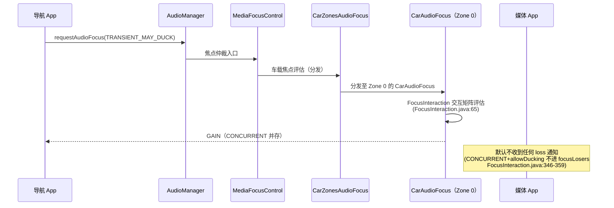

# 20.2 场景：多音区媒体播放与导航播报并发

> [← 上一个](20_20.1_场景阅读指南与全链路全景.md) ｜ [本章导航](README.md) ｜ [下一个 →](20_20.3_场景-语音助手录音链路.md)

**场景**：主驾正在通过媒体 App 播放音乐（usage `MEDIA`），导航 App 发起一次语音播报（usage `ASSISTANCE_NAVIGATION_GUIDANCE`）。本文按时间顺序走完整条链，每步回链已核验文章；产品配置锚点取自 `common_au`（生效变体，见 [11.8](../11_Vendor_Layer/11_11.8_audio_policy_configuration.xml_属性详解.md)）。

## 1. 静态配置前提（产品树核对值）

本产品主 Zone（audioZoneId=0）的映射（`common_au/car_audio_configuration.xml`）：

| 上下文 | Bus 设备 | 音量组 | 配置行 |
|---|---|---|---|
| music | `BUS00_MEDIA` | 组1 | :36-39 |
| alarm/notification/system_sound/emergency/safety/vehicle_status/announcement | `BUS01_SYS_NOTIFICATION` | 组2 | :41-50 |
| **navigation + voice_command** | **`BUS02_NAV_GUIDANCE`** | 组3 | :52-54 |
| call + call_ring | `BUS03_PHONE` | 组4 | :58-60 |

即：**媒体与导航在本产品走不同 Bus、不同音量组、不同 HAL 输出流**（audio_policy_configuration 为 media（:70）与 nav_guidance（:79）分别定义 mixPort，属性与路由规则见 [11.8 §11.8.7/§11.8.11](../11_Vendor_Layer/11_11.8_audio_policy_configuration.xml_属性详解.md)；各 Bus 路由均为单 source，:275-286）。

## 2. 阶段一：焦点交互（谁可以出声）

- 焦点请求类型由**应用**决定（常见导航实现请求 `AUDIOFOCUS_GAIN_TRANSIENT_MAY_DUCK`；若请求更强类型，矩阵结果不同）。仲裁过程与矩阵语义见 [12.3 请求流程](../12_Audio_Focus_Deep_Dive/12_12.3_requestAudioFocus完整流程.md) 与 [12.6 AAOS 交互矩阵](../12_Audio_Focus_Deep_Dive/12_12.6_AAOS焦点交互矩阵.md)。
- 多 Zone 分发：[9.10 CarZonesAudioFocus](../09_AAOS_Car_Audio/09_9.10_CarZonesAudioFocus-多Zone焦点分发器.md) 负责把请求分发到对应 Zone 的 **[9.4 CarAudioFocus](../09_AAOS_Car_Audio/09_9.4_CarAudioFocus-车载焦点管理.md)**，由后者用 FocusInteraction 矩阵评估（9.10 自己不实现矩阵）；跨 Zone（副驾同时听歌）互不抢占，见 [9.3 CarAudioZone](../09_AAOS_Car_Audio/09_9.3_CarAudioZone-多Zone音频管理.md)。
- **媒体 App 默认不会收到焦点 loss 通知**：`INTERACTION_CONCURRENT` 且允许 duck 时，普通持有者**不进入** focusLosers 列表（`FocusInteraction.java:346-359`；仅当 App 声明 `AUDIOFOCUS_FLAG_PAUSES_ON_DUCKABLE_LOSS` 或持有 `RECEIVE_CAR_AUDIO_DUCKING_EVENTS` 权限时才收到通知，[12.6 §4.1](../12_Audio_Focus_Deep_Dive/12_12.6_AAOS焦点交互矩阵.md)、[9.14](../09_AAOS_Car_Audio/09_9.14_CarDucking-AAOS系统级Ducking.md)）。

## 3. 阶段二：Ducking 执行（降的是谁的音量）

AAOS 的 duck 决策是**按 Context 的矩阵**，不是简单音量叠加：

- `CarDuckingUtils` 的 `sContextsToDuck`：胜者为 `NAVIGATION` 时被压低的 Context 集合包含 `MUSIC`（music Context，对应 usage `MEDIA`）等 8 项；胜者为 `MUSIC` 时为空数组（"MUSIC ducks nothing"，`CarDuckingUtils.java:50-61`，方向勘误详见 [9.14 CarDucking](../09_AAOS_Car_Audio/09_9.14_CarDucking-AAOS系统级Ducking.md)）。
- **执行层（本产品关键点）**：AAOS 系统级 Ducking 以**设备地址（Bus）为粒度**把 addressesToDuck 下发给 AudioControl HAL（[9.14](../09_AAOS_Car_Audio/09_9.14_CarDucking-AAOS系统级Ducking.md) §9.14.9：MEDIA VolumeGroup 的 bus0_media_out 地址进入 duck 列表；[10.4](../10_AudioControl_HAL/10_10.4_Ducking机制.md)：AAOS 执行位置=HAL/DSP 层、按设备地址）。本产品媒体（BUS00）与导航（BUS02）分属不同 Bus，媒体 Bus 地址被下发 duck；**实际压低由 HAL/DSP 侧实现决定，本树未验证**（10.1 §8 的示例 HAL 仅记录日志）。
- **Framework 每 Track duck 是另一条路且默认不触发**：`MediaFocusControl`→`PlaybackActivityMonitor` 的 Track 音量 duck（[12.11](../12_Audio_Focus_Deep_Dive/12_12.11_PlaybackActivityMonitor_Duck执行深度.md)）入口是 `FocusRequester.handleFocusLoss` 的 loss 处理路径——框架 duck（`frameworkHandleFocusLoss`→`duckPlayers`，FocusRequester.java:397）成功时 App **反而收不到回调**（:400-410 "NOT dispatching … response handled by framework" 直接返回；框架 duck 与 App 通知互斥而非因果）。而本产品 AAOS 策略的 loss 派发走 `dispatchFocusChange` **直达 App 监听器、全程不经 duckPlayers**（CarAudioFocus.java:138-140 → MediaFocusControl.java:766-786 → FocusRequester.java:487-515），opt-in App 收到 CAN_DUCK 时由 App 自行处理。默认场景（§2）无任何 loss 派发，该路径整体不触发。
- 两者职责边界在 9.14 已核验；Bus 增益（`<gains>`，产品 −6000~600 mB，[11.9](../11_Vendor_Layer/11_11.9_car_audio_configuration.xml_深度解析.md) 11.9.13）不参与 duck 路径（`<gains>`/setAudioPortConfig 是用户音量那条路，见 §5）。

## 4. 阶段三：路由与数据面（两条独立通路）

从 usage 到 DSP（每步的完整讲解在链接文章）：

| 步骤 | 媒体流 | 导航流 | 讲解 |
|---|---|---|---|
| 1. usage→Context | `MEDIA`→music | `ASSISTANCE_NAVIGATION_GUIDANCE`→navigation | [9.6 CarAudioContext](../09_AAOS_Car_Audio/09_9.6_CarAudioContext-车载音频上下文深度解析.md)（CONTEXT_TO_USAGES :137-214） |
| 2. Context→Bus | music→BUS00 | navigation→BUS02 | 本篇 §1 配置锚点 |
| 3. 动态路由注入 | CarAudioService 启动时注册 AudioPolicyMix（[9.11 CarAudioDynamicRouting](../09_AAOS_Car_Audio/09_9.11_CarAudioDynamicRouting-动态路由构建.md)） | 同左 | mix 与 output 绑定 |
| 4. AudioFlinger | Track 进入 media mixPort 对应输出 | Track 进入 nav_guidance 输出 | [5.9 播放全栈](../05_AudioFlinger/05_5.9_音乐播放全栈调用链.md)、线程体系 [5.2](../05_AudioFlinger/05_5.2_Thread体系-AudioFlinger的核心执行单元.md) |
| 5. HAL（HIDL 6.0） | 两条独立 `IStreamOut`（open 写设备的调用链见 [15.10](../15_PAL_Architecture/15_15.10_HAL-PAL适配层架构.md)） | 同左 | 产品 HIDL 版本 [11.7](../11_Vendor_Layer/11_11.7_OEM定制指南.md) |
| 6. PAL→AGM/GSL | 各自 Stream/Session/图 | 同左 | [18.1](../18_AGM_GSL_Architecture/18_18.1_AGM会话与音频图.md)；QNX 侧 [16.12](../16_Vendor_QNX_Architecture/16_16.12_Android+QNX双域架构总结.md) |

> **注意**：表格第 6 行以后是"各自独立通路"的结构性结论（独立 mixPort/route/Bus 逐项可证）；两条流在 PAL 以下的会话细节（图 ID、模块组态）由 `resourcemanager`/`usecaseKvManager` XML 决定（[15.6](../15_PAL_Architecture/15_15.6_ResourceManager-PAL核心管理模块.md)、[16.9 auto-casa-xml](../16_Vendor_QNX_Architecture/16_16.9_auto-casa-xml配置.md)），本篇不替它画具体图。

## 5. 音量与用户操作

- 调节导航音量只改组3（BUS02）的 CarVolumeGroup index→换算 mB 增益→`setAudioPortConfig` 下发（HIDL `IDevice@6.0`，调用链 [11.7](../11_Vendor_Layer/11_11.7_OEM定制指南.md) 的增益路径）；媒体音量同理只影响组1。
- 音量组优先级/激活组仲裁见 [9.12 CarVolume](../09_AAOS_Car_Audio/09_9.12_CarVolume-音量优先级算法.md)。

## 6. 常见误解与观察入口

| 误解 | 事实 | 出处 |
|---|---|---|
| "导航来了媒体必须停" | 本产品默认 CONCURRENT 并存，媒体 App 甚至收不到 loss 通知；是否升级为抢占取决于应用请求类型与矩阵 | 12.6/9.14 |
| "duck 是把媒体 Bus 增益调低" | AAOS duck 以 Bus 地址为粒度下发 AudioControl HAL，压低由 HAL/DSP 实现（未验证）；`<gains>`/setAudioPortConfig 的用户音量路径不参与；Framework 每 Track duck 仅经 FocusRequester.handleFocusLoss 路径触发（框架 duck 成功时 App 收不到回调，见 §3） | 9.14/10.4/12.11 |
| "媒体和导航在 HAL 是一条流" | 产品为两者分别定义 mixPort 与 Bus 路由 | 11.8、本篇 §1 |

**观察入口**（全部为静态文档推荐的调试面，非运行时日志摘录）：[17.8 AAOS CarAudio 调试](../17_Debug_and_OEM_Guide/17_17.8_AAOS_CarAudio调试.md)、[17.1 dumpsys audio](../17_Debug_and_OEM_Guide/17_17.1_dumpsys_audio-音频系统全量状态.md)、[17.9 配置验证](../17_Debug_and_OEM_Guide/17_17.9_AudioPolicy配置验证.md)。

---

**本篇引用的产品配置锚点**

| 内容 | 位置 |
|------|------|
| zone0 音量组与 Context→Bus | `vendor/qcom/opensource/audio-hal-ar/primary-hal/configs/common_au/car_audio_configuration.xml:34-63` |
| Bus 地址总表 | 同文件 `:36,41,52,58,65,81,98,107,124` |
| mixPort/route（media、nav_guidance） | `common_au/audio_policy_configuration.xml`（详见 [11.8 表](../11_Vendor_Layer/11_11.8_audio_policy_configuration.xml_属性详解.md)） |
| Duck 矩阵 | `packages/services/Car/service/src/com/android/car/audio/CarDuckingUtils.java:50-61`（详见 9.14） |
