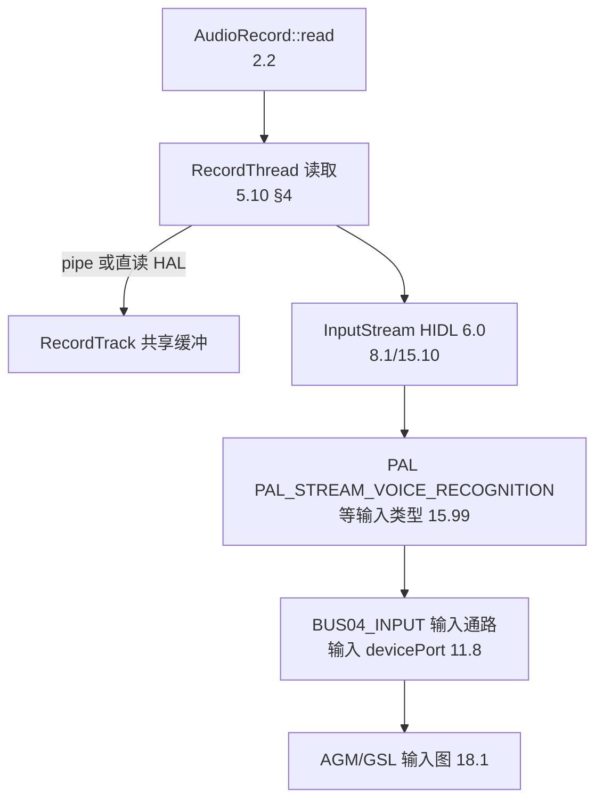

# 20.3 场景：语音助手录音链路（从并发仲裁到输入 Bus）

> [← 上一个](20_20.2_场景-多音区媒体与导航并发.md) ｜ [本章导航](README.md) ｜ [下一个 →](20_20.4_场景-蓝牙通话链路.md)

**场景**：用户唤醒语音助手并说话；同时后台可能有媒体在播、其他 App 在录。本文聚焦**录音**方向的三道关卡：并发仲裁、输入设备选择、输入 Bus 到 PAL 的通路。

## 1. 关卡一：并发录音仲裁（谁有资格录）

12L 的并发录音规则（[3.9 Concurrent Capture](../03_Java_Framework_Layer/03_3.9_录音并发仲裁机制-Concurrent_Capture.md)）在本场景的判定：

| 客户端 | 典型判定 | 依据 |
|---|---|---|
| 语音助手（`VOICE_RECOGNITION` 或 HOTWORD） | 合法保留录音 | 3.9 的仲裁表 |
| 普通后台 App（`MIC`/`CAMCORDER`） | 被禁录（silenced）或移除 | 3.9 |
| 媒体播放 | 不参与录音仲裁 | — |

同时，`RecordingActivityMonitor`（[3.10](../03_Java_Framework_Layer/03_3.10_RecordingActivityMonitor-录音状态追踪.md)）向系统 UI/隐私指示器广播"正在录音"状态。**助手的热词检测若走 SoundTrigger 硬件路径，则不经过本关**（检测在 DSP 侧，见 [15.15 CAPIv2](../15_PAL_Architecture/15_15.15_QC_CAPIv2_编解码接口.md) 的 csd2 边界；本树 `SoundTriggerEngineGsl` 存在于 PAL，见 [15.99 映射表](../15_PAL_Architecture/15_15.99_附录_Stream-Session-Device映射关系.md)）。

## 2. 关卡二：输入设备与路由选择

1. App 创建 `AudioRecord`（[2.2 AudioRecord](../02_Application_Layer/02_2.2_AudioRecord.md)），携带 usage（如 `VOICE_RECOGNITION`）与格式；
2. AudioPolicyManager 按 usage/输入设备策略选择 input 混合口与设备（[6.2 APM](../06_Audio_Policy_Engine/06_6.2_AudioPolicyManager-策略核心实现.md)；输入配置见 [11.8](../11_Vendor_Layer/11_11.8_audio_policy_configuration.xml_属性详解.md) 的 mixPort/devicePort 输入段）；
3. **本产品的输入侧 AAOS 语义**：`car_audio_configuration.xml` 每个 Zone 声明输入设备——主 Zone `BUS04_INPUT`（`common_au/car_audio_configuration.xml:65`）、副驾 `BUS09_INPUT_FRONT_PASSENGER`（:98）、后排 `BUS17_INPUT_REAR_SEAT`（:124）；对应 `audio_policy_configuration.xml` 的输入 devicePort/mixPort（`Primary In Bus`/`BUS09`/`BUS17`，[11.8](../11_Vendor_Layer/11_11.8_audio_policy_configuration.xml_属性详解.md) 输入行）。

> **注意**：助手的录音是否按"乘员 Zone 输入"路由（副驾助手→BUS09）取决于 AAOS 的音频分配与 Zone 绑定（[9.1 总览](../09_AAOS_Car_Audio/09_9.1_AAOS音频系统总览.md)），树内配置只证明 Bus 的存在与地址，不证明分配策略。

## 3. 关卡三：AudioFlinger 输入与 HAL

- 读取的帧协议与两个缓冲边界（RecordThread pipe / 无 pipe 直读）在 [5.10 录音全栈](../05_AudioFlinger/05_5.10_录音全栈调用链.md) §4 已核验；本文不重复。
- `FAST` 录音的接受条件、`STARTING_1/STARTING_2` 状态同样见 5.10 §2.2/§3。
- HAL 输入流到 PAL 的映射：[15.10](../15_PAL_Architecture/15_15.10_HAL-PAL适配层架构.md) 的 open/start/read 层次；PAL 流类型→Session/Device 的映射表见 [15.99](../15_PAL_Architecture/15_15.99_附录_Stream-Session-Device映射关系.md)（输入方向含 VOICE_RECOGNITION 等条目）。

## 4. 语音链路的"回声参考"边界

助手做 AEC 需要回声参考（各 HAL 提供方式不同）。本树相关事实：

- HAL 侧 `libqcomvoiceprocessing`（产品音效库清单，[11.10](../11_Vendor_Layer/11_11.10_OEM定制点完整矩阵.md)）含预处理（含 AEC 类）能力，效果 UUID 清单在 11.10 已逐字核验；
- `echo-reference` 控件存在于产品 `mixer_paths_gvmauto8295_adp_star.xml`（:314-323，[11.10 QUAT_TLAIN 勘误](../11_Vendor_Layer/11_11.10_OEM定制点完整矩阵.md) 时的实测锚点）——它是 QNX 侧混频器控件，不等于"HAL 直接暴露参考流给 App"；
- **树内没有可证明的"语音助手回声参考公开通路"**；不要把 mixer 控件的存在写成 App 可用的 AEC 参考 API。预处理生效路径见 [7.9 内置与 Vendor 效果](../07_Effects_Framework/07_7.9_内置效果与Vendor效果.md)。

## 5. 失败路径速览（详见 20.5 与 17 章）

- 录音被仲裁禁用：客户端收到 silenced 状态（3.9）；
- 输入设备打开失败/热插拔：`AudioDeviceBroker`（[3.5](../03_Java_Framework_Layer/03_3.5_AudioDeviceBroker-设备热插拔管理.md)）与 [13.2 Device 状态机](../13_Volume_Device_Deep_Dive/13_13.2_Device状态机.md)；
- underrun/overrun 与缓冲诊断：[17.11 录音问题调试](../17_Debug_and_OEM_Guide/17_17.11_录音问题调试.md)、[17.10 延迟调试](../17_Debug_and_OEM_Guide/17_17.10_延迟调试深度指南.md)。

---

**本篇引用的产品配置锚点**

| 内容 | 位置 |
|------|------|
| 各 Zone 输入设备 | `common_au/car_audio_configuration.xml:65,98,124` |
| 输入 devicePort/mixPort | `common_au/audio_policy_configuration.xml`（[11.8 输入行](../11_Vendor_Layer/11_11.8_audio_policy_configuration.xml_属性详解.md)） |
| echo-reference 控件 | `msmnile_au/mixer_paths_gvmauto8295_adp_star.xml:314-323`（详见 11.10） |
| 预处理库 | 产品效果清单（详见 11.10 音效 UUID 表） |
