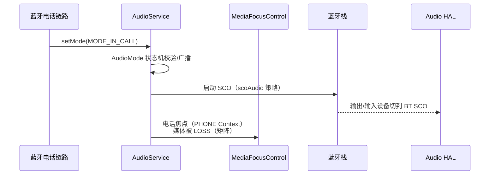

# 20.4 场景：蓝牙通话链路（HFP/SCO）

> [← 上一个](20_20.3_场景-语音助手录音链路.md) ｜ [本章导航](README.md) ｜ [下一个 →](20_20.5_场景-异常与恢复.md)

**场景**：用户通过车机蓝牙连接手机并接听来电。通话音频与普通媒体走完全不同的设备域（SCO 而非 A2DP），并触发 Framework 的 AudioMode 切换。本文把 12L 本树可证的各环节串起来；蓝牙协议栈源码边界先读第 14 章声明。

## 1. 树内证据边界（先读）

[14.1 蓝牙协议总览](../14_Bluetooth_Audio/14_14.1_蓝牙音频协议总览.md) 已核验：本树含 `packages/apps/Bluetooth`（蓝牙应用栈），**不含** `packages/modules/Bluetooth`；因此 HF/HFP 状态机的协议栈侧讲解以 `apps/Bluetooth` 与 Framework 音频侧为准，栈内实现细节按 14 章的兼容边界处理。

## 2. 通话的三个阶段

### 2.1 来电铃流（call_ring）

- 铃声 usage：`NotificationChannel`? 不是——本产品把 `call_ring` 与 `call` 都映射到 `BUS03_PHONE`（`common_au/car_audio_configuration.xml:58-60`，见 [20.2 §1](20_20.2_场景-多音区媒体与导航并发.md) 同源配置）；
- 焦点：来电铃声按 PHONE Context 参与矩阵（交互矩阵中 CALL 相关行，[12.6](../12_Audio_Focus_Deep_Dive/12_12.6_AAOS焦点交互矩阵.md)）。

### 2.2 摘机：AudioMode 与 SCO 建立

- `setMode` 的状态机与通信设备路由在 [3.8 AudioMode](../03_Java_Framework_Layer/03_3.8_AudioMode状态机与通信设备路由.md)（含 MODE 切换时对策略/设备的影响）；
- SCO 音频路径（SCO 与 A2DP 的设备类型、路由与并发限制）在 [14.4 SCO/HFP](../14_Bluetooth_Audio/14_14.4_SCOHFP-通话语音.md)；
- 通话焦点：AAOS 中电话属于 CALL Context；矩阵中 EMERGENCY→CALL 等行已核验（[12.6](../12_Audio_Focus_Deep_Dive/12_12.6_AAOS焦点交互矩阵.md)）；媒体通常收到 `LOSS_TRANSIENT`（与导航的 CAN_DUCK 不同）。

### 2.3 通话中的音量与增益

- 通话音量走 STREAM_VOICE_CALL 体系与 `commute` 设备类别（[13.1 Volume 状态机](../13_Volume_Device_Deep_Dive/13_13.1_Volume状态机.md)、音量曲线表 [11.9 引擎侧解析](../11_Vendor_Layer/11_11.9_car_audio_configuration.xml_深度解析.md)）；
- 车辆侧可经 AudioControl HAL 介入通话音量/静音（[10.1 总览](../10_AudioControl_HAL/10_10.1_AudioControl_HAL总览.md)、[10.5 Muting](../10_AudioControl_HAL/10_10.5_Muting机制.md)）。

## 3. 通话数据面在哪一层

**12L 本树可证的结论**（不画超出证据的箭头）：

1. SCO 是**蓝牙基带域**的同步链路，PCM 不经过 A2DP 的 AudioFlinger 压缩通路；
2. 车机侧通话音频经 HAL 的 SCO 设备（framework 侧设备类型 `BLUETOOTH_SCO`，路由决策在 [6.2 APM](../06_Audio_Policy_Engine/06_6.2_AudioPolicyManager-策略核心实现.md) 与 3.8 的通信设备路由）进出蓝牙栈；
3. HAL 以下，PAL 对 BT 设备的处理与 Session 映射见 [15.99 映射表](../15_PAL_Architecture/15_15.99_附录_Stream-Session-Device映射关系.md)（含 BT 相关流条目与负结论：`PAL_AUDIO_FMT_SBC/LDAC/APTX` 不存在，见 [15.15 勘误](../15_PAL_Architecture/15_15.15_QC_CAPIv2_编解码接口.md)）；
4. **通话 DSP 侧（窄带/宽带语音处理）不在本库已核验范围**：csd2 通话模块在 QNX 侧可见（[15.15](../15_PAL_Architecture/15_15.15_QC_CAPIv2_编解码接口.md) 的 csd2 边界），从 HAL 到 csd2 的完整通话图未静态追踪，不做断言。

## 4. 与 11.7 增益路径的交叉

车辆静音/恢复类操作可经 `IAudioControl` → Framework 触发 `setAudioPortConfig`（HIDL `IDevice@6.0`）改变 Bus 增益——该链路（含 `useForVolume` 本树缺省不启用的勘误）在 [11.7 OEM 定制指南](../11_Vendor_Layer/11_11.7_OEM定制指南.md) 已核验，本场景不重复画。

## 5. 常见误解

| 误解 | 事实 | 出处 |
|---|---|---|
| "通话音质差是 A2DP 编码问题" | 通话走 SCO，与 A2DP（14.2）是不同链路 | 14.4 |
| "来电铃声和通话同一条流" | call_ring/call 同 Bus（BUS03）但铃声是普通媒体路径，摘机后才是 SCO 通路 | 本篇 §2 |
| "通话音量调的是 Bus 增益" | 通话音量在 STREAM_VOICE_CALL/曲线层；Bus 增益是另一条配置路径（HIDL setAudioPortConfig，需 useForVolume 语义配合） | 13.1/11.7 |

**观察入口**：[17.3 常见问题定位](../17_Debug_and_OEM_Guide/17_17.3_常见问题定位.md)、[17.8 AAOS CarAudio 调试](../17_Debug_and_OEM_Guide/17_17.8_AAOS_CarAudio调试.md)。

---

**本篇引用的产品配置锚点**

| 内容 | 位置 |
|------|------|
| call/call_ring → BUS03_PHONE | `common_au/car_audio_configuration.xml:58-60` |
| 音量曲线（含 commute 类别） | `audio_policy_volumes.xml` + `default_volume_tables.xml`（[11.9](../11_Vendor_Layer/11_11.9_car_audio_configuration.xml_深度解析.md) 引擎侧解析） |
| HAL 增益路径 | [11.7](../11_Vendor_Layer/11_11.7_OEM定制指南.md)（AudioFlinger.cpp:2350-2375 → IDevice@6.0 setAudioPortConfig） |
